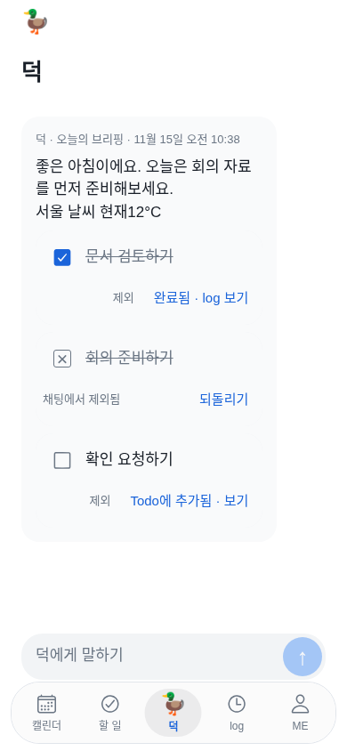
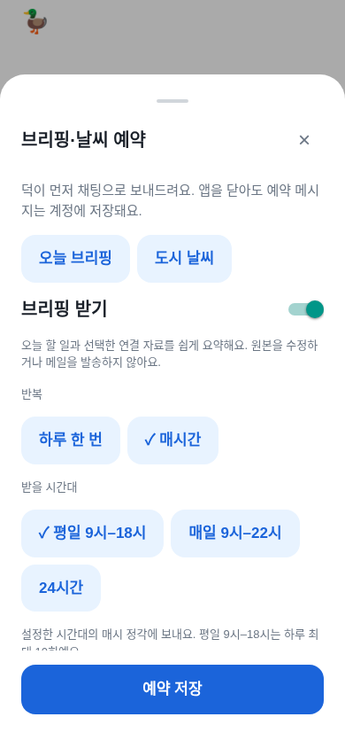
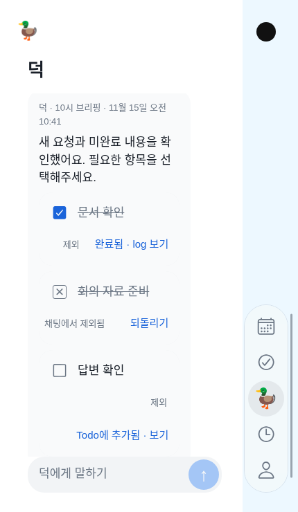
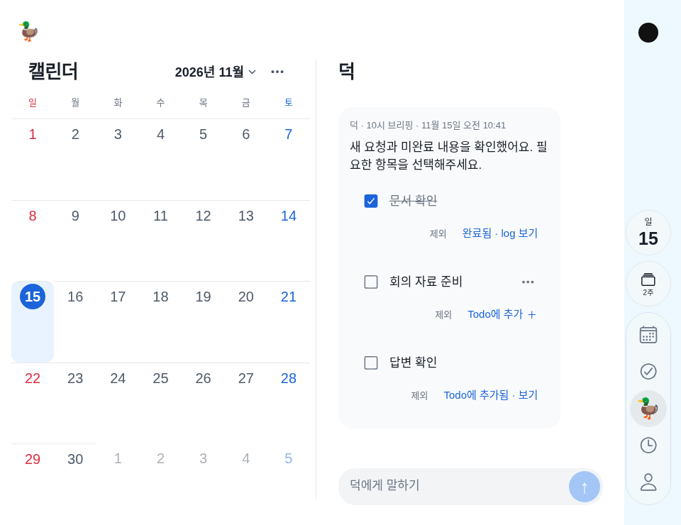
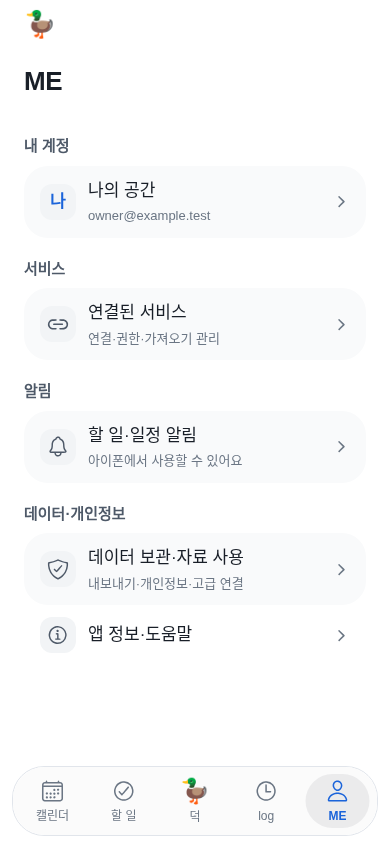

# 개인 비서 브리핑·문서 확인 — 검사와 한계

[현재 계약/연결 가능 범위](assistant-briefing-2026-11-15.md). 기준은 사용자 첨부 브리핑의 새 업무/미완료/날짜·회신 대기 구조와 기존 덕 체크리스트다. 원본 첨부에 들어 있는 개인 연락처·업무 본문을 공개하지 않는다. 아래 화면은 모두 합성자료로 같은 Expo 화면을 실행한 것이며 실제 iOS/실계정 캡처가 아니다.

## 실제 통과

- 전체324검사:323통과, 실패0, 기존 선택 검사1제외.
- 시간별 평일9–18시/주말/끝 시간/잘못된 범위, DST 반복 시간 한 슬롯, 병렬 실행 중복 방지, 기존 daily/날씨/지연 복구/끄기 회귀.
- 새 브리핑 최초에는 Todo 쓰기0, 체크하면 done/completedAt 한 번에 저장, 잃은 응답·재시작·다음 시간에 같은 ID, X는 Todo 쓰기0, 기존 Todo 삭제 후 조용한 재생성 거부, 다른 계정/키 접근 거부.
- 중요한 변화는 첫 읽기 기준 생성, 바뀐 자료만 AI 판별, 동일 임박 사건/재시작/동시 worker 중복 방지, 끄기 후 늦은 결과 폐기, AI 판별 실패 중에도 확인된 임박 일정 알림 유지/오류 표시, 계정 삭제 시 새 상태 제거, 주기 제한5건 이후 나머지가 누락/기아 상태가 되지 않음.
- Notion 중첩·이어 읽기·체크 완료/미완료·표 행·첨부 미확인 표시·사이클/최대치·실패, 실제 모델 프로토콜의 검색→본문 읽기→출처 제안, 임의 ID 읽기 거부, 생성 중 권한 해제409, Drive 검색 escaping/본문 권한 검사.
- 로컬 백업 복구 후 예약/중요 확인기가 자동 재개되지 않음. 원격 복구의 기존 예약 해제 정책 유지.
- 서버/웹/도구54개 문법, TypeScript, Expo web와iOS JS export, 전체 앱 회귀 통과. IPA/Swift 빌드 결과가 아니다.
- 브리핑 화면 직접 조작: 예약 기본 off, 반복/중요 알림 변경 시 재동의, 실제 연결 없는 자료 비활성, 정확한 저장 값, 날씨 독립,320px 저장버튼, 폴링 중 입력 보존, 채팅에서 체크/X/Todo→새로고침 뒤 상태 유지, 계정 교체 격리, 모델 호출0.
- 일반/Duo 접힘/펼침의 체크와 좌우 PanResponder 조작, 동일 ID 유지, 왼쪽 X는 Todo 쓰기0, 오른쪽 반복으로 중복 생성0, 왼쪽 고정 달력 유지.
- ME 한 단계 안의 서비스 목록, Back/스크롤/초점, 실제 승인과 요청 권한 구분, 상태 읽기 실패 후 유지/복구, 선택 가져오기, 해제 확인과 Todo 보존, 계정/알림/내보내기/작은 화면 회귀.

새 화면26장: 브리핑5장, 일반/Duo 조작4장, ME17장. 기존 회귀가 덮어쓴24개 이미지는 검사 스크립트의 생성 파일 목록과 대조한 **정확한 경로만** 복원했다. 새 디버그 실패 이미지도 제거했다. 사용자 복구 bundle SHA-256 `1b73da76ca222cff8a16d6b5a783eeed596d6930d90f05b5a9266990ad7b742d`를 유지한다.

## 확인할 화면

## 배포와 실사용 구분

이 검사는 사용자 로그인·외부 원본 수정·실제 운영 AI 모델 요청을 사용하지 않았다. 공개 `/api/capabilities` 설정 조회만 수행했다. 실제 Google/Notion OAuth 재승인, 사용자 문서별 접근, 모델 할당량·답변 품질·잘못된 중요도 분류, 아이폰 push 수신·오프라인·VoiceOver·native 제스처는 별도 확인이 필요하다.

신규 자동 예약/중요 변화 확인은 실제 사용자 계정에서 켜지 않았다. 기존 일일 예약도 시간별로 강제 전환하지 않는다. 무료 기존 자원만 사용하며 새 paid worker/cron/PubSub/인증키는 만들지 않는다. 공급자 이벤트 수신과 보장된 실시간, 웹 조사/컴퓨터/장기 기억은 미구현이다.

최신 성공 native는 사용자 실행43655786235, 소스1a6dd56,1.0.0(35), Apple업로드2026-11-15 00:07:58UTC다. 이번 변경은35 이후이며 새 수동 native 빌드/설치가 필요하다. 이 요청에서 새 native 빌드를 시작하지 않았다. 서버 배포는 별도 실제 publish 커밋/Render live/health로 확인하며 GitHub 저장만으로 앱 설치나 원본 API 성공을 주장하지 않는다.
