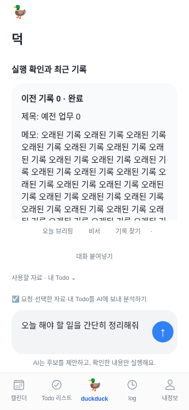
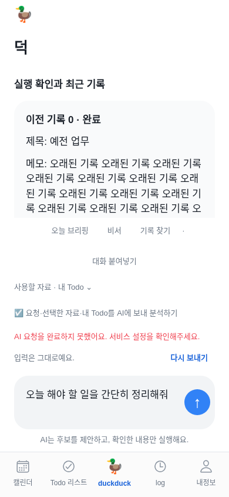

# 덕 채팅 전송 무반응 진단과 수정 — 2026-11-12

## 2026-11-12 — 첫 실제 AI 답변 사용자 확인과 인사 말투 보완

사용자가 운영 덕에서 인사를 보낸 뒤 실제 답변을 받았다고 알려 AI 호출 성공을 **사용자 확인**으로 기록한다. 답변이 업무 자료 부족과 부분 조회·완료 기록을 불필요하게 설명하는 문제도 확인했다. 작업자가 운영 세션이나 공급자 로그에서 해당 답변을 독립 재현한 것은 아니다. 새 Todo 생성·외부 쓰기·전체 자료 분석·실제 잔액과 모델 설정값을 검증한 것으로 확대하지 않는다.

원인은 모든 요청에 오늘 할 일/실행 초안·근거·부분 조회·필수 정보 질문을 요구하던 서버 지침이다. 단순 인사·감사·잡담에는 짧은 존댓말 1~2문장과 빈 후보 목록으로 답하고, 실제 업무 요청이 있을 때만 근거와 후보를 제안하도록 지침을 구분한다. 예를 들어 인사에는 “안녕하세요. 무엇을 도와드릴까요?” 같은 답변을 목표로 한다. 이는 목표 예시이며 수정 후 실모델에서 확인한 답변은 아니다.

자료를 사용한 정리에서는 확인한 범위와 필요한 제한을 짧게 알리고, 읽지 않은 자료를 읽었다고 하지 않는다. 완료·중복 Todo 제외, 날짜 추정 금지, 외부 자료 지시 불신, 고정 카탈로그/대상 검증, 사용자 확인 후 실행은 그대로다. 인사를 로컬 고정 문자열로 바꾸거나 AI 호출을 생략하지 않는다. 키·모델·결제·동의·계정·자료 전송 범위는 변경하지 않는다.

기존 비서 관련 14개 검사와 전체 207개 중 206개 통과·실패 0개·선택 1개 건너뜀, 문법 39개 파일 검사 통과. 모의 검사는 API의 동의·검증·실행 경계 회귀이며 실제 모델의 자연스러운 답변을 증명하지 않는다.

서버의 말투 지침만 변경하므로 새 모바일 설치가 필요한 변경은 아니다. 수정 후 실모델의 말투는 사용자가 다시 인사해 확인해야 하며 테스트 결과와 배포 상태는 아래 최신 기록을 따른다.

## 후속 사용자 확인 — 요청 제한(HTTP 429)

공개 수정 뒤 사용자는 “AI 요청이 제한됐어요. 잠시 뒤 다시 시도하고, 계속되면 운영자의 사용 한도와 API 계정 확인이 필요해요.”를 확인했다. 당시 `7ad8d3f` 코드에서 이 문구는 AI 공급자 응답이 429이고 알려진 상세 코드를 분류하지 못했을 때 나온다. 전송이 서버의 AI 응답 처리까지 진행됐다는 근거지만 실제 모델 응답 성공·유효한 잔액·특정 한도 문제를 증명하지 않는다. 사용자의 잔액/계정 화면은 아직 읽지 않았다. 같은 시간대 Render 요청·오류 로그 조회는 빈 목록이었으므로 세부 원인으로 해석하지 않는다.

[OpenAI 오류 코드](https://developers.openai.com/api/docs/guides/error-codes)와 [공식 429 진단](https://help.openai.com/en/articles/5955604-troubleshooting-api-rate-limits-and-429-errors)을 직접 확인했다. 최신 공식 코드 5개가 기존 분류 목록에 없어, 다음 응답에서 더 정확히 안내하도록 추가했다.

| 코드 | 확인된 의미와 안내 |
|---|---|
| `credit_balance_exhausted` | 선불 API 잔액 소진 → 잔액 확인 |
| `organization_spend_limit_exceeded` | 조직 사용 금액 한도 도달 → 조직 한도 확인 |
| `project_spend_limit_exceeded` | 프로젝트 사용 금액 한도 도달 → 해당 프로젝트 한도 확인 |
| `organization_usage_limit_exceeded` | OpenAI가 허용한 조직 사용 한도 도달 → API 사용 한도 확인 |
| `slow_down` | 요청량이 급격히 증가 → 잠시 뒤 사용자가 직접 재시도 |

이전 `insufficient_quota`·`rate_limit_exceeded`와 분류 불가의 중립 안내는 유지한다. HTTP 502 반환, 8KiB까지만 읽는 오류 본문, 고정 문구, 비밀값 비노출, 동의·이메일 인증 선확인과 자동 재전송 금지를 유지한다. 새 코드를 안다고 사용자에게 과금이나 한도 상향을 자동 적용하지 않는다.

사용자에게 먼저 [API 결제·잔액](https://platform.openai.com/settings/organization/billing/overview)을 열고 키를 만든 조직의 잔액 표시만 알려달라고 안내했다. 필요할 때 [API 사용 제한](https://platform.openai.com/settings/organization/limits)을 확인한다. 즉시 결제를 요청하지 않는다. ChatGPT와 API 결제는 별개지만 자격에 따른 크레딧 혜택은 실제 활성화·잔액을 확인해야 한다. [공식 결제 안내](https://help.openai.com/en/articles/9039756-managing-billing-for-chatgpt-and-the-api-platform).

검증: 기존 검사 행렬에 5개 응답을 추가해 비밀값 비노출·재전송 없음·고정 문구를 검증했다. 관련 비서 검사 14개, 문법 39개 파일, 전체 207개 중 206개 통과·실패 0개·기존 선택 1개 건너뜀. 실제 원인과 AI 답변은 다음 사용자 계정 확인 단계다. 새 오류 분류는 서버 변경이며 모바일 코드·네이티브 설치를 바꾸지 않는다.

## 사용자 보고와 확인 범위

사용자는 Render에 AI 설정을 저장한 뒤, 덕 채팅의 파란 위쪽 화살표를 눌러도 화면이 그대로이고 대화 아래에도 오류가 보이지 않는다고 알렸다. 설정 저장에는 Git 커밋이 필요하지 않다. 기존 무료 서비스의 `6a3d6f5`를 배포한 `dep-dbqk495g1s2s73ej1gb0`가 13:36:22 KST에 live가 됐으며 공개 health 정상과 `assistant:true`를 확인했다. 이는 서버 설정이 켜졌다는 증거이고 실제 모델 응답 성공의 증거는 아니다.

사용자 문제 보고 후에도 공개 health 정상·AI 활성화 상태를 다시 확인했다. Render의 해당 시간대 채팅 POST 필터와 오류 수준 로그 조회는 빈 목록이었다. 이 결과만으로 사용자의 요청이 전송되지 않았다고 단정하지 않는다. 사용자 로그인 세션·비밀 키·실제 대화·원본 Todo는 읽지 않았다.

## 재현한 화면 문제

390×844px 터치 화면, 입력창 포커스, 모션 사용, 이전 기록 5개에서 모의 403과 502 응답을 각각 재현했다. 파란 전송 버튼은 요청을 1회 보냈지만 실패 뒤 입력만 그대로 남았다. 오류 문구는 대화 스크롤의 맨 끝에 출력돼 화면 밖에 숨었다. 확인한 오류 위치는 y=2290.5였고, 보이는 대화 영역은 y=115~453.5였다. 401은 기존 로그인 화면으로 정상 이동했다.

사용자가 겪은 실제 API 실패가 이메일 미인증, 키 권한, 모델 접근, 잔액, 네트워크 중 어느 것인지는 아직 확정하지 않았다. 모의 재현은 무반응처럼 보이는 화면 결함을 확인한 것이며 실제 계정의 원인을 추정하는 근거로 쓰지 않는다.

## 수정 기준

- 전송 처리와 오류를 입력창 근처에서 바로 볼 수 있게 한다. 실패 때문에 입력·자료 동의를 지우지 않는다.
- 다시 보내기는 사용자 동작으로만 수행한다. 계정 전환 보호·중복 전송 잠금·명시적 자료 전송 동의·실행 초안 확인을 유지한다.
- 이메일 인증·AI 인증/권한·모델 접근·사용 한도·일시 제한·서비스 장애를 고정된 안내로 구분한다. 공급자의 원문 오류, 키, 헤더, 프롬프트, 사용자 자료는 화면·로그에 복사하지 않는다.
- 기존 기록 읽기 실패가 AI 상태 조회 성공을 함께 버리지 않도록 하며, 조회 재시도를 명시적으로 제공한다.
- 전체 색상·레이아웃·브리핑·날씨·Duo 동작은 이번 오류 수정 범위에서 변경하지 않는다.

## 수정 결과와 실제 검증

입력창 위 고정 위치에 즉시 처리 표시와 실패 안내를 둔다. 이메일 미인증은 서버가 반환한 경우에만 **내정보 → 내 계정 → 이메일 인증**을 안내한다. 오래된 클라이언트의 인증 상태로 전송을 미리 막지 않는다. 상태와 이전 실행 기록은 독립적으로 읽고, 초기 조회 실패에는 **AI 연결 다시 확인**을 제공한다. 새 요청 뒤 늦게 온 초기 조회 오류가 현재 오류를 덮지 못한다.

공급자 오류는 401 인증, 403 이용 권한, 404/확인된 모델 오류, 429의 사용 한도/일시 제한/분류 불가, 5xx 일시 장애, 연결 실패와 시간 초과로 구분한다. 읽는 오류 본문은 최대 8KiB이며 허용한 오류 코드만 사용한다. API 공급자의 원문 메시지를 복사하지 않고 한도 오류를 무조건 일시 혼잡으로 설명하지 않는다.

- `npm run check`: 문법 검사 통과.
- `npm test`: **207개 중 206개 통과·실패 0개·기존 선택 사무실 격리 검사 1개 건너뜀**. 새 오류 분류·비밀값 비노출·재시도 없음·이메일/동의 차단 검사 포함.
- 모바일 타입 검사·웹 export 통과.
- `node mobile/e2e/assistant-chat.mjs`: 기존 제안→확인→결과·이전 계정 응답 격리·동의 회귀 통과.
- `node mobile/e2e/assistant-chat-errors.mjs`: 390/320px, 실제 터치 이벤트, 모션 사용/줄이기, 이전 기록 0개/5개, 403/502/서버 시간 초과/클라이언트 AbortController 시간 초과, 처리 표시, 입력·동의 보존, 수정 후 명시적 재전송, 상태 재조회, 기록 조회 실패 분리, 401 로그인 전환 통과. 모든 공급자 응답은 모의 데이터다.
- 전체 모바일 앱 브라우저 회귀 통과. 체크·되돌리기·계정·로그인·기존 비서 확인 실행을 유지한다.
- iOS JS export 통과. Swift 컴파일·서명·TestFlight 설치·실기기 성공을 뜻하지 않는다.

운영 AI 호출·실제 키/모델 권한·한도는 아직 미확인이다. 사용자 세션을 대신 사용하거나 운영 테스트 계정을 생성하지 않았다. 구현 커밋은 [e6ae9dc](https://github.com/thepmpo/donknow/commit/e6ae9dc9b56993ad677dc81d8f790cb75cfc68b9)다. 문서를 포함한 `7eeac79`의 Render 배포 live와 공개 문서 반영을 13:52 KST에 확인했다. 빌드 15 생성·제출 요청도 접수됐다. [정확한 배포와 남은 확인](release-readiness-2026-11-12.md)을 따른다.

## 사용자가 다음에 할 일

공개 배포를 확인한 뒤 다음 순서로 안내한다. 서버 설정 저장에 사용자 Git 커밋은 필요하지 않다.

1. [덕 열기](https://duckduck-test.onrender.com/) → 브라우저 **새로고침**.
2. 아래 가운데 **duckduck** → **덕에게 이야기하기**에 `안녕. 한 문장으로 인사해줘` 입력.
3. **요청·선택한 자료·내 Todo를 AI에 보내 분석하기** 동의 선택 → 파란 **↑**.
4. 입력창 바로 위의 처리 표시 후 실제 답변 또는 오류를 확인한다. 오류가 있으면 키/비밀번호 대신 그 안내 문구만 전달한다.

답변을 받는 것과 외부 작업을 실행하는 것은 별도다. 외부 쓰기는 제안 확인 단계를 유지한다.
