# 채팅·일정·ME 직접 조작 감사와 수정

사용자의4장과 현재 앱을 대상으로 흐름·디자인·접근성 위험을 확인한 뒤 수정했다. 기존 Expo 앱을 Chromium에서 실행했고 합성 계정/API·기하를 사용했다. 일반390×844, Duo431×640/960×740과 작은320px에서 확인했다. 실제 iOS 화면/물리 키보드/실계정 자료가 아니다. 일반형 웹 확인 방식은 유지하며 앱 안 기기 전환은 만들지 않는다.

## 1. 채팅 진입과 연결 확인 — 수정·검사 통과

P1: AI 확인 전에는 다른 화면의 전송 동작이 Todo 초안을 만들었다. 이후 AI가 켜지면 화면/입력 처리도 바뀌어 사용자가 요청하지 않은 저장 의미가 생겼다. 같은 대화 화면을 유지하고 상태 도착 전후 입력을 보존했다. 연결 전 전송은 비활성화되고 연결 완료만으로 모델을 호출하지 않는다. 정상 답변만으로도 Todo는 생성하지 않는다. 첫 화면의4개 보조 진입은 숨겼다.

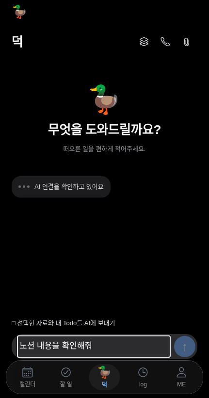

## 2. 작성 중 가림과 마지막 대화 — 수정·검사 통과

P1: Duo 본문이 실제 키보드 가림을 빼지 않아 입력창이 뒤에 남았다. 실제 screenY의 겹침만 예약하고 입력 높이·viewport 변경 뒤 마지막 답변을 보정했다. 사용자 과거 스크롤은 유지한다. 테스트에서 키보드가 시작하는 y보다 composer 끝이 위에 있고 마지막 답변도 보이는 것을 직접 측정했다. 하단 빈 공간은 합성 가림 영역이며 가짜 키보드를 그린 화면이 아니다.

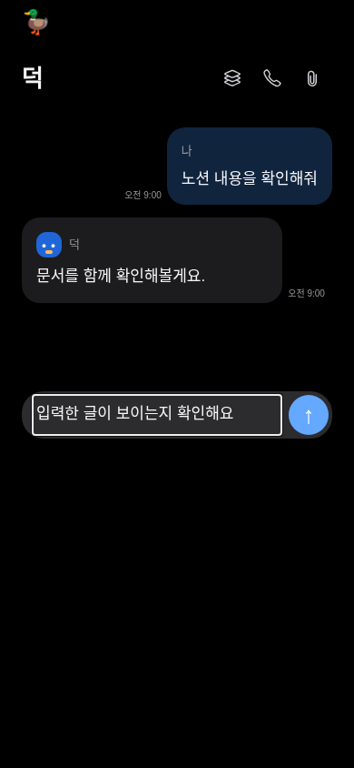
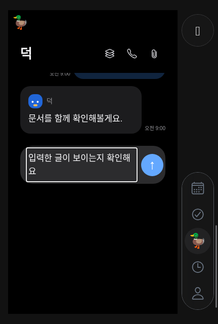
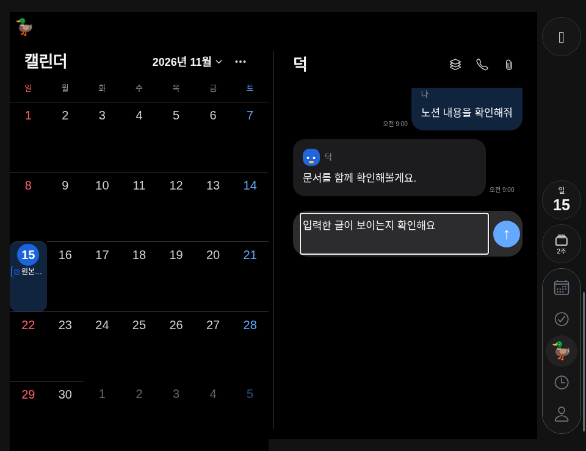

## 3. Todo 조회·오류·동시 저장 — 수정·검사 통과

P1: 알려진 목록의 배경 조회도 쓰기 전체를 막고 큰 당김 표시를 띄웠다. 읽기 완료 전에는 초기 상태를 보호하고, 이미 읽은 상태에서는 새 저장을 허용한다. 늦은 조회/오류가 새 저장을 덮지 않게 했다. 직접 당긴 경우에만 큰 새로고침을 표시한다. HTML200→JSON을 합성하여1회 복구, 기존 할 일 유지, 배경 조회 중 새 Todo1개 명시 저장과 늦은 응답 이후 보존을 확인했다. 사용자 실요청의 통신 실패 원인을 서버 지연으로 단정하지 않는다.

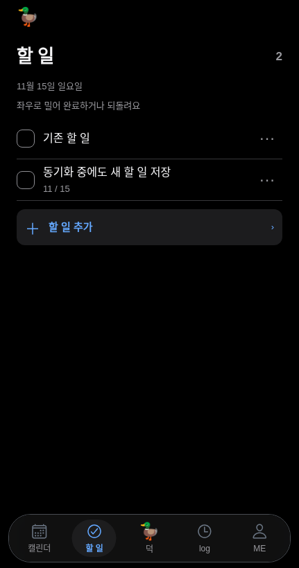

## 4. 일정 메모와 권한 — 수정·검사 통과

P1: 캐시/확인 직후 항목의 권한 미확인이 읽기 전용으로 고정됐고, 새 조회의 권한이 열린 편집창에 전달되지 않았다. 편집 프레임도 키보드 겹침을 본문에서 빼지 않았다. 로컬 입력은 허용하되 실제 원본 쓰기 권한·ETag/확인은 유지했다. 새 권한 전달 뒤 제목·메모 초안이 남고 메모 전체가 보이며 저장 버튼은 키보드 동안 숨는 것을 측정했다. Google 권한을 실제 승인한 실계정 검수는 아니다.

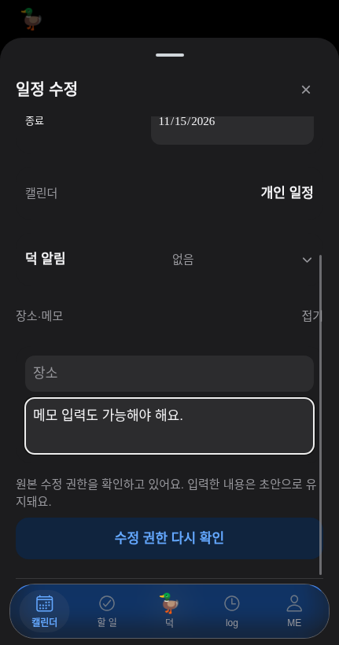
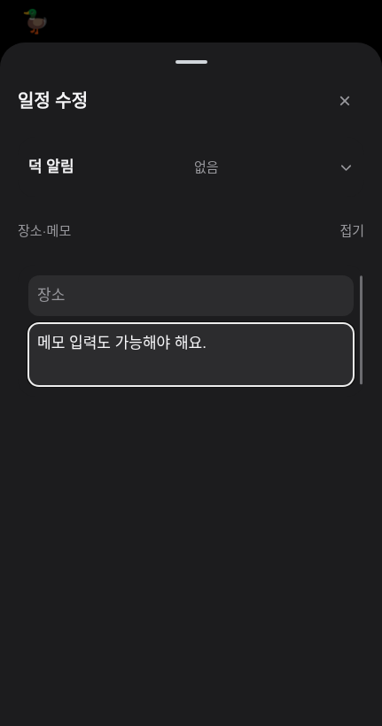

## 5. ME 진입·설정·돌아오기 — 수정·검사 통과

P1: 같은 ME에서 일부 항목은 페이지, 다른 항목은 별도 modal을 열었다. 동작 방식은 unrelated10개 조회가 모두 끝나야 열렸고 외형·지침·규칙이 한 화면에 길게 섞였다. 기억·예약·AI 자료 관리는 공통 페이지/뒤로가기로 맞추고 동작 방식은 해당 profile만 조회하는 목록으로 분리했다. 지침 저장 실패 응답 후 입력 보존·명시 재시도·저장 값 재표시, 기억 설정 조회 실패 시 미확인을 꺼짐/0개로 표시하지 않고 재확인 후에만 실제 스위치/개수를 보이는 것, 공급자 권한/가져오기·확인 후 연결 해제·계정 삭제·내보내기와100→100 스크롤/초점 복원을 확인했다.

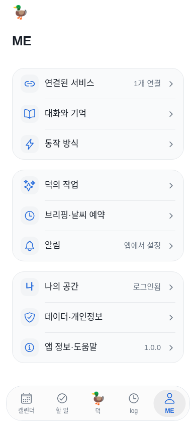
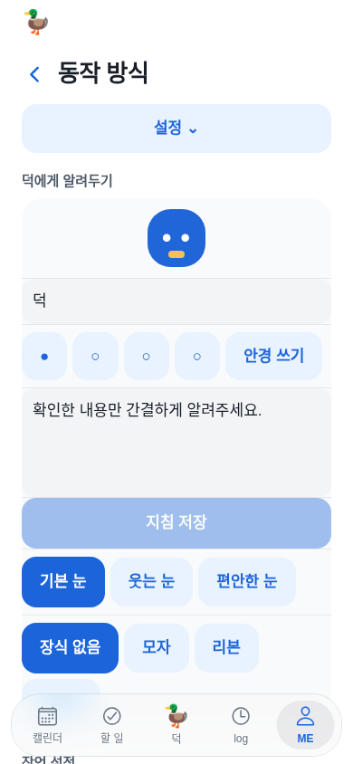
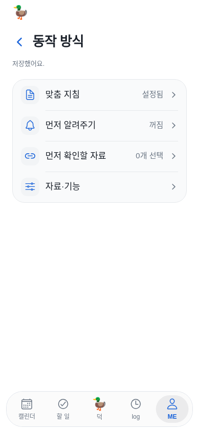
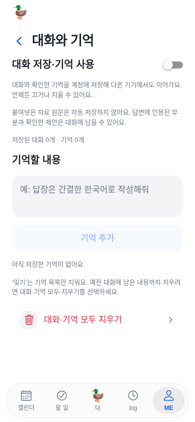
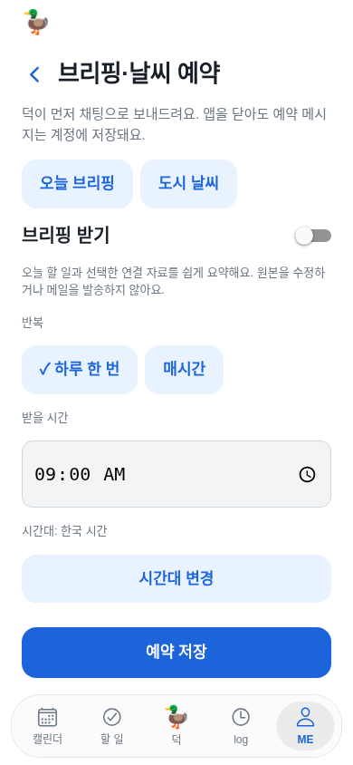
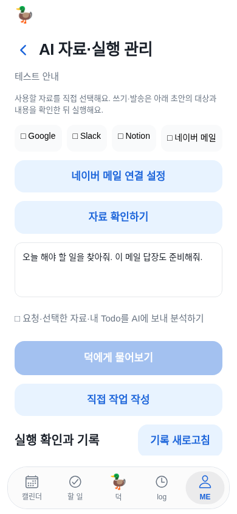

## 검증 범위와 남은 확인

33장은 이번 실행의2장 before·7장 상호작용·24장 ME다. `interaction/verification.json`과 `me/verification.json`에 합성 가림 좌표·scroll·요청/오류 결과를 보관했다. 사용자 원본4장은 공개 갤러리에 복사하지 않았다.

355개 중354통과·실패0·기존 선택1제외, 모바일 타입·96문법·web/iOS JS export, 전체 앱·AI 채팅/오류·ME·일정 편집·기존 고정 편집창 회귀를 확인했다. 숨긴 첫 화면 도구와 자동 Todo fallback을 요구하던 옛 앱 검사는 새 계약의 숨김·입력 유지/명시 Todo 추가로 바꿨다. 기존 원본 확인·중복 실행 금지·임차인 격리 검사는 유지했다. 폼을 여는 것만으로 예약/AI/외부 쓰기를 켜지 않는다.

시스템 글꼴·의미 색·최소44pt 조작·포커스 복귀·검은 배경 대비·작은 화면의 가로 넘침을 확인했다. 오류/저장 중·성공은 텍스트로 알리고 읽지 못한 설정을 확정 상태로 표시하지 않는다. 모든 WCAG/실기기 준수를 주장하지 않는다. 실제 UIKit/한국어 IME·VoiceOver·물리 Duo/외부 계정·실제 gateway 성능은 남는다. 마지막 native39 성공은 이번 UI 이전 소스다.

최종 결과: covered browser flows passed. 실제 기기 확인은 별도다.

공개 문서의1048개 이미지 치환도 한 번의 순회로 바꿨다. 동일 소스ce1ba4b에서 기존 방식과 변경 방식의 public/project.html SHA-256이 모두 `c7e10206e0395c6fa3d8ab711fec3daebce56eebeda38281f794f9fbffa1f37e`로 일치함을 확인했다. 문서 갱신 시간을 줄이면서 출력과 이미지/댓글 동작을 유지한다. 체험 화면의 설명도 로그인 안내로 맞춰 숨긴 Todo 도구를 제안하지 않는다.
