# 날짜·알림·캘린더 가독성 QA

**final result: blocked** — 오늘 음영 범위 사용자 답변과 새 native build에서 iOS spinner/물리 bounce·알림 수신/VoiceOver 검수가 남았다. 나머지 구현의 실제 Expo 웹·합성 API/기하 검사는 통과했다. Apple 앱과 픽셀 동일/실기기 성공으로 보고하지 않는다.

## 참고와 실제 비교

사용자 첨부8개 JPG862×1280 원본은 현재 작업 공간에 있으며1·2·8 및 Apple 상대 알림 메뉴를 열어 봤다. 기존 앱 캡처와 Apple 참조가 섞여 있다. 본문/시트/메뉴는 해당 날짜·알림·선 처리의 목표이며 덕 브랜드/내비게이션을 Apple 앱으로 교체하라는 뜻이 아니다. 원본은 개인 일정/이메일을 포함하므로 공개하지 않는다. `/tmp/calendar-comfort-comparison-{1,2,3}.png`에 원본+실제 렌더를 나란히 놓고 검사했다. 브라우저/기기 chrome과 viewport가 달라 pixel score를 제시하지 않는다.

- Apple12월: 마지막 주 선을12/31에서 끝내고 요일 아래 선을 확인. 덕은 인접월 숫자를 유지하고 그 구간 선만 제거. 첫 주와 당월에 속한 주 수는 기존 계약 유지.
- Apple 알림 메뉴: 상대값 목록/선택 check를 따르고 실제 울릴 날짜·시각을 추가. 덕은 자체 스크롤 popup이고 Apple native glass 메뉴라고 주장하지 않는다. 검정/회색sheet/#323234popup 경계를 실제 rendered RGB로 확인했다.
- 사용자 Todo wheel: 무완료/검정 팝업 문제를 shared Done toolbar와 semantic sheet로 변경. **웹에는 UIKit wheel이 없어 원본 wheel과 실제 native 렌더의 시각 일치를 검증할 수 없다.** 웹 input을 wheel처럼 꾸며 증거로 쓰지 않았다.

## 기능 검사

`calendar-display.test.ts`5개: 서울/뉴욕 시작 시각·종일/계속/없음, DST와 실제 서버 알림 instant 일치, 자정을 넘는 날짜, 없는 시각/잘못된값 거절, DST 겹친 시간의 원래 두 번째 instant 보존.

전체306중305통과/실패0/기존선택1제외, 문법50·타입·web/iOS JS export 통과. 첫 최종 export는 Expo telemetry가 쓰기 불가한/home/agent/.expo를 만들려다 실패했고 EXPO_NO_TELEMETRY=1 CI=1로 정상 생성했다. 패키지/환경권한을 확대하지 않았다.

새 `calendar-comfort.mjs`는 실제 Expo Shell을 official resolver로 생성하고 다음을 검증했다: 빈 Todo fit scroll막기/긴폼 허용/접으면 같은 node에서 다시 막기, 날짜 Done이 폼을 저장하지 않음, 예정일11/16과 알림11/15 08:45 독립 저장, 시작09:00/end10:00 중 시작만, 종일00:00 없음, Dark layers,5·15분 옵션과 실제08:45표시, 알림-only저장1회/원본쓰기0,12/31선·1/1선없음, 일반390×844·접힘431×640·펼친가로960×740/세로740×960·320px nooverflow와 카메라 중심선/반대Calendar 보존. `verification.json`은 합성/네이티브 미검수/오늘 음영 대기를 명시한다.

기존 전체앱·AI 채팅/오류·채팅 체크카드·Duo 회귀도 통과했다. 전체앱의 날짜 입력 변경과 새 목록 testID가 과거 행 prefix 검사에 끼어들던 검사 경로를 보완한 후 저장/3초·계정 격리·알림 저장을 그대로 확인했다. 이전 calendar-event-refinement baseline의 connectionId 기대값 누락은 fixture문제이며 sourceID 보호를 지우지 않았다. 날짜 입력 변경에 맞춰 전체앱 알림 조작을 갱신하고 체크카드 regression 캡처는/tmp로 분리해 옛 증거를 덮지 않는다.

## 현재 합성 화면

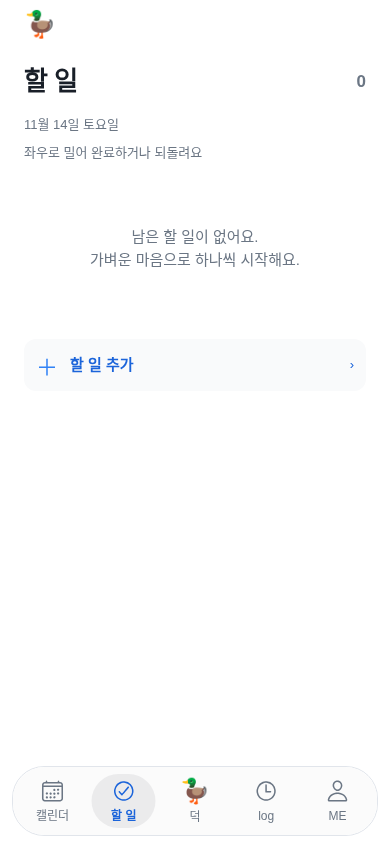

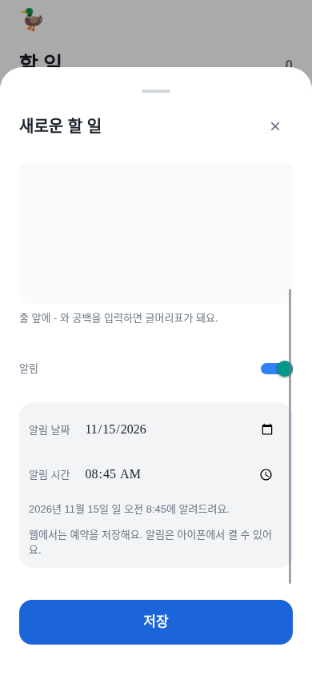

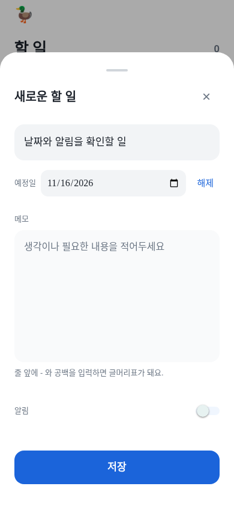

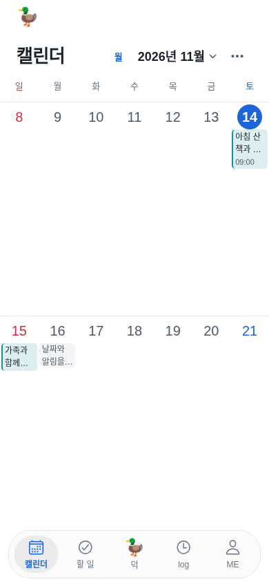

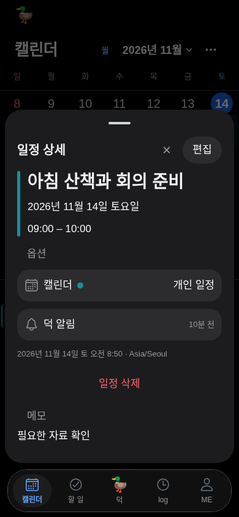

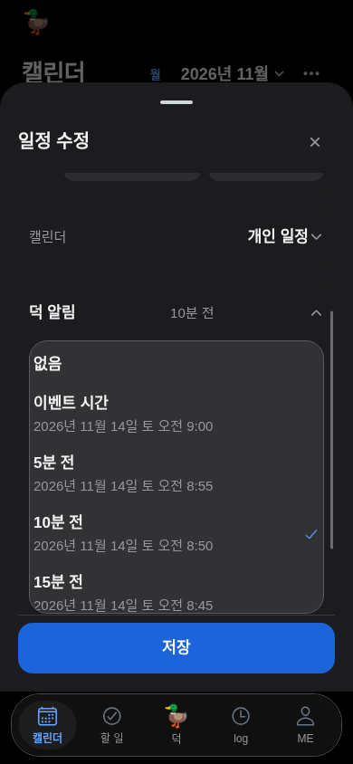

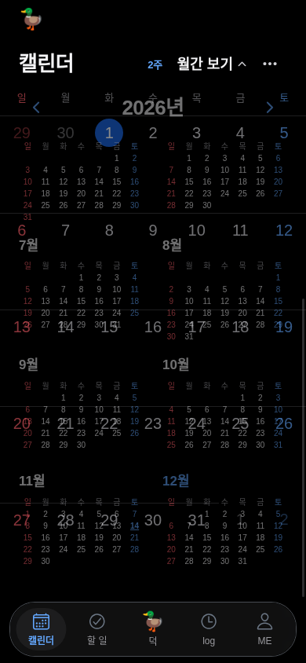

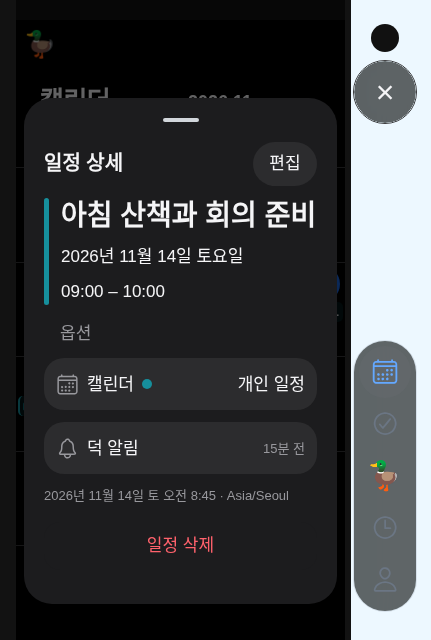

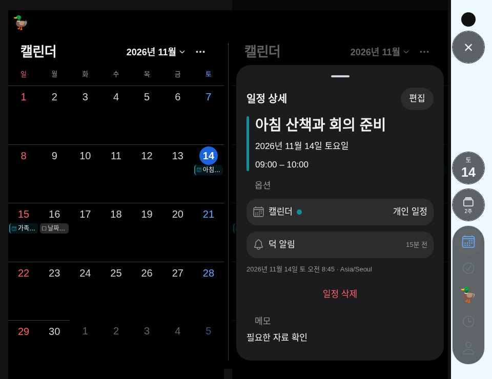

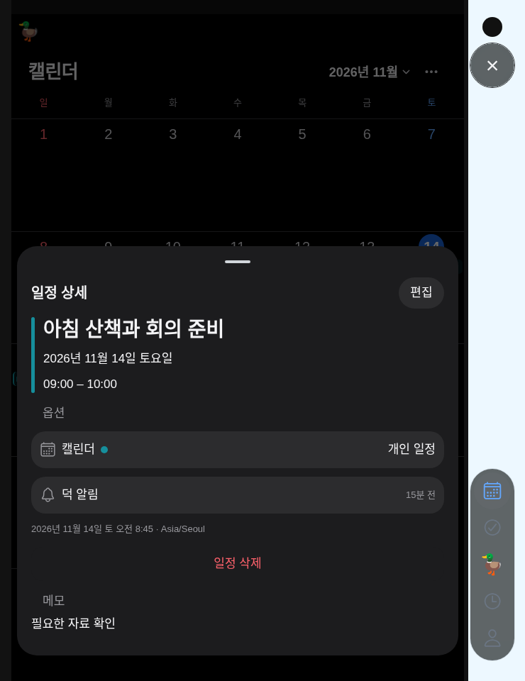

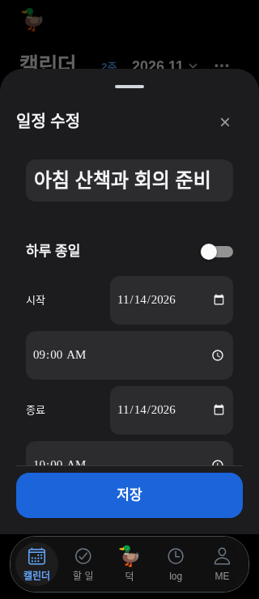

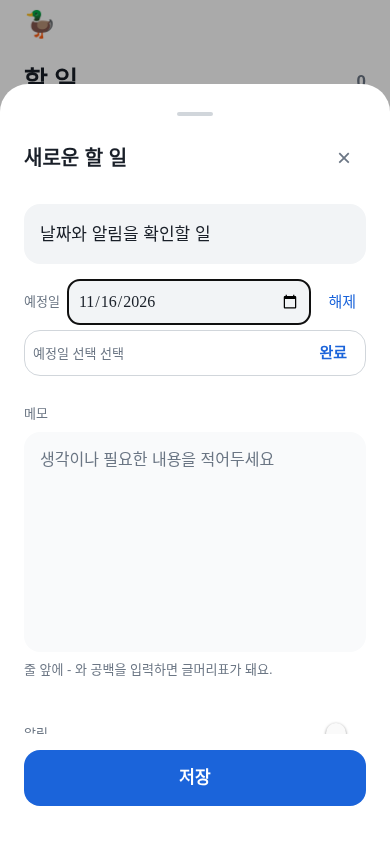
