# 캘린더 UX/UI 감사 — Apple Calendar·Fantastical·Apple HIG 비교

문서 ID `CAL-AUDIT-20261113` · 검토일2026-11-13 · **관찰·개선 제안, 구현 승인/완료 아님**.

사용자 요청은 현재 캘린더의 부족한 점과 활용할 Apple 가이드를 찾는 것이다. 이번 작업은 앱 코드/동작/권한을 바꾸지 않았다. [현재 확정 기준](continuation-guide.md)·[내비게이션 구현 계약](liquid-glass-navigation.md)을 유지한다. 이 제안서를 기존 기준 대신 조용히 적용하지 않는다.

## 1. 결론과 확인 범위

덕은 ‘월 전체와 Todo를 함께 보는 간결한 비서’의 기반은 있다. 그러나 **날짜를 고르는 화면과 그날 실제로 무엇을 해야 하는지 확인·추가하는 과정이 분리**돼 있다. 유리 재질을 더 입히는 것보다 월의 실제 높이, 선택일 상세, 주 단위 이동, 접근성, 데이터 상태를 먼저 다듬는 편이 효과가 크다.

- 대상: 최신 main `20bc8eba2ff40129b807cd6b4668192a010cc2fb`의 실제 Expo/React Native 웹 출력. 내비게이션 구현은aa55b90을 포함한다.
- 도구: Playwright/Chromium. 운영 계정 대신 격리된API 응답. 고정시각2026-11-13 09:00 KST, 시간대Asia/Seoul. 예시 일정5개(종일/여러 날/시간 겹침)·Todo5개(완료1개).
- 새 증거: 6개 흐름·16개 캡처.390×844,320×667,글자160% CSS 시뮬레이션,960×740 Duo 기하 fixture. 모든 저장 이미지 원본을 열어 확인했다.
- 외부 쓰기0건·페이지 JS 오류0건. Todo 작성 시트는 열기만 하고 저장하지 않았다. 운영 데이터·OAuth·키·서명·원본 복구 bundle은 보존했다.
- Apple/Fantastical은 이번에 읽은 **공식 사용 설명·HIG에 근거한 비교**다. 두 네이티브 앱을 실제 사용자 계정으로 조작하거나 동일 버전의 화면을 픽셀 대조한 것은 아니다. Apple 참고 이미지 직접 다운로드는HTTP403이어서 비교 캡처로 사용하지 않았다.
- 공유 브라우저 제어 도구는 제공되지 않았다. 앞서 사용자가 승인한 테스트용 브라우저로 같은 앱 코드를 실행했다. Product Design 저장 맥락은 preflight 결과없음. 보조critical-overrides 리소스는 읽기 실패였으므로 실제로 읽었다고 하지 않는다. 감사 본문·framework와 현재 프로젝트 계약을 사용했다.

재현: `CI=1 EXPO_NO_TELEMETRY=1 npm --prefix mobile run export:web -- --max-workers 2` → `node tools/audits/calendar-2026-11-13.mjs`. [관찰 JSON](../artifacts/calendar-audit-2026-11-13/observations.json)에 요청·DOM·측정값·실제 소스가 있다. 스크립트는 외부 API에 쓰지 않고 fixture 쓰기도0건임을 확인한다. native 결과를 대신하지 않는다.

## 2. 흐름별 판정

| 단계 | 사용자가 하려는 일 | 판정 | 현재 근거 |
|---|---|---|---|
|1|월을 보고 오늘/선택일/바쁜 날 파악|개선 필요|01·12·13·14·15.42칸은 있으나 작은 폰에서 한 화면에 다 안 들어가고 제목 두 개가 잘림 |
|2|선택일의 일정·할 일·일정 상세 확인|개선 필요|02·03.아젠다 점프는 되지만 월/도구가 사라지고 외부 일정 제목은 상세로 열리지 않음 |
|3|선택한 날짜에 새 일 추가|부분 양호|04.날짜가 이어진Todo 시트·닫기/메모/저장은 있으나 Calendar 안의 일정 추가 경로는 없음 |
|4|월/주 전환·다음 기간·다른 탭에서 복귀|우선 수정 권장|05·06·16.주가 날짜7개이며 다음달 이동. 일반 폰은12월에서 다른 탭을 다녀오면11월로 초기화 |
|5|멀리 있는 년월로 이동|부분 양호|07.직접 이동·취소 가능. native는년월만 필요한데 날짜spinner를 사용(코드 확인, 기기 미검수) |
|6|빈 날·불러오는 중·연결 실패 구분|우선 수정 권장|08~11.상단 월에서는 상태가 안 보이고, 실패 시 아래에서 빈 안내와 오류가 동시에 나옴 |

유지할 장점: 날짜별 접근성 이름/선택 상태,44pt 월 이동/오늘/보기 조작, 직접 년월 이동, 일정/Todo 섹션 분리, 종일/시각 표시, 완료 취소/복원, 실제 명시적 Todo 가져오기, 새로운 하단 바와Duo 고정Calendar. 현재 역할이 있는 기능을 ‘없다’고 다시 만들지 않는다.

## 3. Apple Calendar·Fantastical과의 기능·UX 비교

| 비교 축 | Apple 공식 설명 | Fantastical 공식 설명 | 덕 현재/기회 |
|---|---|---|---|
|월의 정보량|Compact/Stacked/Details 선택|월 전체·색상 밀도·Calendar/DayTicker|고정2제목+개수. 선택 가능한 정보 밀도와 유형 구분이 약함 |
|선택일 연결|월+선택일 목록, 다음 일정 목록|DayTicker/월과 아래 일정이 동기화|날짜 선택은 되지만 목록이 첫 화면 아래. 임시 상세 시트가 적합 |
|주/일 계획|주·여러 날·일별 보기|시간 축이 있는Day/Week|현재7날짜+선택일 목록. 겹침/빈 시간 비교에 부족 |
|추가|제목·시작/종료·장소/화상통화·알림 등|+/자연어·날짜/시간 길게 누르기|Calendar 안은Todo 추가만. 기존 calendar.create/update 실행 계약을 UI로 연결할 기회 |
|상세/수정|일정 탭→상세/편집, 시간/길이 조작|상세·Edit·문맥 메뉴·끌어 이동|외부 일정 제목/행이 상세 조작으로 이어지지 않음 |
|찾기|제목·참가자·장소·메모|제목/장소/초대자·캘린더 범위|Calendar 내부 검색 없음. 덕 도구의 통합 검색과는 별개 |
|출처|여러 캘린더 선택·색상|Calendar Sets·소스 구분|기본 Google calendar만 조회. 출처별 필터 UI/소스 데이터 확장이 필요 |
|공간 적응|보기 선택·Duo의추가보기|작은DayTicker/풀스크린/회전 보기|전체 window 높이로 행을 계산. 실제 pane/헤더/하단 보호 높이를 반영할 여지 |
|시간/날짜|기기와서비스 설정·별도시간대|기본/추가시간대·시작요일 설정|서버Asia/Seoul 고정+클라이언트기기시간대. 해외·자정·DST 경계 검증 필요 |
|외관|시스템도구/선택/재질/접근성|고유 브랜드와다양한뷰|같은정돈원칙을 적용하되Apple빨강/Fantastical자산/구조를 그대로복제하지 않음 |

보기/작성/검색 비교는 공식 설명의 기능 비교다. 유료 등급·언어·기기별 제공 범위, 실제 네이티브 반응은 별도 확인한다. Apple Intelligence를 기존 OpenAI API에 자동 연결할 수 있다고 설명하지 않는다.

## 4. 부족한 점 — 우선순위·근거·완료 기준

P1은 핵심 사용·접근성·상태 신뢰에 영향을 주는 문제, P2는 사용성 보완·기능 확장, P3는 후속 완성도다. 심각한 원본 손상·무단 쓰기 P0는 이번 감사에서 확인하지 않았다.

| ID/순위 | 관찰·현재 문제 | 개선안·완료 기준 | 근거 |
|---|---|---|---|
|CA-01/P1|390pt에서grid높이564pt·아젠다시작y819.5.320×667은grid528pt·끝y783.5여서6주가한화면에안들어감|전체 window 대신 실제Calendar pane의 남은 높이로 계산.42칸/44pt터치/안전영역 유지. 한 화면 월 보기와큰글자 예외를명시|01·12·14, rowHeight |
|CA-02/P1|날짜 선택 후 내용이 아래에 있고 점프하면 월/기간도구가 화면 밖으로 사라짐|기본 전체 월은 유지. 선택일 상세를내용높이에맞는임시sheet로열거나전용목록보기를선택.닫으면선택/월/스크롤복원. 강제DayTicker기본화금지|01·02, agendaY |
|CA-03/P1|‘주’가7개날짜+한날목록이어서일주일시간충돌/빈시간을알수없음|실제시간축주/일모드또는현재뷰를‘주간날짜선택’으로명확히명명. 시간표추가는새범위로구분|05 |
|CA-04/P1|주 모드에서도우측화살표/스와이프가다음달1일로이동|월은±1월/주는±7일로해석,접근성이름도‘이전주/다음주’.월경계/년말검사.기존월스와이프계약유지|05→06, shift/swipe |
|CA-05/P1|일반 iPhone은12월탐색후Todo탭을다녀오면11월오늘로초기화|같은계정/세션의month/selected/view/scroll보존. 계정전환시정리. Duo고정Calendar의기존보존은그대로유지|16, Shell조건부마운트 |
|CA-06/P2|모든 칩이 같은파랑·최대2제목/11pt로잘리고‘10개’가일정5/Todo4/완료1을합침|일정/할일아이콘·형태·짧은출처로구분, ‘일정5·할일4·완료1’등명시.색만으로분류하지않음.전체제목은선택일상세에서읽음|01·02·15 |
|CA-07/P2|여러날행사는매일같은잘린칩,겹친14:30/15:00회의는단순순차목록|월에서는이어지는여러날표시/기간라벨,상세는종일그룹·시각정렬·겹침안내.종일종료일exclusive규칙유지|01·02, occurs |
|CA-08/P1|외부일정제목을눌러도상세가열리지않고‘Todo로추가’만있음|행탭→일정상세.읽기/원본열기/권한있는편집을구분.장소/회의URL/메모는실제로받은데이터만사용|02·03 |
|CA-09/P1|Calendar 안의추가는Todo뿐,시간있는새일정작성/수정직접경로없음|+에서‘할 일/일정’을선택. 기존calendar.create/update→계정소유미리보기→명시확인재사용. read-only면쓰기를된것처럼보이지않음|04, provider-actions |
|CA-10/P1|로딩/실패가월상단에서보이지않고오류가할일목록뒤에있음.전체월개수는부분조회일수있음|기간도구근처에서동기화/실패/일부불러옴/재시도표시.실패를‘비어있음’으로표시금지.50개+nextCursor·기존자료복구검사|09~11, loadExternal/nextCursor |
|CA-11/P2|정상빈날에도‘연결권한과날짜를확인’안내,빈설명반복|성공했지만빈날/미연결/권한부족/오류를분리. 빈날은‘일정이 없어요’+명확한추가행동,불필요한재승인유도없음|08·10 |
|CA-12/P1|글자160% 시뮬레이션에서선택일‘13’이30pt숫자상자에잘림|숫자/칩/행높이를글자크기에맞게확장.큰글자는제목목록/요약으로대체하되날짜선택보존.nativeDynamicType별도검사|13, number 고정 높이/overflow |
|CA-13/P1|외부일정‘Todo로추가’터치높이40pt.월/주선택상태는파랑만이고보조기술용선택속성없음|프로젝트최소44pt,동등폭그룹/selected상태/읽기순서.오늘/선택일은‘오늘’접근성라벨+색외표시.정확한VoiceOver는기기검수|02·05·15, DOM측정 |
|CA-14/P2|소스필터없고기본Google캘린더만조회.모두같은종류처럼보임|표시캘린더선택+출처라벨.소스ID/이름/색/쓰기권한이필요하므로프런트색만늘리지않음.추가읽기/쓰기승인별도|01·02, server primary |
|CA-15/P2|Calendar 내부검색/목록필터직접진입없음|월유지하면서검색sheet→제목/날짜/출처→결과탭해당날짜/상세.비어있음/읽는중/실패구분.덕의기존통합검색을없다고하지않음|01·02, Calendar controls |
|CA-16/P2|제목·년월·월/주·오늘·선택일이위에분산.주요추가행동은아래,내비게이션만Glass|기간탐색/보기/생성그룹을정돈.필요한floating toolbar에regularGlass·scroll edge분리.새별도네비게이션줄을늘리지않음|01·07, HIG toolbars |
|CA-17/P2|년월이동인데native DateTimePicker는day까지고르는date/spinner.웹만으로native품질평가불가|년/월선택의도에맞는플랫폼컨트롤·현재값/취소/적용.키보드/VoiceOver/큰글자/취소복귀검사|07+native코드분기 |
|CA-18/P2|서버날짜/조회Asia/Seoul·클라이언트표시는기기시간대.주 시작요일고정|제품기준시간대·표시시간대·일정원본시간대명시.해외/자정/DST·여러날끝경계검증.주 시작설정은선택사항|integrations.js·occurs·Intl, 코드위험 |
|CA-19/P2|Duo 왼쪽고정Calendar도window높이행계산으로선택일목록이y803.5아래|좌측pane의실제높이에맞춘월.상세는좌측맥락안에서열고우측활성탭/입력과카메라열을바꾸지않음|14, layout/pane |
|CA-20/P3|월전환은의미연결이약하고정적light토큰만으로OS표현대응을확정할수없음|주/월의짧은방향성전환·선택피드백,지원시절제된haptic.다크/고대비·동작/투명도줄이기·성능을native에서검사|코드+HIG, native미검수 |

중요한 정정: 실제 Google 조회는 `orderBy=startTime`으로 정렬한다. 이번 fixture도 시작시각 순서로 맞췄다. **시간이 무조건 뒤섞인다는 결함은 확인하지 않았다.** 일정의 겹침/여러 날/시각과 Todo의 관계를 읽기 어렵다는 것이 관찰이다. 코드 위험(CA-18/20), 기능 기회(CA-14/15), 실제 캡처 관찰을 서로 구분한다.

## 5. Apple 가이드 적용 지도 — 쓸 수 있는 것과 적용 경계

‘모두 활용’은 캘린더의 목적에 맞는 원칙을 연결한다는 뜻이다. 모든 표면을 Glass로 만들거나 Apple의 모든 기능을 추가한다는 뜻이 아니다.

| 공식 HIG | 현재 기회 | 권장 적용과 경계 |
|---|---|---|
|[Materials](https://developer.apple.com/design/human-interface-guidelines/materials)|CA-16|조작/탐색층만regularGlass.월칸/일정본문/메모는기존표면.흰배경에clear/가짜무늬금지 |
|[Toolbars](https://developer.apple.com/design/human-interface-guidelines/toolbars)|CA-16|년월/오늘·보기·추가/검색을의미별로묶음.작은폰은덜쓰는명령을더보기로.탭바와명령바구분 |
|[Segmented controls](https://developer.apple.com/design/human-interface-guidelines/segmented-controls)|CA-03/13|월/주/목록등관련보기는선택상태가명확한동등한그룹.필터와생성명령을한그룹에섞지않음 |
|[Pickers](https://developer.apple.com/design/human-interface-guidelines/pickers)|CA-17/09|입력의도에맞는날짜/시간선택·현재값·취소.기존시간spinner유지,년월에불필요한day선택지양 |
|[Sheets](https://developer.apple.com/design/human-interface-guidelines/sheets)|CA-02/08/09|선택일/일정상세/추가를맥락있는임시작업으로.콘텐츠높이·잡아당김/닫기·작성중상태를보존 |
|[Lists and tables](https://developer.apple.com/design/human-interface-guidelines/lists-and-tables)|CA-06/07/08|시간열/제목/출처/종일그룹.행탭상세와보조가져오기분리.긴제목이좁은버튼옆에서깨지지않게함 |
|[Search fields](https://developer.apple.com/design/human-interface-guidelines/search-fields)|CA-15|찾기진입·지우기·범위/결과상태·취소복귀.검색때월/선택일을잃지않음 |
|[Context menus](https://developer.apple.com/design/human-interface-guidelines/context-menus)|CA-08/09|길게눌러추가/수정/가져오기보조.숨은제스처만으로핵심기능을제공하지않고보이는+도유지 |
|[Buttons](https://developer.apple.com/design/human-interface-guidelines/buttons)|CA-09/13|추가/확인/보조구분.범위·상태명확한이름.프로젝트최소44pt.비활성/처리중/실패상태 |
|[Typography](https://developer.apple.com/design/human-interface-guidelines/typography)|CA-06/12|시스템글꼴/Dynamic Type.작은칸에긴제목을강제하지않음.글자크기에맞는레이아웃전환 |
|[Color](https://developer.apple.com/design/human-interface-guidelines/color)|CA-06/13/14|선택파랑과비조작성내용색의의미분리.출처/종류는색외아이콘/라벨.시스템색/고대비검수 |
|[Accessibility](https://developer.apple.com/design/human-interface-guidelines/accessibility)|CA-12/13|날짜·오늘·선택·일정수·시각을읽을수있게.44pt프로젝트기준·글자확대·VoiceOver/키보드 |
|[Layout](https://developer.apple.com/design/human-interface-guidelines/layout)|CA-01/02/19|실제남은공간·safe area·키보드·pane에맞춤.기기모델/화면폭으로Duo추정안함 |
|[Split views](https://developer.apple.com/design/human-interface-guidelines/split-views)|CA-19|선택과상세관계는참고.사용자확정Calendar좌고정/Todo우초기화/카메라열을master-detail로임의교체안함 |
|[Motion](https://developer.apple.com/design/human-interface-guidelines/motion)|CA-04/20|입력에즉시반응하고전환목적을보이기.빠른연속조작/취소·Reduce Motion우선 |
|[Playing haptics](https://developer.apple.com/design/human-interface-guidelines/playing-haptics)|CA-20|지원기기의선택/명시완료에만가볍게.계속스크롤할때진동남발/유일한성공표시금지 |

Apple 접근성 문서의 현재 표는 iOS 기본권장44×44pt와 더작은최소값을 구분한다. 이 프로젝트는 **최소44pt 계약**을 유지한다.11pt라는 이유만으로 접근성 위반이라고 단정하지 않는다. 이번 문제는 실제 잘림/좁은폭/읽기상태와 맥락에 있다. 스크린샷만으로 WCAG 또는 VoiceOver 완전 준수를 선언하지 않는다.

## 6. 덕에 권장하는 완성 흐름 — 제안

1. 월 진입: 현재 년월·오늘·분명한보기선택·추가/검색.42칸 전체월 기본은 유지하며 실제공간에맞춘다.
2. 날짜 선택: 오늘과선택일을다르게식별.선택일‘일정5·할일4·완료1’요약.날짜상세sheet가해당일목록을바로보여준다.
3. 상세: 종일·여러날먼저,시간일정/겹침·미완료Todo,완료는접어서참고.일정행탭→원본상세/가능한행동.닫으면월/선택일/스크롤복원.
4. 추가: 보이는+→‘할일/일정’.할일은기존Todo작성,일정은시작/종료·저장대상·권한·미리보기/확인.말로작성은기존덕의자료동의/확인흐름으로후속연결.
5. 탐색: 월은월단위,주는주단위.탭을갔다와도기간/선택/보기/스크롤을유지.검색결과에서원하는날/상세로돌아옴.
6. 데이터상태: unconnected/loading/ready-empty/ready-data/partial/error를기간도구근처에서구분.오류일때일정이없다고추정하지않음.
7. Duo: 왼쪽Calendar고정·오른쪽Todo/선택탭·카메라열세로바는그대로.좌측의날짜상세가우측탭/초안을바꾸거나힌지를가리지않음.세로/접힘은기존단일화면계약.

단계별 버튼/열림/닫힘/오류/취소/접근성을 정의한 다음 구현한다. 날짜 시트나 시간표의 정확한 치수/움직임은 아직 사용자 승인 토큰이 아니다. 현재 내비게이션의12pt/32pt/250ms 등을 모든새부품에기계적으로복사하지 않는다.

## 7. 구현 우선순위와 다음 작업자 검수

### 1차 — 기존 동작의 신뢰와 가독성

CA-04/05/10/12/13을 먼저 수정한다. 주±7일·탭복귀보존·실패/부분상태·큰글자잘림/44pt·선택의미. 외부쓰기/새권한없이가능한부분부터검증한다.

### 2차 — 월과 선택일을 연결

CA-01/02/06/08/11/16/19. 실제높이기반42칸·일정/Todo요약·상세sheet·행상세·빈문구·toolbar. 기본월/브랜드/5탭/Duo배치를보존한다. 대표흐름시안/허용범위확정후진행.

### 3차 — 실제 계획 기능 확장

CA-03/07/09/14/15/17/18/20. 시간표·여러날/겹침·일정작성/수정·소스필터/검색·시간대. 기존API/사용자권한/모델차이를명세한다. 반복/초대/일정삭제/첨부/지도·이동시간은서버계약이없는데동작하는버튼부터그리지않는다.

| 구현 영역 | 대상 코드 | 반드시 검사할 것 |
|---|---|---|
|기간/선택/보존|CalendarScreen·Shell·필요시계정별Calendar상태|주/월/년경계,오늘,빠른이동,다른탭복귀,logout정리,늦은응답 |
|공간/타이포|CalendarScreen·theme·DuoWorkspace|320/390/430,실제pane,42칸/44pt,글자160~200%,선택숫자/한글제목 |
|데이터상태|CalendarScreen·integrations|0/1/50/다음page,로딩/503/권한철회,자료중복/누락,계정격리 |
|상세/작성|공통sheet·provider-actions·기존assistant preview|읽기전용/추가쓰기,원본ETag/중복실행,취소/작성중복귀,timezone |
|native재질/접근성|Glass/플랫폼컨트롤·motion|실제iPhone굴절/Reduce Transparency/Reduce Motion/VoiceOver/키보드 |

권장 명령: `npm run check`, `npm test`, `npm --prefix mobile run typecheck`, 웹/iOS JS export, 실제앱/모션/Duo/계정회귀, 이감사캡처재실행. iOS JS 출력과native서명빌드/폰검수는분리한다. 실제TestFlight는요청된수동빌드만,유료플랜/자동빌드금지.

## 8. 다른 서비스에 재사용할 원칙과 가져오지 않을 것

재사용: 정보가그려졌는지보다화면에서읽을수있는지,선택과상세의연결,보기이름/이동단위일치,계정별탐색맥락보존,실패/부분조회/빈데이터분리,주요행동과보조행동분리,실측공간과글자크기대응,색외상태표시,표면/조작층구분. [RP v1.1](reusable-product-design-principles.md)의구체적Calendar적용사례이며새공식원칙버전승인으로취급하지않는다.

복사하지않음:Apple빨강·Apple Calendar고유아이콘/레이아웃그대로,Fantastical로고·DayTicker브랜드/정확한스킨·유료전체기능,덕의오리/파랑/5탭/Duo고정열/3초Todo를다른서비스에강제. 회의참가자/첨부/여행시간/분기보기/날씨를이번핵심흐름에모두추가하지않는다. 날씨는현재합의된예약덕채팅과중복시키지않는다.

## 9. 캡처 원본과 단계별 관찰

아래는 모두 이번 실행의 실제 앱 웹 fixture다. 생성 시안/실기기/Apple·Fantastical 앱 캡처가 아니다. 원본 PNG와관찰JSON을함께보관한다. 작은폰/큰글자/Duo는1단계의변형검사이고,나머지상태는아래단계에연결된다.

### 단계1 · 390pt 월: 제목/도구/42칸/선택일 안내/하단 바

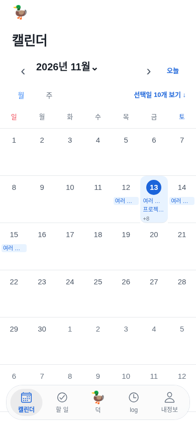

장점: 월전체와오늘을바로고를수있다.

관찰: 하루칸제목두개가잘리고상세목록은y819.5아래.

접근성·한계: 작은글자/선택의색외표현·보조기술은추가검수.

### 단계2 · 선택일로 이동: 종일/시간/겹침/할 일/완료 상태

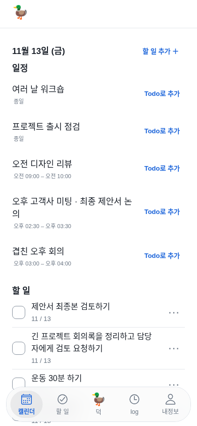

장점: 선택일점프와일정/Todo분리가동작한다.

관찰: 날짜/월맥락이위로사라지고보조가져오기버튼이제목폭을차지한다.

접근성·한계: Todo추가버튼40pt,긴제목줄바꿈확인.

### 단계2 · 외부 일정 제목을 눌러도 상세 화면은 열리지 않음

장점: 조회만으로원본을바꾸지않는다.

관찰: 제목을눌러도상세화면으로이어지지않았다.

접근성·한계: 향후행을명확한조작대상으로하고44pt/이름필요.

### 단계3 · 선택 날짜에서 추가: Todo만 표시, 저장하지 않음

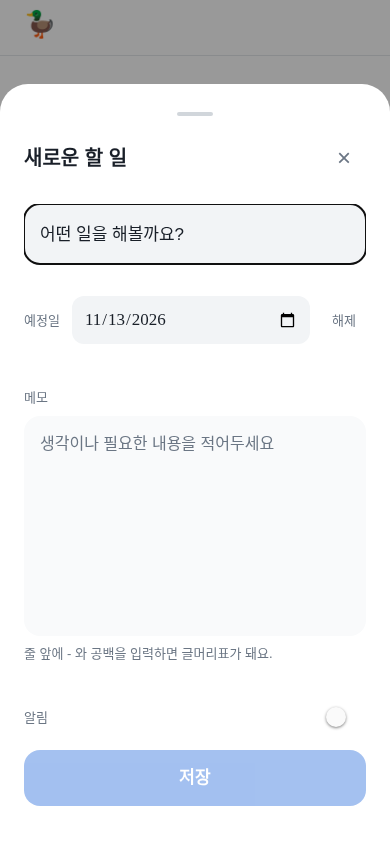

장점: 선택날짜가Todo작성에이어지고닫기/메모/저장이있다.

관찰: 시간있는일정작성은Calendar안에서진입할수없다.

접근성·한계: 기기키보드/VoiceOver는웹으로검증안함.

### 단계4 · 주 보기:7날짜와 아젠다, 시간표 없음

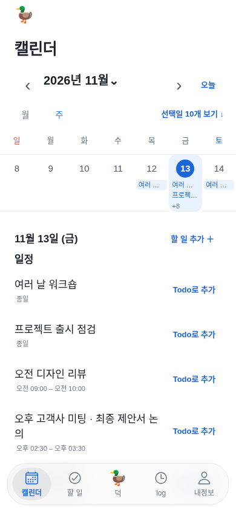

장점: 7일선택과선택일목록이함께보인다.

관찰: 주간시간표가아니라겹침/빈시간을파악하기어렵다.

접근성·한계: 월/주선택속성은색외의미보완필요.

### 단계4 · 주 보기에서도 다음달 버튼은12월1일로 이동

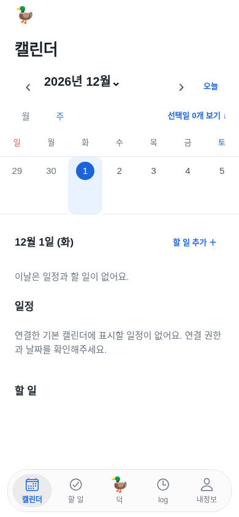

장점: 다음기간버튼자체는반응한다.

관찰: 주모드에서11월8~14일→12월1일포함주로건너뛴다.

접근성·한계: 기능/접근성이름모두보기단위와맞춰야한다.

### 단계5 · 년월 이동 시트: 웹 대체 select, native는 코드에 날짜 spinner

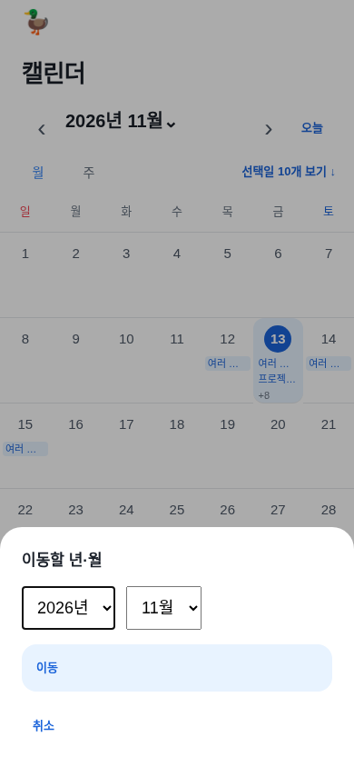

장점: 년월직접이동·취소가가능하다.

관찰: native년월전용선택의적절성은코드확인범위다.

접근성·한계: 이이미지는웹select이며native날짜spinner사진이아니다.

### 단계1 · 오늘13일과 선택20일의 시각 구분

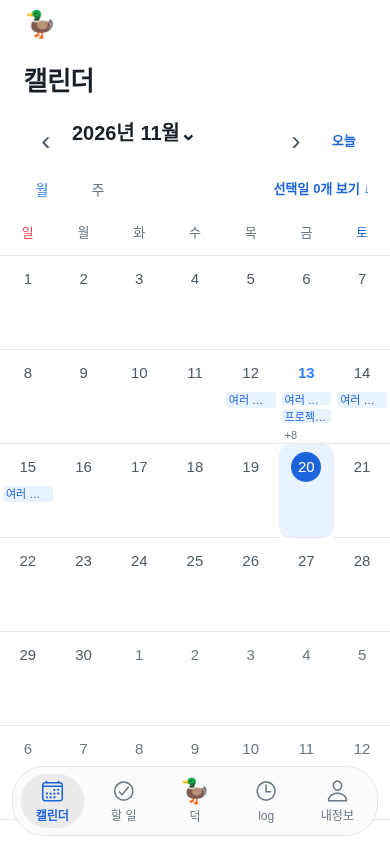

장점: 선택20일과오늘13일의외형은서로다르다.

관찰: 오늘표시는파랑/굵기에의존하고월칩의의미는여전히불명확하다.

접근성·한계: 오늘접근성라벨/고대비상태를추가검수.

### 단계6 · 빈 날짜의 일정/할 일 구분과 안내

장점: 선택일과빈상태가표시된다.

관찰: 빈날설명중복/권한확인유도는불필요하다.

접근성·한계: 짧은설명과보이는추가행동으로간결화.

### 단계4 · 다른 탭을 다녀오면12월에서오늘11월로 초기화

장점: 다른탭에서돌아오는동작은빠르다.

관찰: 보던12월이오늘11월로초기화된실제전이를재현했다.

접근성·한계: 같은계정탐색상태는유지하고계정전환에서는정리해야한다.

### 단계6 · 공급자 오류 상태: 화면 위에는 오류가 보이지 않음

장점: Todo는연결실패에도계속볼수있다.

관찰: 월상단에서는Google조회실패가보이지않는다.

접근성·한계: 비어있는일정으로오해할수있으므로상태를노출해야한다.

### 단계6 · 공급자 오류 상태: 아래 아젠다의 빈 안내와 오류/재시도 동시 표시

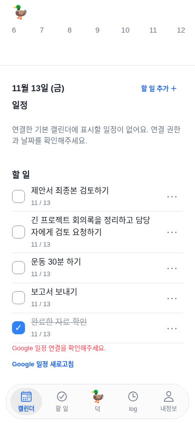

장점: 실제오류문구와재시도가있다.

관찰: 할일뒤아래에있어발견이늦고빈안내와동시에보인다.

접근성·한계: alert역할은있으나시각적배치/상태분리필요.

### 단계6 · 공급자 대기 중: 월 화면의 로딩 발견성

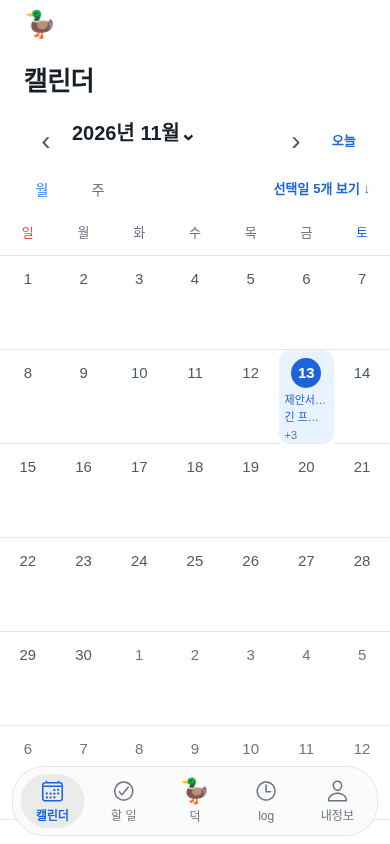

장점: 대기중에가짜일정을보여주지않는다.

관찰: 월상단은빈완료상태와같아보이며로딩은아래에있다.

접근성·한계: 읽는중/일부/실패의비색상안내필요.

### 단계1 · 320×667:42칸과본문/하단 바 관계

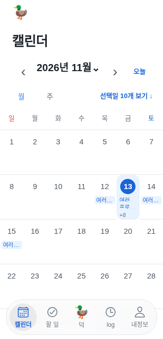

장점: 좁은폭에서도탭을조작할수있다.

관찰: 6주달력이화면높이를넘어끝행과아젠다가숨는다.

접근성·한계: 날짜칸폭은약45.7pt지만높이분배를개선해야한다.

### 단계1 · 320pt·글자160% CSS 시뮬레이션, native Dynamic Type 검사가 아님

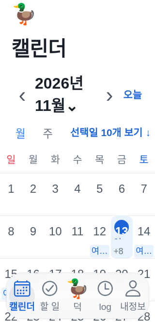

장점: 글꼴확대자체는막지않는다.

관찰: 고정30pt선택숫자상자와작은칩에서내용이잘린다.

접근성·한계: CSS160%시뮬레이션이다.실제DynamicType/VoiceOver는별도.

### 단계1 · Duo 기하 fixture: 왼쪽Calendar 고정/오른쪽Todo, 실제 기기 아님

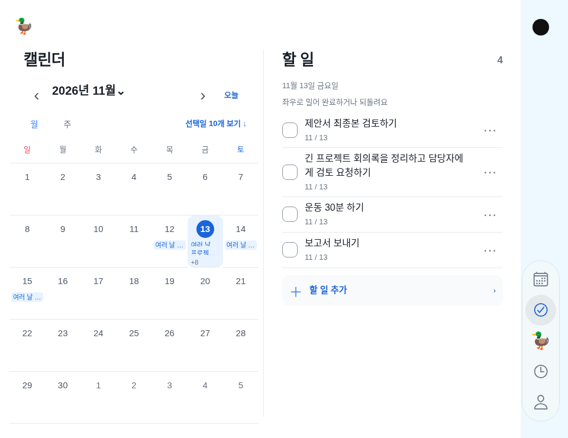

장점: Duo카메라열/좌Calendar고정/우Todo계약이유지된다.

관찰: 월의아젠다가pane아래로밀려큰화면이점이작다.

접근성·한계: 실제Duo/힌지/키보드검사가아닌기하fixture.

## 10. 출처와 남은 확인

- [Fantastical 보기](https://flexibits.com/fantastical-ios/help/calendar-views) · [추가/자연어](https://flexibits.com/fantastical-ios/help/adding-events-and-tasks) · [편집/검색](https://flexibits.com/fantastical-ios/help/editing-events-and-tasks).
- [Apple 보기/월정보량/Duo](https://support.apple.com/guide/iphone/change-how-you-view-events-iphfd1054569/ios) · [작성/편집](https://support.apple.com/guide/iphone/create-and-edit-events-in-calendar-iph3d110f84/ios) · [검색](https://support.apple.com/guide/iphone/search-for-events-iph2c9ef44ad/ios) · [복수캘린더](https://support.apple.com/guide/iphone/use-multiple-calendars-iph3d1110d4/ios).
- Apple HIG16항목은5절의실제읽은공식주소. date-pickers.md는404였으며실제존재하는pickers.md를확인했다. 페이지가있다는이유로native기기/앱을본것으로기록하지않는다.
- 다음 구현 전: 사용자 선호에맞춘월/선택일상세의대표시안,일정/Todo작성범위,주간시간표제공여부를현재확정과구분한다. 이번감사는코드변경/원본쓰기승인이나새UI확정이아니다.
- 실제기기: nativeLiquidGlass/상단컨트롤/스크롤경계·터치/햅틱·DynamicType·VoiceOver·키보드·dark/고대비·시간대·실계정권한/ETag/페이지조회.
- Figma69개화면의Current baseline/Proposed정리는아직미완료이며이번감사를Figma반영완료로기록하지않는다.

검증:16캡처·6흐름·쓰기0·JS오류0. 감사도구의문법/문서링크/공개HTML/이미지해시는커밋전확인한다. 문서저장·main반영·CI·Render공개반영은각각운영기록으로남긴다. 이번작업은앱코드수정이나새TestFlight빌드를수행하지않는다.
