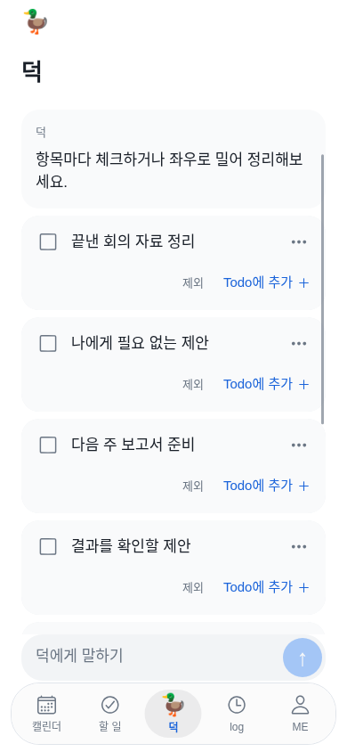
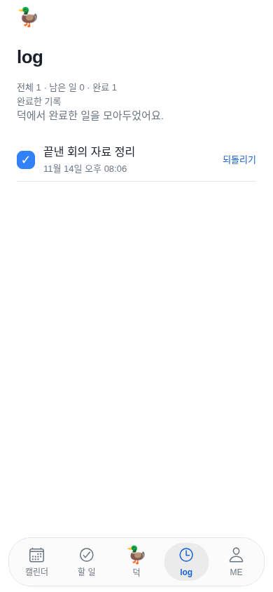
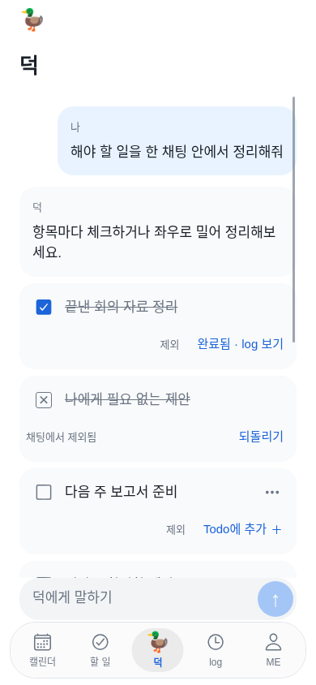
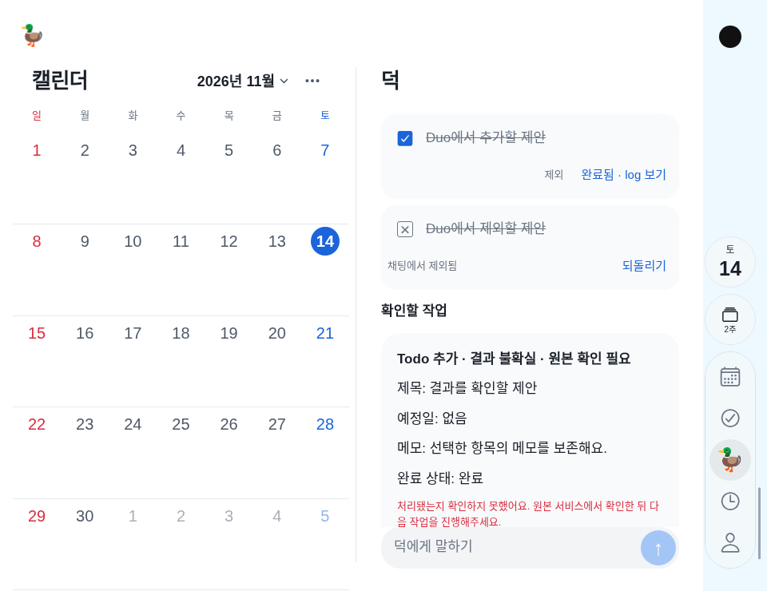

# 채팅 체크리스트 검수

**구현·웹/격리 API 결과: 통과. 실제 iPhone/Duo TestFlight·Swift/키보드·VoiceOver 검수: 대기.**

## 실제 확인

- 전체301개 중300통과·실패0·기존 선택1제외. 새 클라이언트 상태 검사8개와 실제 격리 API 완료 저장 검사1개를 포함한다.
- 첫 체크는 완료 기록 한 개만 생성하며 일반 Todo 생성은 계속 미완료다. action 확인 재전송/동시 확인에도 한 개, 다른 사용자의 확인/조회 불가, boolean 외 상태 거절, 완료 시각·메모 보존을 API로 확인했다.
- 클라이언트는 중복 제스처, 같은 제목의 다른 Todo, 성공 응답 유실/읽기 복구, unknown 재실행 금지, pending 원래 ID 재확인, 소유자 변경 중단, 구 서버/삭제 ID에서 몰래 재생성 금지를 검사했다.
- TypeScript·서버/웹/도구50파일 문법·Expo web/iOS JS export 통과. iOS JS 생성이 Swift/IPA·서명 성공을 뜻하지 않는다.
- `chat-checklist.mjs`: 실제 Expo Shell/격리된 합성 API·기하로 한 답변8항목, 체크→실제 log 화면, 왼쪽 X·되돌리기 쓰기0, 짧은 스와이프 무시, 오른쪽 추가·반복 중복0, 같은 ID 완료·기존3초 이동, 빠른 두 번 입력1회, 불확실 결과 재전송0, 응답 유실 복구를 확인했다. 일반폰은 합성 touch, Duo 기하 fixture는 mouse drag로 RN responder를 검수했다. 실제 기기 터치/FPS를 검증한 것은 아니다.
- 일반 iPhone·Duo 접힘/펼침에서 상태 유지, 왼쪽 Calendar 불변·카메라 열 중심선, 320px 어두운 외형과44pt 대체 버튼을 확인했다. 새 캡처10장과 `verification.json`을 보관했다.
- 기존 Duo 기하/상태 유지 회귀(접힘·펼침·세로·카메라 열·반대 pane)도 통과했다. 전체 앱/격리 API 회귀, AI 채팅의 긴 답변·초안·한 번 저장·기록 경쟁·계정 격리·수동 대체, AI 오류/상태 복구 회귀를 통과했다. 기존 자동 테스트의 후보 저장 부분은 새 명시 조작으로 갱신했으며 외부 쓰기 확인은 유지한다.

## 현재 화면

원본/전체 영수증: `artifacts/chat-checklist-2026-11-14/current/verification.json`. 모두 합성 API/기하를 사용한 실제 Expo 웹 캡처다. 사용자 운영 데이터/native 캡처가 아니다.

## 남은 기기 확인

새 TestFlight 설치 후 일반 iPhone과 Duo 접힘/펼침/회전에서 실제 손가락 좌우/세로·짧은 이동·OS 취소를 확인한다. VoiceOver·큰 글자·한국어 편집/키보드 완료·실계정 서버 지연에서 성공/실패/초안과 기존 원본 동기화 선택을 확인한다. 모델 실행·실계정 원본 변경·native 빌드/배포는 대신 실행하지 않았다.
