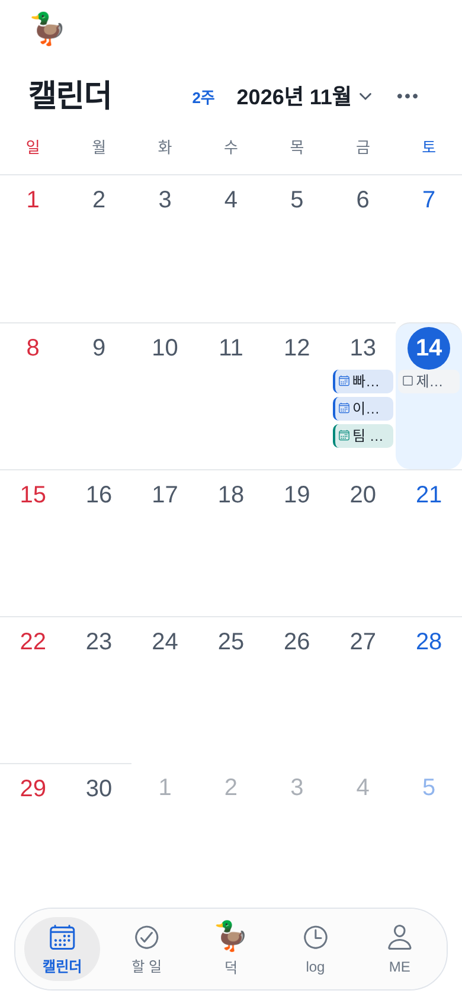
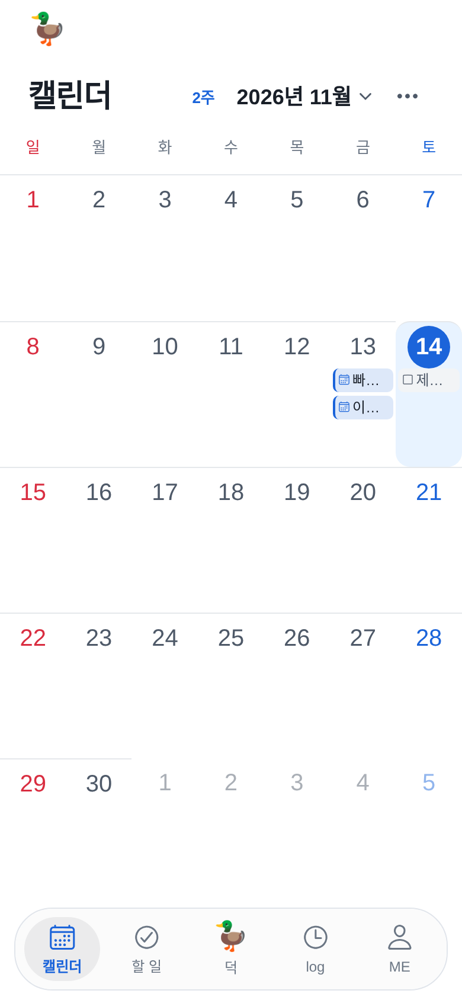
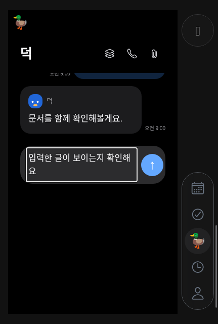

# 캘린더 저장본·AI 연결·미리 알림 안정화 — 2026-11-15

사용자3장의 오류와 느린 연결/갱신을 조사했다. 일반 iPhone·Duo 접힘/펼침에 적용하며 카메라 열·반대 pane, X 위 키보드 닫기, 기존 입력·ME 구조와3초 Todo↔log를 유지한다.

## 확인한 원인과 변경

- **미리 알림 CALENDARWRITEONLY:** SDK58.0.7의 `ExpoCalendar.get`은 reminder 목록 ID에도 event calendar 쓰기 권한을 검사한다. `getCalendars(REMINDER)`에서 받은 shared list 객체로 읽고, 객체가 사라졌을 때도 REMINDER 목록만 다시 조회한다. 불필요한 캘린더 권한을 추가하지 않는다. 미완료/완료 분리, 선택한20개 가져오기, 중복 방지와 명시적 원본 상태 변경은 유지한다.
- **원격 DB 병목:** 일정50개의 정규화가 각 항목의 기본 연결/메타데이터를 반복 조회하고, 자료도 하나씩 저장했다. AI 상태도 action catalog마다 같은 연결을 다시 읽었다. 페이지 단위의 메타데이터 읽기/갱신·자료 upsert, 상태 호출 안의 최신 연결 snapshot을 사용한다. 요청 사이에 권한을 캐시하지 않으며 바로 다음 상태 조회는 연결 해제/권한 변경을 반영한다. 선택 가져오기도 자료/기존 Todo를 일괄 조회하고 한 트랜잭션 안에서 일괄 추가한다.
- **저장본 우선:** 선택한 캘린더 ID를 서버·사용자별로 기억한다. 일정을 먼저 지우지 않고 마지막 표시 저장본을 복원한다. 조회 범위가 달라져도 같은 계정/시간대/선택 목록의 겹치는 일정을 먼저 표시한다. 오래된 복원이 이미 도착한 공급자 응답을 덮지 않으며, 다른 화면의 캐시 알림도 현재 범위에 맞춰 읽는다. native 저장은 기존 SecureStore, 웹은 현재 탭의 sessionStorage를 사용한다. 메모·ETag·원본 수정 권한을 디스크에 저장하지 않는다. 로그아웃/계정 변경/Google 연결 해제 때 삭제한다. 두 Duo pane의 같은 GET은 실행 중에만 공유한다. 표시 중에는30초 간격으로 갱신하고, 앱이 배경이거나 이전 조회 중이면 중복 poll하지 않는다. Google 연결/권한 상태 변경 직후에도 캘린더를 깨운다.
- **서버 준비와 쓰기:** iOS의 AI 전송·일정 미리보기/저장 전에 최근 성공 응답이 없다면 읽기 전용 health GET으로 준비를 확인한다. 짧은 일시 실패는 이 health 조회만 제한 시간 안에서 재시도한다. 실제 POST/PATCH/확인·원본 쓰기는 자동 재실행하지 않는다. 대기 전에 기존 세션 토큰을 캡처하여 로그인 교체 뒤 이전 초안이 새 계정으로 전송되지 않게 한다. 일정/AI 작업 응답은 최대60초 기다리고, background chat 영수증 GET에도 기존 안전한 읽기 복구를 적용한다.
- **유휴 부하:** 원격 DB의 빈 메일 큐를2초마다 여러 UPDATE/빈 트랜잭션으로 검사하던 작업을 줄였다. 유지 정리는 분당 한 번, 빈 큐는 한 SELECT, 유휴 remote poll은15초다. 인증 메일 요청은 기존 `worker.tick()`을 즉시 실행한다.

## 검사 근거

격리 DB statement 계수에서 일정50개8회, AI 상태2회, 선택 미리 알림20개 가져오기6회다. 운영 네트워크 응답 시간이나 실제 Google 계정의 실측 값이 아니다. 실제 libSQL HTTP client와 로컬 Hrana fixture에서도100개 경계를 넘는 resource upsert와 암호화된 calendar metadata batch 갱신·복원/트랜잭션을 검사했다. 완료 참고 기록·계정 분리·원본 확인/중복 방지는 유지한다.

전체366개 중365통과·실패0·기존 선택1개 제외. 문법96개·모바일 타입·web/iOS JS export, 전체 앱·AI 채팅 오류/명시 재전송·일정 부분 저장/권한/중복 방지·입력 가림·캘린더 캐시 회귀를 확인했다. 새14장은 실제 Expo 웹과 합성 계정/API/키보드 가림 기하를 사용했다. 사용자 원본3장을 공개 갤러리에 복사하지 않았다. 실제 EventKit 권한/한국어 IME·실계정 Google/모델 품질 검수는 남는다.

## 운영 조사와 실제 빌드 상태

서버 로그에는 이전 인스턴스 재시작이 있었지만 사용자 요청과의 직접 인과는 확인하지 못했다. 12:00~12:20 UTC 메모리는 약50~73MB/512MB, CPU는 낮았고 HTTP 지연 메트릭/필터한5xx 요청 로그는 비어 있었다. 따라서 모든503/비JSON 오류를 cold start, 메모리 부족 또는 특정 DB 호출로 확정하지 않는다. 코드에서 확인한 반복 동기 DB 작업과 복원 문제를 수정했다. 무료 서버의 첫 기동 지연과 외부 서비스 지연을 완전히 없앴다고 하지 않는다. 읽기 성공과 원본 저장 결과 불확실은 계속 구분한다.

[새로 확인한 iPhone40](https://github.com/thepmpo/donknow/actions/runs/43711587874)은 dc934af 소스로 실제 Mac Swift 사전 검사·서명12:08:36 UTC·Apple 업로드12:09:03 UTC가 성공했다. 이번 안정화는40 이후이며 미리 알림/기기 캐시 수정은 다음 native 빌드·설치가 필요하다. 공개 웹/서버는 별도 수동 Render 배포 후 실제 release/health로 확인한다. 새 유료 자원·DB/암호화 키 변경·실계정 원본 쓰기·옛 Slack 연결 사용은 없다.
