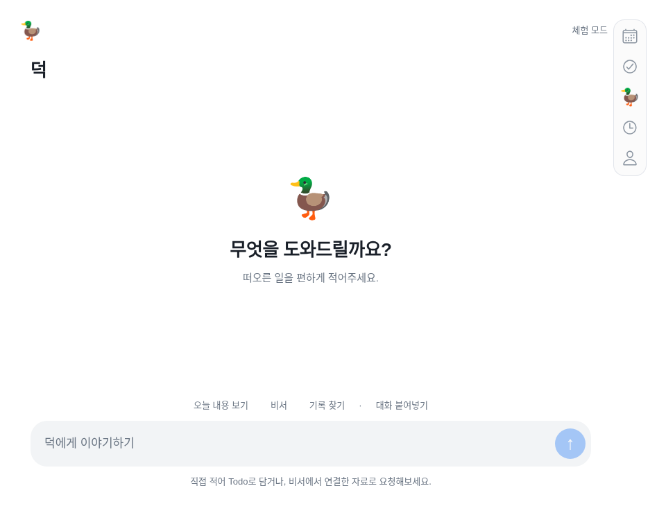

# 현재 UI·기능 통합 대조 — 2026-11-10

## 2026-11-14 — 약한 메뉴 전환·접힘 2주·키보드·작은 실행 기록

[현재 계약](navigation-refinement-2026-11-14.md) · [QA](navigation-refinement-qa-2026-11-14.md) · [내정보 8단계 점검](profile-flow-audit-2026-11-14.md). 일반 iPhone/Duo 각각 승인했고 주간은 기존 **2주 보기**다. 메뉴는 scale1/translate0 고정·opacity .98→1/220ms다. 연간 matched zoom420ms와 sheet640ms를 메뉴에 겹치지 않는다. 월·2주는 하나의 이동값으로 옛/새 페이지를 항상 pane폭 간격으로 움직이고 매 drag의 정지/React 상태 변경을 없앴다. 같은 기간 재선택에는 추가 zoom이 없다. 동작 줄이기·급탭/취소·초안/캐시/반대 pane은 유지한다.

접힘의 작은 카메라 열은 두64pt 슬롯 대신 최소44pt까지 조정하고, 두44pt도 안 들어가면 본문 제목 옆 ‘2주’로 대체한다. 오늘 위·2주 아래·탭 위치/카메라 중심선/하드웨어 회피는 유지한다. 일반 접힘 fixture에서는 이전에도 보였으므로 실제 사용자 누락 원인을 확정하지 않는다. TodoEditor autoFocus를 제거하고 열기 전에 키보드를 닫는다. 제목/메모를 누를 때 입력한다. 완료/취소 기록은 한 줄에 접고 열면 작은 행, pending/running/failed/unknown은 계속 표시한다. 확인/취소 후 결과 reveal·계정별 격리를 유지한다.

내정보는 중복 소개/통계·복잡한 권한 화면·서버/DB/백업 운영 설명 혼재·개인정보 긴 문장/초안 보관 설명을 지적했으며 아직 재설계하지 않았다. 녹음은 백로그, AI 항목 체크박스는 결정 대기다. 전체273중272통과/실패0/기존선택1제외·타입/문법·web/iOS JS·기기별 기하/프레임/초점/기록·Calendar/AI채팅/오류·Duo/전체앱/모션을 확인했다. native FPS/키보드/VoiceOver/실계정은 별도다.

실제 최신 확인은 [사용자 실행43553158014](https://github.com/thepmpo/donknow/actions/runs/43553158014)·소스382ad90의 **1.0.0(30)** 서명 빌드03:50:42UTC/Apple 업로드03:51:08UTC 성공이다. **이번 수정은30 이후이며 새 빌드/설치가 필요하다. 이번 작업에서native 추가빌드는 실행하지 않는다.** 인증/DB/서명·무료/수동 정책·복구bundle·사무실/사이트 보류를 보존한다. 아래 ‘29최신/메뉴640ms zoom/큰 기록’은 이전 이력이다.

## 2026-11-14 — 모션·바깥 스크롤바·입력부 최신 정정

[현재 계약](interaction-polish-2026-11-14.md) · [실제 QA](interaction-polish-qa-2026-11-14.md). 사용자의 Apple 영상/표시 사진과 일반폰 적용 답변에 따른다. 일반 화면은640ms cubic(.32,0,.2,1),scale.975→1/opacity.92→1로 흰색 소거/초반 급가속을 줄인다. 월 드래그는dx를따르고옛/새그리드가pane폭만큼이어이동한다. 연간matchedzoom/개별rollback은그대로다. 줄인모션/급전환·취소/반대pane·초안과캐시는유지한다.

**Duo 스크롤바는 본문이 아니라 카메라 열 내비게이션 아이콘 바깥 오른쪽**이다. 기존capsule끝+3pt/폭3pt/보이는탭높이상하4pt,하드웨어/화면경계보호,마지막스크롤영역만공용표시·1초후240msfade다. ordinary는본문우측유지다. 입력기본52pt/긴입력108pt한도·＋안도구/자료·상시안내제거·Duo아래8pt이며44pt타깃/동의·오류·확인은유지한다. 상세의Google원본/Todo버튼과안내footer는제거했다.

녹음은백로그/구현보류다. AI항목의완료/Todo아님/Todo이동은가능성을확인했으나사용자가추후정하기로했으므로구현하지않는다. 채팅분류/실제Todo완료를임의확정하지않는다. 현재plainText/proposals구조와필요추가구현을계약에기록했다.

**사용자실행43543369494·37a3e28의1.0.0(29)** native/Apple업로드02:03:38UTC성공을확인했다. 이전상세/덕정보/알림은29에포함된다. **이번모션/스크롤바/입력부는29이후수정으로새앱빌드가필요하다. 이번작업에서native빌드를자동실행하지않는다.** 데이터/인증/서명·무료/수동정책·복구bundle/사무실·website보류를유지한다. 아래28최신/본문스크롤바/420ms급가속/상시도구행은이전이력이다.

## 2026-11-14 — 상세·편집·덕 알림·공통 모션 최신 정정

[현재 구현 계약](calendar-events-motion-2026-11-14.md) · [실제 QA](calendar-events-motion-qa-2026-11-14.md). 일반 iPhone/Duo 각각 승인했다. 월간의 빈 하단은 각 주에 균등 분배, Duo는 native안전하단 중 하드웨어 없는 빈 strip만 Calendar에 확장한다. 반대pane·카메라열 오늘→2주→5탭은 유지한다. 상세의 강제높이/빈편집행과 긴계정명라벨깨짐을 없앴다. 공통화면은.96→1/420ms,기존연간은실측matchedzoom이다. 본문/시트의각우측스크롤바는1초유지→240msfade,동작줄이기1000ms후즉시숨김이며월grid에는없다. 이전연간숨김/상세96%고정은이범위에서대체한다.

변경한공통항목만Google에ETag/명시확인으로PATCH,원본반복·참석자·첨부/알림은보존한다. 덕전용메모·URL·첨부링크·앱알림은calendarDetails:1의계정별암호화저장으로분리한다. Google성공후덕실패는덕만재시도하고원본쓰기를반복하지않는다. 읽기전용원본도덕전용필드는저장한다. Todo+일정합쳐가까운60개기기알림이며원본변경은앱동기화후반영한다. 실제iPhone수신/실계정은별도다.

**실제최신native는 사용자실행43536270733·f008503의1.0.0(28)**,서명IPA00:52:04UTC/Apple업로드00:52:32UTC성공이다. 연간/viewport/탭단축은28에포함된다. **이번추가개선은28이후이며새앱빌드/설치가필요하다. 이번작업에서native빌드를자동실행하지않는다.** 기존인증/데이터/서명·무료Render/수동빌드·복구bundle/사무실·website보류를유지한다. 아래27최신/빌드접수실패는그당시이력이다.

## 2026-11-14 — 연간 보기·확대 전환·개별 롤백

[현재 계약](calendar-year-overview-2026-11-14.md) · [실제 QA](calendar-year-qa-2026-11-14.md). 사용자가 연간 달력형/기기별 전환 설명 후 구현을 승인했다. 일반폰 년월→12개월 연간→월 직접 선택, Duo 선택한 pane 안에서 같은 조작이다. 다른 pane과 카메라 열 Today→2주→5탭을 유지한다. 별도 적용/취소 행 없이 선택 즉시 이동하고, 검색/추가/조회·보기/설정은 더보기로 분리한다.

실측 타일↔본문의 균일줌420ms cubic(.22,1,.36,1),동작줄이기/좌표없음120ms페이드다. Apple고정수치가아닌덕구현값이며실제iOS모션/진동은별도다. 연간 숫자는로컬계산으로전체일정을미리조회하지않는다. 기존월/2주·캐시·탭단축·데이터/인증은보존한다. 연간은세로스크롤가능/스크롤바숨김,월·2주는화면맞춤을유지한다.

**calendar-features.ts의 yearOverview=false**로 연간/줌/새메뉴만 끄고 이전 선택창을 복원한다. 실제OFF번들도 검사했다. 설치된앱은롤백코드로재빌드/업데이트해야하며서버즉시스위치가아니다. 이번에는native빌드를시작하지않는다. 아래년월미정/답변대기는승인이전이력이다.

## 2026-11-14 — 기기별 캘린더 단축 조작 확정

[구현 계약](calendar-navigation-2026-11-14.md) · [검수](calendar-navigation-qa-2026-11-14.md) · [Apple 영상/년월 선택 비교](calendar-navigation-review-2026-11-14.md).

일반 iPhone은 다른 탭에서 들어갈 때도, 현재 캘린더 탭을 다시 누를 때도 오늘로 이동한다. 길게 누르면2주 보기이며 상단의 보기 버튼은 유지한다. Duo는 **오늘 →2주 보기→5탭** 배치를 유지하고, 캘린더 재선택은 오늘·길게 누르기는2주다. 펼친 가로에서 오른쪽이 캘린더면 오른쪽에 적용, 다른 탭이면 왼쪽 고정 캘린더에 적용하고 오른쪽 작업을 보존한다. 첫 캘린더 진입 때 보던 날짜를 유지하는 Duo 규칙은 일반폰과 다르다.

길게 누르기500ms·2주로 직접 설정·손뗄때중복Today 차단, 계정/서버·pane별 요청 격리·열린 시트 단축 무시를 구현했다. 앱복귀/접힘/회전 자체를 탭선택으로 취급하지 않는다. 기존 Glass/캐시/원본쓰기 확인·인증/데이터는 보존한다. **년월 UI/Apple 연간 줌은 별도 질문 답변 대기이며 변경하지 않았다.** 아래 과거의 모든질문대기/앱변경없음 설명은 이번 두 답변 이전 이력이다. 단축은 덕의 선택이고 Apple이 규정한 탭동작이 아니다. '포스터치'는 이번에는 압력 감지 대신 **길게 누르기(Haptic Touch)**로 구현한다.

Expo 웹/합성API·명시적 Duo기하 검사는 통과했다. native iPhone의 길게누르기/진동/VoiceOver·실계정은 별도다. 이번 조작은 기존1.0.0(27)에 없으며 새native빌드가 필요하다. 이번에는 native빌드를 시작하지 않았다.

> 실제 최신 확인: 사용자 실행 [43494093136](https://github.com/thepmpo/donknow/actions/runs/43494093136)·a61740e의 **1.0.0(27)** native/Apple 업로드 성공(19:47:29/19:59:32 UTC). **c4eebbd의 viewport·버튼 순서·캐시와3401030의기기별단축은27 이후이며 새 빌드가 필요**하다. Apple 처리/설치·실기기는 별도다. 아래26 최신 표기는 당시 이력이다.

## 2026-11-13 최신 정정 — 화면 채우기·버튼 순서·일정 먼저 표시

[현재 계약](calendar-viewport-2026-11-13.md)과 [QA](calendar-viewport-qa-2026-11-13.md)가 이전24pt 추가 여백·최소92pt/월 세로 스크롤·Today 위 보기 버튼 규칙보다 우선한다. 월/2주 행은 실측 가용 높이를 채우고 grid 세로 스크롤/bounce/스크롤바를 막는다. 목록/시간표/긴 시트 스크롤은 유지한다. 공통 제목 위치를 보존하며 요일 첫 줄을 Todo 날짜 줄과 맞춘다. 사용자 답변으로 카메라 열은 **오늘 위·2주 보기 아래·기존5탭 유지**다. 일반폰은 제목 옆2주 전환/년월 메뉴의Today·기존하단이다.

일정은 Duck계정/서버/시간대별 실행 중 메모리 캐시 최대12기간을 즉시 보여주고 출처별 응답이 오는 대로 갱신한다. capabilities5분 캐시·페이지 마지막 응답 후 삭제 반영·중첩기간 갱신·실패시 보존·세대/key/active 격리를 유지한다. 앱 완전 재시작/첫 기간 조회는 별도이고 원문/토큰을 새 영구 파일에 기록하지 않는다. source범위/원본쓰기 확인·명시적 해제·기존인증/DB/서명·복구bundle·website/사무실 보류는 보존한다. Expo/합성API·Duo기하 검사와 native/실계정/Apple 업로드는 분리한다.

## 2026-11-13 최신 정정 — 캘린더 정리·2주·시트·연동

[현재 전체 계약](calendar-refinement-2026-11-13.md)과 [실제 QA](calendar-refinement-qa-2026-11-13.md)가 이전의42칸/본문 toolbar·status 규칙을 대체한다. 소개 사이트는 그대로 둔다. Calendar 본문 도구/조회 문구를 년월 sheet로 이동하고24pt 여백, 월에 실제 속한 주만28/35/42일(2026-11은11/1–12/5), red/blue 주말·옅은 인접월을 적용했다. fortnight는 selected와 별도 anchor로14일 창을 보존하고 두 행 높이를 실측으로 넓힌다. 물리 카메라 열의 Today 위64pt 보기 버튼·8pt 간격이며 기존5탭 위치/왼쪽 고정 Calendar/오른쪽 우선/회전 상태는 보존한다.

시트 입장360ms cubic(.22,1,.36,1),퇴장260ms,dim220ms. 실제 pane/host 좌표로 앱 상단까지 같은 회색을 이어 덮고 본문/상단 배경·Duo Back/Close/손잡이/Escape로 닫는다. 입력/스크롤·busy·편집 취소·reduced motion과 초점 복귀를 보존한다. 수치는 덕 구현값이며 Apple 공식 값이 아니다.

정상 token회전을 다른 계정으로 오판하지 않고 connectionId/accountId로 검사한다. 실제 해제/교체는 계속 차단한다. 상태 read 순서·session generation·안정화 callback, cold-start GET60초와 네이티브 취소 GET1회 복구로 늦은 응답/일시 실패가 연결을 지우지 않도록 했다. OAuth/쓰기/확인은 자동 반복하지 않는다. 비밀값/인증/DB를 초기화하지 않았다.

코드e2c853b, 전체254개 중253통과·실패0·기존 선택1제외,타입/웹/iOS JS·Calendar/모션/연동경쟁/Duo/전체앱/세션/웹로그인 검사 통과. 새 캡처는 실제 Expo+합성API/기하 fixture다. **실제 사용자 계정·native iPhone 검수는 별도이며26번 앱에는 이번 수정이 없다. 추가 TestFlight는 자동 실행하지 않았다.** 아래25/26·이전42일 설명은 이력이다.

## 2026-11-13 — 첨부 Apple 캘린더·시스템 외형 정정

[현재 구현 계약](calendar-apple-reference-2026-11-13.md). 사용자 답변으로 년·월은 캘린더 본문 우상단, 오늘은 물리 카메라 열의 세로 탭 바로 위 독립 원형, 밝게·어둡게는 시스템 설정으로 확정했다. 기존 light 고정·큰 2단 toolbar·월 화면 상시 agenda/무조건6주 화면 안 맞추기 규칙은 이 부분에서 대체한다.

월42일은 보존하고 최소92pt 주 높이·내부 세로 스크롤·일정 직접 탭·색상 출처·인접 월 옅은 날짜를 적용했다. 큰 제목·출처 세로선·그룹 옵션의 상세, 왼쪽 목록 정렬, iOS DynamicColorIOS/웹 media 변수·Glass scheme·일반 시트의 semantic 배경을 반영했다. Today와 세로 탭/뒤로가기의 안전 좌표·오른쪽 활성 Calendar 우선·fold/rotation/초안을 보존한다. 알림/삭제는 지원하는 Google 원본 경로를 안내하고 가짜 동작을 만들지 않는다.

Calendar body timeout 원인 보존·GET60초/비JSON 최대1회 복구·잘못된200을 빈 일정 성공으로 처리하지 않기·실패 source 캐시 보존·JSON 직렬화 전 성공 헤더 금지를 수정했다. 실제 사용자 계정 오류 원인은 아직 재현하지 못했으며 공개 상태/fixture 개선과 구분한다. 쓰기/확인은 자동 재실행하지 않는다.

단위247개 중246통과·실패0·기존 선택1제외를 확인했고, 타입·웹/격리 Calendar·Duo·전체 앱/로그인·모션·예약·iOS JS 및 공개 문서 회귀의 최종 영수증은 계약/검수 문서에 남긴다. 새 화면은 합성 데이터 웹 캡처다. **25번 앱에는 이번 수정이 없고 새 TestFlight를 자동 실행하지 않았다.** 데이터/인증·서명·무료 플랜·원본bundle·AI사무실 보류는 유지한다.

## 캘린더 개선 전체 구현 — 2026-11-13

사용자가 “지금 그거 전체 수정해”라고 요청해 [감사 CA-01~20](calendar-ux-audit-2026-11-13.md)의 구현을 승인했다. [재현 가능한 구현 계약](calendar-workspace-2026-11-13.md)에 흐름·수치·원본 파일·권한·상태·검증·기기 체크리스트를 연결했다. 감사 당시 제안/미구현은 현재 상태가 아닌 이력이다.

실제 pane 높이의42칸, 선택일/일정 상세 시트, 월·주·일·목록과 올바른 이동 단위, 일반폰 탭 복귀/초안 보존, 일정/할 일/완료 구분, 여러 날/겹침 시간표, Google 일정 작성/수정, source/권한 선택, 기간 내 검색, native 년월 선택, IANA 시간대/주 시작을 연결했다. 상단 상태·실패/부분/재시도·큰 글자/최소44pt·regular Glass 도구와160ms/8pt·지원 iOS 햅틱을 적용했다.

Google 원본 쓰기는 미리보기→사용자 확인→한 번 실행, 역할·연결·ETag 재검사다. 결과 불확실일 때 닫았다 열어도 다시 저장하지 않고 결과만 확인한다. 기존 읽기 권한을 자동 확대하지 않고 데이터·인증·Duo 카메라 열/좌Calendar/우선택·무료 플랜을 보존한다. 앱은 기존light 선언 유지, 전체dark UI 추가는 아니다.

새 증거는 calendar-workspace-2026-11-13 폴더의 실제 Expo 웹/격리 API다. native Glass 광학 효과·Dynamic Type/VoiceOver·실제 Duo·Google 실계정 쓰기·Figma 교정은 별도 검수다. **이번 작업은 새 TestFlight를 자동 요청하지 않는다.** 아이폰 설치 앱은 최신main 수동 빌드/Apple 처리/업데이트 후 바뀐다.

## 이전 캘린더 감사 — 당시 제안/미구현

[Apple Calendar·Fantastical·HIG 비교 보고서](calendar-ux-audit-2026-11-13.md)에6개 흐름·새 캡처16개·20개 관찰/기회를 기록했다. 월42칸의 실제 화면 높이,선택일 상세 연결,주 보기의 월 단위 이동,일반 폰 탭 복귀 시 기간 초기화,큰 글자 잘림,로딩/실패/부분조회 발견성,일정 상세·작성 진입을 우선 검토한다. Apple HIG16항목을 캘린더의 조작/본문/상태/접근성에 연결했다.

**감사 당시 결과는 개선 제안이었다. 이후 CA-01~20 구현 승인과 최신 상태는 맨 위 절이 우선한다.** 기존 전체 월·오리·5탭·권한/확인·Duo카메라열/좌Calendar고정/우선택/세로단일·상태 보존 계약을 유지한다. 실제시간표·선택일sheet·일정작성/추가권한·소스필터는 제안과 현재 가동을 구분한다. Glass는필요한toolbar에만,월칸/일정본문전체에는확대하지않는다.

감사 기준은20bc8eb의 실제 앱 웹 출력,격리API/고정KST시각,쓰기0/JS오류0이다. Apple/Fantastical 네이티브 앱을직접조작한비교나실기기DynamicType/VoiceOver검사가아니다. 재현도구와관찰JSON/출처는보고서에연결했다. 향후구현은이보고서의문제ID/완료기준/원본파일을따라현재계약과대조한다.

> **현재 구현 기준:** [전체 이어받기 기준서](continuation-guide.md) → [Liquid Glass 상태·수치·검수](liquid-glass-navigation.md). 아래 날짜별 기록은 당시 이력입니다. 일반 iPhone 하단 capsule·상태별 터치 동작, Duo 카메라 열·64/272/52/28,3초 완료,예약 메시지 문서 대기 해제가 최신이며 이전 설명보다 우선합니다. 구현·웹 검사·native 빌드·실기기 확인은 따로 읽으세요.

## 2026-11-13 정정 — 파란 선택 음영을 실제 GlassView로 변경

사용자가 “Liquid Glass가 아니라 파란 음영”이라고 보고했다. 소스에서 **움직이는 선택 표시는 rgba(49,130,246,0.16) 색의 일반 Animated.View이고 native GlassView는 바 배경에만 연결돼 있었다**는 것을 확인했다. 따라서 이전 “Glass 연결” 설명을 선택 표시 전체의 실제 유리 검증으로 읽으면 안 된다. 사용자는 **아이폰 TestFlight 앱**에서 본 현상이라고 답했다. 웹 미리보기 차이로 설명하지 않는다. 실제 설치 버전/OS/접근성 모드를 원격으로 읽은 것은 아니다.

구현fdd555f에서 파란 채움을 제거하고 선택 표시 안에도 NavigationGlass의 **selection variant**를 넣었다. 지원 iOS는 실제 GlassView regular·isInteractive=true를 사용하며 글라스가 들어가는 부모/선택 이동 뷰의 opacity를 낮추지 않는다. 바깥 host의 overflow:hidden도 제거해 유리 가장자리/깊이 효과를 자르지 않게 했다. 이동은 기존250ms/1.06배 커스텀 애니메이션이고 Apple이 자동으로 생성하는 tab 동작 전체를 복제했다고 하지 않는다. 선택 아이콘의 기존 파란색·카메라 열·크기·구분선·입력/월/스크롤은 보존한다.

웹/이전OS의 선택 표시는 **중립색 반투명 블러 대체**이며 native Liquid Glass가 아니다. 투명도 줄이기/강제 고대비는 불투명한 대비 선택 표시를 사용한다. 가용성 검사나 사용자 OS 설정을 끄거나 우회하지 않는다. [Apple Materials](https://developer.apple.com/design/human-interface-guidelines/materials.md)는 clear를 시각적으로 풍부한 배경용으로 안내하므로 흰 표면의 덕은 regular를 유지한다. [Expo Glass 공식 API](https://docs.expo.dev/versions/latest/sdk/glass-effect/)를 따르고 새 native 패키지/인증은 추가하지 않았다.

검증: 문법·전체225개 중224통과/실패0/기존 선택1개 제외·타입·웹/iOS JS export·전체 앱/모션·Duo 회귀에서 파란 선택 배경 없음, 명시적 중립 fallback/불투명 모드, glass host 비클리핑, 선택 이동/연속 전환/동작 줄이기·구분선/기존 상태를 확인했다. 첫 웹 색상 단정은 BlurView가 실제 tint 색으로 덮는 점, 고대비는 OS 팔레트를 쓰는 점을 반영해 **중립/투명·대비·불투명 정책**을 검사하도록 바로잡았다. 공개 문서/디자인 가이드와153개 이미지 해시도 검증했다. native 광학 효과를 웹 캡처로 검증했다고 하지 않는다.

실제 최신 빌드도 확인했다. [43374883126](https://github.com/thepmpo/donknow/actions/runs/43374883126)은 소스57530ac의 **1.0.0(20)**이며 Xcode27.1·ExpoGlassEffect58.0.5 설치/패키징·서명IPA 생성·**15:04:13 KST Apple 업로드 성공**이다. [제출 상세](https://expo.dev/accounts/thepmpo/projects/duckduck-donknow/submissions/387bcae4-0749-4feb-b83a-c66fff678447).20번에는 구분선과 Glass 모듈이 있지만 선택 표시는 수정 전 파란색이다. 사용자 설치/Apple 처리 완료까지 독립 확인한 것은 아니다.

**이번 선택 재질 수정은20번에 없다.** 현재 Expo Update를 구성하지 않았으므로 최신 main의 새 무료 빌드·Apple 처리·실제 아이폰 비교가 필요하다. [무료 빌드 화면](https://github.com/thepmpo/donknow/actions/workflows/ios-testflight.yml)의 새 main 실행을 사용하고20번 실행의 재시도는 하지 않는다. 다음 번호를 미리 고정하거나 실제 폰의 Glass 모드를 추정하지 않는다. 기존 데이터·인증·서명·원본 recovery bundle·무료 플랜을 보존했다.

## 2026-11-13 승인·적용 — 펼친 Duo의 연한 좌우 구분선

사용자가 추천 이미지에 **“그렇게 해서 적용하자”**고 승인했다. 구현4d41361에서 펼친 가로 Duo의 실제 pane gutter 중앙에 기존 목록 색 **#E5E8EB**의 **StyleSheet.hairlineWidth** 선을 추가했다. 양 끝은16pt씩 띄우며 흰 배경·카메라 열 내비게이션·왼쪽 캘린더 고정/오른쪽 선택 화면을 유지한다. 이전 이미지 제안의 미승인/미구현 상태는 이 승인으로 해제한다.

선은 스크롤/탭 전환과 독립된 장식이고 터치를 가로채거나 접근성 조작 항목을 만들지 않는다. 세로·접힘·일반 iPhone·분할 비활성 상태에서는 숨긴다. 실제 활성 힌지/가림 영역이 중앙을 차지하면 선을 중복해 그리지 않는다. 화면50%나 기기 모델/폭으로 위치·기기를 추정하지 않고 기존 native-confirmed geometry를 사용한다. 확대 내비게이션·Glass·250ms 선택 이동·초안/월/스크롤·데이터/인증은 보존했다.

검증: 문법·전체225개 중224통과/실패0/기존 선택1개 제외·기하12개·타입·웹/iOS JS export·전체 앱·Duo 선 위치/양끝16pt/색/터치 통과·스크린리더 제외/스크롤·탭 고정/회전·힌지 숨김/기존 상태·Glass 선택 모션 회귀를 통과했다. 공개 문서/디자인 가이드 회귀와148개 이미지 해시도 검증했다. 새 캡처는 **실제 앱 컴포넌트의 기하/체험 데이터 웹 fixture**이며 AI 시안과 구분한다. native Glass·실제 Duo/기기 설치 검수는 새 무료 빌드 후 별도다.

[승인 기준·실제 캡처·공식 근거·남은 검수](https://github.com/thepmpo/donknow/blob/main/docs/duo-pane-divider-proposal-2026-11-13.md) · [무료 빌드](https://github.com/thepmpo/donknow/actions/workflows/ios-testflight.yml). 현재 확인한 설치19번에는 앞선 Glass/확대와 구분선이 없으므로 최신 main을 새로 수동 빌드하면 함께 받는다. 새 빌드 번호나 Apple/실기기 성공을 미리 확정하지 않는다. 기존 인증·서명·데이터·원본 recovery bundle을 보존했고 push 자동 빌드는 계속 꺼져 있다.

## 2026-11-13 승인 반영 — 큰 내비게이션·Liquid Glass·선택 이동

사용자가 제안한 확대/재질/모션을 적용하도록 승인했다. 구현30ea3d9에서 Duo 아이콘24→**28pt**, 탭 터치44→**52pt**, 세로 바48→**64pt**·전체높이**272pt**로 키웠다. 기존 물리 카메라 열과 아래 탭·위 실제 복귀 원형 ‹, 위/아래 안전8pt, 가로 고정 캘린더/오른쪽 선택 화면·세로 현재 화면 규칙을 유지한다. YouTube는 큰 아이콘과 명확한 선택의 참고이며 로고/빨간색/하단 위치를 복제하지 않는다. 일반 iPhone은 하단 위치/기존 아이콘 치수를 유지하며 재질과 선택 표시를 공유한다.

- 실제 native Apple Liquid Glass: Expo SDK58 권장 `expo-glass-effect ~58.0.5`를 잠금 파일과 함께 추가했다. [공식 API](https://docs.expo.dev/versions/latest/sdk/glass-effect/)의 runtime/compiler/API 가용성을 모두 확인하고 iOS26+에서 `GlassView`를 사용한다. Duo 뒤로가기 원에도 같은 재질을 적용한다. GlassView/부모 opacity를 애니메이션하지 않는다.
- 지원하지 않는 OS/웹은 명시적 BlurView 대체이며 native Glass로 보고하지 않는다. 투명도 줄이기/웹 강제 고대비에서는 불투명한 대비 재질을 사용한다. 설정 조회가 실패하면 불투명 상태를 유지하고 이후 OS 변경 이벤트도 반영한다. React Native Web에 없는 reduceTransparency 메서드를 호출하지 않는다.
- 선택 강조판은 실제 측정한 각 탭의 좌표로 **250ms 이동**하고 최대**1.06배**로 짧게 반응한다. 빠른 연속 탭은 이전 이동을 취소하고 최신 탭으로 이어간다. 동작 줄이기에서는 즉시 이동하며 확대하지 않는다. 새 탭 history나 자동 업무 실행은 만들지 않는다.
- `DUO_CHROME`의64/272/52/28이 단일 소스이며, 짧은 높이에서는52pt를 줄이지 않고 스크롤한다. 새 크기로도 카메라 중심선, 본문 밖 위치, 채팅 입력/보내기 비가림·원형 뒤로가기 비활성·현재 탭/초안/월/스크롤 보존을 검사했다.

검증: 문법·전체224개 중223통과/실패0/기존 선택1개 제외·기하11개·타입·웹/iOS JS export·전체 앱·모션·AI 채팅·Duo 실제 선택 이동/연속 입력/동작 줄이기/강제 고대비/52pt 조작·상태 보존 회귀를 통과했다. 공개 문서/디자인 가이드 회귀와142개 이미지 해시도 검증했다. 새 캡처는 **기하/체험 데이터 웹 fixture의 대체 재질**이며 native Apple Glass 실기기 캡처가 아니다. 이전 화면은 이력으로 보존했다.

**현재 설치1.0.0(19)은 이번 확대/Glass 전이다.** native 모듈이 추가돼 최신 main의 새 수동 무료 GitHub Mac 빌드·Apple 처리·실기기 검수가 필요하다. 다음 빌드 번호를 미리 확정하지 않는다. push 자동 빌드는 계속 꺼짐이며 기존 인증·서명·데이터·무료 서버·원본 recovery bundle은 보존한다. [무료 빌드 화면](https://github.com/thepmpo/donknow/actions/workflows/ios-testflight.yml)에서 새 main 실행을 사용한다.

시간 제한 질문:90분은 **한 번의 Mac 빌드 job 제한**이지 월간 빌드 횟수/총시간 한도가 아니다. 현재 공개 저장소·표준 GitHub runner 조건에서 월15회 같은 Expo cloud 횟수 제한을 쓰지 않는다.19번의 Mac job은 약10분에 빌드/제출을 마쳤다. GitHub 사용 정책·대기·동시/작업 시간 제한은 유지한다. 이번 작업에서90분·과금 설정을 변경하지 않았다.

## 2026-11-13 승인 시안 반영 — 카메라 열과 두 화면

Duo는 본문 안쪽 오른쪽이 아니라 **물리 카메라가 있는 맨 오른쪽 열**에 내비게이션을 둔다. 접힘·펼침 모두 그 열 아래에 세로5개 탭, 카메라/상태 표시 아래에는 실제 복귀·닫기 경로에서만 원형 ‹를 표시한다. 상·하 안전 여백8pt,48×226pt 묶음·44pt 조작을 유지한다. 펼친 가로 화면은 왼쪽 캘린더 고정·오른쪽 최초 Todo이며 탭 선택은 오른쪽만 바꾼다. 펼친 세로 화면과 접힌 화면은 선택 중인 화면 하나를 본문 전체에 표시한다. 회전·접힘 시 현재 탭·입력·편집·캘린더 월·스크롤을 보존한다. 일반 iPhone은 기존 하단 탭이다.

이 기준이 아래 이전 가로 탭·본문 안쪽 세로 탭·64pt 보호 padding·단일 본문 정책보다 우선한다. 사용자가 승인한 그림에서 파란 열과 검은 카메라 점은 **위치 확인용 안내 표시**이며 앱에 그려 넣지 않는다. [최신 구현·미리보기·검수](https://github.com/thepmpo/donknow/blob/main/docs/iphone-duo-support.md).

검증: 전체224개 중223통과·실패0·기존 선택1개 제외, 기하11개·모바일 타입·웹/iOS JS 출력·Duo 전환 검사를 통과했다. 카메라 중심선과 탭/뒤로가기 중심선 일치, 본문 밖 배치, 왼쪽 고정/오른쪽 전환, 세로 단일 화면, 월·초안·스크롤 유지, 실제 복귀·비활성 보호·짧은 높이·초기 하단 탭 깜박임 방지를 검사했다. 전체 앱·웹 로그인·모션·AI 채팅/오류·세션 격리 회귀도 통과했다. 공개 문서/디자인 가이드 회귀와131개 이미지 manifest를 검증했다. 구현775a561. 웹 모의 기하/체험 데이터 결과이며 Swift 컴파일·Duo 실기기·시스템 키보드는 미검증이다. 기존1.0.0(17)은380dde2로 이번 수정 전이며 새 네이티브 수동 빌드가 필요하다. push 자동 EAS 빌드는 계속 꺼짐이다.

아래는 정정 전의 날짜별 구현 이력이다. 현재 기준은 위의 카메라 열·가로 분할·세로 단일 화면이다.

## 2026-11-13 추가 정정 — 오른쪽 세로 묶음은 아래, 원형 뒤로가기는 위

사용자는 **하단 가로 내비게이션으로 바꾸라는 뜻이 아니라 지금 오른쪽의 세로5개 묶음을 그대로 아래로 내리라**고 정정했다. 접힘·펼침 모두 세로 배열을 유지하며 아래 안전 영역에서8pt를 띄운다. 배터리/상태 표시 아래의 상단8pt에는 **원 안의 ‹ 뒤로가기**를 별도로 두며 실제 돌아갈 화면/시트가 있을 때만 나타난다. 루트 탭을 바꾸기만 했다고 임의의 뒤로가기 기록을 만들지 않는다.

`DuoBackNavigation`이 안전 영역별 실제 돌아가기/닫기 콜백을 등록·해제한다. 상세/연결/계정 화면과 닫기 조작을 연결하고, 돌아오거나 닫히면 버튼이 사라진다. 저장·연결 중 기존 비활성 조건을 보존한다. 각 모달은 자체 안전 좌표와 콜백을 사용한다. 세로 탭은48×226pt·44pt 조작을 유지하고, 짧은 높이에서는 위 원형 버튼과 겹치지 않게 세로 스크롤한다. 본문 조작 보호를 유지하고 채팅 입력의 최소 폭을 풀어 아래 탭이 보내기 버튼을 가리지 않게 했다. 일반 iPhone의 하단/돌아가기/닫기 위치는 유지한다.

소스 `87849a2`. Duo 전환·동일한 위/아래8pt·세로 열·원형 경계·루트 숨김·상세 진입/복귀 시 표시/해제·비활성 보호·짧은 높이 마지막 탭 접근·실제 채팅 보내기 비가림·초안 유지 검사를 통과했다. 전체221개 중220통과·기존 선택1개 제외, 문법·타입·웹/iOS JS·전체 앱·채팅·오류 회귀를 통과했다. 캡처는 격리 웹 미리보기이며 실제 Duo/Swift/키보드 검수는 별도다. 빌드16은 이전57aee29이므로 새 설치 앱에는 최신 main의 수동 빌드가 필요하다. 추가 EAS 빌드를 요청하지 않았다. 이전의 위쪽 세로 배치 설명은 이 정정 이전 기록이다.

## 2026-11-13 최종 정정 — Duo 오른쪽 세로 배열

사용자의 **“세로배열”** 지시가 최종 기준이다. 이전에 ‘배터리 아래’를 헤더 안의 가로 탭으로 해석한 것은 구현자의 오해다. Duo는 **접힘·펼침 모두 화면 오른쪽 가장자리, 시스템 배터리/상태 표시 아래에서 시작하는 세로5개 탭**이다. 일반 iPhone은 하단 가로 탭을 유지한다.

현재 `DuoTrailingNavigation`은48×226pt의 짧은 세로 묶음이며 각 탭은44×44pt다. 오른쪽·위 안전 영역에서8pt를 띄우고, 헤더 행 밖에서 배치한다. 전체 높이의 별도 패널이나76pt 넓은 rail을 만들지 않는다. 본문 표면은 전체 안전 폭을 유지하되 조작부에는64pt 오른쪽 보호 padding을 적용해 버튼·입력·오류 안내를 가리지 않는다. 높이가 부족하면 탭을44pt보다 줄이지 않고 세로 스크롤로 마지막 탭까지 접근한다. 숫자는 UI 치수이며 기기 판별 조건이 아니다.

공유 `layout` 토큰과 실제 AppNavigation/Shell을 수정했다. 접힘·펼침·책·테이블·320px·짧은 높이·일반 기기 전환에서 세로 열·오른쪽 위치·44pt·짧은 묶음·중복 하단 없음, 입력·현재 탭·편집·스크롤·자식 유지와 마지막 탭 접근을 검사했다. 전체221개 중220통과·실패0·기존 선택1개 제외, 문법·타입·웹/iOS JS·전체 앱 회귀를 통과했다. 캡처는 실제 앱 컴포넌트의 격리된 기하/체험 데이터이며 Swift 빌드·실기기 결과는 아니다.

소스 `5c1ae41`. **기존 빌드16은57aee29로 요청돼 이 세로 수정이 들어 있지 않다.** 웹 배포가 기존 TestFlight 바이너리를 바꾸지 않으며, 아이폰 반영에는 최신 main의 새 수동 빌드가 필요하다. 자동 빌드·유료 전환·기존 인증/데이터 변경은 하지 않는다. 아래 이전226×48 가로/기존 헤더 배치 기록은 폐기된 해석으로 읽는다.

## 2026-11-13 — 예약 브리핑·날씨와 Duo 배치 정정

사용자가 별도 명세 대기를 해제해 정한 시간에 덕 채팅으로 오는 브리핑·도시 날씨를 구현했다. 기본 꺼짐·시간대/자료/AI 동의·중복/취소/복원 보호·아이폰 도착 알림 연결을 포함한다. Duo는 접힘·펼침 모두 배터리 아래 기존 헤더 오른쪽으로 모으고 본문76pt 예약 공간과 전체 높이 rail을 제거했다. [현재 기능·서버 제약](functional-completion-2026-11-13.md), [예약 사용·보호·검증](scheduled-messages-2026-11-13.md), [Duo 화면](iphone-duo-support.md)을 우선한다.

네이버 읽기/읽음 변경을SMTP와 분리했다. Render Free의465/587 차단은 실제 공식 제약이므로 발송은 이 호스트에서 막고 이유를 표시한다. 유료 전환·외부 쓰기·기존 데이터/인증 재설정은 하지 않는다. 실제 계정 승인·iPhone 빌드/기기 수신은 별도이며 TestFlight 수동·출시 준비 마지막 정책을 유지한다. 아래 이전 ‘브리핑·날씨 상세 문서 대기’와‘Duo76pt 세로 열’은 당시 기록이다.

## 2026-11-12 — UX/UI 10개 수정·편집 저장 가림 보완

사용자 요청에 따라 감사10개와 추가로 발견한 할 일 편집창 저장 버튼 가림을 수정했다. 덕 도구 접기·동의 안내·후보 확인 우선·메모/완료 상세 펼치기·권한 선택 후 연결·44pt·버튼 대비·날짜 선택·작은 탭·선택일/계정 바로가기를 적용했다. 기존 동의/확인·데이터·인증과 브리핑/날씨는 유지한다. [19개 화면과 실제 회귀 검증](ux-ui-fixes-2026-11-12.md), [남은 실계정 가동·기기 확인](functional-workstream-2026-11-12.md)을 따른다. TestFlight는 수동이며 이번 EAS 빌드는 없다. GitHub 반영과 Render 실제 공개 반영은 별도 확인 후 기록한다.

## 2026-11-12 — 출시 준비를 마지막으로 두고 기능·UX 점검

사용자가 추천한 빌드 절약 방식을 승인했다. TestFlight는 수동 실행으로 전환하고 코드 push/PR 검사는 app-checks로 분리했다. 새 EAS 빌드는 요청하지 않는다. 실제 임시 서버·인증·DB에서 모의 AI 후보→초안→사용자 확인→Todo1개 저장·다른 계정 거부·중복 방지를 검증했다. 전체208개 중207개 통과·실패0·기존 선택1개 제외, 문법·타입·웹/iOS JS·전체 앱·계정 격리·오류·Duo 회귀를 확인했다. 사용자 승인 테스트 브라우저의 새15개 화면으로 [UX/UI 부족한 점10개](ux-ui-audit-2026-11-12.md)를 정리했다. 앱 디자인을 일괄 변경한 것이 아니다. 실제 외부 계정 승인·기기 검수와 Figma 한도는 [진행표](functional-workstream-2026-11-12.md)를 따른다. 브리핑·날씨는 후속 명세 대기, 스토어 출시 준비는 마지막이다.

## 2026-11-12 — 실제 AI 답변 확인과 자연스러운 인사

사용자가 운영 덕의 실제 인사 응답을 전달해 모델 호출 성공을 사용자 확인으로 기록했다. 인사에도 업무 자료와 부분 조회 안내를 길게 요구하던 서버 지침을 고쳐, 일상 대화는 짧게 답하고 업무 요청일 때만 근거·후보·확인 흐름을 쓰게 한다. 고정 인사로 AI 호출을 대신하지 않으며 기존 동의·이메일 인증·완료/중복 제외·외부 실행 확인을 유지한다. 수정 후 실모델 말투·실제 할 일/외부 쓰기 성공은 별도다. [확인 범위·변경 기준](assistant-chat-feedback-2026-11-12.md).

## 2026-11-12 — 덕 전송 무반응처럼 보이는 오류 안내 수정

사용자가 파란 ↑를 눌러도 그대로이고 오류도 보이지 않는다고 보고했다. 모의 403/502에서 요청은 한 번 전송되지만 안내가 대화 스크롤 밖으로 밀리는 문제를 재현했다. 처리·오류 안내를 입력창 위로 옮기고, 입력과 동의를 보존한 **다시 보내기**, **AI 연결 다시 확인**, 서버 오류별 쉬운 안내를 추가했다. 자동 재전송·실행 확인 생략은 없다. 기존 계정·인증·데이터·브리핑·날씨는 보존한다. [진단·수정 전후 화면·버튼별 안내](assistant-chat-feedback-2026-11-12.md).

문법·타입·웹/iOS JS·전체 앱·기존 채팅 및 새 오류 회귀를 통과했다. 루트 207개 중 206개 통과·실패 0개·기존 선택 1개 건너뜀. 서버 AI 설정은 13:36 KST 배포 후 활성화됐지만 실제 사용자 AI 응답·권한/한도 원인은 아직 미확인이다. GitHub 저장과 공개 배포는 [실제 배포 근거](release-readiness-2026-11-12.md)로 구분한다.

후속 확인: `7eeac79`의 Render 배포가 13:52 KST에 live가 됐고 공개 문서·디자인 가이드·로그인 화면·서버 정상과 `assistant:true`를 확인했다. 같은 커밋의 iOS 자동화는 빌드 15 생성·제출 요청까지 성공했다. 실제 AI 답변·Apple 처리·기기 설치는 미확인이다. [배포 근거](release-readiness-2026-11-12.md).

## 2026-11-12 — Product Design 덕 채팅 후속 검토

Product Design 설치 알림 뒤 요청→후보→확인→결과의 네 단계를 실제 웹 번들의 모의 데이터로 캡처·검토했다. 새 후보가 나올 때 메모 아래로 내려가 제목·날짜가 가려지는 문제, 자료 선택을 열어도 보이지 않는 문제, 이미 준비한 후보의 날짜가 수정 가능해 보이는 문제를 고쳤다. 기존 동의·실행 확인·계정 격리·톤과 토큰을 보존했다. 이전 기록 5개가 있어도 새 답변/초안/결과가 화면에 보이는 회귀와 전체 앱 검사를 통과했다. 루트 검사 202개 통과·기존 선택 1개 건너뜀, 문법 39개·타입·웹/iOS JS export 통과. 실제 AI·기기 검증은 별도다. [수정 전후 화면과 상세 결과](product-design-chat-audit-2026-11-12.md). 구현 커밋 [adf396b](https://github.com/thepmpo/donknow/commit/adf396b), Render 공개 반영은 대기였다.

후속 확인: 검증한 `dd1abae`의 Render 배포가 live가 됐고 공개 `/project`·`/design-guide`·지원 연락처·health를 확인했다. 같은 커밋의 iOS 자동화도 성공해 빌드 14 생성·제출 요청을 접수했다. 실제 AI 활성화·Apple 처리·설치는 별도다. [정확한 배포·빌드 근거](release-readiness-2026-11-12.md).

## 2026-11-12 — 덕 작업 재개

사무실 개발은 보류하고 덕 채팅과 iPhone Duo 대응을 진행하도록 사용자 승인을 받았다. 이전의 Duo 구현 보류는 해제됐으며, 일반 iPhone 하단 내비게이션과 기존 데이터·인증·확정 디자인 토큰을 보존한다. 아래 2026-11-09/10 대조는 변경 전 기록이므로 최종 코드와 새 검증 결과를 함께 확인해야 한다. 예약 브리핑·날씨는 간략 문서를 받기 전까지 수정하지 않는다.

Figma는 기존 69개 프레임 ID를 다시 읽었으나 후속 호출이 Starter 한도에 걸렸다. 캔버스 수정·Proposed 복제·실기기 기준 확정은 하지 않았다. [69개 원본과 최신 검수 항목](figma-baseline-review-2026-11-12.md)을 참조한다. Notion은 앞으로 매 업무 기록의 기본 위치이며 계정·대상 문서 확인 후 저장한다. [문서 도구·스킬 안내](tooling-and-documentation.md).

2026-11-10 후속 승인: 최신 추천안 A + ② + 가(차분한 비서·필요 시 역할 표시·오리는 의미 있는 순간에 가볍게 표현)를 공식 v1.0으로 확정했다. 아래 합의 대기 기록은 승인 전 상태이며 [디자인 가이드](design-guide.md)의 최신 승인 범위가 우선한다. 앱/Figma와 개별 시안·토큰은 이번에 변경하지 않는다.

2026-11-10 사용자 최신 확인: Render f76172d·TestFlight1.0.0(12). 아래 빌드 번호 미확인/서버 배포 필요 설명은 각 브랜치 당시 기록이다. [AI 사무실/톤 상세 분석](ai-office-ux-analysis.md)과 [쉬운 선택지](ai-office-tone-summary.md)를 추가했으며 시각 톤 합의 전 앱/Figma 변경은 없다. 브리핑·날씨는 후속 간략 문서 전 코드 유지, DuoTrailingNavigation은 “Duo 진행” 전 기록만 유지한다.

원격 main의 기존 와이어프레임 대조와 기능 완료 커밋의 대조를 함께 보존한다. 아래 2026-11-09 기록의 HEAD·차이 없음·파일 부재 설명은 각 브랜치의 당시 상태이며 병합 후 상태를 뜻하지 않는다. 병합 후 덕 탭에는 오늘 브리핑과 붙여넣기 목록 초안/AI 분석 준비가 추가되어, 아래 원격 A01/A11 대조에도 후속 반영이 필요하다. 기존 Figma 69개 노드와 실기기 미검증 조건은 유지한다.

## 원격 main에서 보존한 UI·와이어프레임 대조

# 현재 앱 UI 대조 — 2026-11-09

기준은 `mobile/` 실제 코드다. `git fetch origin` 후 HEAD와 origin/main은 `ede1f9c35d6dd0fe9af2a2f720fb731e883abf99`이며, 사용자가 지정한 앱 커밋 `d1be345e0891e491ad1ce43a0c3ca421f5ace037`과 HEAD 사이의 `mobile/` diff는 없다.

사용자 확인: TestFlight 앱 버전 1.0.0. 빌드 번호와 현재 기기 캡처는 아직 받지 않았다. 저장소 artifacts의 기존 이미지는 웹/체험/fixture 캡처이며 현재 TestFlight 증거로 사용하지 않는다.

Figma Starter MCP 호출 한도가 재차 차단되어 이번 작업에서 Figma 읽기·쓰기·프레임 복제를 수행하지 않았다. 아래 `현재 앱과 차이`는 기존 생성 인벤토리와 최신 코드의 비교이며, Figma 캔버스에 아직 붙이지 못한 메모다. 어느 프레임에도 `Current baseline` 검증 완료를 선언하지 않는다.

## 5개 기본 화면의 기존 프레임과 수정 메모

| 기존 프레임 | 코드의 실제 표시 순서 | 현재 앱과 차이 — 적용 대기 |
| --- | --- | --- |
| [C01 캘린더](https://www.figma.com/design/UkWrjnq8PQpqOZvY0uVZSx?node-id=4-8) | 캘린더 → 이전 달 / 년월 / 다음 달 / 오늘 → 월·주 → 일~토 → 날짜 그리드 → 선택 날짜와 할 일 추가 ＋ → 일정 → 할 일 | 기존 그리드는 좌우 24pt 안에 압축되어 있으나 코드는 날짜 그리드 전체 너비, 셀 14.285714%. 행 높이는 max(88,min(120,(화면높이-280)/6)). 날짜 15/30, 일정 11/16, 최대 2줄 뒤 +N. 오늘과 선택일 표현이 다르고 다음 달 9일 중복 강조 제거 필요. 일정/할 일을 실제 데이터와 같은 날짜에 표시해야 함. |
| [T01 Todo](https://www.figma.com/design/UkWrjnq8PQpqOZvY0uVZSx?node-id=4-482) | 제목 `할 일`과 우측 미완료 숫자 → 한국어 날짜 → `좌우로 밀어 완료하거나 되돌려요` → Todo 행 → ＋ / 할 일 추가 / › | 초안은 날짜에 `남은 일 3`을 합쳤지만 코드는 개수를 제목 오른쪽에 별도 배치. 행 최소 60pt, 상하 6pt, 간격 12pt, 체크 26pt, 본문 최소 44pt. 초안 행 64pt와 행 사이 16pt를 코드에 맞춰야 함. 날짜 없는 항목은 `날짜 없음` 문구를 만들지 않음. 추가 버튼은 일반 주요 버튼이 아니라 최소 48pt의 좌측 정렬 전용 행. |
| [A01 덕](https://www.figma.com/design/UkWrjnq8PQpqOZvY0uVZSx?node-id=4-1297) | 덕 → 가운데 오리 → `무엇을 도와드릴까요?` → `떠오른 일을 편하게 적어주세요.` → `비서` / `기록 찾기` / · / `대화 붙여넣기` → `덕에게 이야기하기` 입력 + ↑ → `직접 적어 Todo로 담거나, 비서에서 연결한 자료로 요청해보세요.` | 초안의 `오늘은 어떤 일을 해볼까요?`와 단축 버튼 순서·문구가 다름. 입력은 라벨이 붙은 일반 필드가 아니라 가로 composer: radius24/padding8/left16, 입력 최소48pt, 보내기44×44/radius22. 오리56pt, 인사26/35 중앙 정렬, 환영 영역 flex1. |
| [L01 로그](https://www.figma.com/design/UkWrjnq8PQpqOZvY0uVZSx?node-id=4-1878) | 제목 `log`와 우측 완료 숫자 → `완료한 기록` → `덕에서 완료한 일을 모아두었어요.` → 완료 Todo 행 | 초안은 `완료한 기록 2`로 합치고 설명을 생략. 코드의 카운트 위치와 보조 문구를 복구. 행은 log 모드 TodoRow, 완료 시각·출처, 우측 `되돌리기`. 연동 실행 기록을 log 탭에 추가하지 않음. |
| [P01 내정보](https://www.figma.com/design/UkWrjnq8PQpqOZvY0uVZSx?node-id=4-2045) | 내정보 → `나의 공간` → `나에게 맞는 하루를 준비해요.` → 아바타/이름/`덕과 함께, 하나씩`/편집 → 전체 할 일·완료한 일·남은 일 → 아이폰 미리 알림 가져오기 → 서비스 연결 설명 → Slack/Google/Notion → 알림 → 저장과 연결 → 내보내기·계정(로그인 시) → 백업 정보(응답 시) | 초안의 상단 라벨·설명·아바타가 빠져 있고 통계 라벨을 축약. 서비스는 개별 카드가 아닌 하나의 목록 안 행(좌우20/상하20/gap12/하단 구분선), 상태 배지와 ›. section marginTop36/bottom16, 아바타52×52/radius20. 데이터 상태를 예시로 고정해 일치 판정하면 안 됨. |

## 공통 위치·버튼·글꼴

- 실제 헤더는 iOS 상단 safe area 아래 최소48pt, 오리26pt, 좌우24pt/상하4pt. 체험 모드에서는 우측 `체험 모드`가 표시된다. 초안의 상태바44pt 고정값을 실제 기기 좌표로 확정하지 않는다.
- ScreenHeading은 26/35, weight700, letterSpacing -0.5. 제목 아래16pt, 본문 좌우24pt/위16pt. 글꼴은 네이티브 기본 시스템 폰트다. 초안의 Noto Sans KR 대체와 weight 차이는 실기기와 대조해야 한다.
- 하단은 화면 끝 absolute bottom0, BlurView intensity85/light, paddingTop4, paddingBottom=max(bottomInset,8), 탭 최소58pt. 아이콘 Ionicons24pt(덕만 오리), 라벨12/18, gap6. 초안의 106pt 고정 높이·11pt 라벨·문자 아이콘은 현재 코드와 다르다.
- 기본 버튼 최소56pt, 보조48pt, 좌우20/상하14, radius16. 초안 공통52pt 고정과 회색 보조 버튼은 수정 필요. 보조 배경 blue50/문자 blue700. disabled opacity0.4.

## 시트·모달 및 Todo 상태

- TodoEditor(E01~E08): 제목 입력 → 예정일 → 메모 → 알림 스위치 → 시간 스피너(켠 경우) → 오류 → 저장 → 공유(수정 시) → 삭제(수정 시). 제목 placeholder `어떤 일을 해볼까요?`, 메모 placeholder `생각이나 필요한 내용을 적어두세요`, 힌트 `줄 앞에 - 와 공백을 입력하면 글머리표가 돼요.`를 그대로 사용한다.
- 메모 입력 자체가 최소220pt이고 라벨·힌트·marginVertical12는 바깥이다. 초안은 220pt 박스 안에 라벨을 함께 넣어 입력 공간이 작아졌다.
- 편집 시트 maxHeight90%, width100%/max600, radius28, padding24/bottom38, header marginBottom24, 스크롤 gap16/bottom24. 실제 높이는 콘텐츠·화면·키보드에 따라 달라진다. 자동 포커스로 뜨는 iPhone 키보드를 기기에서 확인해야 한다.
- DraggableSheet 손잡이36×4, 터치 영역 최소44, 아래로72pt 또는 dy>30/vy>0.7에서 닫기. 작은 X는44×44/문자24/28. 저장 중 둘 다 비활성. 본문 스크롤과 손잡이 드래그는 별개다.
- C04 년월 모달은 일반 Modal/하단 View다. 현재 코드에는 손잡이와 X가 없고 `이동`/`취소`로 조작한다. 초안에 공통 손잡이·X를 붙인 것은 현재 앱과 다르다. radius24/padding24/gap16, 네이티브 날짜 스피너.
- 표시 이름·개인정보 모달(U03/U04)은 중앙 배치, 바깥padding24, 내부padding24/radius24/maxWidth440. 아래로 끌어 닫는 시트와 혼동하지 않는다.
- Todo 완료(T02~T07): 즉시 체크/취소선, `완료 · 3초 후 log로 이동` → 2 → 1, 우측 되돌리기. 3초 동안 불투명도 유지 후350ms 동안 행 전체 페이드·높이 축소. 초안 pending 제목에 취소선이 빠져 있다. 동작 줄이기는 페이드 생략. 저장 중 되돌리기도 가능.
- 실제 예정일과 알림 시간은 iPhone spinner. 웹 select의 모양을 TestFlight 기준으로 대신 사용하지 않는다.

## 후속 적용 순서

1. 기존 69개 노드 ID를 재확인하고 C01/T01/A01/L01/P01을 제자리 수정한다. 차이가 남으면 프레임 바깥에 `현재 앱과 차이` 메모를 붙인다.
2. TestFlight 버전·빌드·기기·현재 캡처와 같은 데이터/날짜/완료/연결 상태로 비교한다. 확인 전에는 `Current baseline` 표시하지 않는다.
3. 코드와 TestFlight 양쪽을 맞춘 기본 화면을 `Current baseline`으로 표시한다. 재현 화면의 임의 기능·문구 변경 금지.
4. 그 뒤 검증된 화면만 복제해 `Proposed`로 구분한다. 이는 사용자가 새로 허용한 개선안 복제이며 기존69개 재생성과 다르다. 개선안은 동일 정보/기능을 유지한다. baseline이 미확정인 상태에서 제안 복제를 앞서 수행하지 않는다.

현재 Figma 변경0, Proposed 생성0. 필요한 실기기 자료: 버전1.0.0의 빌드 번호, 기기 모델/글자 크기, 기본5개 탭 캡처, Todo 완료 과정과 편집/날짜·시간/년월 모달 캡처 또는 영상. 개인정보는 가려도 된다.

## 기능 완료 브랜치에서 보존한 구현·검증 대조

# 현재 UI·기능 대조 — 2026-11-09

작업 시작 시 이 파일은 저장소에 없었다. `AGENTS.md`, `docs/notion-handoff.md`, `docs/remaining-activation.md`, `docs/assistant-actions.md`, 디자인 가이드와 실제 코드를 대조해 작성했다. `/project`의 로컬 원본은 `public/project.html`이고 `scripts/build-handoff.py`가 생성한다. 운영 `/project` 접근은 환경 프록시 403으로 실패했으므로 운영 댓글과 배포 상태는 확인하지 못했다.

| 우선순위 | 코드·화면 상태 | 검증과 실제 가동의 경계 |
|---|---|---|
| AI 비서 | 동의→자료·근거→제안→미리보기→확인 후 한 번 실행. 붙여넣은 원문 분석 추가 | 공급자 모의 응답·API·웹 검증. 운영 키·모델·AI_ENABLED와 서버 배포는 미확인 |
| Google·Notion·Slack 쓰기 | 기존 고정 카탈로그와 소유권·연결·원본 변경 검사 유지 | 전체 작업 모의 공급자 회귀. 운영 OAuth 재승인/실계정 쓰기는 수행하지 않음 |
| 네이버 메일 | 기존 고정 TLS IMAP/SMTP, 암호화 앱 비밀번호, 연결·조회·확인 후 발송 유지 | 모의 어댑터 테스트. 운영 활성화·계정 IMAP/SMTP·실제 연결은 미확인 |
| 로그인 안정성 | 기존 60초 로그인 대기·쿠키/SecureStore·계정 전환 정리 유지. 여러 외부 자료를 읽는 context도 60초 대기 | 가입·로그인·새로고침·계정 분리·만료·암호 재설정·실패 복구 웹 회귀 |
| Apple 미리 알림 | 기존 네이티브 읽기·선택 가져오기·직접 양방향 상태 반영/원본 변경 확인 유지 | 계획/상태 API 테스트·웹 미지원 안내. iPhone EventKit 실기기는 미확인 |
| 자동 백업 | 암호화 백업→격리 DB 복원 검증 workflow 유지 | 격리 백업·복원 자동 테스트. 이번 정기 schedule 결과는 GitHub 접근 불가로 미확인 |
| TestFlight | 기존 계정·프로젝트·서명 설정 보존. 요청 전 서버 문법/단위·API/모바일 타입/iOS 번들 검사 추가 | 로컬 검사·iOS JS export. EXPO_TOKEN/원격 EAS/Apple 업로드·설치는 미확인 |
| 붙여넣기 Todo | 서비스와 무관한 목록 최대 20개 분리·중복/완료 체크 제외·개별 수정/버리기/저장. 대화는 별도 동의 후 AI 제안 | 날짜 추정 없음. 확인한 제목·메모만 저장, 원문 보관 안 함. 웹·단위·AI 모의 검증 |
| 날씨 | 오늘 브리핑에서 7개 도시 직접 선택, 현재 온도·최저/최고·강수 확률·시각·출처 | 위치 권한/개인 좌표 없음. 고정 Open-Meteo 호스트, 10분 캐시·동시 요청 병합. 모의 성공/오류 검증. 실제 API는 환경 403 |
| 오늘 통합 브리핑 | 오늘까지 미완료 Todo와 이후/날짜 없음 수, 직접 선택한 Google·Notion·Slack·네이버 최근 자료, 부분 조회 오류 표시 | 읽기만 실행. 외부 자료는 최근 일부이며 전체/오늘 자료만이라는 보장 없음. 완료 자료 제외·날씨 오류 복구·320px 웹 회귀 |

기존 다섯 탭, 월 이동, 3→2→1 후 350ms 페이드, 즉시 체크·되돌리기, 사용자별 저장, 토큰 암호화와 외부 실행 확인을 유지한다. 화면 캡처 `artifacts/mobile-today-weather-fixture.png`는 모의 공급자 자료다. iOS JS export는 서명 IPA나 실제 iPhone 검증이 아니다.

## 남은 실제 활성화

이 환경은 운영 비밀값/원격 계정 권한이 없으며 GitHub GH_TOKEN도 유효하지 않았다. 기존 데이터·암호화 키·OAuth 설정을 읽어 내보내거나 덮어쓰지 않았다. 서버 수동 배포, 정기 백업 실행 조회, EAS 요청/Apple 처리 확인은 인증된 운영 환경에서 이어가야 한다. Open-Meteo 공개 무료 API의 비상업 용도·호출 한도를 배포 용도에 맞게 확인하며 유료 플랜은 활성화하지 않는다.

사용자 계정에서 필요한 권한: Google 선택한 쓰기 scope 재승인, Slack chat:write 및 대상 채널 접근, Notion 콘텐츠 쓰기 capability와 대상 페이지 공유/재승인, 네이버 IMAP/SMTP 및 앱 비밀번호, iPhone 미리 알림·알림 허용. 비밀값은 채팅/Git이 아닌 기존 보안 설정에서 관리한다.
