# Dots 전체 대응 — 실제 검사와 화면

2026-11-15. [기능 계약](dots-parity-2026-11-15.md) · [실제 활성화](dots-full-setup-2026-11-15.md). 아래 모델/공급자 검사는 합성 전송이며 사용자 원본·메일·메신저를 바꾸거나 실제 AI 비용을 발생시키지 않았다. Docker 코드/브라우저와 생성 파일은 실제 실행했다. 합성 UI를 native 실기기 캡처라고 하지 않는다.

## 실행한 검증

| 검사 | 결과·증거 |
|---|---|
| 서버/도구 문법 | `npm run check` — 94개 파일 |
| 전체 자동 검사 | `npm test` — 전체354중353통과·실패0·기존 선택1제외. CI에 독립 Python 문서 reader가 없으면 해당 검사는 추가 skip으로 표시 |
| 모바일 타입 | `npm --prefix mobile run typecheck` 통과 |
| web/iOS JS export | 실제 Expo web bundle·Hermes iOS JS 생성. native 컴파일 아님 |
| AppIntents/Widget prebuild | 격리 임시 프로젝트에서 Shortcuts 소스 연결, 기존 main target/별도 Widget bundle ID 확인. Swift SDK·프로필·실기기 미검수 |
| 배경 실행 | `test/agent-engine.test.js` — 실파일 생성/프로세스 교체 후 재개/완료 증거/중복 발행 방지, 완료 도구 직후 중단 checkpoint 복구 |
| 원문 확인 | `test/agent-sources.test.js` — Google 여러 계정·긴 본문 커서/소유자/해제, Notion 긴 중첩·완료 체크·순서·마지막 부분, HTML-only 메일, Gmail history 페이지/삭제·Calendar410 |
| 제어와 기억 | `test/agent-controls.test.js` — 컴퓨터 소유자·인계·실행 확인·결과·폐기, 공유 기억/별도 채널·색인 변경, 독립 이벤트 깨우기, 비동기 대화 복구, Slack 소유자/설치·중복, SDP 서버키 격리, 반복/DST·월말, 컴퓨터 규칙 개정/원래 동의 재확인 |
| HTTP 격리 | `test/agent-http.test.js` — 이메일 인증·로그인·다른 계정 파일/컴퓨터 접근 거부, 미설정 Slack·AI의 실제 오류, 일회용 연결 코드, 비밀값 응답 제외 |
| 복원 | `test/backups.test.js` — 기억/Todo 보존, 작업 정지·책임 off·연락 해제·큐 폐기, 외형/이름 편집으로 자동 활동 재개 방지 |
| 실제 Office/PDF | 별도 Python python-docx/openpyxl/python-pptx/pypdf로 생성 파일을 다시 열고 한글 문장·셀 값을 확인. 모델이 파일 이름만 답한 검사가 아님 |
| 운영 Docker 이미지 | 실제 image build와 native CA/libSQL TLS·인증 API·web asset·영속 volume·서명 백업/복원·컨테이너 재시작 검사 통과. 최종 공개 문서는 릴리스 시 별도 재생성 |
| 실제 격리 컴퓨터 | `node scripts/agent-computer-smoke.mjs` — Chromium 탐색·화면·클릭/타이핑·선택 업로드·실제 다운로드·private IP403; Docker network none/host env 차단/작업 공간 유지·pandas Excel 재읽기42·matplotlib PNG |
| 새 화면 조작 | `node mobile/e2e/agent-work.mjs` — 실제 Expo Shell, 합성 소유자 API, 즉시 입력 지우기·응답 복구·작업 정지/재개·실제 web 다운로드 경로·책임/파일/컴퓨터 동의/지침 저장/채널 미준비, 일반폰/Duo 접힘·펼침11장, page error0 |
| 기존 흐름 | `mobile/e2e/app.mjs`, `assistant-chat.mjs`, `assistant-chat-errors.mjs` — 기존5탭·월 달력·3초 Todo/log·초안·ME·계정/격리/오류/다시 시도·채팅 동의/근거/실행 확인 검수 |

브라우저 테스트의 네트워크는 테스트 스크립트에서만 주입한 합성 HTTP 서버다. Chromium은 실제 network-none Docker에서 실행했고 공개/비공개 주소 판별을 검사했다. 이 환경의 실제 공개 DNS가 EAI_AGAIN이므로 일반 인터넷 사이트·로그인·실제 파일 서비스 작업을 검수했다고 하지 않는다. 공개 egress의 구현은 DNS로 확정한 IP를 고정해 연결하며 SSL 검증 우회를 사용하지 않는다.

export와 UI 검사를 동시에 시작해 중간 산출물이 교체된 첫 검사 두 개는 중단됐다. export 완료 후 순서대로 재실행해 확인했다. Duo 작업 detail의 첫 테스트는 한 번 뒤로 가면 작업 목록으로 돌아오는 실제2단계 흐름을 한 단계로 가정해 실패했고, 두 단계 뒤로 가기로 바로잡아 실제 클릭을 다시 검사했다. 앱의 버튼을 강제 클릭으로 통과시키지 않았다. 실제11번 캡처에서 새 작업 Modal이 반대 pane까지 덮는 것도 찾아 수정했다. Duo에서는 작업·통화가 선택 본문의 내부 화면으로 열리고, 반대 캘린더의 hit test와 작업 bounds를 실제 브라우저로 확인한다. 일반폰은 기존 modal 방식이다.

## 직접 확인한 새 화면

모두 합성 자료다. 일반폰390×844, Duo 접힘/펼침은 Expo Shell에 주입한 기하이며 실제 Duo OS 측정이 아니다. 원본 녹화·사용자 일정/이메일·연결 코드는 공개 갤러리에 넣지 않았다.

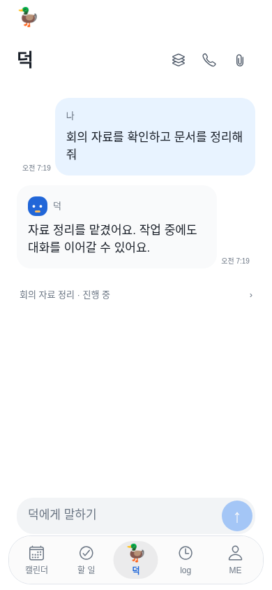
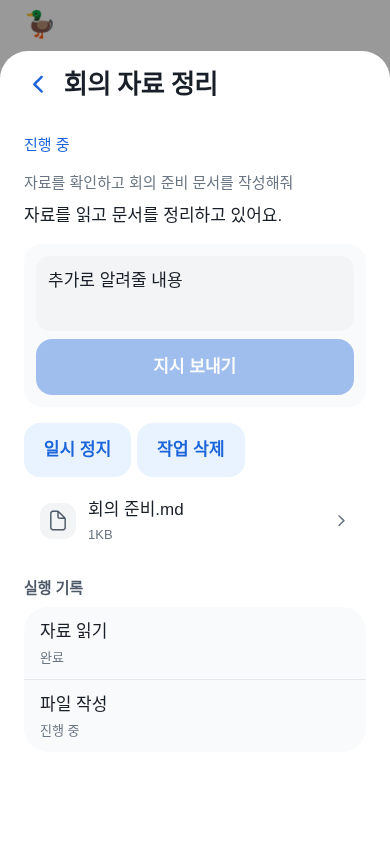
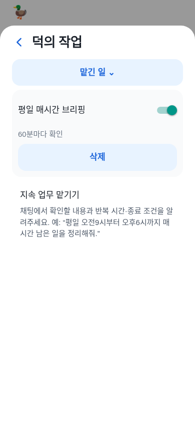
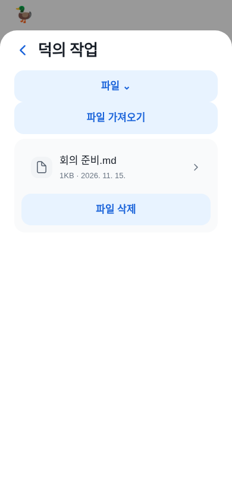

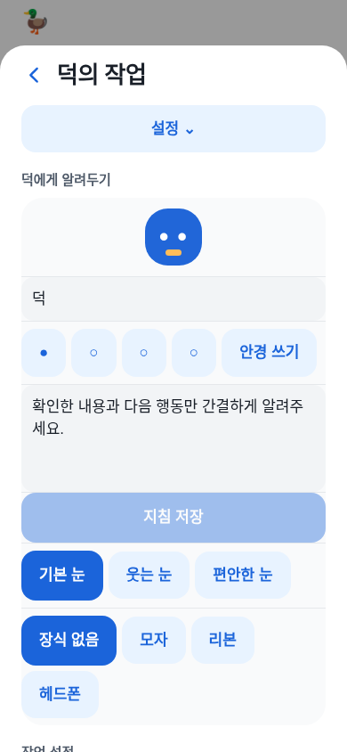
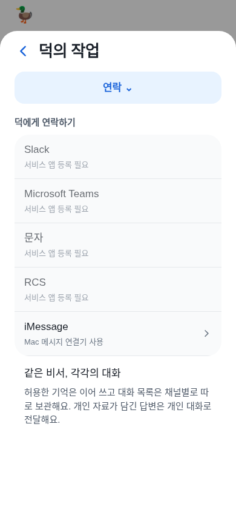
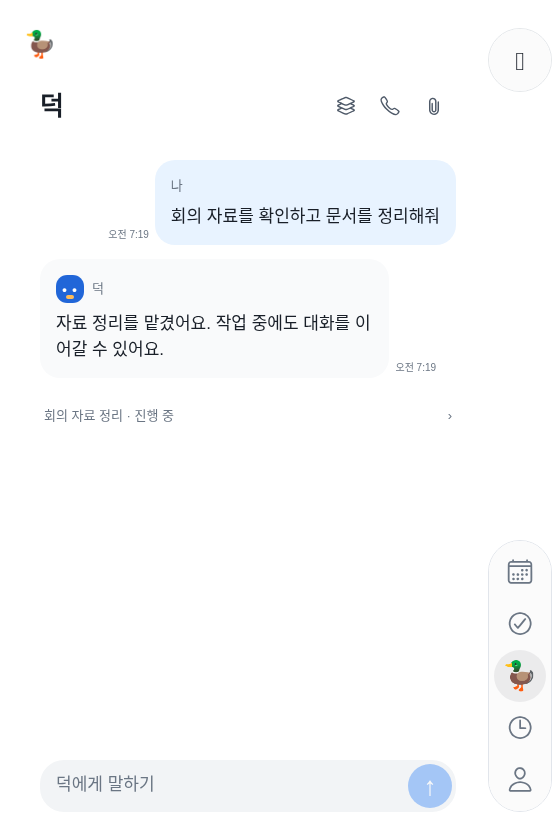
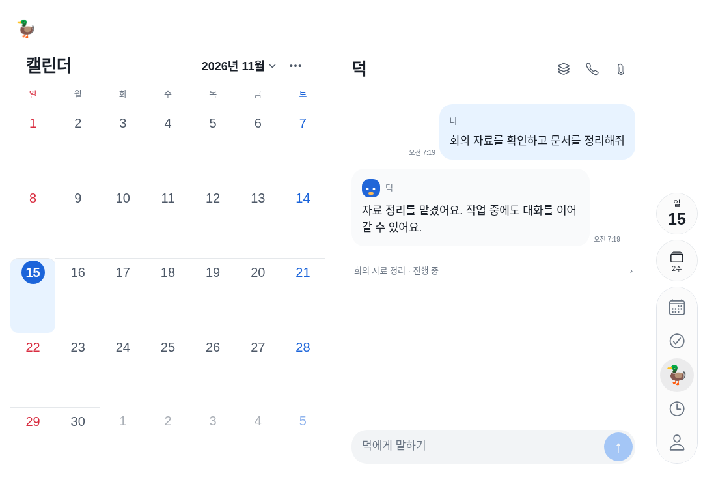
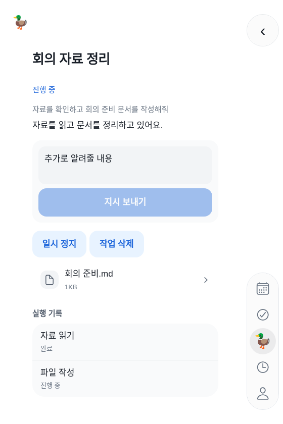
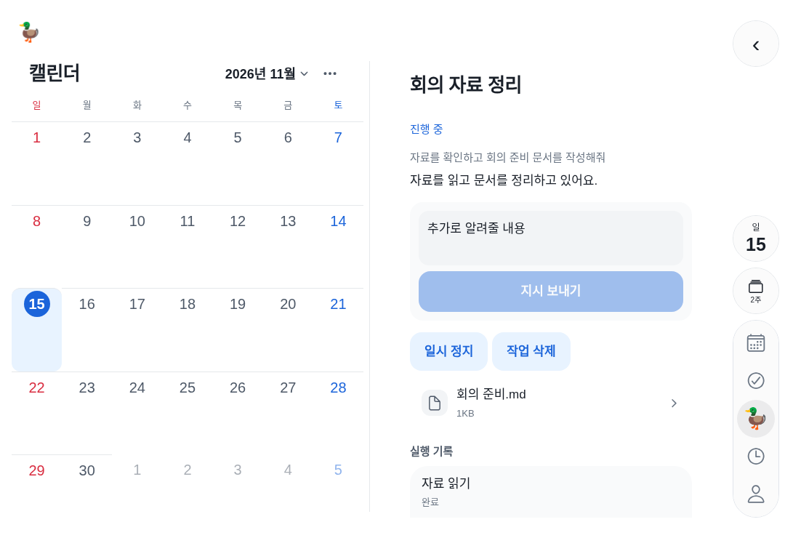

## 실제 실행기 출력

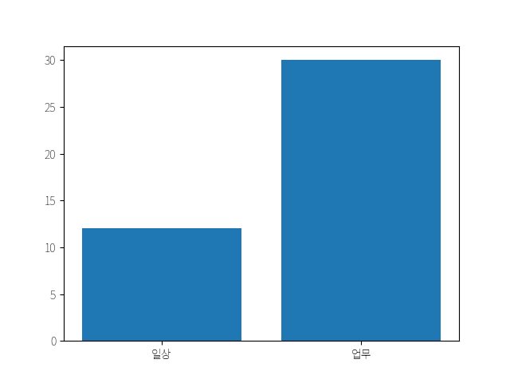

[실제 생성 Excel](../artifacts/dots-full-2026-11-15/computer/분석.xlsx) · [컴퓨터 검사 결과 JSON](../artifacts/dots-full-2026-11-15/computer/result.json) · [화면 검사 결과 JSON](../artifacts/dots-full-2026-11-15/current/result.json). Excel은 다시 읽어 합계42를 확인했다.

## 실제 계정·OS에서 남은 검수

실제 OpenAI 작업/embeddings/web/Realtime 모델 접근과 품질, 새 Slack workspace 등록/OAuth/수신/DM, Teams/Twilio sender·지역 승인, Notion/Google 실제 구독과 push, Mac iMessage/desktop·Windows/Linux desktop, iOS 마이크/Shortcuts/Widget/VoiceOver/회전·키보드는 아직 성공으로 기록할 수 없다. 필요한 코드는 구현했고 private 설정·본인 기기 권한·별도 native 빌드가 있어야 이어서 검수할 수 있다.

새 유료 자원을 만들거나 현재 사용자의 브리핑/장기 기억/외부 자동 발송을 임의로 활성화하지 않았다. 원래 복구 bundle의 SHA256은 `1b73da76ca222cff8a16d6b5a783eeed596d6930d90f05b5a9266990ad7b742d`이며 파일 자체는 변경/추가 커밋하지 않는다. 기존 native1.0.0(35)와 이번 web/server 릴리스는 다르다.
