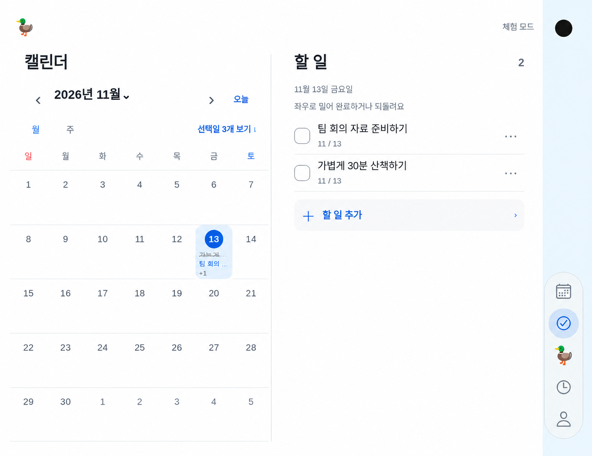

# 펼친 Duo 좌우 구분선 · 추천 시안 — 2026-11-13

**상태: 이미지 제안, 사용자 선택 전. 앱 코드·공식 토큰·빌드 미변경.** 사용자는 펼친 Duo의 좌측 캘린더/우측 선택 화면을 구분하고 싶지만 진한 선은 이질적일 수 있다며 다른 서비스의 방식을 확인하고 가장 나은 이미지 하나를 요청했다. 여러 시안 대신 추천 한 장을 생성했다.

## 확인한 공식 근거

| 출처 | 실제 확인 내용 | 덕에서 취할 점 |
|---|---|---|
| [Apple Split views](https://developer.apple.com/design/human-interface-guidelines/split-views) · [공식 Markdown](https://developer.apple.com/design/human-interface-guidelines/split-views.md) | Mail의 두 pane, Keynote의 여러 pane 사례를 설명한다. **macOS** 절은 두꺼운 선 대신 thin divider(1pt)를 권장한다. | 배경을 크게 바꾸지 않는 가는 세로선. 이 권고를 모든 iOS 서비스의 동일한 치수로 일반화하지 않는다. |
| [Material vertical divider](https://m3.material.io/components/divider/guidelines) · [supporting pane](https://m3.material.io/foundations/layout/canonical-examples/supporting-pane) | 큰 화면에서 텍스트/미디어 등을 세로선으로 나눌 수 있다. supporting pane은 주요/보조 콘텐츠의 공간을 구분한다. | 현재 두 화면 사이 gutter를 사용하고 본문·내비게이션을 재배치하지 않는다. 덕의 두 독립 화면을 일방적인 주요/보조 관계로 바꾸지 않는다. |
| [Fluent Divider](https://fluent2.microsoft.design/components/web/react/core/divider/usage) | inset 선은 컨테이너 끝까지 닿지 않으며 가까운 관계의 콘텐츠를 묶는다. 여백/제목과 함께 쓰고 장식적 구분은 스크린리더에서 숨긴다. | 위아래에 여백을 두고, 실제 조작부가 아닌 장식 선으로 취급한다. |

본문/가이드의 확인과 실제 앱 화면 실측을 구분한다. Apple 기본 HTML은 JS 안내만 반환해 공식 Markdown을 읽었다. 외부 서비스의 링크된 예시 이미지 다운로드는 환경의403으로 열지 못했고 그 화면을 직접 시각 검수했다고 기록하지 않는다. 이번 시안의 시각적 원본은 직접 열어 본 **덕의 현재 테스트 캡처**다.

## 추천: 같은 흰 표면 + 위아래 여백이 있는 연한 hairline

- 색: 기존 덕 목록 선과 맞춘 **#E5E8EB**를 제안한다. 새로운 진한 회색/검정이나 glass 벽을 만들지 않는다.
- 두께: **1 physical pixel hairline**을 제안한다. 실제 구현은 StyleSheet.hairlineWidth를 우선하며 기기 배율에 따라 pt가 다르다. 이는 Apple macOS1pt의 복사값이 아닌 덕용 제안이다.
- 위치: 왼쪽 pane의 오른쪽 끝과 오른쪽 pane의 왼쪽 시작 사이 **실제 gutter 중앙**. 화면 전체의50%나 내비게이션 옆으로 추정하지 않는다. 원본960×740 예시는 약x445이고 이 값은 기기용 상수가 아니다.
- 범위: 콘텐츠 위/아래에서 약16pt 여백을 둔다. 얇은 선 하나만 사용하고 그림자·배경색 분할·전체 테두리·드래그 손잡이를 더하지 않는다.
- 노출: native-confirmed Duo의 fullyOpen 가로 분할일 때만. 세로·접힘·일반 iPhone에는 추가 선이 없다. 기존 실제 힌지/가림 영역이 있으면 중복 선을 그리거나 그 영역을 조작부로 만들지 않도록 실제 geometry를 확인한다.
- 동작: 캘린더/오른쪽 화면이 스크롤하거나 탭이 바뀌어도 선의 위치는 고정한다. 크기 조절 기능을 뜻하지 않으며 터치를 가로채거나 스크린리더 조작 항목을 추가하지 않는다.

## 생성한 추천 이미지

Image Gen으로 기존 [확대된 덕 웹 fixture](../artifacts/duo-liquid-glass-2026-11-13/01-open-calendar-todo.png)를 편집한 **제안 이미지**다. 원본 파일은 보존했다. 글자/픽셀을 그대로 보장하는 구현 캡처가 아니며 native Apple Glass나 Duo 하드웨어 검증 결과도 아니다. 파란 카메라 열/검은 점은 원본 fixture의 위치 안내다. 새 앱 UI로 그려 넣지 않는다. 캘린더 날짜 기준은2026-11-13 금요일이다.

## 다음 작업자에게

사용자가 이 이미지를 선택하면 DuoWorkspace의 실제 pane gutter에 장식 선만 추가한다. 카메라 열/28pt 아이콘·52pt 터치·64×272 bar/250ms 선택 이동, 왼쪽 캘린더 고정·오른쪽 선택 화면, 세로 단일 화면을 보존한다. 분할/세로/접힘/단일 기기·현재 탭/월/스크롤·터치 통과·힌지/안전 영역·고대비를 검증하고 새 실제 캡처를 남긴다. 아직 이 시안으로 구현하라는 승인은 없으며 선 때문에 추가 빌드를 실행하지 않았다.
