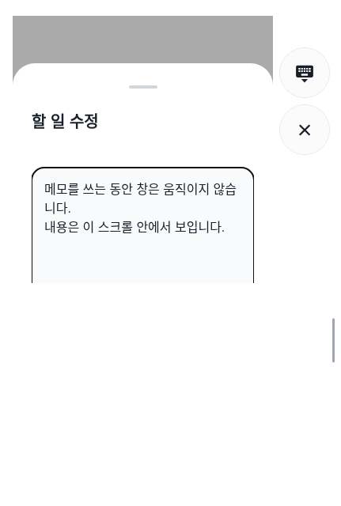
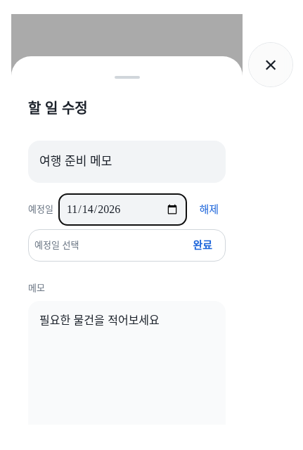
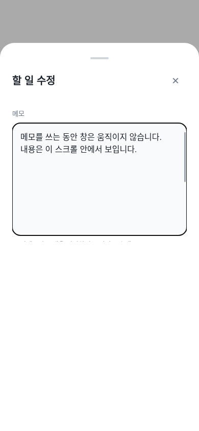
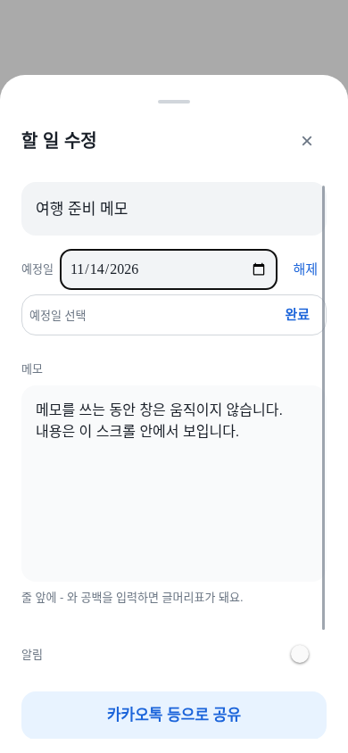
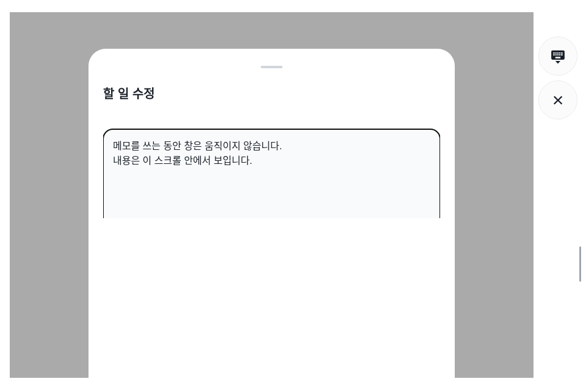
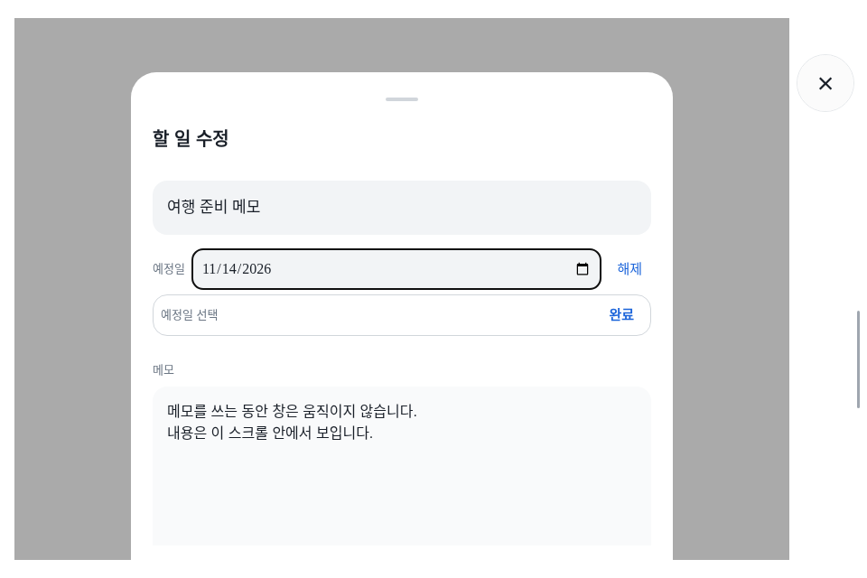
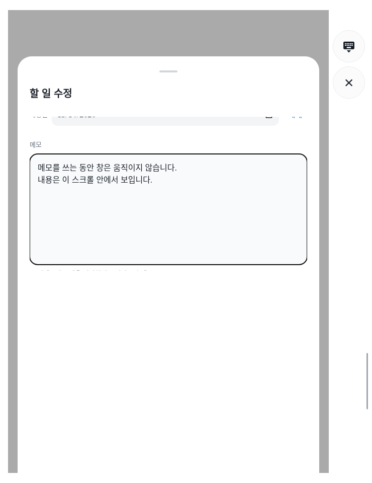
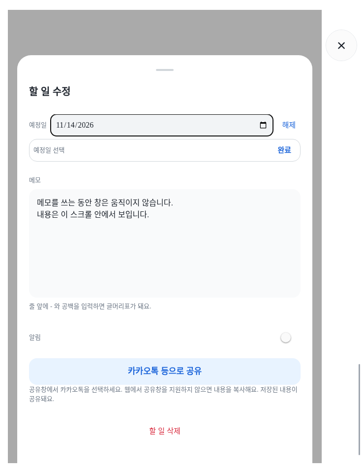
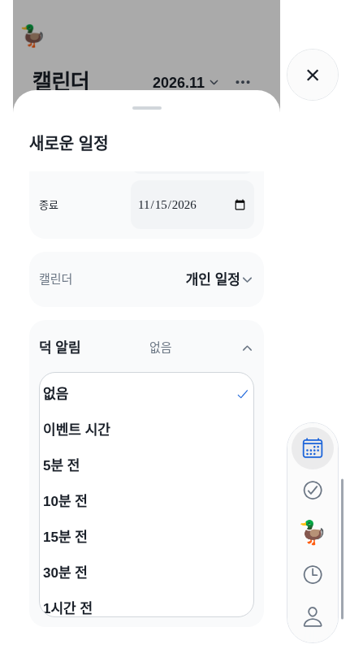
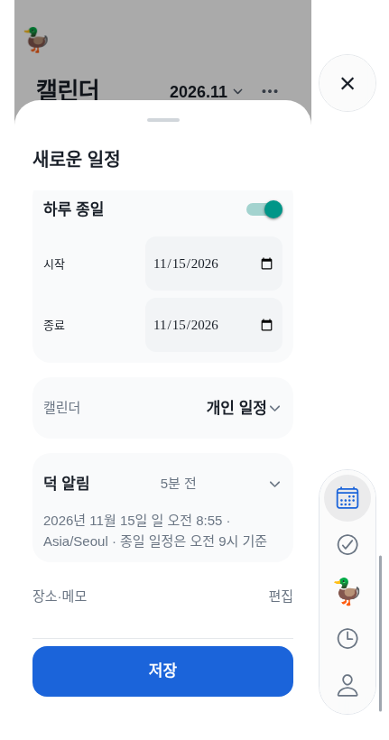

# 편집 화면 UX/UI 점검·수정 검수

**final result: blocked** — 같은 Expo 코드/합성 API·Duo 기하/키보드 가림 직접 조작은 통과했다. 실제 iOS keyboard/wheel·IME/VoiceOver·native Modal 기하를 구동할 Mac/iPhone 도구가 없어 그 검수는 남는다. 웹 캡처로 native 완료라고 하지 않는다.

## 감사 범위와 3개 흐름

이번4장 원본을 확인했고 현재 실행의 baseline을 /tmp/editor-viewport-baseline에 새로 캡처해 열었다. 과거 저장된 화면을 새 감사 근거로 사용하지 않는다. 원본의 개인정보는 공개하지 않는다. 같은 폼/기하를 구동해 수정 후10장을 새로 캡처·확인했다. screenshot3의 실제 UIKit wheel은 직접 캡처할 수 없고, 그 부분은 명시적 blocker다.

1. **닫기 버튼과 오른쪽 정렬 — 수정 후 합성 검수 정상.** 전에는 X 대신 keyboard-close가 보여 편집 닫기와 키보드 닫기가 섞였다(P1). 이제 키보드 위/X 아래의 독립 버튼이며 닫기 후 메모 유지/화면닫기0, X를 누르면 원래 close callback이 실행됨을 별도로 검수했다. 카메라 열의 두 원/캡슐/5개 아이콘 중심선 차이1px 미만을 측정했다. 1번의 정렬 대상 질문은 아직 답변 대기다. 하드웨어 정보는 합성이고 실제 native 광학 정렬을 확인했다고 하지 않는다.
2. **알림 선택 — 수정 후 합성 검수 정상.** 옵션마다 같은 날짜/시간이 반복돼 읽기 길이를 늘리고 선택 영역을 가렸다(P2). 반복 부제는 없애고 선택 결과 한 번의 정확한 시각은 보존했다. popup 외곽이 editor viewport 안에 들어오도록 scroll했고 Save는 선택 중0개다. 긴 옵션은 popup 자체의 내부 스크롤로 선택하며 실제 권한 동작/원본 저장은 바꾸지 않았다.
3. **날짜·메모 입력 — 수정 후 합성 검수 정상, native 확인 대기.** picker 확장을 부모 scroll에 알리지 않아 하단이 잘렸고, Todo sheet 높이를 입력 중 바꾸고 있었다(P1). 이제 일반폰/접힘/펼친 가로·세로에서 키보드 겹침을 주입해도 sheet의 y·height 차이1px 미만, scroll viewport의 끝이 keyboardTop 이하, 실제 첫 작성 줄이 viewport 안, 저장0개임을 확인했다. 날짜는 native의216pt 휠+44pt Done 전체 크기를 DOM 기하로만 모델링해 측정했다. 모델은 screenshot 전에 제거했으며 native 휠 그림을 만든 것이 아니다. 물리적으로 큰 입력은 첫 부분/스크롤을 사용한다. 실제 keyboard animation/긴 한글 caret은 새 앱에서 검수한다.

## 검사와 경계

전체314 중313통과·실패0·기존 선택1제외. 새3검사는 선택기/초점 reveal offset과 큰 영역 처리, Duo의 독립44pt 이상 슬롯·하드웨어 회피/카메라 중심/탭 비겹침을 확인했다. 타입·50문법·Expo web/iOS JS export, 전체앱·기존 interaction-repair 회귀를 통과했다. 실제 원본 캘린더 쓰기는0이며 합성 쓰기/캐시 회귀와 운영 Google은 구분한다. 새 editor-viewport fixture는 쓰기0/오류0이다.

기존 전체앱 회귀가 재생성한24개 캡처는 그 실행 코드의 정확한 파일 목록과 대조한 뒤 원래 증거로 복원했다. 새 증거10장/verification만 남겼다. 화면마다44pt 조작영역과 접근성 이름이 있으며 화면만으로 WCAG/VoiceOver 완료를 주장하지 않는다. 사용자 실행35의 빌드/서명/Apple 업로드 성공은 확인했지만 이번 코드는35에 없으며 이번에 추가native빌드는 하지 않았다.

## 실제 Expo 웹 화면 — native 키보드/휠을 그리지 않은 합성 자료

