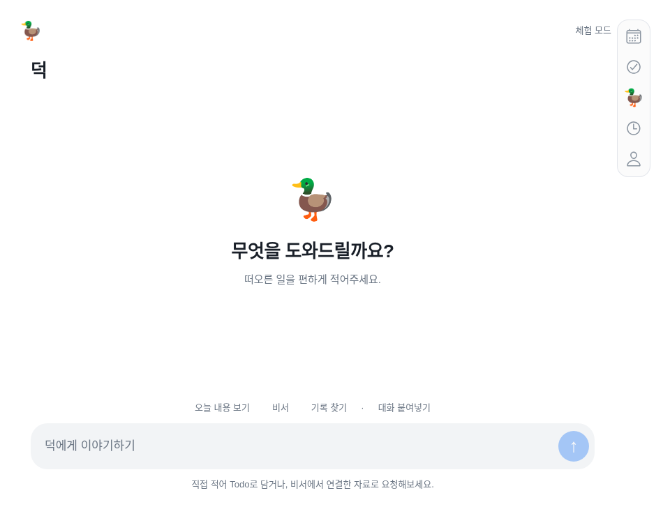

# 덕 기능 가동과 Duo 수정 — 2026-11-13

## 2026-11-13 승인 시안 반영 — 카메라 열과 두 화면

Duo는 본문 안쪽 오른쪽이 아니라 **물리 카메라가 있는 맨 오른쪽 열**에 내비게이션을 둔다. 접힘·펼침 모두 그 열 아래에 세로5개 탭, 카메라/상태 표시 아래에는 실제 복귀·닫기 경로에서만 원형 ‹를 표시한다. 상·하 안전 여백8pt,48×226pt 묶음·44pt 조작을 유지한다. 펼친 가로 화면은 왼쪽 캘린더 고정·오른쪽 최초 Todo이며 탭 선택은 오른쪽만 바꾼다. 펼친 세로 화면과 접힌 화면은 선택 중인 화면 하나를 본문 전체에 표시한다. 회전·접힘 시 현재 탭·입력·편집·캘린더 월·스크롤을 보존한다. 일반 iPhone은 기존 하단 탭이다.

이 기준이 아래 이전 가로 탭·본문 안쪽 세로 탭·64pt 보호 padding·단일 본문 정책보다 우선한다. 사용자가 승인한 그림에서 파란 열과 검은 카메라 점은 **위치 확인용 안내 표시**이며 앱에 그려 넣지 않는다. [최신 구현·미리보기·검수](https://github.com/thepmpo/donknow/blob/main/docs/iphone-duo-support.md).

## 이번에 바뀐 기능

| 항목 | 구현·검증 | 실제 가동 경계 |
|---|---|---|
| Duo | 본문 밖 실제 카메라 열·아래 세로5개·위 실제 복귀 원형 ‹. 펼친 가로 Calendar 고정/오른쪽 Todo·선택 탭, 세로 현재 화면 하나 | 힌지 상태·기하 모의 검증. 새 네이티브 빌드·실기기·키보드 검수는 별도 |
| 브리핑 | 시간·시간대·자료·반복 AI 동의를 저장하고 예약 메시지를 덕 채팅에 전달 | 기본 꺼짐. 사용자 설정/실모델·실예약 수신 확인 필요 |
| 날씨 | 브리핑에 포함하거나 별도 시각·도시로 예약, AI 없이도 단독 사용 | 실제 날씨 장애는 실패로 안내 |
| 휴대폰 도착 알림 | OS 허용·Expo 기기 연결·세션에 묶인 큐·일반 안내·탭 시 덕 열기 | APNs/Expo 연결·새 iOS 빌드·기기 수신은 별도 |
| 네이버 | 읽기 연결을 SMTP 검증과 분리. 읽음 변경·메일 발송을 별도 선택, 제한된 서버에서는 발송 차단 | Render Free SMTP465/587 차단. 실제 계정 읽기·읽음 변경은 앱 비밀번호/IMAP 허용 후 검증 |
| Google/Notion/Slack 쓰기 | 기존 확인·원본 변경 경계 유지, 관련 API/회귀 검사 | OAuth 재승인·앱 설정·대상 공유/채널 접근 필요 |
| 로그인·백업 | 새 메시지/기기/예약도 계정별 분리·내보내기·삭제·복원 보호에 포함 | 운영 DB를 덮거나 키를 재생성하지 않음 |

자세한 동작·보안·검수: [예약 브리핑·날씨](scheduled-messages-2026-11-13.md) · [Duo 최신 배치](iphone-duo-support.md).

## 네이버 메일에서 추가로 확인한 실제 제약

[Render 공식 무료 서비스 문서](https://render.com/docs/free)는 무료 인스턴스에서 SMTP포트25·465·587의 외부 통신을 차단한다고 명시한다. 기존 코드는 연결할 때 IMAP 다음 SMTP까지 확인해, 읽기만 하려는 사용자도 연결하지 못할 수 있었다.

새 연결은 기본 읽기이며 **읽음 상태 변경 허용**과 **메일 발송·답장 허용**을 나눈다. 읽기/읽음 변경은SMTP를 호출하지 않는다. 발송을 선택한 경우에만 SMTP를 확인한다. 제한된 서버에서는 선택/미리보기 단계에서 쉬운 오류로 멈추고, 되지 않는 발송을 완료로 표시하지 않는다. 오래된 mailWrite 연결 기록은 권한 호환을 유지하지만 현재 호스트의 SMTP제한은 적용한다.

현재 Render Free에는 공개 가능한 비밀 아닌 `NAVER_MAIL_ENABLED=true`, `NAVER_SMTP_ENABLED=false`만 병합 반영한다. 기존 DB·암호화 키·OAuth·AI 키 값은 읽거나 바꾸지 않는다. Blueprint와 실제 설정이 일치하도록 기록하며 서비스 환경 변수 전체를 교체하지 않는다. 실제 반영 성공은 배포 후 확인한다.

**네이버 발송 코드는 있지만 현재 무료 호스트에서는 가동할 수 없다.** SMTP가 허용되는 호스트로 옮기거나 다른 발송 경로를 합의해야 한다. 유료 전환·새 서비스 생성·메일 실제 발송을 임의 실행하지 않는다. Naver 계정 앱 비밀번호도 채팅에 요청하지 않는다.

## 설치·외부 계정에서 남는 확인

- Google: 덕 내정보 → Google → 추가 읽기·쓰기 권한 → 필요한 것만 선택 → 연결 권한 다시 선택 → 공식 승인.
- Notion: 같은 방식으로 콘텐츠 쓰기 재승인과 대상 페이지 공유. 이 채팅의 문서용 Notion 연결과 다르다.
- Slack: [manifest](../tools/integrations/slack-app-manifest.json)로 앱 설정·설치, 서버의OAuth 설정과chat:write·채널 접근. 현재 실제 설정 유무는 배포 확인에 기록한다.
- 네이버: 덕 도구 → 비서 → 네이버 메일 연결 설정. 공식 IMAP 허용·앱 비밀번호를 앱에 직접 입력하고, 읽음 변경은 필요할 때만 선택. SMTP 제한은 위와 같다.
- 아이폰: 미리 알림·알림 허용, 도착 알림 기기 연결. 최신 코드가 설치되려면 TestFlight 수동 빌드가 필요하다. 이전 바이너리가 자동으로 바뀌지 않는다.
- 실기기: Duo 두 상태·회전·safe area·시트·키보드·큰 글자·VoiceOver와 실제 예약/푸시 수신을 확인한다.

출시 준비는 마지막이다. 이번 push는 코드 품질 검사만 수행하고 EAS 빌드/심사/공개를 자동 요청하지 않는다.

## 실제 로컬 검증

구현 [8e512cf](https://github.com/thepmpo/donknow/commit/8e512cf22a0be9e82ddf0d16faee08beceb1bd8f)를 검증했다. 루트219개 중218통과·실패0·기존 선택1개 제외,44개 문법·모바일 타입·웹/iOS JS 출력·전체 앱·예약UI·채팅/오류·모션·계정 격리·Duo 상단 탭·복원 보호를 확인했다. 실제 모델·푸시·외부 쓰기는 모의이며 운영 계정 원본을 변경하지 않았다. GitHub/Render/예약 실행 결과는 공개 반영 후 별도로 기록한다.

연결 검증 보완: 수동gh 실행은 환경의GitHub API CONNECT403에 막혀 전용 실행기 변경 시 자동 연결 검사를 추가했다. 서버protocol2 대기 후 짧은 OIDC를 받아 동일한 보호 endpoint를 확인하며, 서명/저장소ID/main/전용workflow 제한을 유지한다. EAS를 호출하지 않는다.

### 공개 서버·예약 실행기 확인 — 2026-11-13 10:06 KST

main `e7e0ea2`를 일반 push했고 [자동 검사43341877783](https://github.com/thepmpo/donknow/actions/runs/43341877783)가 성공했다. Render 배포 `dep-dbr64qdbedkc73cl5ilg`는10:06:11 KST에 live이며 공개 health 정상, `schedulerProtocol:2`, `scheduledMessages:true`, 네이버 읽기 활성/발송 비활성, 새 `/project`와 `/design-guide`를 확인했다.

[예약 실행기43341877727](https://github.com/thepmpo/donknow/actions/runs/43341877727)의 첫 시도는 배포 전 시작되어 서버 대기180초를 소진했다. 서버 live 후 실패 작업만 재실행해10:06:50 KST에 `{"ok":true,"processed":0}`으로 성공했다. 이는 실제 GitHub OIDC→서버 인증 경로 확인이다. 처리0건을 사용자의 실모델 브리핑 생성·예약 수신·아이폰 푸시 성공으로 해석하지 않는다. 정확한 분 단위 전달은 무료 서버/GitHub 지연으로 보장하지 않는다. 새 TestFlight/EAS 빌드는 요청하지 않았다.

## 2026-11-13 — 네이버 읽기 전용 확정·아이폰 빌드16 요청

사용자 결정으로 네이버는 **받은 메일 읽기 전용**을 유지한다. `NAVER_READ_ONLY=true`를 기존 무료 서버에 병합하고 Blueprint에도 같은 비밀 아닌 값을 기록한다. 읽음 상태 변경·발송·답장을 연결 설정·서버 미리보기/실행·AI/수동 카탈로그에서 막는다. 예전에 저장된 `mailWrite` 권한이나 준비한 실행 초안도 제한을 우회할 수 없으며, 기존 인증·메일 계정·자료를 삭제하거나 다시 저장하지 않는다. 최신 UI는 쓰기 선택을 숨긴다. 기존 설치 앱에 선택칸이 보여도 서버에서 차단되므로 꺼두고 읽기만 연결한다.

[사용자 수동 실행43345083809](https://github.com/thepmpo/donknow/actions/runs/43345083809)는 소스57aee29의 검사 후 **아이폰 빌드16** 요청·자동 제출 예약 접수를 완료했다. [EAS 빌드](https://expo.dev/accounts/thepmpo/projects/duckduck-donknow/builds/f2dcece3-7540-4407-b02a-5019579976dd), [제출](https://expo.dev/accounts/thepmpo/projects/duckduck-donknow/submissions/a92f2559-01cd-4ca5-8b98-165299799d45). 실제 IPA·Apple 처리·설치는 아직 확인 전이다. 공개 EAS URL은 로그인 없이 정상 상태를 확인하지 못했으므로 실패/완료로 단정하지 않는다. 읽기 전용은 서버 정책으로 이 빌드에도 적용하고, 새 UI만을 위해 추가 EAS 빌드를 요청하지 않는다.

웹·서버 변경은 일반 배포로 반영하며, 설치 앱 코드가 바뀌어 새 아이폰 버전을 테스트할 때만 수동 TestFlight 빌드가 필요하다. 지금 사용자가 버튼을 누른 이유는 작업 환경의 GitHub API 요청 제한이며 매 업무마다 빌드할 필요가 없다. push 자동 EAS 빌드는 계속 꺼둔다. Google·Notion은 설치 후 본인 권한 승인→읽기→시험용 항목/페이지 작성·수정까지 최종 테스트에 포함한다.

[공식 Render 가격](https://render.com/pricing)의 최소 유료 웹 서버는월 US$7부터이며 세금·초과 사용료는 별도다. 네이버 발송을 쓰지 않으므로 무료 플랜을 유지하고 결제·마이그레이션을 실행하지 않는다.

검증: 전체221개 중220통과·실패0·기존 선택1개 제외, 문법·모바일 타입·웹/iOS JS 출력·네이버 전용 읽기 UI·기존 채팅을 통과했다. 전용 회귀에서 이전 인증/권한 보존·읽기 가능·원본 변경0·기존 초안 차단·쓰기 선택 제거·앱 비밀번호 초기화를 확인했다. 이 검사는 모의 계정/공급자이며 운영 네이버 계정 접속 성공과 다르다. 실제 공개 정책 적용은 배포 후 확인한다.

## 2026-11-13 최종 정정 — Duo 오른쪽 세로 배열

사용자의 **“세로배열”** 지시가 최종 기준이다. 이전에 ‘배터리 아래’를 헤더 안의 가로 탭으로 해석한 것은 구현자의 오해다. Duo는 **접힘·펼침 모두 화면 오른쪽 가장자리, 시스템 배터리/상태 표시 아래에서 시작하는 세로5개 탭**이다. 일반 iPhone은 하단 가로 탭을 유지한다.

현재 `DuoTrailingNavigation`은48×226pt의 짧은 세로 묶음이며 각 탭은44×44pt다. 오른쪽·위 안전 영역에서8pt를 띄우고, 헤더 행 밖에서 배치한다. 전체 높이의 별도 패널이나76pt 넓은 rail을 만들지 않는다. 본문 표면은 전체 안전 폭을 유지하되 조작부에는64pt 오른쪽 보호 padding을 적용해 버튼·입력·오류 안내를 가리지 않는다. 높이가 부족하면 탭을44pt보다 줄이지 않고 세로 스크롤로 마지막 탭까지 접근한다. 숫자는 UI 치수이며 기기 판별 조건이 아니다.

공유 `layout` 토큰과 실제 AppNavigation/Shell을 수정했다. 접힘·펼침·책·테이블·320px·짧은 높이·일반 기기 전환에서 세로 열·오른쪽 위치·44pt·짧은 묶음·중복 하단 없음, 입력·현재 탭·편집·스크롤·자식 유지와 마지막 탭 접근을 검사했다. 전체221개 중220통과·실패0·기존 선택1개 제외, 문법·타입·웹/iOS JS·전체 앱 회귀를 통과했다. 캡처는 실제 앱 컴포넌트의 격리된 기하/체험 데이터이며 Swift 빌드·실기기 결과는 아니다.

소스 `5c1ae41`. **기존 빌드16은57aee29로 요청돼 이 세로 수정이 들어 있지 않다.** 웹 배포가 기존 TestFlight 바이너리를 바꾸지 않으며, 아이폰 반영에는 최신 main의 새 수동 빌드가 필요하다. 자동 빌드·유료 전환·기존 인증/데이터 변경은 하지 않는다. 아래 이전226×48 가로/기존 헤더 배치 기록은 폐기된 해석으로 읽는다.

## 2026-11-13 추가 정정 — 오른쪽 세로 묶음은 아래, 원형 뒤로가기는 위

사용자는 **하단 가로 내비게이션으로 바꾸라는 뜻이 아니라 지금 오른쪽의 세로5개 묶음을 그대로 아래로 내리라**고 정정했다. 접힘·펼침 모두 세로 배열을 유지하며 아래 안전 영역에서8pt를 띄운다. 배터리/상태 표시 아래의 상단8pt에는 **원 안의 ‹ 뒤로가기**를 별도로 두며 실제 돌아갈 화면/시트가 있을 때만 나타난다. 루트 탭을 바꾸기만 했다고 임의의 뒤로가기 기록을 만들지 않는다.

`DuoBackNavigation`이 안전 영역별 실제 돌아가기/닫기 콜백을 등록·해제한다. 상세/연결/계정 화면과 닫기 조작을 연결하고, 돌아오거나 닫히면 버튼이 사라진다. 저장·연결 중 기존 비활성 조건을 보존한다. 각 모달은 자체 안전 좌표와 콜백을 사용한다. 세로 탭은48×226pt·44pt 조작을 유지하고, 짧은 높이에서는 위 원형 버튼과 겹치지 않게 세로 스크롤한다. 본문 조작 보호를 유지하고 채팅 입력의 최소 폭을 풀어 아래 탭이 보내기 버튼을 가리지 않게 했다. 일반 iPhone의 하단/돌아가기/닫기 위치는 유지한다.

소스 `87849a2`. Duo 전환·동일한 위/아래8pt·세로 열·원형 경계·루트 숨김·상세 진입/복귀 시 표시/해제·비활성 보호·짧은 높이 마지막 탭 접근·실제 채팅 보내기 비가림·초안 유지 검사를 통과했다. 전체221개 중220통과·기존 선택1개 제외, 문법·타입·웹/iOS JS·전체 앱·채팅·오류 회귀를 통과했다. 캡처는 격리 웹 미리보기이며 실제 Duo/Swift/키보드 검수는 별도다. 빌드16은 이전57aee29이므로 새 설치 앱에는 최신 main의 수동 빌드가 필요하다. 추가 EAS 빌드를 요청하지 않았다. 이전의 위쪽 세로 배치 설명은 이 정정 이전 기록이다.
