# 채팅·키보드·달력 반응 점검

**final result: blocked** — 구현의 실제 Expo/합성 API·Duo 기하/키보드 가림 검사 통과. 새 native의 실제 키보드·한글/VoiceOver/Keychain 재실행·FPS 검수가 남아 전체 실기기 완료라고 하지 않는다.

## 이번 근거와 4개 흐름

사용자 첨부 영상4.771667초·1398×2034·60fps와 JPG2개를 확인했다. 이번 작업에서 실제 프레임을 추출하고1.6초 화면 및 시간순 contact sheet를 열었다. 관찰은 월 전환 중 요일이 옆으로 이동하고, 큰 완료 pill이 composer와 겹치며, 제목 입력 중 sheet 아래에 달력/저장이 드러나는 상태다. 영상만으로 native 프레임 지연이나 서버 지연의 원인을 수치화하지 않는다. 이전1번 선택 시안은 별도로 열어 확인했다.

1. **대화 작성** — 시각과 마지막 내용이 부족했다. 현재01~05에서 시각/마지막 줄·입력 중 focus/높이 변경/일반폰·접힘·펼친 가로/세로를 검수했다. 입력 내용을 남기고 keyboard-close는 추가 AI/쓰기 요청0이다.
2. **일정 입력** — 제목을 누르면 저장/배경이 공간을 차지했다.07~08·11~13에서 가용 영역을 덮는 sheet, keyboard 동안 저장/일반 탭 숨김, 확장한 장소·메모의 초점/스크롤을 검수했다. 다른 pane와 카메라 열을 보존한다. 실제 OS 키보드는 그리지 않고 occlusion과 viewport를 주입했다.
3. **일정 표시** — 진입/확인된 생성에 네트워크 완료를 기다리던 지점을 고쳤다.06·09·14는 prefetch/보존, 실제 확인된 create 후 GET을 고의로 지연해도 표시됨, 페이지상 임시/원본 ID 중복0, 다른 pane의 생성 전 GET이 늦게 도착해도 새 일정이 두 pane에서 유지됨을 확인한다. fixture 쓰기2회이며 운영 Google 쓰기를 하지 않았다.
4. **월 이동** — 요일은 고정, 날짜 두 페이지는 항상 pane폭 간격이다.10a에서 손가락 이동 중 인접 월이 먼저 보이고,10/verification frames에서 이후 정착과 선·요일 위치를 확인한다. native FPS/손가락 지연 검수가 아니다. 월의 실제 주수, 날짜 선택·연간 전환·일/주/목록은 유지한다.

원본+실제 렌더를 `/tmp/duck-interaction-review`의 비교 입력에 나란히 놓고 점검했다. 비교는 해당 composer/편집·요일 고정의 범위다. 원본은 OS 키보드/하드웨어 표시를 포함하며 Expo 웹에는 없으므로 전체 이미지가 픽셀 일치한다고 주장하지 않는다. 공개 이미지에는 사용자 원본·개인 일정/이메일을 넣지 않는다.

## 검사 결과

전체311개 중310통과·실패0·기존 선택1제외. 새 저장 검사5개는 표시 snapshot의 권한/ETag·메모 제외, 서버/계정/Unicode owner 격리, chunk 실패 때 이전 정상 manifest 보존, 로그아웃/queued write 삭제, 기간 한도/누락 chunk 거절을 확인했다. native 암호화 저장소 자체를 실행한 검사는 아니다.

문법50·TypeScript·web/iOS JS export를 통과했다. 신규 interaction-repair, 기존 전체앱·AI 채팅/오류·체크카드·Duo/캘린더 캐시 회귀를 확인한다. prefetch가 시작되므로 예전 AI 오류 fixture에는 capabilities GET을 추가했다. 긴 답변은 위 제목 강제 노출 대신 마지막 답변/체크카드가 보이는 계약으로 assertion을 갱신했다. 오류·세션/동의·재시도 검사는 약화하지 않았다.

현재 캡처16장이다. 캘린더 쓰기 권한이 없을 때도 새 초안 작성은 되고 저장은 비활성화/쓰기0인 상태를 추가로 확인했다. 일·주·월 전환의 날짜 칸1/7/35개도 새 fixture에서 확인했다.

## 현재 화면 — 실제 Expo / 합성 자료 / native 아님

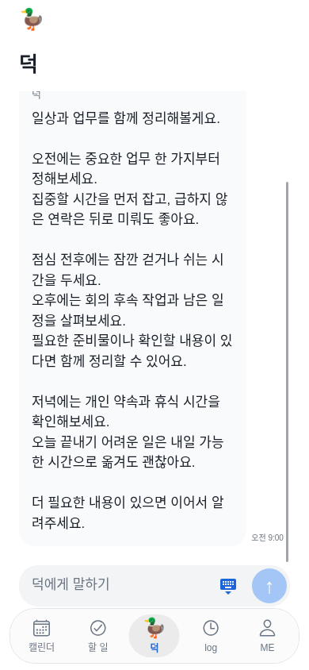

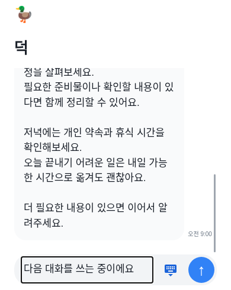

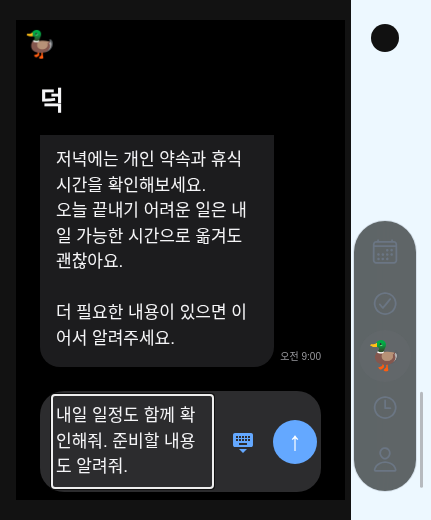

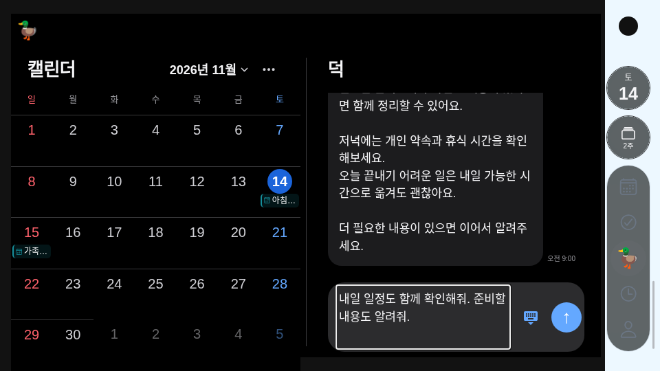

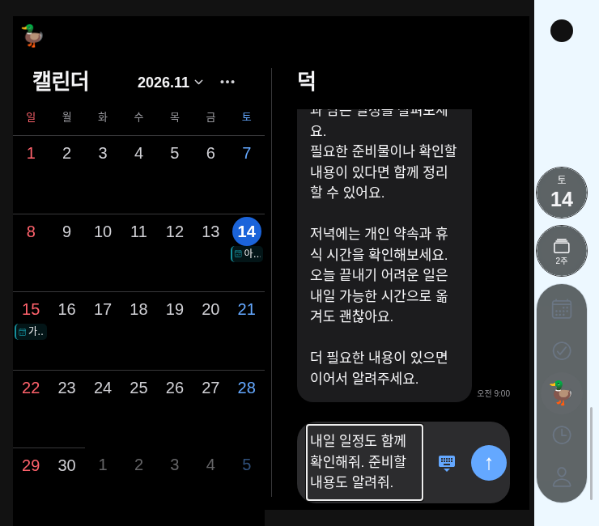

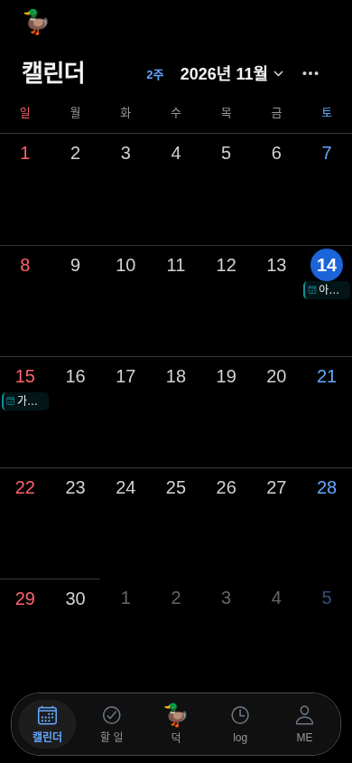

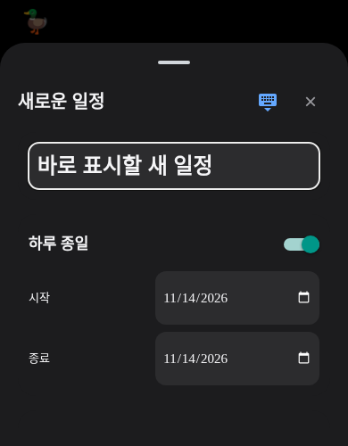

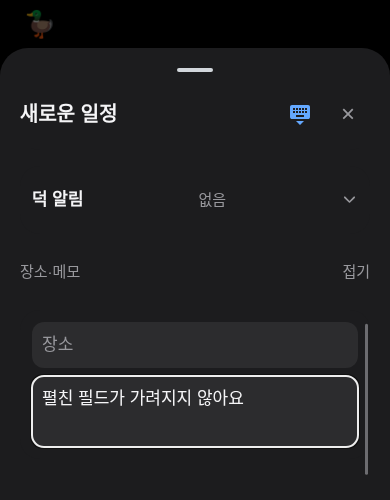

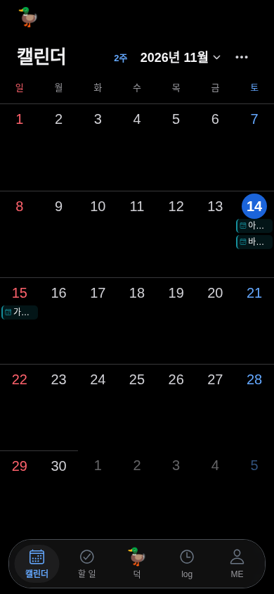

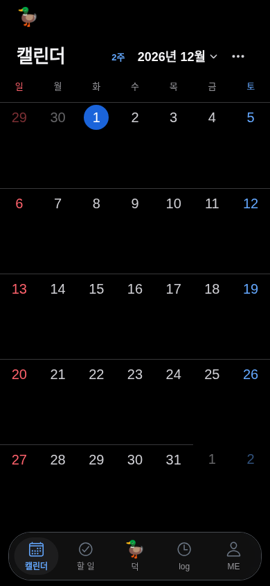

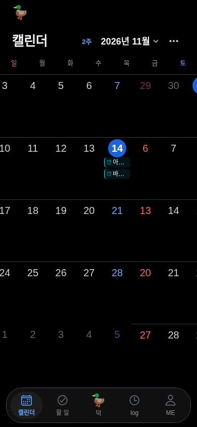

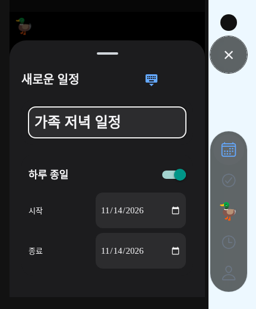

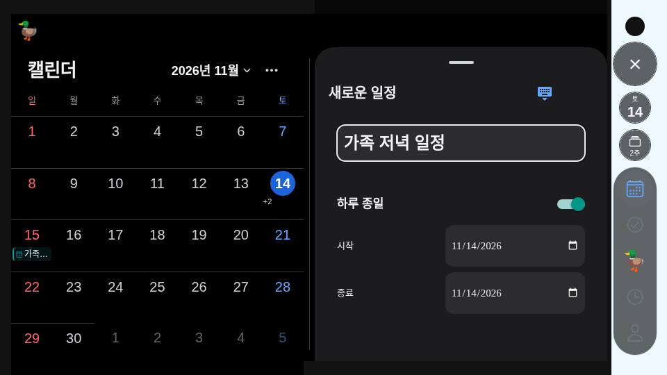

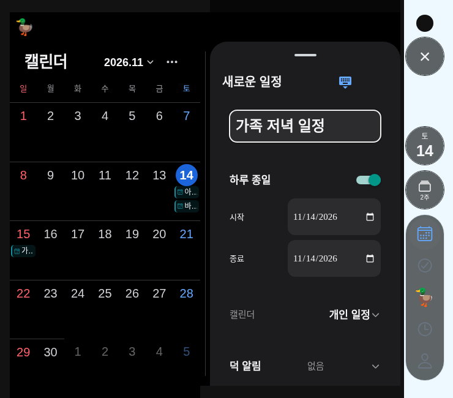

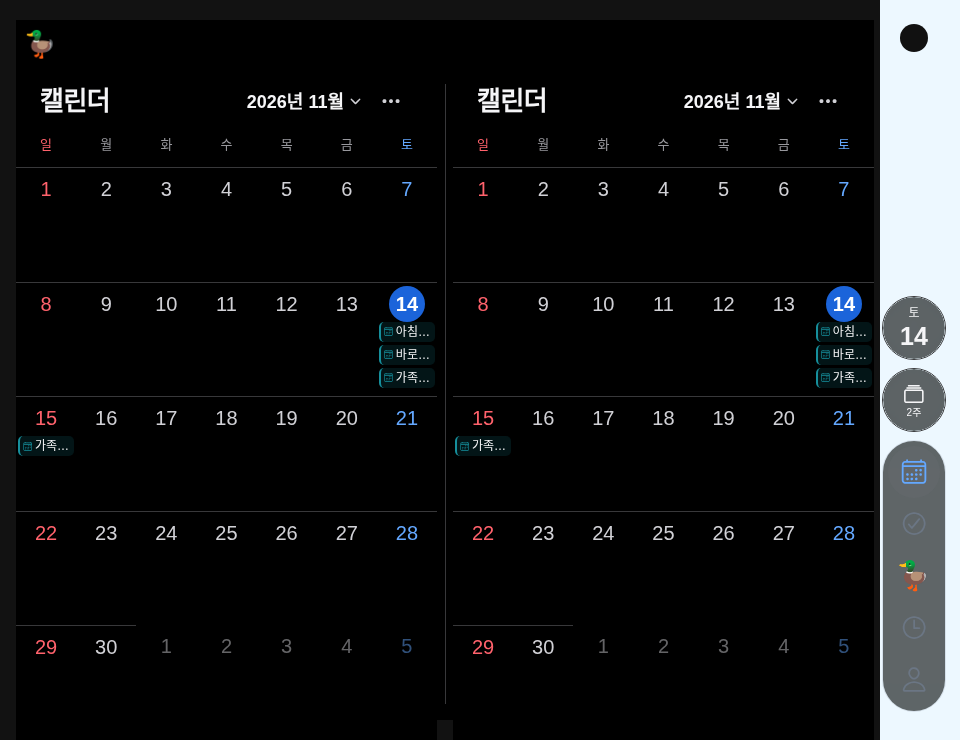

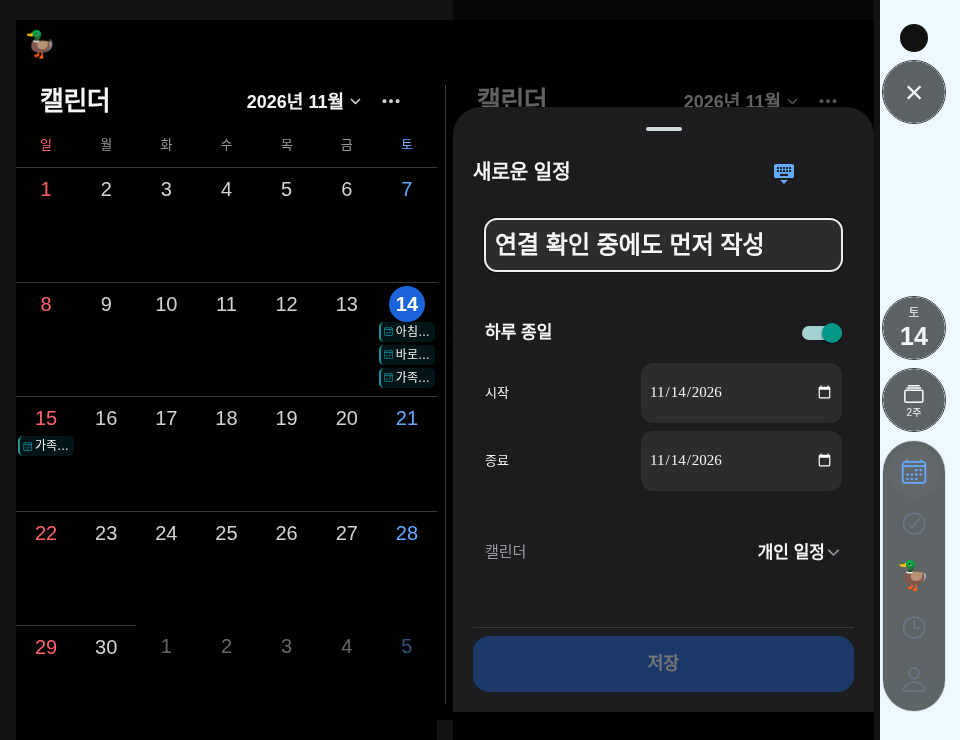
