# Apple iPhone Duo 대응 · 2026-11-12

## 최신 후속 정정 — 화면 채우기·버튼 순서·캐시

[현재 캘린더 계약](calendar-viewport-2026-11-13.md)이 아래의 이전42일/92pt·월 세로 스크롤·Today 바로 위 보기 버튼 규칙보다 우선한다. 월/2주는 필요한 주만 실측높이로 채우고, 제목 아래추가24pt를 없애 Todo 날짜 줄과 요일 줄 시작선을 맞춘다. 카메라열Today가 위·2주보기아래·기존5탭/Back/Glass·pane/상태는 유지한다. 일반폰은 제목옆2주/년월메뉴Today·하단탭이다. 기존 일정은 계정/서버/시간대별 메모리12기간에서 먼저 표시하고 출처별로 갱신한다. 실기기/실계정과 새native설치는 별도다.


## 2026-11-13 — 첨부 Apple 캘린더·시스템 외형 정정

[현재 구현 계약](calendar-apple-reference-2026-11-13.md). 사용자 답변으로 년·월은 캘린더 본문 우상단, 오늘은 물리 카메라 열의 세로 탭 바로 위 독립 원형, 밝게·어둡게는 시스템 설정으로 확정했다. 기존 light 고정·큰 2단 toolbar·월 화면 상시 agenda/무조건6주 화면 안 맞추기 규칙은 이 부분에서 대체한다.

월42일은 보존하고 최소92pt 주 높이·내부 세로 스크롤·일정 직접 탭·색상 출처·인접 월 옅은 날짜를 적용했다. 큰 제목·출처 세로선·그룹 옵션의 상세, 왼쪽 목록 정렬, iOS DynamicColorIOS/웹 media 변수·Glass scheme·일반 시트의 semantic 배경을 반영했다. Today와 세로 탭/뒤로가기의 안전 좌표·오른쪽 활성 Calendar 우선·fold/rotation/초안을 보존한다. 알림/삭제는 지원하는 Google 원본 경로를 안내하고 가짜 동작을 만들지 않는다.

Calendar body timeout 원인 보존·GET60초/비JSON 최대1회 복구·잘못된200을 빈 일정 성공으로 처리하지 않기·실패 source 캐시 보존·JSON 직렬화 전 성공 헤더 금지를 수정했다. 실제 사용자 계정 오류 원인은 아직 재현하지 못했으며 공개 상태/fixture 개선과 구분한다. 쓰기/확인은 자동 재실행하지 않는다.

단위247개 중246통과·실패0·기존 선택1제외를 확인했고, 타입·웹/격리 Calendar·Duo·전체 앱/로그인·모션·예약·iOS JS 및 공개 문서 회귀의 최종 영수증은 계약/검수 문서에 남긴다. 새 화면은 합성 데이터 웹 캡처다. **25번 앱에는 이번 수정이 없고 새 TestFlight를 자동 실행하지 않았다.** 데이터/인증·서명·무료 플랜·원본bundle·AI사무실 보류는 유지한다.

> **현재 구현 기준:** [전체 이어받기 기준서](continuation-guide.md) → [Liquid Glass 상태·수치·검수](liquid-glass-navigation.md). 아래 날짜별 기록은 당시 이력입니다. 일반 iPhone 하단 capsule·상태별 터치 동작, Duo 카메라 열·64/272/52/28,3초 완료,예약 메시지 문서 대기 해제가 최신이며 이전 설명보다 우선합니다. 구현·웹 검사·native 빌드·실기기 확인은 따로 읽으세요.


## 2026-11-13 정정 — 파란 선택 음영을 실제 GlassView로 변경

사용자가 “Liquid Glass가 아니라 파란 음영”이라고 보고했다. 소스에서 **움직이는 선택 표시는 rgba(49,130,246,0.16) 색의 일반 Animated.View이고 native GlassView는 바 배경에만 연결돼 있었다**는 것을 확인했다. 따라서 이전 “Glass 연결” 설명을 선택 표시 전체의 실제 유리 검증으로 읽으면 안 된다. 사용자는 **아이폰 TestFlight 앱**에서 본 현상이라고 답했다. 웹 미리보기 차이로 설명하지 않는다. 실제 설치 버전/OS/접근성 모드를 원격으로 읽은 것은 아니다.

구현fdd555f에서 파란 채움을 제거하고 선택 표시 안에도 NavigationGlass의 **selection variant**를 넣었다. 지원 iOS는 실제 GlassView regular·isInteractive=true를 사용하며 글라스가 들어가는 부모/선택 이동 뷰의 opacity를 낮추지 않는다. 바깥 host의 overflow:hidden도 제거해 유리 가장자리/깊이 효과를 자르지 않게 했다. 이동은 기존250ms/1.06배 커스텀 애니메이션이고 Apple이 자동으로 생성하는 tab 동작 전체를 복제했다고 하지 않는다. 선택 아이콘의 기존 파란색·카메라 열·크기·구분선·입력/월/스크롤은 보존한다.

웹/이전OS의 선택 표시는 **중립색 반투명 블러 대체**이며 native Liquid Glass가 아니다. 투명도 줄이기/강제 고대비는 불투명한 대비 선택 표시를 사용한다. 가용성 검사나 사용자 OS 설정을 끄거나 우회하지 않는다. [Apple Materials](https://developer.apple.com/design/human-interface-guidelines/materials.md)는 clear를 시각적으로 풍부한 배경용으로 안내하므로 흰 표면의 덕은 regular를 유지한다. [Expo Glass 공식 API](https://docs.expo.dev/versions/latest/sdk/glass-effect/)를 따르고 새 native 패키지/인증은 추가하지 않았다.

검증: 문법·전체225개 중224통과/실패0/기존 선택1개 제외·타입·웹/iOS JS export·전체 앱/모션·Duo 회귀에서 파란 선택 배경 없음, 명시적 중립 fallback/불투명 모드, glass host 비클리핑, 선택 이동/연속 전환/동작 줄이기·구분선/기존 상태를 확인했다. 첫 웹 색상 단정은 BlurView가 실제 tint 색으로 덮는 점, 고대비는 OS 팔레트를 쓰는 점을 반영해 **중립/투명·대비·불투명 정책**을 검사하도록 바로잡았다. 공개 문서/디자인 가이드와153개 이미지 해시도 검증했다. native 광학 효과를 웹 캡처로 검증했다고 하지 않는다.

실제 최신 빌드도 확인했다. [43374883126](https://github.com/thepmpo/donknow/actions/runs/43374883126)은 소스57530ac의 **1.0.0(20)**이며 Xcode27.1·ExpoGlassEffect58.0.5 설치/패키징·서명IPA 생성·**15:04:13 KST Apple 업로드 성공**이다. [제출 상세](https://expo.dev/accounts/thepmpo/projects/duckduck-donknow/submissions/387bcae4-0749-4feb-b83a-c66fff678447).20번에는 구분선과 Glass 모듈이 있지만 선택 표시는 수정 전 파란색이다. 사용자 설치/Apple 처리 완료까지 독립 확인한 것은 아니다.

**이번 선택 재질 수정은20번에 없다.** 현재 Expo Update를 구성하지 않았으므로 최신 main의 새 무료 빌드·Apple 처리·실제 아이폰 비교가 필요하다. [무료 빌드 화면](https://github.com/thepmpo/donknow/actions/workflows/ios-testflight.yml)의 새 main 실행을 사용하고20번 실행의 재시도는 하지 않는다. 다음 번호를 미리 고정하거나 실제 폰의 Glass 모드를 추정하지 않는다. 기존 데이터·인증·서명·원본 recovery bundle·무료 플랜을 보존했다.

## 2026-11-13 승인·적용 — 펼친 Duo의 연한 좌우 구분선

사용자가 추천 이미지에 **“그렇게 해서 적용하자”**고 승인했다. 구현4d41361에서 펼친 가로 Duo의 실제 pane gutter 중앙에 기존 목록 색 **#E5E8EB**의 **StyleSheet.hairlineWidth** 선을 추가했다. 양 끝은16pt씩 띄우며 흰 배경·카메라 열 내비게이션·왼쪽 캘린더 고정/오른쪽 선택 화면을 유지한다. 이전 이미지 제안의 미승인/미구현 상태는 이 승인으로 해제한다.

선은 스크롤/탭 전환과 독립된 장식이고 터치를 가로채거나 접근성 조작 항목을 만들지 않는다. 세로·접힘·일반 iPhone·분할 비활성 상태에서는 숨긴다. 실제 활성 힌지/가림 영역이 중앙을 차지하면 선을 중복해 그리지 않는다. 화면50%나 기기 모델/폭으로 위치·기기를 추정하지 않고 기존 native-confirmed geometry를 사용한다. 확대 내비게이션·Glass·250ms 선택 이동·초안/월/스크롤·데이터/인증은 보존했다.

검증: 문법·전체225개 중224통과/실패0/기존 선택1개 제외·기하12개·타입·웹/iOS JS export·전체 앱·Duo 선 위치/양끝16pt/색/터치 통과·스크린리더 제외/스크롤·탭 고정/회전·힌지 숨김/기존 상태·Glass 선택 모션 회귀를 통과했다. 공개 문서/디자인 가이드 회귀와148개 이미지 해시도 검증했다. 새 캡처는 **실제 앱 컴포넌트의 기하/체험 데이터 웹 fixture**이며 AI 시안과 구분한다. native Glass·실제 Duo/기기 설치 검수는 새 무료 빌드 후 별도다.

[승인 기준·실제 캡처·공식 근거·남은 검수](https://github.com/thepmpo/donknow/blob/main/docs/duo-pane-divider-proposal-2026-11-13.md) · [무료 빌드](https://github.com/thepmpo/donknow/actions/workflows/ios-testflight.yml). 현재 확인한 설치19번에는 앞선 Glass/확대와 구분선이 없으므로 최신 main을 새로 수동 빌드하면 함께 받는다. 새 빌드 번호나 Apple/실기기 성공을 미리 확정하지 않는다. 기존 인증·서명·데이터·원본 recovery bundle을 보존했고 push 자동 빌드는 계속 꺼져 있다.

## 2026-11-13 승인 반영 — 큰 내비게이션·Liquid Glass·선택 이동

사용자가 제안한 확대/재질/모션을 적용하도록 승인했다. 구현30ea3d9에서 Duo 아이콘24→**28pt**, 탭 터치44→**52pt**, 세로 바48→**64pt**·전체높이**272pt**로 키웠다. 기존 물리 카메라 열과 아래 탭·위 실제 복귀 원형 ‹, 위/아래 안전8pt, 가로 고정 캘린더/오른쪽 선택 화면·세로 현재 화면 규칙을 유지한다. YouTube는 큰 아이콘과 명확한 선택의 참고이며 로고/빨간색/하단 위치를 복제하지 않는다. 일반 iPhone은 하단 위치/기존 아이콘 치수를 유지하며 재질과 선택 표시를 공유한다.

- 실제 native Apple Liquid Glass: Expo SDK58 권장 `expo-glass-effect ~58.0.5`를 잠금 파일과 함께 추가했다. [공식 API](https://docs.expo.dev/versions/latest/sdk/glass-effect/)의 runtime/compiler/API 가용성을 모두 확인하고 iOS26+에서 `GlassView`를 사용한다. Duo 뒤로가기 원에도 같은 재질을 적용한다. GlassView/부모 opacity를 애니메이션하지 않는다.
- 지원하지 않는 OS/웹은 명시적 BlurView 대체이며 native Glass로 보고하지 않는다. 투명도 줄이기/웹 강제 고대비에서는 불투명한 대비 재질을 사용한다. 설정 조회가 실패하면 불투명 상태를 유지하고 이후 OS 변경 이벤트도 반영한다. React Native Web에 없는 reduceTransparency 메서드를 호출하지 않는다.
- 선택 강조판은 실제 측정한 각 탭의 좌표로 **250ms 이동**하고 최대**1.06배**로 짧게 반응한다. 빠른 연속 탭은 이전 이동을 취소하고 최신 탭으로 이어간다. 동작 줄이기에서는 즉시 이동하며 확대하지 않는다. 새 탭 history나 자동 업무 실행은 만들지 않는다.
- `DUO_CHROME`의64/272/52/28이 단일 소스이며, 짧은 높이에서는52pt를 줄이지 않고 스크롤한다. 새 크기로도 카메라 중심선, 본문 밖 위치, 채팅 입력/보내기 비가림·원형 뒤로가기 비활성·현재 탭/초안/월/스크롤 보존을 검사했다.

검증: 문법·전체224개 중223통과/실패0/기존 선택1개 제외·기하11개·타입·웹/iOS JS export·전체 앱·모션·AI 채팅·Duo 실제 선택 이동/연속 입력/동작 줄이기/강제 고대비/52pt 조작·상태 보존 회귀를 통과했다. 공개 문서/디자인 가이드 회귀와142개 이미지 해시도 검증했다. 새 캡처는 **기하/체험 데이터 웹 fixture의 대체 재질**이며 native Apple Glass 실기기 캡처가 아니다. 이전 화면은 이력으로 보존했다.

**현재 설치1.0.0(19)은 이번 확대/Glass 전이다.** native 모듈이 추가돼 최신 main의 새 수동 무료 GitHub Mac 빌드·Apple 처리·실기기 검수가 필요하다. 다음 빌드 번호를 미리 확정하지 않는다. push 자동 빌드는 계속 꺼짐이며 기존 인증·서명·데이터·무료 서버·원본 recovery bundle은 보존한다. [무료 빌드 화면](https://github.com/thepmpo/donknow/actions/workflows/ios-testflight.yml)에서 새 main 실행을 사용한다.

시간 제한 질문:90분은 **한 번의 Mac 빌드 job 제한**이지 월간 빌드 횟수/총시간 한도가 아니다. 현재 공개 저장소·표준 GitHub runner 조건에서 월15회 같은 Expo cloud 횟수 제한을 쓰지 않는다.19번의 Mac job은 약10분에 빌드/제출을 마쳤다. GitHub 사용 정책·대기·동시/작업 시간 제한은 유지한다. 이번 작업에서90분·과금 설정을 변경하지 않았다.

### 확대 후 미리보기 — 웹의 대체 재질

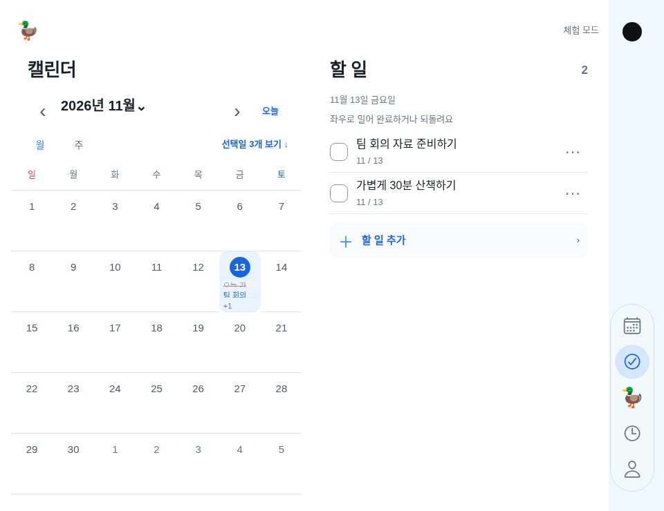


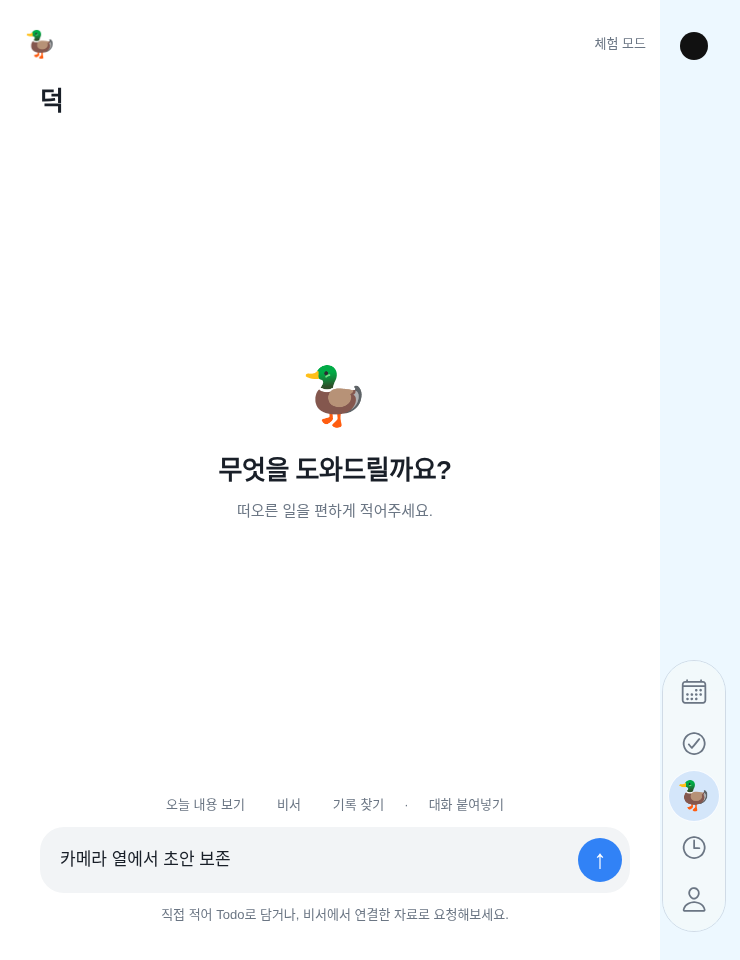

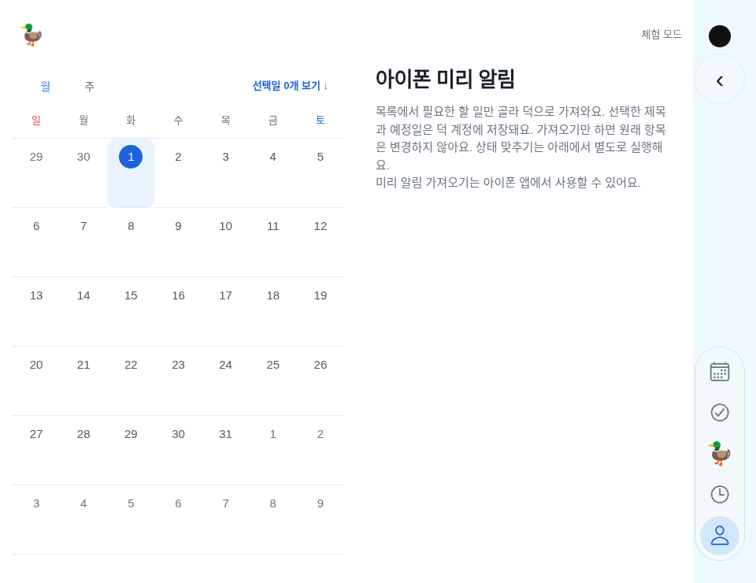

캡처의 파란 열·검은 카메라는 위치 검증 안내이며 제품에는 그리지 않는다. native Glass의 굴절/빛·OS 접근성 설정과 실제 손가락 터치는 새 빌드 설치 후 확인한다. 웹 검수의 성공을 native Glass 완료로 올리지 않는다.

## 2026-11-13 실제 성공 — 무료 GitHub Mac 빌드1.0.0(19)·Apple 업로드

[사용자 수동 실행43365834762](https://github.com/thepmpo/donknow/actions/runs/43365834762)은 **소스224a498**, validate와build-and-submit 두 job 모두 성공이다. [실제 빌드·제출 job131690178721](https://github.com/thepmpo/donknow/actions/runs/43365834762/job/131690178721)의 로그에서 Xcode27.1, 기존 서명 재사용, 원격번호18→19, `Build successful`, 서명된IPA11.4MB, `Submitted your app to Apple App Store Connect!`를 확인했다. 앱 설정 버전1.0.0과 합쳐 **1.0.0(19)**다. Expo cloud build가 아니라 앞서 설정한 공개 저장소의 표준 GitHub Mac에서 `--local`로 실제 빌드했다. 새 유료 가입·과금 설정·인증서 재발급을 하지 않았으며 추가 빌드를 요청하지 않는다.

IPA 생성은 **13:39:30 KST**, Apple 업로드 완료는 **13:40:01 KST**다. [제출 상세](https://expo.dev/accounts/thepmpo/projects/duckduck-donknow/submissions/0d6c6741-25ea-4444-9a1e-62c55ec958da). 제출 완료 로그의 마지막 상태는 **Apple 처리 중**이며, 실제 TestFlight 목록 등장·설치·Duo 실기기 동작은 아직 확인하지 않았다. 설치 파일 생성/서명/Apple 업로드 성공을 기기 검수나 App Store 공개 완료로 확대하지 않는다. 이번 로그에서 DuckduckDuo1.0.0 pod 설치·패키징도 확인했지만 실제 카메라/힌지/키보드는 기기에서 검수한다.

사용자는 아이폰의 **TestFlight → duckduck → 업데이트**에서 **1.0.0(19)**를 확인한다. 아직19가 안 보이면 Apple 처리 완료를 기다리고 같은 이유로 다시 빌드하지 않는다. 이 버전은 승인한 카메라 열의 세로 탭·상황별 원형 뒤로가기, 펼친 가로의 왼쪽 캘린더 고정/오른쪽 Todo·선택 탭, 펼친 세로의 현재 화면 하나를 포함한다. 일반 iPhone 하단 탭은 유지한다. [Duo 검수 기준](iphone-duo-support.md) · [Apple TestFlight 관리](https://appstoreconnect.apple.com/apps/6829597261/testflight/ios).

이제 **첫 무료 Mac 빌드/서명/제출 미확인**은 해제한다. 아래 Linux 단계나이전17·18의 미확인/실패 기록은 당시 상태다. 이번 변경은 실제 결과 기록뿐이며 앱 코드·서명·데이터·OAuth·원본 recovery bundle을 바꾸지 않는다.

## 2026-11-13 승인 시안 반영 — 카메라 열과 두 화면

Duo는 본문 안쪽 오른쪽이 아니라 **물리 카메라가 있는 맨 오른쪽 열**에 내비게이션을 둔다. 접힘·펼침 모두 그 열 아래에 세로5개 탭, 카메라/상태 표시 아래에는 실제 복귀·닫기 경로에서만 원형 ‹를 표시한다. 상·하 안전 여백8pt,64×272pt 묶음·52pt 조작·28pt 아이콘을 유지한다. 펼친 가로 화면은 왼쪽 캘린더 고정·오른쪽 최초 Todo이며 탭 선택은 오른쪽만 바꾼다. 펼친 세로 화면과 접힌 화면은 선택 중인 화면 하나를 본문 전체에 표시한다. 회전·접힘 시 현재 탭·입력·편집·캘린더 월·스크롤을 보존한다. 일반 iPhone은 기존 하단 탭이다.

이 기준이 아래 이전 가로 탭·본문 안쪽 세로 탭·64pt 보호 padding·단일 본문 정책보다 우선한다. 사용자가 승인한 그림에서 파란 열과 검은 카메라 점은 **위치 확인용 안내 표시**이며 앱에 그려 넣지 않는다. [최신 구현·미리보기·검수](https://github.com/thepmpo/donknow/blob/main/docs/iphone-duo-support.md).

### 화면별 계약

| 상태 | 왼쪽 | 오른쪽/본문 | 내비게이션 |
|---|---|---|---|
| 완전히 펼친 가로 | 캘린더 고정 | 최초 Todo, 이후 선택한 탭 | 카메라 열 아래 세로5개 |
| 펼친 세로 | 분할하지 않음 | 현재 선택한 화면 하나 | 같은 카메라 열 |
| 접힘·부분 접힘·힌지 상태 unknown | 분할하지 않음 | 현재 선택한 화면 하나 | 같은 열의 안전한 구간 |
| 일반 iPhone/iPad·힌지 없음 | 기존 화면 | 기존 단일 화면 | 기존 하단 내비게이션 |

최초 실행의 Todo와 달리 회전/접힘은 사용자가 선택한 탭을 초기화하지 않는다. 세로일 때 표시할 화면은 오른쪽 활성 화면이다. 고정 캘린더는 숨겨도 부모/인스턴스를 유지하고, 선택한 월과 스크롤을 보존한다. 양쪽에서 Todo를 수정하면 같은 기존 store를 쓰며 복사 데이터를 만들지 않는다. 로그인·서버/계정 전환 시 계정별 화면 상태는 기존 정책으로 분리한다.

### 좌표·API와 구현자가 바꾸면 안 되는 것

- `DuoSafeSurface`의 네이티브 관찰 View는 전체 화면 좌표를 읽는다. **SafeAreaView로 먼저 카메라 열을 제외한 뒤 그 본문 끝에 탭을 붙이지 않는다.** `DuoChrome`은 본문 밖에서 탭과 뒤로가기를 배치한다. 각 모달은 자체 좌표로 계산하고 분할하지 않는다.
- 실제 `UIHingeInteraction`의 `hinge.status`가 `fullyOpen`이고 현재 View가 가로일 때만 분할한다. 화면 폭/기기 이름으로 Duo를 추정하지 않는다. 네이티브 상태가 없으면 폭이 커도 단일 화면이다.
- UIKit의 `reservedRegions(kind:options:)`는 카메라 전용 식별 API가 아니다. `occlusion`에는 카메라·Dynamic Island·창 조작부 등이 포함된다. 화면 오른쪽 위의 실제 예약 영역을 정렬 근거로 사용하며 `.includeInactive`도 읽는다. 후보가 없으면 실제 오른쪽 safe inset, 그것도 없으면 trailing edge로 대체한다. `alignment`에 출처를 남긴다. **대체 좌표는 물리 카메라 일치가 검증됐다는 뜻이 아니다.** 실기기 예약 영역 확인이 남는다.
- 조작부는 한 x 중심선을 유지한다. 활성 힌지·가림 구간은 세로로 건너뛰며 카메라 왼쪽의 본문 열로 옮기지 않는다. 원형 ‹는 실제 callback에서만 표시하고 저장 중 비활성·닫힘 후 제거를 유지한다.
- `DUO_CHROME`이64pt 너비·최대272pt 높이·52pt 탭/28pt 아이콘·8pt 안전 간격·분할 사이16pt의 단일 소스다. 실제 힌지가 양 화면을 가르면 그 경계를 우선한다. 짧은 높이는52pt 터치를 줄이지 않고 세로 스크롤한다. 과거64pt 본문 보호 padding은 제거했다. 지금64pt는 실제 카메라 열의 바 너비이며 본문 padding이 아니다.
- 일반 기기는 안전 영역 inset을 본문에 적용하고 기존 하단 bar의 bottom inset을 중복 적용하지 않는다. 네이티브 첫 기하를 받기 전 하단 bar를 잠깐 표시하지 않는다.

공식 근거: [Duo 준비](https://developer.apple.com/documentation/technologyoverviews/preparing-your-app-for-iphone-duo), [예약 영역](https://developer.apple.com/documentation/uikit/uiview/reservedregions(kind:options:)), [힌지 상태](https://developer.apple.com/documentation/uikit/uihinge/status-swift.enum). 기존 SDK guard는 유지하며 실제 Xcode27.1 컴파일은 이 Linux 환경에서 수행하지 못했다.

### 승인 그림과 새 캡처

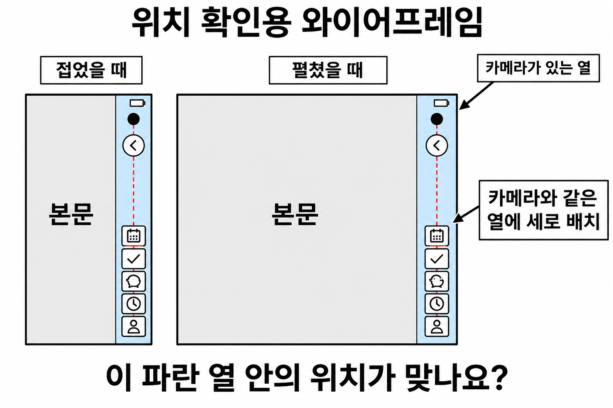

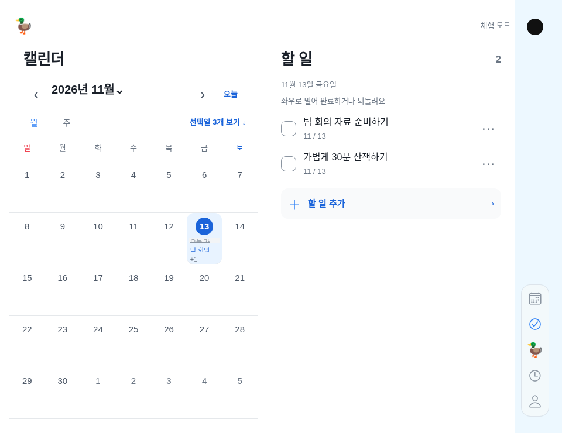

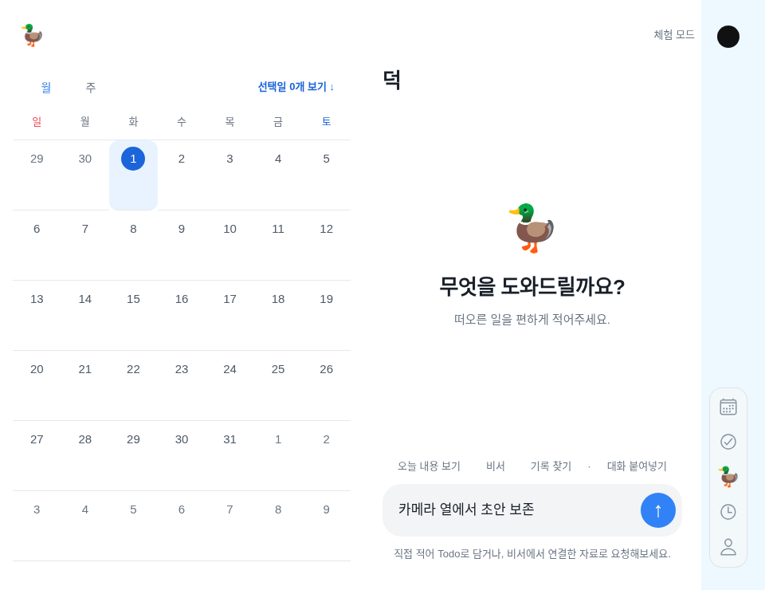

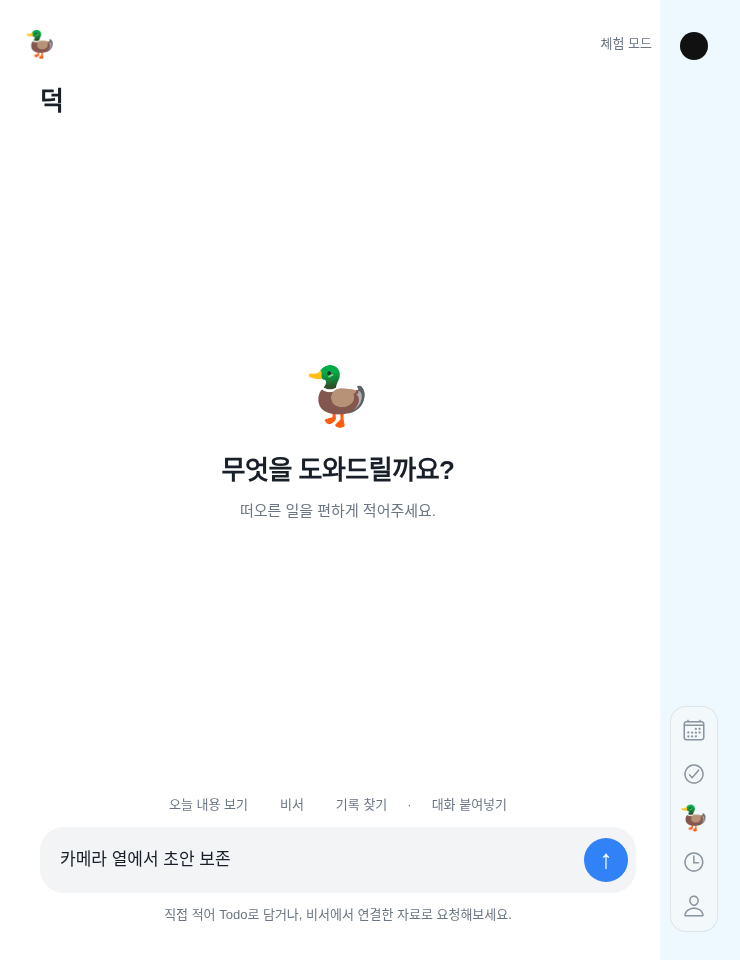


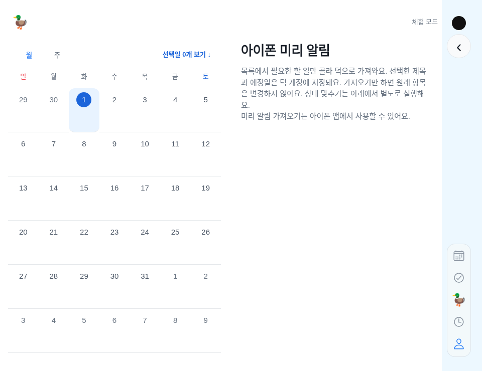

캡처는 실제 앱 컴포넌트에 테스트 기하를 전달한 **격리 웹 fixture**다. 파란색/카메라 점은 fixture에만 있으며 운영 앱에는 없다. 실제 Duo 사진·Apple 하드웨어 치수의 증거로 사용하지 않는다. 제품에는 URL/폭으로 Duo를 켜는 숨은 스위치를 추가하지 않았다.

### 실제 검증과 남은 검수

검증: 전체224개 중223통과·실패0·기존 선택1개 제외, 기하11개·모바일 타입·웹/iOS JS 출력·Duo 전환 검사를 통과했다. 카메라 중심선과 탭/뒤로가기 중심선 일치, 본문 밖 배치, 왼쪽 고정/오른쪽 전환, 세로 단일 화면, 월·초안·스크롤 유지, 실제 복귀·비활성 보호·짧은 높이·초기 하단 탭 깜박임 방지를 검사했다. 전체 앱·웹 로그인·모션·AI 채팅/오류·세션 격리 회귀도 통과했다. 공개 문서/디자인 가이드 회귀와131개 이미지 manifest를 검증했다. 구현775a561. 웹 모의 기하/체험 데이터 결과이며 Swift 컴파일·Duo 실기기·시스템 키보드는 미검증이다. 기존1.0.0(17)은380dde2로 이번 수정 전이며 새 네이티브 수동 빌드가 필요하다. push 자동 EAS 빌드는 계속 꺼짐이다.

재현: `npm run check`, `npm test`, `npm --prefix mobile run typecheck`, `npm --prefix mobile run export:web`, `npm --prefix mobile run export:ios`, `npm --prefix mobile run test:duo`. Export의 첫 시도는 환경의 `/home/agent/.expo` 쓰기 실패로 중단됐고 `EXPO_NO_TELEMETRY=1 CI=1`로 동일 코드를 재실행해 통과했다. 인증값/보안 설정은 변경하지 않았다.

- [x] 최초 펼친 가로의 Calendar/Todo, 탭을 바꿔도 왼쪽 유지, 세로에서 현재 탭만 표시.
- [x] 회전 뒤 작성 중 메시지·양쪽 선택 월·고정 캘린더 스크롤 위치/인스턴스 유지.
- [x] 접힘·펼침·세로·부분 접힘·짧은 높이의 카메라 열·8pt·44pt·뒤로가기/비활성·입력 조작 비가림.
- [x] Xcode27.1 네이티브 빌드·서명·Apple 업로드:43365834762의1.0.0(19).
- [ ] Apple 처리 완료·TestFlight19 설치·실기기 확인.17은 이번 코드가 아니다.
- [ ] Duo 실제 reserved region/카메라 중심선·접힘/회전·힌지·안전 영역, 키보드와 시스템 시트 동작. 대체 alignment인 기기는 좌표를 확인한다.
- [ ] 일반 iPhone의 실제 notch/가로 안전 영역·Dynamic Type·VoiceOver, Figma Current baseline 교정. 이번에는 Figma를 수정하지 않았다.

## 이전 구현 이력 — 아래 배치/수치는 현재 기준이 아님

## 2026-11-13 추가 정정 — 오른쪽 세로 묶음은 아래, 원형 뒤로가기는 위

사용자는 **하단 가로 내비게이션으로 바꾸라는 뜻이 아니라 지금 오른쪽의 세로5개 묶음을 그대로 아래로 내리라**고 정정했다. 접힘·펼침 모두 세로 배열을 유지하며 아래 안전 영역에서8pt를 띄운다. 배터리/상태 표시 아래의 상단8pt에는 **원 안의 ‹ 뒤로가기**를 별도로 두며 실제 돌아갈 화면/시트가 있을 때만 나타난다. 루트 탭을 바꾸기만 했다고 임의의 뒤로가기 기록을 만들지 않는다.

`DuoBackNavigation`이 안전 영역별 실제 돌아가기/닫기 콜백을 등록·해제한다. 상세/연결/계정 화면과 닫기 조작을 연결하고, 돌아오거나 닫히면 버튼이 사라진다. 저장·연결 중 기존 비활성 조건을 보존한다. 각 모달은 자체 안전 좌표와 콜백을 사용한다. 세로 탭은48×226pt·44pt 조작을 유지하고, 짧은 높이에서는 위 원형 버튼과 겹치지 않게 세로 스크롤한다. 본문 조작 보호를 유지하고 채팅 입력의 최소 폭을 풀어 아래 탭이 보내기 버튼을 가리지 않게 했다. 일반 iPhone의 하단/돌아가기/닫기 위치는 유지한다.

소스 `87849a2`. Duo 전환·동일한 위/아래8pt·세로 열·원형 경계·루트 숨김·상세 진입/복귀 시 표시/해제·비활성 보호·짧은 높이 마지막 탭 접근·실제 채팅 보내기 비가림·초안 유지 검사를 통과했다. 전체221개 중220통과·기존 선택1개 제외, 문법·타입·웹/iOS JS·전체 앱·채팅·오류 회귀를 통과했다. 캡처는 격리 웹 미리보기이며 실제 Duo/Swift/키보드 검수는 별도다. 빌드16은 이전57aee29이므로 새 설치 앱에는 최신 main의 수동 빌드가 필요하다. 추가 EAS 빌드를 요청하지 않았다. 이전의 위쪽 세로 배치 설명은 이 정정 이전 기록이다.


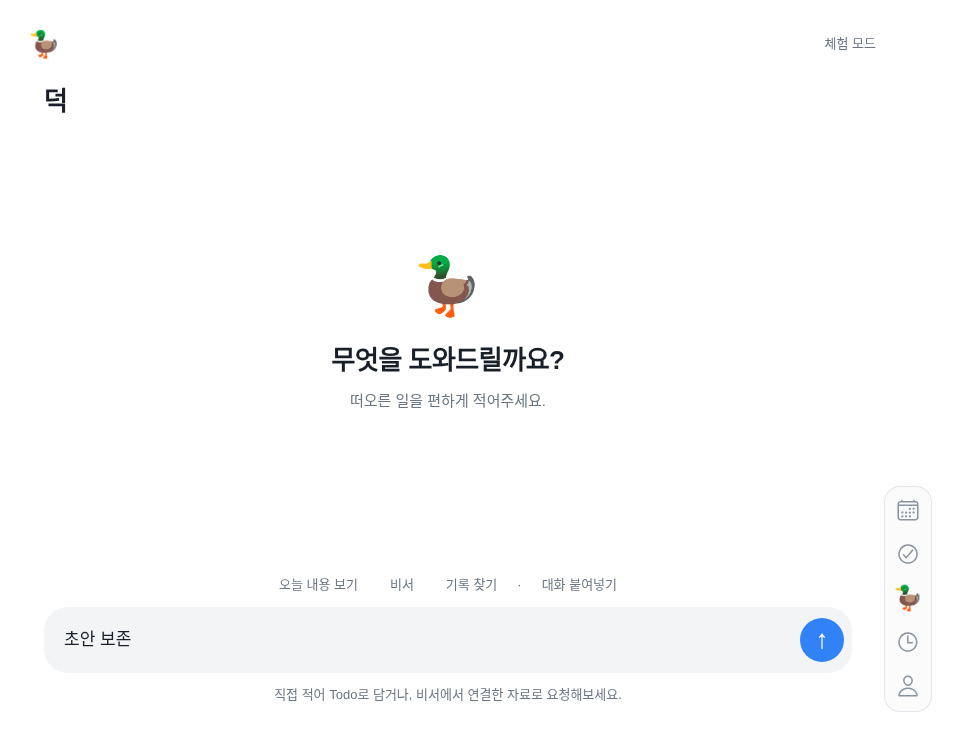

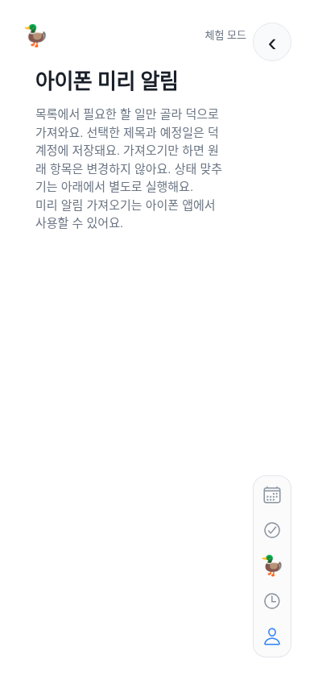

## 2026-11-13 최종 정정 — Duo 오른쪽 세로 배열

사용자의 **“세로배열”** 지시가 최종 기준이다. 이전에 ‘배터리 아래’를 헤더 안의 가로 탭으로 해석한 것은 구현자의 오해다. Duo는 **접힘·펼침 모두 화면 오른쪽 가장자리, 시스템 배터리/상태 표시 아래에서 시작하는 세로5개 탭**이다. 일반 iPhone은 하단 가로 탭을 유지한다.

현재 `DuoTrailingNavigation`은48×226pt의 짧은 세로 묶음이며 각 탭은44×44pt다. 오른쪽·위 안전 영역에서8pt를 띄우고, 헤더 행 밖에서 배치한다. 전체 높이의 별도 패널이나76pt 넓은 rail을 만들지 않는다. 본문 표면은 전체 안전 폭을 유지하되 조작부에는64pt 오른쪽 보호 padding을 적용해 버튼·입력·오류 안내를 가리지 않는다. 높이가 부족하면 탭을44pt보다 줄이지 않고 세로 스크롤로 마지막 탭까지 접근한다. 숫자는 UI 치수이며 기기 판별 조건이 아니다.

공유 `layout` 토큰과 실제 AppNavigation/Shell을 수정했다. 접힘·펼침·책·테이블·320px·짧은 높이·일반 기기 전환에서 세로 열·오른쪽 위치·44pt·짧은 묶음·중복 하단 없음, 입력·현재 탭·편집·스크롤·자식 유지와 마지막 탭 접근을 검사했다. 전체221개 중220통과·실패0·기존 선택1개 제외, 문법·타입·웹/iOS JS·전체 앱 회귀를 통과했다. 캡처는 실제 앱 컴포넌트의 격리된 기하/체험 데이터이며 Swift 빌드·실기기 결과는 아니다.

소스 `5c1ae41`. **기존 빌드16은57aee29로 요청돼 이 세로 수정이 들어 있지 않다.** 웹 배포가 기존 TestFlight 바이너리를 바꾸지 않으며, 아이폰 반영에는 최신 main의 새 수동 빌드가 필요하다. 자동 빌드·유료 전환·기존 인증/데이터 변경은 하지 않는다. 아래 이전226×48 가로/기존 헤더 배치 기록은 폐기된 해석으로 읽는다.


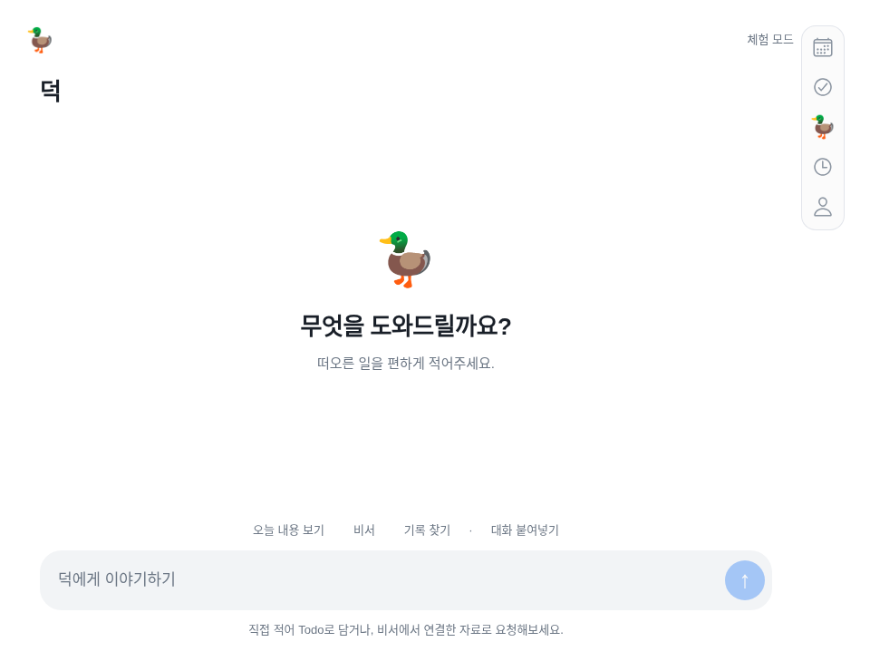

## 2026-11-13 — 배터리 아래 기존 헤더 오른쪽으로 정정

최신 사용자 확정은 접힘·펼침 모두 **시스템 배터리 표시 아래 오른쪽 위**다. 기존 구현의 전체 높이76pt 세로 rail과 본문의 오른쪽 예약 여백을 제거했다. 기존 헤더 안에5개 탭을226×48pt의 compact 그룹으로 두며 각 조작 영역은44×44pt다. 탭 이름·선택 상태는 접근성에 유지하고, 일반 iPhone은 기존 하단 아이콘+라벨을 사용한다. 본문은 선택된 안전 영역의 전체 폭을 사용한다.

‘배터리 아래’는 시스템 safe area 아래를 뜻한다. 배터리 그림/상태 바를 앱이 다시 그리거나 특정 모델의 화면 좌표를 하드코딩하지 않는다. 기기 판별은 기존 iOS27.1 UIHingeInteraction의 실제 hinge 값만 사용한다. 활성 접힘/카메라 영역을 피하는 안전 본문 계산과 모달별 좌표계는 유지한다. 내비게이션 폭을 본문 최소 폭에 더하던 계산도 제거했다.224pt 본문 최소 사용성 기준은 기기 판별값이 아니다.

기존 아래의 ‘오른쪽76pt 전체 높이 내비게이션’ 설명은 당시 구현이며 이 정정이 우선한다. 원본을 역사로 보존한다. 네이티브 모듈·API는 바꾸지 않았고 [Apple UIHingeInteraction 공식 JSON](https://developer.apple.com/tutorials/data/documentation/uikit/uihingeinteraction.json)을 다시 읽어27.1·실제 hinge/nil 기준을 확인했다. HTML은JavaScript 안내만 반환해 공식 JSON을 근거로 사용했다.

자동 검사는 실제 앱의 AppNavigation 컴포넌트와 Shell을 사용한다. Expo 공식 export:embed 웹 resolver로 묶어 아이콘·BlurView를 그대로 사용하며, 기존의 손으로 만든 resolver는 웹/네이티브 의존성을 다 처리하지 못해 교체했다. 접힘·펼침·책·테이블·320px·일반 기기 전환에서 탭·입력·편집·스크롤·자식 identity 보존,44px·상단/우측 위치·전체 폭 본문·중복 하단 탭 없음을 검증한다. 실제 iPhone/Duo·키보드·Swift 빌드는 별도다.


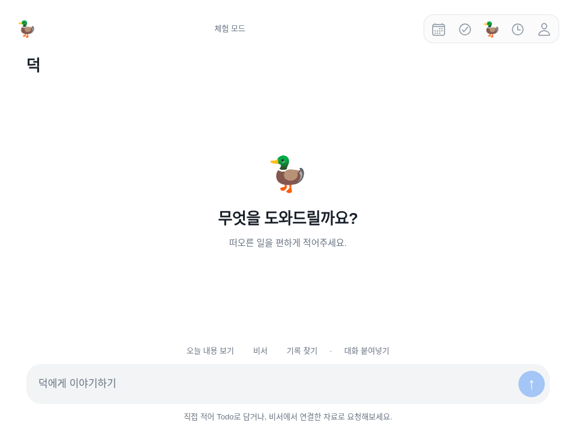

스크린샷은 네이티브 기하를 주입한 격리 웹 fixture이며 실기기 캡처가 아니다. 코드에 웹 URL/모델명으로 Duo를 켜는 우회는 추가하지 않았다. 재현: `npm --prefix mobile run test:duo`.

**현재 상태:** 공식 iOS 27.1 API를 사용하는 네이티브 연결과 `DuoTrailingNavigation`을 구현했다. 기하 계산 8개 테스트, React 화면 유지 테스트, TypeScript 검증을 수행했다. Linux 환경에서는 Swift 네이티브 빌드와 Duo 실기기 동작을 확인할 수 없으므로 **TestFlight·실기기 검증 완료로 표시하지 않는다.**

사용자가 이번 업무에서 Duo 구현 진행을 명시적으로 승인했다. 기존의 “Duo 진행 전 보류”는 해제한다. 대상은 **Apple iPhone Duo**이며 Microsoft Surface Duo나 Android 폴더블이 아니다. 일반 iPhone은 기존 하단 탭을 유지한다.

## 공식 근거

2026-11-12 Apple 공식 제품 페이지, 개발자 문서 JSON, 기술 영상의 본문을 확인했다. 검색 요약이나 모델명 추측을 구현 근거로 쓰지 않았다.

| 확인 내용 | 공식 출처 |
|---|---|
| Apple iPhone Duo 제품과 접힘·펼침 | [제품 페이지](https://www.apple.com/kr/iphone-duo/) |
| iOS 27.1 SDK 전체 화면 대응, 크기 변경과 safe area | [개발 준비](https://developer.apple.com/iphone-duo/prepare/), [앱 준비 개요](https://developer.apple.com/documentation/technologyoverviews/preparing-your-app-for-iphone-duo) |
| 상태 유지, 비대칭 safe area, 다양한 자세 | [Human Interface Guidelines](https://developer.apple.com/design/human-interface-guidelines/designing-for-iphone-duo) |
| 실제 힌지 지원 여부: `UIHingeInteraction`, `update.hinge` | [UIHingeInteraction](https://developer.apple.com/documentation/uikit/uihingeinteraction), [문서 원본 JSON](https://developer.apple.com/tutorials/data/documentation/uikit/uihingeinteraction.json), [공식 기술 영상 111464](https://developer.apple.com/videos/play/tech-talks/111464/) |
| 가림·접힘 경계: `UIView.reservedRegions(kind:options:)`, `.division`, `.occlusion`, `.includeInactive` | [ReservedRegion](https://developer.apple.com/documentation/uikit/uiview/reservedregion), [메서드 원본 JSON](https://developer.apple.com/tutorials/data/documentation/uikit/uiview/reservedregions(kind:options:).json), [공식 기술 영상 111463](https://developer.apple.com/videos/play/tech-talks/111463/) |
| 시스템 세로 바 방향: `UITraitCollection.verticalBarEdge` | [문서 원본 JSON](https://developer.apple.com/tutorials/data/documentation/uikit/uitraitcollection/verticalbaredge.json) |
| 사용 가능한 Xcode 27.1 빌드 이미지 | [Expo 빌드 인프라](https://docs.expo.dev/build-reference/infrastructure/) |

Apple의 App Resizability 스킬은 [개발 준비 문서](https://developer.apple.com/iphone-duo/prepare/)에 안내되어 있다. 지원하는 Xcode 설치 환경에서 `xcrun agent skills export`로 외부 에이전트에 내보낼 수 있다. 현재 Linux 환경에는 Xcode가 없어 내보내기·실행 여부를 검증하지 않았다.

## 구현 기준

1. **기능 탐지:** iOS에서 네이티브 모듈이 있고 iOS 27.1 API 사용 가능 및 `update.hinge != nil`일 때만 Duo 모드를 활성화한다. 모델명, 화면 폭, 화면 비율, iPad 여부, 가로 방향만으로 탐지하지 않는다. 힌지 값이 없으면 하단 탭으로 되돌아간다.
2. **오른쪽 내비게이션:** 접은 상태와 펼친 상태 모두 같은 탭 컴포넌트를 오른쪽에 배치한다. 고정 폭 76pt, 탭 최소 높이 64pt는 앱의 조작 영역 수치이며 기기 식별값이 아니다. 키보드 등으로 세로 공간이 줄면 탭 목록을 스크롤할 수 있다. iOS의 `verticalBarEdge`는 공식 근거로 확인했지만, 사용자가 명시한 **물리적 오른쪽** 배치를 위해 시스템 leading 선호를 기기 식별로 사용하지 않는다.
3. **접힘과 가림 회피:** native view의 실제 `bounds`, `safeAreaInsets`, `reservedRegions`만 사용한다. API의 frame은 해당 뷰 좌표이며 여유 공간을 이미 포함한다. `updateConstraints()`에서 읽어 변경을 관찰한다. 비활성·폭 0 접힘 선은 본문을 잘라내지 않는다.
4. **초기 단일 본문 정책:** 접힘 경계가 활성 상태일 때 본문을 복제하거나 양쪽에 나누지 않고 안전한 한 영역에 표시한다. 전체 높이를 가르는 세로 접힘이면 **오른쪽 영역을 우선**한다. 오른쪽이 300pt(본문 224pt + 내비게이션 76pt)보다 좁아 사용할 수 없으면 가장 넓고 안전한 영역으로 이동하며, 그 영역의 오른쪽에 내비게이션을 둔다. 카메라 옆의 가느다란 빈 공간보다 충분한 폭을 확보한 영역을 우선한다. 300pt는 사용성 기준이며 Duo 탐지 기준이 아니다.
5. **상태 유지:** 접힘·펼침은 스타일과 안전 영역만 바꾼다. 화면·편집기를 재생성하거나 key를 바꾸지 않는다. 현재 탭·입력·편집·스크롤 상태를 그대로 유지한다. 계정 변경·로그아웃 때 필요한 기존 사용자 데이터 초기화는 유지한다.
6. **모달과 시트:** 공통 `MotionModal`과 캘린더 월 선택창에도 별도의 관찰 뷰를 둬 모달 자신의 좌표로 가림 영역을 계산한다. 기존 키보드 회피와 시트 제스처를 유지한다. 모든 키보드 조합은 실기기 검증 대상이다.
7. **빌드 호환:** CocoaPods 설치 시 선택된 실제 iPhoneOS SDK가 27.1 이상이면 `DUCKDUCK_DUO_SDK` 컴파일 조건을 추가한다. 새 UIKit 선언은 이 조건 안에 두며 런타임도 `#available(iOS 27.1, *)`로 검사한다. 모듈이 없는 기존 바이너리·Expo Go·이전 SDK·웹은 기존 내비게이션으로 동작한다. EAS preview/production은 공식 목록의 `macos-tahoe-26.6-xcode-27.1`을 지정했다.
8. **방향:** Expo `orientation`을 `default`로 설정해 기기의 자세 전환을 허용한다. 일반 iPhone 가로 모드도 하단 내비게이션을 유지하며 Duo로 오인하지 않는다.

## 구현 위치

- [`mobile/modules/duckduck-duo`](../mobile/modules/duckduck-duo): Expo 로컬 iOS 모듈, 공식 API 관찰, SDK 컴파일 조건.
- [`mobile/src/duo-layout.ts`](../mobile/src/duo-layout.ts): 검증된 기하 데이터, 기능 탐지, 안전한 영역 계산.
- [`mobile/src/DuoLayout.tsx`](../mobile/src/DuoLayout.tsx): 상태를 유지하는 레이아웃 및 모달 별 좌표 공간.
- [`mobile/App.tsx`](../mobile/App.tsx): `DuoTrailingNavigation`, 기존 하단 탭 대체 배치.
- [`mobile/src/motion.tsx`](../mobile/src/motion.tsx), [`mobile/src/ui.tsx`](../mobile/src/ui.tsx): 모달 보호, 본문 아래 여백.
- [`mobile/src/duo-layout.test.ts`](../mobile/src/duo-layout.test.ts), [`mobile/e2e/duo-layout.mjs`](../mobile/e2e/duo-layout.mjs): 수학·기능 탐지와 실제 React 상태 유지 테스트.

## 검증과 다음 작업

```sh
node --test mobile/src/duo-layout.test.ts
node mobile/e2e/duo-layout.mjs
npm --prefix mobile run typecheck
```

테스트용 geometry는 **독립 브라우저 fixture에서만** 전달한다. 제품에는 URL·query·기기 폭으로 Duo를 켜는 숨은 스위치를 추가하지 않았다. 브라우저 fixture의 성공은 UIKit 실행 성공의 증거가 아니다.

- [x] iPad·일반 iPhone 가로 화면·웹·Android 오탐 방지.
- [x] 비대칭 safe area, 비활성 접힘, 세로·가로 활성 접힘, 카메라 가림, 뷰 밖 영역 계산.
- [x] 비대칭 접힘에서도 사용 가능한 오른쪽 영역 우선, 가느다란 영역 회피.
- [x] 펼침→책처럼 접기→접힘 화면→탁상 자세→펼침→일반 레이아웃에서 탭·초안·편집 상태·스크롤 600px 및 동일 React 자식 유지.
- [x] Expo autolinking에서 `duckduck-duo` 모듈 발견 확인.
- [ ] EAS/Xcode 27.1 **Swift 컴파일·링크** 성공 확인. Linux TypeScript/JS 번들 검증으로 대체하지 않는다.
- [ ] TestFlight 설치 후 힌지 데이터의 초기 제공·닫힘·펼침·백그라운드 복귀에서 `UIHingeInteraction` 값을 확인한다.
- [ ] Duo 실기기에서 키보드 열림/닫힘, Todo 편집, AI 채팅, 캘린더 선택창, 권한 시트·시스템 시트, 회전·Dynamic Type·VoiceOver를 확인한다.
- [ ] iPhone/iPad 이전 OS 및 새 OS에서 기존 하단 탭·일반 가로 모드 회귀를 확인한다.
- [ ] Figma Current baseline은 실기기 검증 결과와 맞춘 뒤 업데이트한다. Proposed에 구현 완료로 표시하지 않는다.

데이터·인증 스키마, Apple 계정 권한, AI 실제 연결, 브리핑·날씨 정책은 이 변경에서 수정하지 않는다. 추가 자격증명이나 비밀번호를 채팅에 요청하지 않는다.
