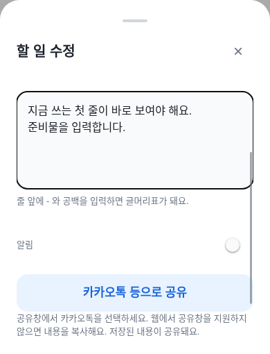
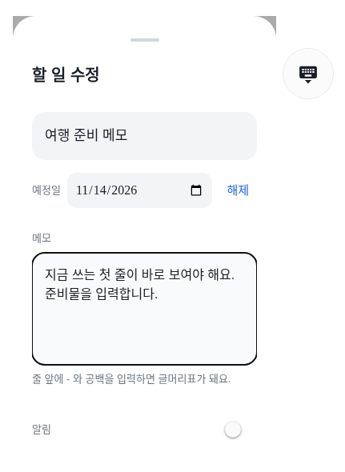
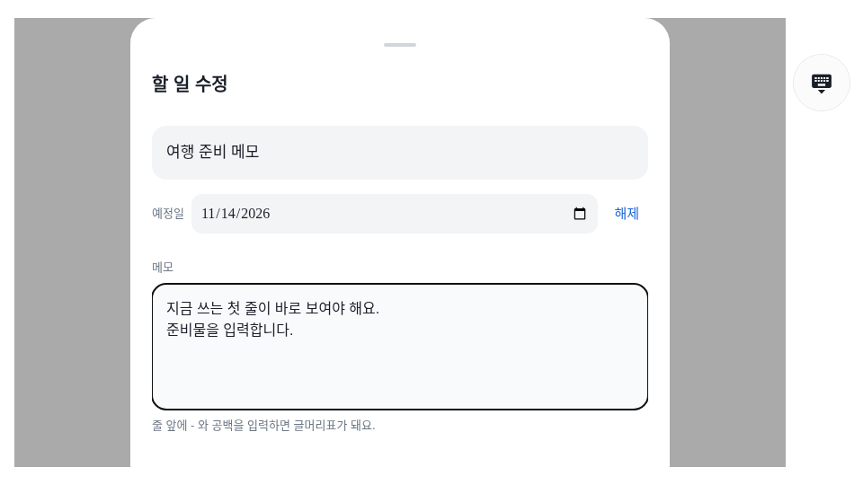
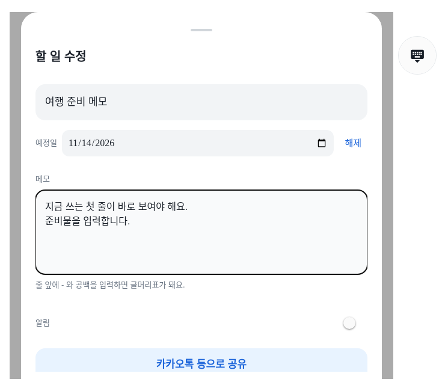
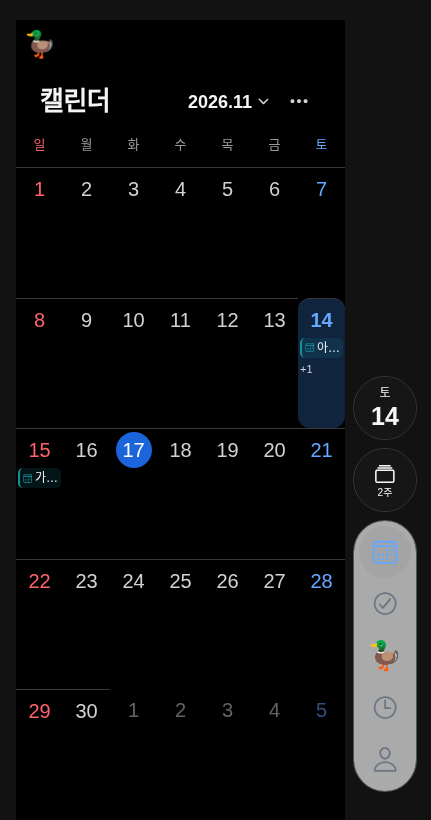
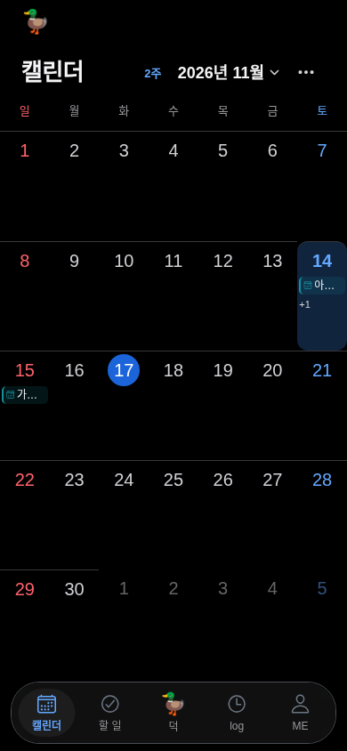
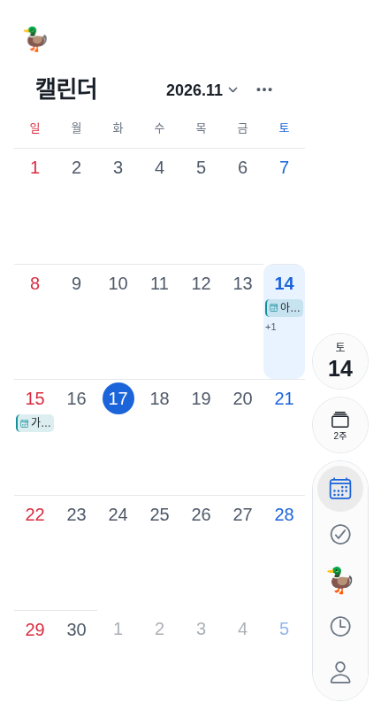
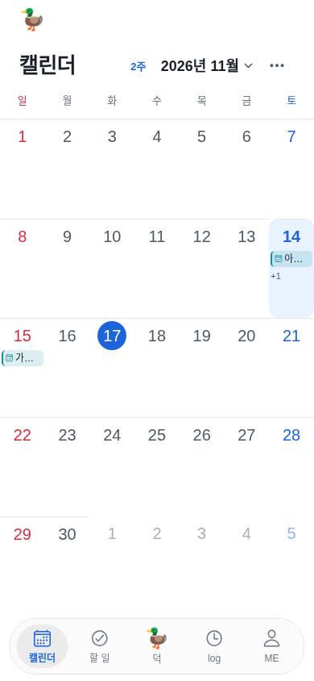

# 기기별 키보드·메모·오늘 음영 검수

**final result: blocked** — Expo 실제 렌더/합성 API·Duo geometry·키보드 가림/viewport 검사는 통과했다. Linux에서 UIKit/실제 키보드·Modal native geometry·한글 IME·VoiceOver를 실행하지 못해 실기기 완료라고 하지 않는다. 최신 사용자 빌드34는 이 변경 전이다.

## 근거와 확인한 흐름

첨부4장 중 첫2장은 TodoEditor 메모가 Save 아래에서 잘리고 제목 옆의 키보드 아이콘이 멀리 있는 문제,3장은 오늘과 선택일이 다른 상태,4장은 오늘 날짜 칸 전체 pale 음영의 근거다. 원본은 도구로 열었고 실제 합성 폼/달력 캡처와 같은 비교 입력으로 확인했다. 합성 웹은 OS 키보드를 그리지 않아 전체 native 화면 픽셀 일치로 주장하지 않는다. 사용자 원본/개인 일정은 공개하지 않았다.

1. **Duo 입력과 닫기** — 접힘·펼친 가로/세로의 실제 TodoEditorForm에서 focus 후 keyboard viewport를 줄인다. Save가 없어지고 메모 입력의 첫 줄/두 줄이 scroll viewport 안에 있다. camera column의 기존 X 자리에는 keyboard-close만 뜬다. 누르면 초안 유지·화면 닫기0·추가 쓰기0이고 원래 X가 다시 뜬다. 같은 form이 native Modal 안에서 사용되지만 native 기하 알림 자체는 별도다.
2. **일반 iPhone** — 같은 폼에서 메모/제목 복귀와 저장 숨김/복원을 검수했다. 시트 헤더·composer의 중복 아이콘은0이다. 실제 완료는44pt native accessory이므로 웹에 가짜 Done 바를 만들지 않았다. Swift customView UIButton의 실제 모습/키보드와 맞물림은 새 native 설치 후 확인한다.
3. **오늘과 선택일** — light/dark·일반폰/Duo에서 오늘 칸 배경이 투명하지 않고 다른 날을 선택한 뒤에도 같은색이다. 선택한17일의 원과 오늘14일의 전체 음영은 독립이다. 실제 사용자 캡처의 오늘15일을 날짜값으로 하드코딩하지 않는다. 요일/주말·인접월/실제주수·오늘/2주/탭 열은 보존한다.
4. **다른 기능 회귀** — 기존 interaction-repair의 일반폰 inline 기대만 새 기기별 계약으로 바꾸고 웹 닫기는 Escape/blur로 한다. Duo는 실제 열 버튼을 누른다. 시각/꼬리·키보드중 일정 편집·확장필드·백그라운드 캐시·확인된 생성 즉시 표시·늦은 다른pane GET·페이지 중복·고정요일/월seam/정착·새초안 권한 검사를 그대로 통과했다. 전체앱도 Todo 저장/메모 복구/3초 이동·로그·연결·권한/세션 회귀를 통과했다.

## 실행 결과

- 전체311 중310통과·실패0·기존 선택1제외. 문법50·TypeScript·Expo web/iOS JS export 통과. 처음 export는 sandbox의 ~/.expo 쓰기 실패였고 기존 EXPO_NO_TELEMETRY=1/CI=1로 다시 실행해 성공했다. 서명IPA/Swift컴파일 검사가 아니다.
- keyboard-device.mjs 새8장/오류0·쓰기0. 동일TodoEditorForm을 fixture에서 실행하며 실제 API와 사용자 계정을 호출하지 않는다.
- interaction-repair 회귀/전체앱 검사 통과. 회귀 캡처는 /tmp에만 두어 과거 공개 증거를 덮지 않았다. 전체앱이 재생성한 과거 tracked 캡처도 복원했다.
- GitHub 실제 성공43609269160·validate132490513712/build-and-submit132490749073·f8a9b36·1.0.0(34)·Apple업로드15:26:13UTC를 확인했다. 이번 변경에는 새 native 빌드를 시작하지 않았다. Keychain/IME/모션 실제수치 검수도 완료로 바꾸지 않는다.

## 새 화면 — OS 키보드 없는 합성 검수

