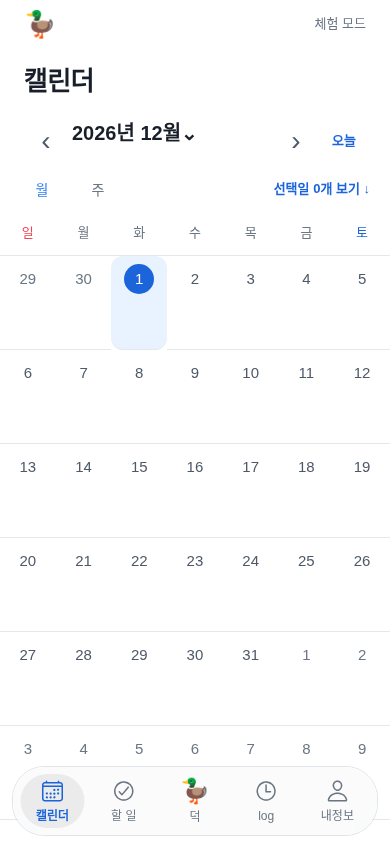
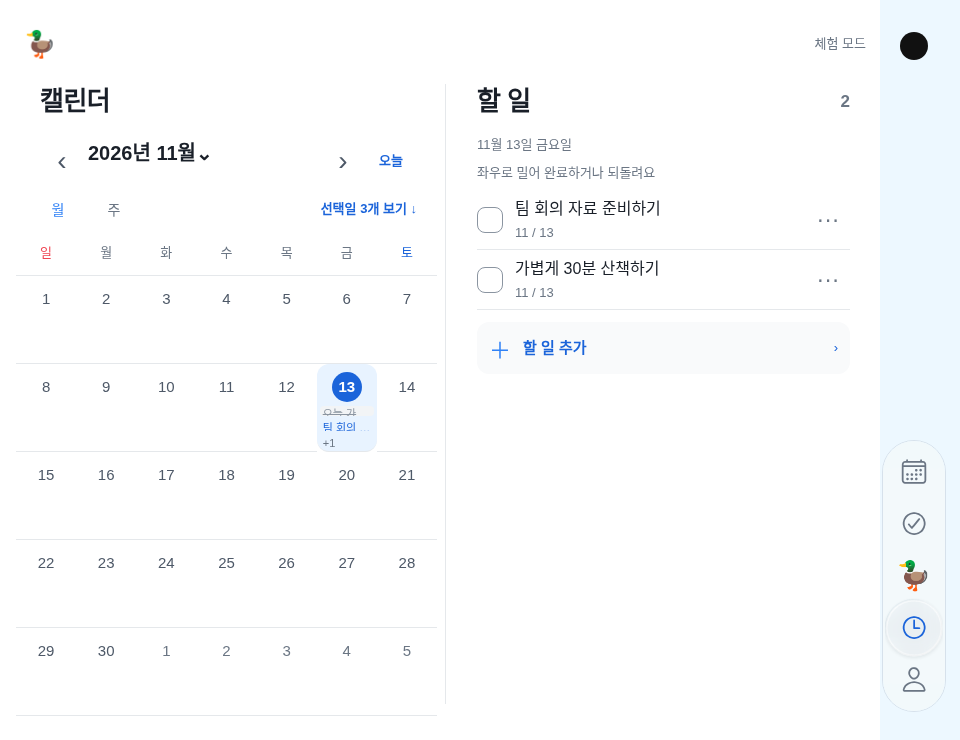

# Liquid Glass 내비게이션 — 구현·재사용 계약

문서 ID `NAV-GLASS` · 2026-11-13 · 현재 사용자 승인.
[전체 최신 기준](continuation-guide.md) · [공통 디자인 원칙](reusable-product-design-principles.md).

사용자가 ‘애플 본 것대로, 하단도 가이드대로 수정’하고 다른 채팅·서비스에서도 재현 가능한 기록을 요청했다. 이 문서가 이전의 항상 선택 Glass·평평한 하단 바 설명보다 우선한다.

## 1. 공식 근거와 적용 판단

| 출처 | 확인한 내용 | 덕에 적용 |
|---|---|---|
| [Apple HIG Materials](https://developer.apple.com/design/human-interface-guidelines/materials) | Glass는 조작·내비게이션 층. regular는 가독성에 적응, clear는 풍부한 사진·영상 배경에 사용 | 흰 본문 유지, 바 regular, 본문 전체 Glass 금지 |
| [Apple HIG Tab bars](https://developer.apple.com/design/human-interface-guidelines/tab-bars) | iPhone 하단에서 내용 위에 뜨는 Glass 바, 의미 있는 짧은 라벨, 섹션 상태 보존 | 하단 capsule, 짧은 표시명, 아이콘·텍스트·접근성 상태 |
| [WWDC25 Meet Liquid Glass](https://developer.apple.com/videos/play/wwdc2025/219/) | 외형과 모션을 함께 설계. 접촉에 유연하게 반응. 일부 요소는 상호작용 중에만 Glass로 떠오르고 평소에는 차분 | 선택 표시는 평소 은은하게, 누르면 확대·Glass, 끌면 따라옴, 해제 시 복귀 |
| [Expo Glass API](https://docs.expo.dev/versions/latest/sdk/glass-effect/) | iOS 26+의 API 가용성 검사. regular/clear/none과 native 재질 전환 지원. opacity로 숨기는 방식 지양 | 기존58.0.5 유지, 가용성 검사, regular↔none 전환, opacity1 유지 |

Apple 문서는 구현 방향이며 아래 숫자는 **덕의 구현값**이다. App Store 앱을 직접 원격 실행·촬영하거나 내부 수치를 읽은 것은 아니다. 모든 Glass가 평소에는 사라져야 한다는 규칙도 아니다. 바는 Glass를 유지하고 선택 lens는 상호작용 중 강조한다. 스크롤 시 탭 바 축소는 별도 기능이므로 이번에 추가하지 않는다. UIKit UITabBar와 완전히 동일한 물리 반응을 구현했다고 하지 않는다.

## 2. 공간과 수치 — 구현 원본

| 항목 | 값·기준 | 원본 |
|---|---|---|
| 일반 iPhone 위치 | absolute bottom=max(bottomSafeInset,8), 좌우12pt | theme.layout·AppNavigation |
| 하단 모서리·테두리 | radius32pt, hairline 테두리, 내부 padding4pt | theme.layout·AppNavigation |
| 하단 각 탭 | 최소44pt 폭·58pt 높이, 아이콘24pt, 라벨12/16pt·필요하면 두 줄, gap4pt | AppNavigation |
| 하단 선택 표시 | 실제 탭 중앙. width=min(64,frame.width−4), height=min(54,frame.height−4), radius27 | AppNavigation |
| Duo |64×272pt,52pt 터치,28pt 아이콘. 기존 카메라 열·세로·안전8pt 유지 | DUO_CHROME·duo-layout |
| 선택 좌표 이동 |250ms cubic-out | theme.navigationMotion.travel |
| 누름·해제 | 누른 동안1.08배/100ms, 해제 시1배/180ms | theme.navigationMotion |
| 끌기 시작 | 주축>6pt && 주축>교차축×1.3. 실제 스크롤 overflow가 없을 때만 | navigation-geometry |
| 끌기 좌표 | measureInWindow의 실제 items 원점. 포인터−원점−lens 반 크기를 bounds 안으로 제한 | AppNavigation·navigation-geometry |
| 평소 선택 | 중립 rgba(120,120,128,0.12). 선택 아이콘·글자#1B64DA | NavigationGlass·theme |
| native 재질 | 바 regular. 선택 active regular/idle none. 재질 전환180ms | NavigationGlass |
| 대체 재질 | 웹·미지원 OS는 BlurView. bar85/selection45·light. 평소 선택은 중립 표시만 | NavigationGlass |
| 불투명 모드 | 바#F2F6FB, 선택#DCE2E9+1pt#8B95A1. OS 강제 색상 존중 | NavigationGlass |
| 본문 끝 보호 | Page navigationHeight72+bottomSafeInset+sectionGap24. 각 입력 화면의 기존 보호 유지 | ui·screens |

5개 탭 순서·ID는 변경하지 않는다. 표시명은 캘린더/할 일/덕/log/내정보, VoiceOver 이름은 기존 이름을 유지한다. 미수신 뱃지는 덕 탭에 실제 unread만 표시한다. 본문 표면·달력·초안·권한은 재질 변경과 분리한다. 단색 흰 배경이어도 무늬·가짜 그라디언트를 추가하지 않는다. 실제 내용이 바 뒤로 지나가면 재질이 그 내용을 처리하며 마지막 항목은 가리지 않는다.

## 3. 상태 전이와 예외

| 상태·입력 | 시각·재질 | 선택·데이터 동작 |
|---|---|---|
| idle | 바 Glass, 선택 중립, scale1 | 실제 현재 탭만 aria-selected, 원문 상태 보존 |
| touchDown(target) | 대상 아이콘 미리보기,100ms1.08배, lens regular | 실제 탭은 유지, 원점 측정 |
| drag | lens가 포인터 추적, 대상 탭 미리보기, 바 범위 안으로 제한 | 중간 탭을 열거나 업무를 실행하지 않음 |
| releaseInside |250ms 선택 중앙 정렬,180ms 축소·none 전환 | 최종 실제 대상에 한 번 onSelect |
| releaseOutside/cancel | 원래 선택 중앙, scale1, none | 실제 탭 유지, 추가 클릭 억제 |
| 단순 tap·keyboard·VoiceOver | 기존 탭 이동, 짧은 중앙 정렬 | 접근성 활성화·onPress로 섹션 전환 |
| 빠른 연속 tap | 기존 애니메이션 중단 후 최신 대상으로 이동 | 옛 완료 콜백으로 선택을 뒤집지 않음 |
| 짧은 Duo·overflow | 크기 유지, ScrollView로 스크롤 | 끌어 선택하기를 가로채지 않음. 마지막 탭도 접근 가능 |
| 회전·배치 변경·화면 해제 | 상호작용 종료, 새 측정, 애니메이션 정리 | 오래된 포인터로 다른 탭을 확정하지 않음 |
| Reduce Motion | 좌표 즉시, scale1, native 재질 전환 animate=false | 탭·동의·되돌리기 동작 동일 |
| Reduce Transparency·forced colors | 불투명 선택과 식별 가능한 테두리, blur 없음 | 사용자 설정을 우회하지 않음 |

Pressable은 PanResponder 인계 전에 onPressOut을 보낼 수 있다. 따라서 capture를 결정하는 시점에 drag ref를 먼저 설정한다. 원점을 지운 뒤 grant를 받으면 release가 항상 취소되는 회귀가 생긴다. release/terminate에서 정리하고 다음 터치에서 억제 플래그를 새로 시작한다. 측정 콜백은 세대 번호로 구분해 이전 측정이 새 상호작용을 덮지 않게 한다. 다중 터치는 새 탭을 확정하지 않고 취소하며 앱이 비활성화되면 상호작용을 정리한다.

장식 lens는 pointerEvents=none이다. 실제 터치·끌기는 RN Pressable/PanResponder가 처리한다. native layer의 isInteractive=false이며, isInteractive 하나만으로 시스템 탭의 동작이 완성됐다고 설명하지 않는다. native Glass나 부모의 opacity를 낮춰 숨기지 않고 style none↔regular 전환을 사용한다. 바 외곽의 overflow:hidden은 유리 가장자리를 자르므로 금지한다. 개별 fallback의 clipping은 별개다.

## 4. 코드 연결

| 파일 | 책임 |
|---|---|
| mobile/src/theme.ts | 브랜드·공간·모션 단일 값 |
| mobile/src/AppNavigation.tsx |5탭·측정·미리보기/실제 선택·tap/drag/release/cancel·하단/Duo 공유 |
| mobile/src/navigation-geometry.ts | 대상 판정·좌표 제한·방향/overflow 판정. 제품과 분리한 순수 함수 |
| mobile/src/NavigationGlass.tsx | native 지원·재질 상태·접근성·대체. 외부 데이터와 무관 |
| mobile/src/motion.tsx | OS/browser Reduce Motion |
| mobile/src/DuoChrome.tsx · duo-layout.ts | native 전체 좌표 portal·카메라 열/힌지·상태 보존 |
| mobile/e2e/duo-layout.mjs | 실제 컴포넌트의 격리 웹. Duo/일반 폰·제스처·상태 회귀·새 캡처 |
| mobile/e2e/motion.mjs | 실제 웹 앱. 하단 공간·누름/해제·3초/시트·상태 보존 |
| scripts/build-design-guide.py · build-handoff.py | 실제 토큰과 최신 계약→공개 문서·이미지 manifest |

## 5. 검수 체크리스트와 증거 수준

- [ ] 문법·단위 검사, 모바일 타입, 웹/iOS JS export. JS 출력은 Swift·IPA 검사가 아니다.
- [ ] 실제 컴포넌트에서 평소/누름 재질 구분, 확대·실측 좌표 이동·release 확정·밖에서 취소·다음 tap 정상.
- [ ]320/390/430pt의 하단 여백·44pt 터치·짧은 라벨. 큰 글자·키보드·스크린리더 접근.
- [ ]Duo 카메라 중심선·52pt·가로 Calendar 고정/오른쪽 선택·세로 전체. 초안·월·스크롤 유지, 짧은 높이 스크롤.
- [ ]Reduce Motion 확대 없음, forced colors 불투명 구분. 화면 해제 후 오래된 작업 없음.
- [ ]새 native 무료 빌드·Apple 처리·설치 후 실제 굴절/빛/재질 전환·연속 터치/끌기/취소·VoiceOver·OS 접근성 설정.
- [ ]Figma Current와 이번 코드 차이 기록. Figma를 갱신하지 않았다면 같다고 하지 않는다.

실제 자동 검사·캡처·커밋·배포는 아래 결과 절에 확정 후 기록한다.21번은 이번 터치/capsule 수정 전이고 사용자의 Glass 확인은 앞선 버전에 관한 관찰이다. 웹 캡처로 native 광학 효과나 실제 Duo 하드웨어 검사를 대신하지 않는다.

## 6. 다른 서비스에서 재사용

idle→press→drag→release/cancel 용어·전이, 미리보기와 실제 선택의 분리, 취소와 overflow 스크롤 보호, 실측 좌표, OS 접근성, 재질 가용성·대체 표시, 단일 토큰, 증거 수준은 공통이다. 새 서비스는 탭 수·브랜드·내용·배치·크기를 별도 승인값으로 교체한다. 덕의 오리·파랑·Duo 좌표·Todo 규칙은 복제하지 않는다. iOS가 아닌 플랫폼의 블러를 native Liquid Glass라고 부르지 않는다.

## 7. 이번 구현의 실제 결과

구현 커밋: [aa55b90](https://github.com/thepmpo/donknow/commit/aa55b909b3c76e871ac5a2a24053a828f84a037f).

- 문법44개, 전체228개 중227통과·실패0·기존 선택1개 제외, 모바일 타입, 웹/iOS JS export 통과.
- 실제 앱 웹 회귀·로그인·모션 회귀 통과. 새 제스처 회귀에서 세로/가로 끌기의 미리보기·해제 확정·바깥 취소·다음 tap·키보드 활성화·실측 이동·빠른 전환·동작 줄이기를 확인했다.
-320/390/430pt, bottom safe inset34pt, 라벨160% 시뮬레이션·44pt 터치·가로 넘침 없음 확인. 실제 VoiceOver·키보드·Dynamic Type 전체 검사는 폰에서 별도다.
- Duo 카메라 중심선·64/272/52/28·분할선·입력/월/스크롤 보존·짧은 높이 스크롤 회귀 통과. 탭의 실제 좌표를 유지하면서 ScrollView 안쪽에 확대 여유를 분리했다(바 padding2+items padding3). 유리 가장자리의 실제 기기 품질은 별도다.
- 새 화면10개는 아래 별도 폴더에 보존하며 과거 승인 시안·검사 화면은 덮지 않았다. 공개 문서/이미지 해시는 문서 커밋 전에 검사한다.

증거 폴더: `artifacts/navigation-interaction-2026-11-13/`. 첫5개는 Duo 각 상태,06은 끌기,07은 일반 iPhone3폭,08은320pt/라벨160%다. 카메라 점과 파란 열은 fixture의 위치 설명일 뿐 제품 그래픽이 아니다.

이번 작업에서 새 TestFlight를 자동 실행하지 않았다.21번에는 이 수정이 없으며 [최신 main 무료 수동 빌드](https://github.com/thepmpo/donknow/actions/workflows/ios-testflight.yml) 후 설치·실기기 광학/상호작용·VoiceOver·투명도/모션 설정 검수를 진행한다. 운영 원본·권한·서명·복구 bundle은 보존했다.
