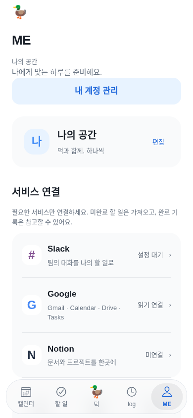
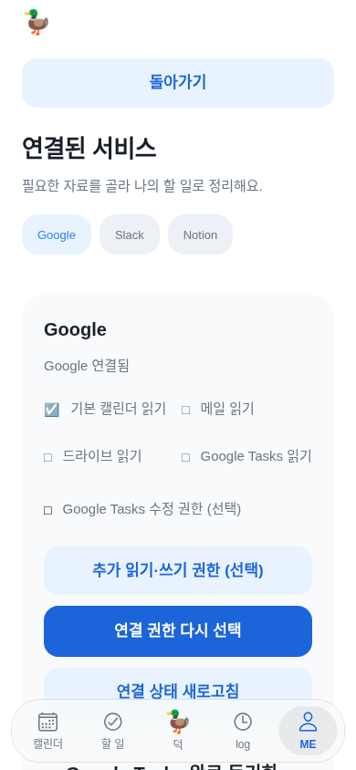
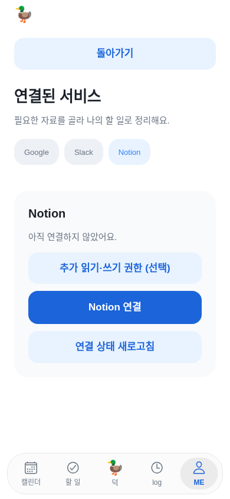
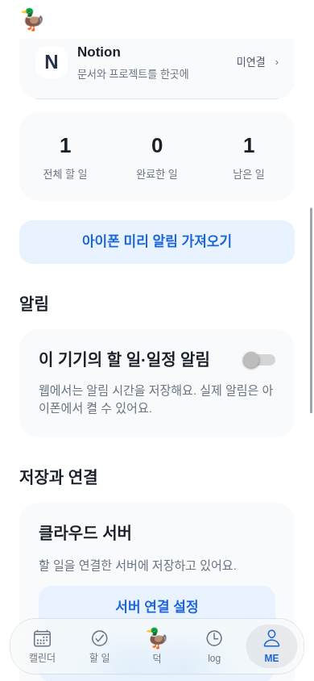
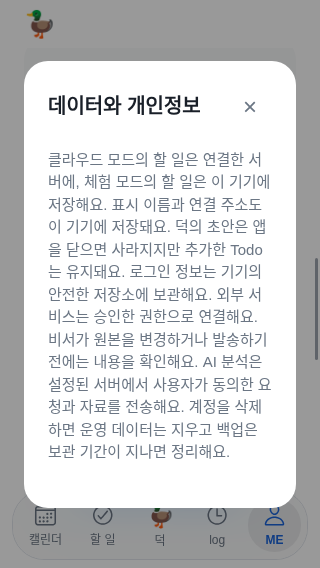
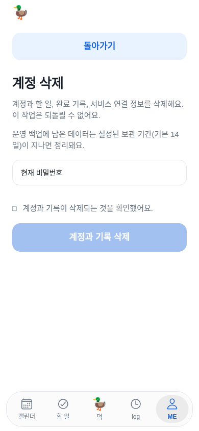
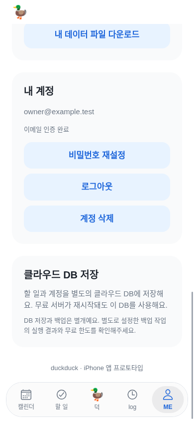
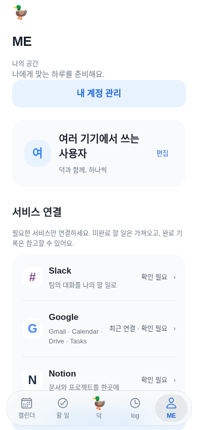
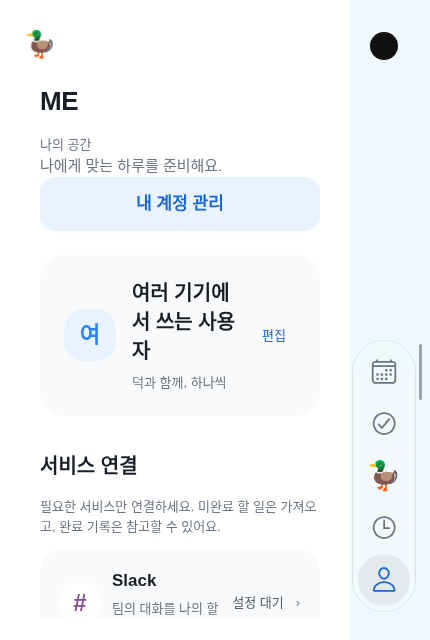
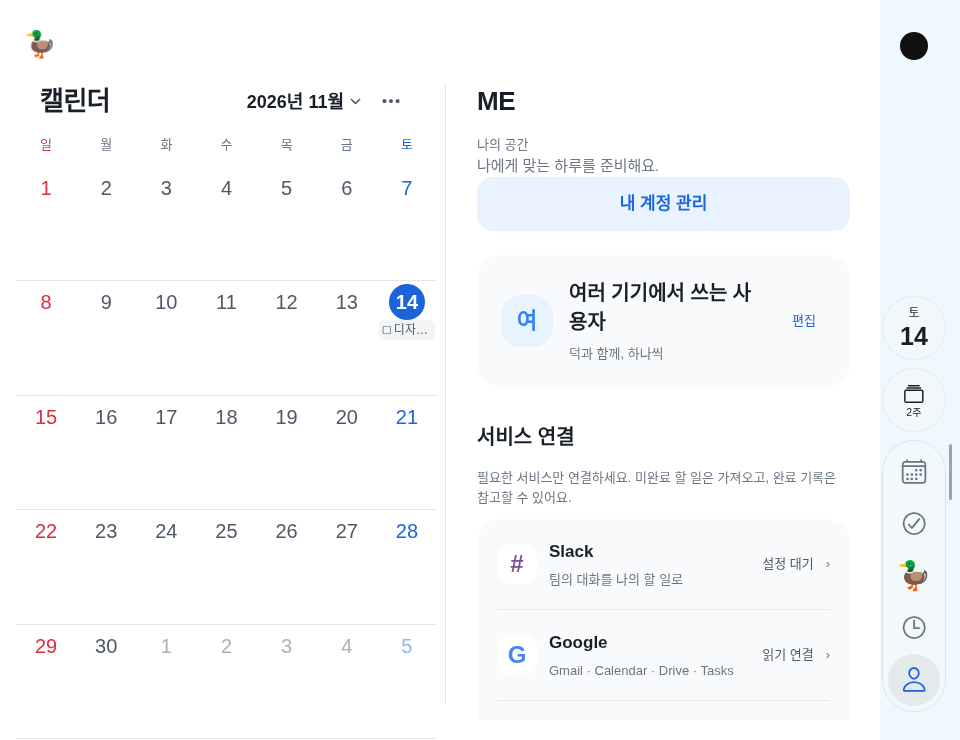

# ME — 개인 계정·연결·알림의 제품 디자인 검토

> 최신 정정: 사용자가 검토 제안 전체 구현을 승인했고 [ME 재설계 계약](me-settings-2026-11-14.md)에 구현했다. 아래 관찰·제안은 변경 전 연구 이력이다. [새 QA/화면](me-settings-qa-2026-11-14.md)을 현재 판단 기준으로 쓴다.

## 결론과 이번에 실제로 바꾼 범위

ME의 목적은 **내 계정과 연결 상태를 확인하고, 나에게 맞는 사용 방식을 정하는 것**이다. 현재는 프로필·일반 설정·자료 가져오기·서버 운영 설명이 같은 층위에 섞여 있다. 예쁜 카드로 다시 꾸미는 것보다 역할과 진입 경로를 먼저 정리해야 한다.

이번에는 사용자가 요청한 `내정보 → ME` 명칭만 실제 반영했다. 일반 iPhone 하단 탭/화면 제목, Duo 오른쪽 사람 아이콘의 접근성 이름/화면 제목, 이메일 인증 안내 등 현재 앱의 경로 설명을 통일했다. Duo에는 새 글자 탭을 만들지 않았고 아이콘·카메라 열·접힘/펼침/분할 위치를 보존했다. 내부 profile ID·표시 이름 저장 키·사용자 계정·OAuth·원본 데이터는 바꾸지 않았다. 기기별 선택 질문에는 별도 답변이 없어 같은 메뉴의 명칭은 두 기기에 통일하는 기본 적용으로 안내했다. 이를 새 배치/재설계의 승인으로 취급하지 않는다.

아래 정보 구조와 시각 정리는 **제안**이다. 이미 적용했다고 표시하지 않는다. 이전 [내정보 검토](profile-flow-audit-2026-11-14.md)는 이력이며, 이번에는 새 화면을 다시 조작·캡처했다.

## 다른 서비스에서 확인한 흐름

Apple·Google·Todoist는 아래 공식 안내를 직접 읽었다. 다른 서비스의 실계정이나 iOS 앱을 설치·로그인해 전 과정을 조작한 것은 아니다. 공식 문서에 설명된 흐름과 덕의 직접 조작을 비교한 연구이며 타 서비스의 화면 간격·속도를 실측했다고 주장하지 않는다. 검색 요약만으로 결론을 내리지 않았고 Apple HIG의 JavaScript 안내는 제공된 Markdown 원문으로 다시 확인했다.

| 비교 대상 | 공식 자료에서 확인한 구조 | 덕에 적용할 판단 |
| --- | --- | --- |
| Apple Calendar | 계정 추가·기본 캘린더·기본 알림 시간·표시 옵션을 구분해 안내한다. | 계정 연결과 개별 일정의 알림, 캘린더 보기를 같은 설정으로 섞지 않는다. [공식 설정 안내](https://support.apple.com/guide/iphone/change-your-calendar-settings-iphc37be2016/ios) |
| Google Calendar | 프로필 사진에서 계정 추가/기기 계정을 관리하고, 메뉴의 설정→일반에서 시작 요일·시간대·표시 방식을 바꾼다. | ‘누구의 자료인가’와 ‘어떻게 볼 것인가’를 나눈다. [계정](https://support.google.com/calendar/answer/15619834?co=GENIE.Platform%3DiOS) · [일반 설정](https://support.google.com/calendar/answer/6084644?co=GENIE.Platform%3DiOS) |
| Todoist | iOS의 Browse→설정→Calendar에서 캘린더 연결/동기화를 관리하고, Account에서 이름·계정 삭제 등을 다룬다. | 계정·서비스 연결·동기화는 목적별 하위 화면으로 나눈다. 덕의 서비스 연결을 Google Tasks 완료 동기화와 동일시하지 않는다. [캘린더 연결](https://www.todoist.com/help/todoist/integrations/use-the-calendar-integration-rCqwLCt3G) · [Account 설명](https://www.todoist.com/help/todoist/get-started/todoist-glossary-cA60laWMH) |

[Apple HIG Settings](https://developer.apple.com/design/human-interface-guidelines/settings)와 [공식 Markdown 원문](https://developer.apple.com/design/human-interface-guidelines/settings.md)은 설정 수를 줄이고 적절한 기본값을 제공하며, 특정 작업의 옵션을 그 작업 안에서 바꾸도록 권한다. 시스템 설정도 중복하지 않도록 한다. 따라서 ME를 ‘모든 설정을 옮겨 담는 곳’으로 만들지 않는다. 월/2주·검색/필터 같은 현재 캘린더의 조작은 계속 캘린더에 둔다. 단순한 새 다크 모드/접근성 스위치도 추가하지 않는다.

## 새 캡처로 확인한 순서

모두 현재 Expo 앱과 예시 API를 사용했다. Google 읽기 연결/Notion 미연결/Slack 운영 설정 없음이라는 상태를 구분했다. 원본 화면은 [current](../artifacts/me-product-review-2026-11-14/current/)에 보관한다.

1. **ME 진입 — 이름 변경 정상, 첫 화면의 우선순위 개선 필요.** ME 제목/하단 탭이 일치한다. ‘나의 공간’ 소개·동기부여 문구·큰 계정 이동 버튼·프로필 카드가 반복된다. 자주 찾는 알림 진입이 첫 화면 밖으로 밀린다.
   
2. **서비스 연결 — 상태 표시 가능, 진입과 선택이 중복된다.** ME에서 Google을 고른 뒤 다시 Google/Slack/Notion 탭을 제시한다. 이 테스트 상태에서 버튼11개와 별도 권한 체크박스가 있었다. Google 행을 누르면 Google 관리로 바로 가고, 연결 상태·사용할 자료를 우선 제시해야 한다. Notion 첫 연결에는 연결 버튼을 먼저 두는 게 명확하다.
   
   
3. **알림 찾기 — 웹의 기능 구분 정상, 위치는 개선 필요.** 통계와 미리 알림 가져오기가 알림보다 먼저 나온다. 알림은 별도 설정 구역으로 올리고, 자료 가져오기는 연결 관리 안으로 넣는 편이 자연스럽다. 웹의 native 알림 스위치는 비활성으로 구분되어 있었다. native에서 거절됐을 때 실제 OS 설정 이동·복귀 흐름은 별도 확인해야 한다. 현재 코드에는 이미 아이폰 설정에서 허용하라는 안내가 있으므로 안내 자체가 없다고 하지 않는다.
   
4. **데이터·개인정보 — 읽을 수 있으나 문장과 보관 범위 설명 개선 필요.** 320×568에서도 닫기44pt가 화면 안에 있었다. 잘렸다고 보고하지 않는다. 긴 한 문단을 저장 위치/AI 자료 사용/외부 연결/삭제로 나누고, ‘덕 초안’이 입력 중 문장인지 준비한 실행 초안인지 저장된 실행 기록인지 구분해야 한다.
   
5. **계정 관리·삭제 — 보호 절차 정상, 계정의 위치는 모호하다.** ‘내 계정 관리’는 새 화면 대신 같은 페이지 아래로 이동한다. 계정 전용 화면을 열어 이름·이메일·인증·로그아웃을 모으는 편이 예측 가능하다. 삭제는 비밀번호와 별도 체크를 요구하며 실행 전까지 비활성이다. 이 기능을 운영용 고급 설정 속에 숨기지 말고 계정 안에서 찾을 수 있게 유지해야 한다. 실제 삭제는 하지 않았다.
   
   
6. **저장·운영 설명 — 일반 사용자에게 과도하다.** 서버 연결 주소·클라우드 DB·무료 서버 재시작·백업 한도가 개인 설정과 같은 크기로 표시된다. 사용자에게 필요한 저장 상태만 먼저 보여주고 운영 정보는 고급 정보로 옮긴다. 실제 최근 동기화 시각이 없으면 성공 시각을 만들어 표시하지 않는다. 프로토타입 푸터도 실제 배포 상태에 맞게 정리할 필요가 있다.
   
7. **긴 이름·일시 오류·Duo — 상태 보존은 정상, 설명과 밀도 개선 필요.** 긴 이름은 줄바꿈됐지만 Duo 접힘에서는 이름이 세 줄로 늘고 마지막 한 글자가 남아 카드가 커졌다. 최대 두 줄·전체 이름을 읽을 수 있는 상세/접근성 이름을 함께 검토해야 한다. 일시 조회 실패에서도 기존 Google 연결을 지우지 않은 점은 유지해야 한다. ‘읽기 연결/쓰기 포함/설정 대기’만으로는 어떤 계정과 어떤 기능을 사용할 수 있는지 알기 어렵다. 표시 이름은 현재 기기별 저장이므로 여러 기기에서 동일한 계정 이름이라고 오해하지 않도록 범위를 설명해야 한다. Duo의 ME 제목·접근성 이름·카메라 열과 펼친 왼쪽 고정 캘린더도 확인했다.
   
   
   

## 추천하는 ME 구조 — 아직 미구현

| 기본 화면 | 바로 알 수 있어야 할 내용 | 들어가서 하는 일 |
| --- | --- | --- |
| 프로필 한 행 | 표시 이름·로그인 계정·인증 필요 여부 | 계정/이름·이메일 인증·비밀번호·로그아웃·계정 삭제 |
| 연결된 서비스 | 실제 연결 계정과 연결/확인 필요 상태 | 서비스별 자료 선택·추가 권한·가져오기·동기화·해제 |
| 알림 | 이 기기의 알림 상태 | 권한 확인·OS 설정 안내·예약/오류 복구 |
| 데이터·개인정보 | 데이터 보관과 AI 자료 사용의 진입점 | 데이터 내보내기·개인정보 설명·고급 연결 정보 |

지원·앱 정보는 작은 하단 항목으로 두되 새 지원 기능이 이미 구현돼 있다고 표시하지 않는다. 통계는 목적이 맞는 log에서 다루는 안을 추천한다. 현재 없는 계정 동기화 이름·새 권한 상태·새 지원 화면을 이 표만으로 완료 처리하지 않는다.

### 서비스별 흐름 제안

- 연결 확인: ME → Google → 연결된 계정/사용 중 기능 확인.
- 새 연결: ME → 서비스 연결 → 필요한 자료만 선택 → 외부 서비스 승인 → 돌아와 상태 확인.
- 원본 변경 권한: 실제 작업에서 필요할 때 설명 → 추가 승인 → 기존 미리보기/명시 확인. ME에 모든 쓰기 권한을 기본 노출하거나 자동 부여하지 않는다.
- 알림 문제: ME → 알림 → 기기 허용 상태 확인 → 필요하면 OS 설정 → 복귀 후 재확인. 단순 ‘다시 예약’을 반복시키지 않는다.
- 계정 삭제: ME → 내 계정 → 삭제 내용 확인. 비밀번호/별도 확인을 보존한다.

### UI 방향과 우선순위

1. **우선:** 서비스 선택의 중복과 과도한 버튼을 정리한다. 같은 서비스 안에서 여러 서비스 탭을 다시 고르게 하지 않는다. 자료/권한/복구를 필요한 단계에만 펼친다.
2. **우선:** 프로필·연결·알림·데이터 구역을 명확히 나눈다. 중복 소개·통계·서버 설명으로 주요 설정이 밀리지 않게 한다.
3. **다음:** 연결 계정/기능 범위와 저장 설명을 쉬운 말로 바꾼다. 준비되지 않은 서비스는 실행 가능한 버튼처럼 보이지 않게 한다. 실제 연결 실패와 미설정을 구분한다.
4. **다음:** 현재 디자인 토큰을 사용한 단순한 목록 행/구분선/일정한 여백으로 정돈한다. 모든 항목을 큰 파란 버튼·큰 카드로 반복하지 않는다. Glass는 기존 탐색·전환 역할을 유지하고 읽는 본문에는 과도한 효과를 더하지 않는다.

일반 iPhone은 기존 하단 ME에서 전체 본문을, Duo 접힘·세로는 오른쪽 탭을 유지한 단일 본문을 사용한다. 펼친 가로는 오른쪽 ME 안에서만 전환하고 왼쪽 캘린더를 보존한다. 새 배치·모달/하위 화면의 범위는 실제 재설계에 들어갈 때 기기별로 다시 확정한다. 현재 명칭 통일을 이 레이아웃 변경의 승인으로 해석하지 않는다.

## 검증과 한계

새 `mobile/e2e/me-review.mjs`로 위 흐름을 직접 조작·캡처했고 일반 iPhone·Duo 접힘/펼침에서 ME 진입과 고정 캘린더/카메라 중심선을 확인했다. 일시 조회 실패 후 기존 연결 보존/명시 재확인, 개인정보 닫기, 삭제 보호도 확인했다. 타입과 iOS JS/Hermes export가 통과했다. 이름만 바꾼 작업에 새 기능을 가정한 단위 테스트는 추가하지 않았다.

이 자료는 사용자 조사·성과 측정이 아니다. 실제 iPhone/Google/Todoist/Apple 앱의 사용 성공률·native VoiceOver/글자 확대·OS 알림 권한·여러 기기 이름 동기화는 별도다. 타 서비스 비교를 전체 서비스의 디자인 복제나 실계정 검수로 부풀리지 않는다. 실제 API/로그인/삭제/내보내기·모델 요청·새 native 빌드는 실행하지 않았다. 설치된 TestFlight30에는 이번 이름 변경이 없으므로 새 앱 빌드/업데이트가 필요하다.
