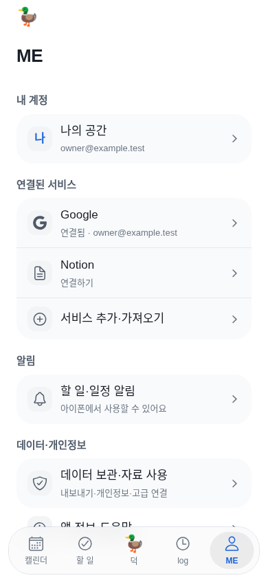
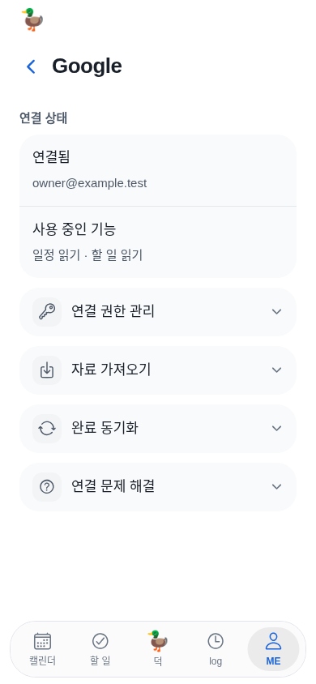
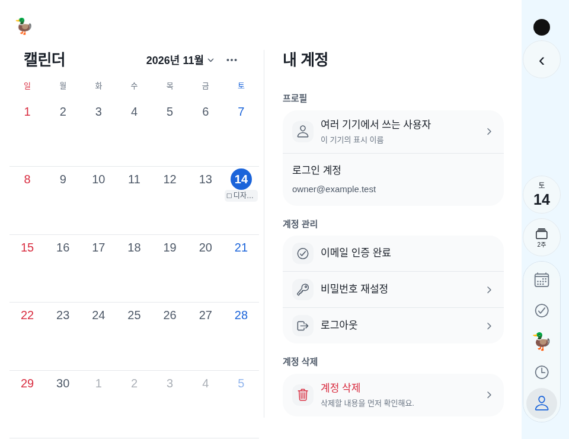

# ME 재설계 검증 — 2026-11-14

[구현 계약](me-settings-2026-11-14.md) · [이전 감사](me-product-review-2026-11-14.md) · [기계 검증 영수증](../artifacts/me-settings-2026-11-14/current/verification.json).

## 실제 실행 결과

- `npm test`: 전체276개·275통과·실패0·기존선택1제외. 상태 실패와 실제 해제 구분·정확한 scope 설명·잘못된 연결/동기화 응답 검증3건을 추가했다.
- `npm run check`: 서버/웹/도구49개 문법 통과. `npm run mobile:check`: TypeScript 통과. `EXPO_NO_TELEMETRY=1 CI=1`로 web/iOS JS export 통과. iOS JS export는 Xcode/서명 IPA 빌드가 아니다.
- `node mobile/e2e/me-settings.mjs`: 실제 Expo에서 이름/계정·Google 직접 진입·접힌 권한/자료/동기화·잘못된 성공 응답 복구·별도 권한 승인·미완료만 가져오기·명시 해제/취소·Todo 보존·알림 웹 안내·개인정보/내보내기·고급 조회·Back 스크롤/웹 초점 통과. 브라우저 pageerror0, 새 화면17개.
- `node mobile/e2e/app.mjs`: 기존5탭·가입/이메일 인증·원격 API Todo 저장·쿠키 재접속·로그아웃/계정 격리·세션 만료·확인 후 AI 실행·할 일 낙관적 완료/되돌리기/실패 복구·메모·일정·자료 가져오기/완료 참고·명시 동기화·데이터 파일·비밀번호 재설정·삭제 절차·반응형 통과. 격리된 로컬 API이고 사용자 계정은 아니다.
- `node mobile/e2e/session-isolation.mjs`: 시작 응답·늦은401·늦은 프로필 응답의3시나리오에서 새 계정/Todo 보존 통과.
- `node mobile/e2e/integration-stability.mjs`: 취소된 안전 GET의1회복구·최신 응답 우선·일시 실패시 연결 보존·재조회 성공시 상태 오류 제거 통과. 실제 서비스 토큰을 사용하지 않는다.
- `node mobile/e2e/duo-layout.mjs`: 물리 카메라 열 중심·접힘/펼침/회전·왼쪽 고정 Calendar·오른쪽만 전환·실제 Back·초안/월/스크롤 보존·짧은 높이·일반폰320/390/430·크게 표시한 라벨·줄인 모션 통과.
- `node mobile/e2e/motion.mjs`: 약한 메뉴 fade·급전환 초안 보존·시트 닫기·줄인 모션·완료 애니메이션/되돌리기 통과.
- `node mobile/e2e/assistant-chat.mjs`: 자료 동의·후속 질문/제안·미리보기/명시 실행·탭/크기변경 보존·이력 복구·소유자 격리 통과. 공급자 응답은 합성이다.
- `node mobile/e2e/calendar-cache.mjs`: 캐시 즉시 표시·출처별 반영·기간 겹침·오류 보존·페이지/삭제·늦은 응답 격리 통과.

## 직접 확인한 차이와 수치

새 첫 화면에 중복 통계/소개와 서버/DB 정보가 없다. Google 진입에서 같은 서비스를 다시 선택하지 않는다. 연결된 Google의 최초 버튼은 Back포함5개이며, 이전 감사 fixture에서는11개와 별도 권한 체크가 함께 보였다. 초기 화면에서 백업·완료 동기화 API 요청0회, 고급 화면을 열었을 때만 백업1회, 내보내기1회, 명시 확인한 해제1회다. 스크롤은 실제51→51px로 복귀했고 웹 키보드 초점도 원래 데이터 항목으로 돌아왔다.

권한의 임시 gmailSend 선택을 접어도 보존한다. 별도 완료 동기화 승인 요청은 기존 승인+tasks/tasksWrite만 보내고 이 gmailSend를 섞지 않았다. 해제 취소는 요청0회, 최종 해제 후 기존+가져온 Todo2개를 보존했다. 긴 이름은2줄이며 이름 수정창에 자동 초점을 주지 않는다.

## 새 화면

모두 현재 실제 Expo 앱과 **합성 자료·Duo 기하 fixture**다. 일반폰390×844, 작은폰320×700/다크, Duo접힘430×640/펼침960×740을 조작했다. 사람/실제 일정/로그인 토큰을 캡처하지 않았다. 검은 원과 파란 보조열은 카메라 기하를 검증하는 fixture 표시이며 제품 배경이 아니다.

| 화면 | 캡처 |
| --- | --- |
| 첫 ME | [01](../artifacts/me-settings-2026-11-14/current/01-me-overview.png) |
| Google 기본·펼친 권한·완료 참고 | [02](../artifacts/me-settings-2026-11-14/current/02-google-overview.png) · [03](../artifacts/me-settings-2026-11-14/current/03-google-permissions.png) · [04](../artifacts/me-settings-2026-11-14/current/04-completed-reference.png) |
| 일시 오류 보존 | [05](../artifacts/me-settings-2026-11-14/current/05-stale-connection.png) |
| 삭제 진입·긴 이름 | [06](../artifacts/me-settings-2026-11-14/current/06-account-delete.png) · [07](../artifacts/me-settings-2026-11-14/current/07-long-name-overview.png) |
| 알림·개인정보·고급·내보내기 | [08](../artifacts/me-settings-2026-11-14/current/08-notifications.png) · [09](../artifacts/me-settings-2026-11-14/current/09-privacy.png) · [10](../artifacts/me-settings-2026-11-14/current/10-advanced.png) · [11](../artifacts/me-settings-2026-11-14/current/11-export.png) |
| Notion 첫 연결 | [12](../artifacts/me-settings-2026-11-14/current/12-notion-connect.png) |
| Duo접힘·펼침 ME | [13](../artifacts/me-settings-2026-11-14/current/13-folded-overview.png) · [14](../artifacts/me-settings-2026-11-14/current/14-open-overview.png) |
| Duo접힘·펼침 계정 | [15](../artifacts/me-settings-2026-11-14/current/15-folded-account.png) · [16](../artifacts/me-settings-2026-11-14/current/16-open-account.png) |
| 작은 다크 화면 | [17](../artifacts/me-settings-2026-11-14/current/17-small-dark.png) |

## 한계와 업데이트

실제 Apple/Google/Todoist 앱을 재설치·로그인한 비교가 아니다. 이전 공식 문서 연구와 덕의 직접 조작을 근거로 한다. 사용성 정량 성과, native FPS/VoiceOver·동적 글자·권한 거절/기기 설정 복귀·iPhone 실제 알림 수신·실계정 OAuth는 미확인이다. 이를 웹 fixture 성공으로 대체하지 않는다.

가장 최근 확인된 native1.0.0(30)의 소스는382ad90, 서명 빌드/Apple업로드 성공은43553158014다. **이번 ME 재설계와 이전 메뉴 모션 수정은30 이후다. 사용자가 보려면 새 빌드·TestFlight 업데이트가 필요하며 이번에는 native 빌드를 시작하지 않았다.** 공개 문서/프로토타입 배포와 앱 설치는 구분한다.
