# ME 단순화 검증 — 2026-11-15

사용자 첨부0C284FBF의3장을 구조 참고로 삼았다. 실제 Expo 앱을 Chromium에서 실행하고 합성 계정/API·Duo 기하로 조작했다. 사용자 원본 자료/실계정 연결/실제 native 화면은 아니다. 일반390×844·작은320×640/700·Duo접힘430×640·펼침960×740을 확인했다.

전체 비교에서는 검정 배경, 회색 둥근 묶음, 아이콘과 제목, 오른쪽 짧은 상태, 들여쓴 구분선과 chevron 구조를 대조했다. 첫 묶음의 제목/상태/구분선을 집중 확인했다. 시스템16pt 본문·60pt 행을 유지했고 외부 서비스의 글꼴/로고/미제공 기능을 복제하지 않았다. 일반 하단 탭과 Duo 카메라 열은 의도적으로 유지한 차이다. 비교용 원본과 합성 화면을 함께 배치한 보드는 비공개 임시 경로에 두며 사용자 참고 이미지를 공개 갤러리에 복사하지 않았다.

수정 전에는 각 행마다 반복된 절 제목과 긴 설명이 있었다. 수정 후에는3개 묶음 목록이며 대화·기억/동작 방식에 바로 들어간다. 현재 범위의 최종 시각 검사에서 남은 P0/P1/P2는 없다. 실제 iOS Dynamic Type·VoiceOver/IME·키보드·physical Duo는 별도 검수가 남는다.

실제 조작 검사:

- ME의 유일한 상단 제목, 서비스 목록 한 단계 안쪽 진입, 짧은 연결 상태와 unavailable 구분.
- 동작 방식 직접 진입·맞춤 지침 표시·읽기만으로 권한 변경 없음.
- Google 개별 scope 확인·추가 권한 선택 유지·명시 승인 전 권한 확대 없음.
- 완료 동기화의 지연 조회/잘못된 응답 복구, 미완료만 가져오기, 완료 기록 읽기만 허용.
- 연결 상태 실패 뒤 재확인, 취소/확인 후 해제, 가져온 Todo 보존.
- 표시 이름 편집·자동 키보드 초점 없음, 계정 삭제 확인, 개인정보/내보내기/고급 정보 진입.
- 돌아오기 전후 스크롤100→100와 버튼 초점 복원,320px 가로 넘침 없음.
- Duo 반대 캘린더 pane 경계·카메라/내비게이션 중심선 보존, 일반형 하단 탭 유지.
- 콘솔 pageerror0. 별도 agent 회귀11장으로 채팅/작업/파일/지침/일반·Duo를 확인했다.

`mobile/e2e/me-settings.mjs`의 검사 결과는 [verification.json](../artifacts/me-simple-2026-11-15/verification.json), 새 화면은 아래22장이다. `ME_CAPTURE_DIR`와 `AGENT_CAPTURE_DIR`로 옛 공개 이미지를 덮어쓰지 않고 회귀를 실행했다. 모바일 타입과 web export, 실제 전체 앱 회귀도 통과했다. native prebuild/import·96문법과 수정2a7c64d CI43700584690 성공은 별도의 빌드38 수정 검증이다. 추가 Apple SDK preflight의 실제 Mac 실행/서명/제출 성공은 아직 확인 전이다.

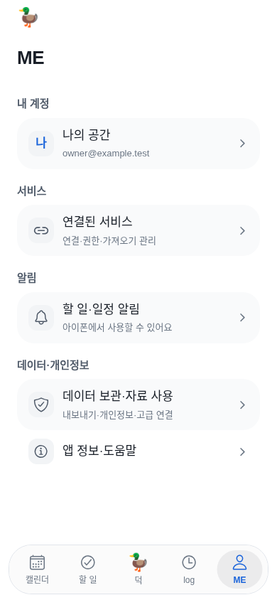
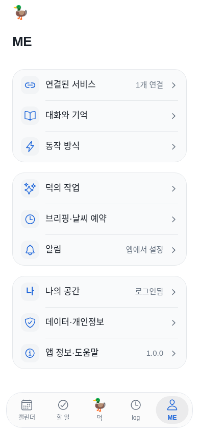
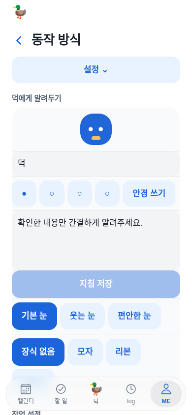
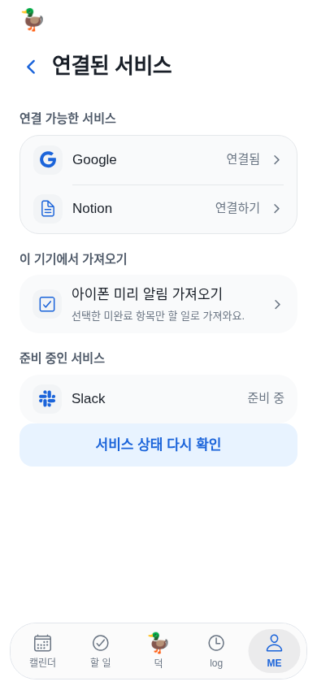
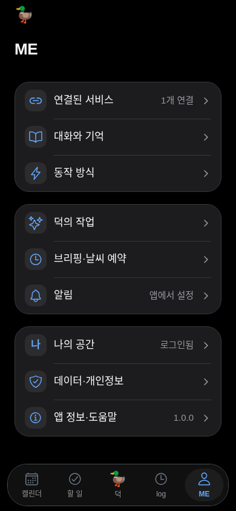
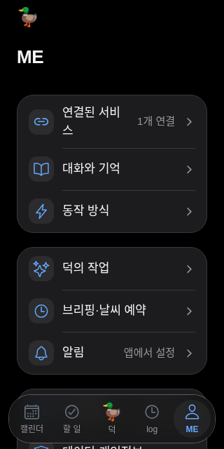
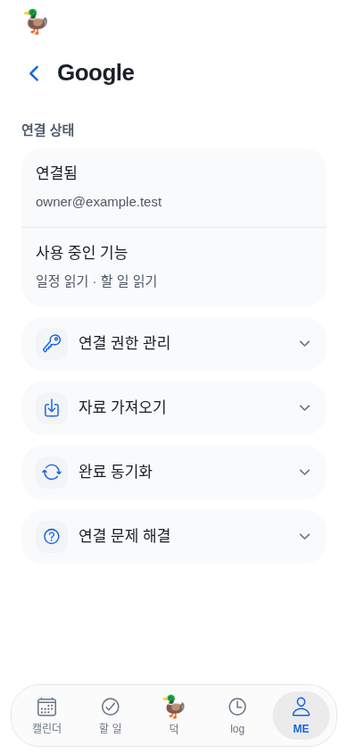
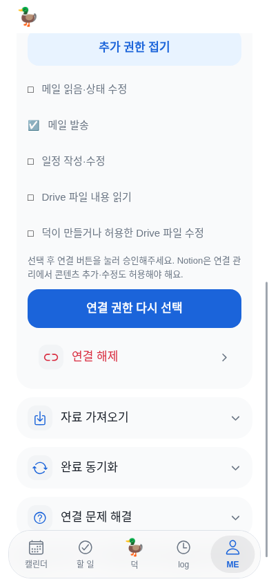
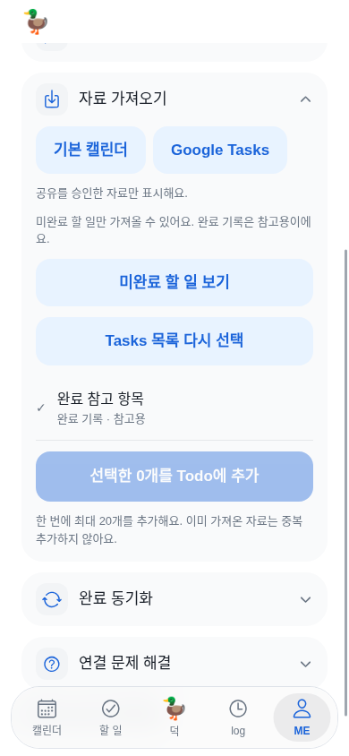
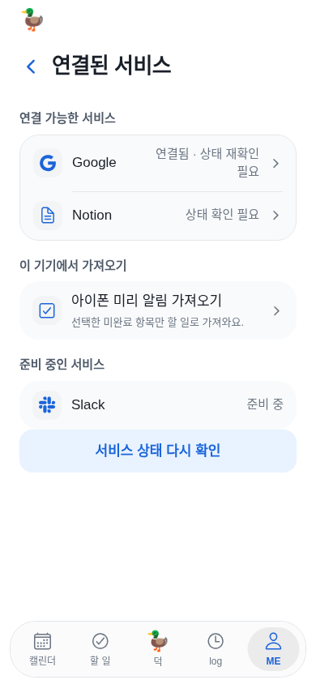
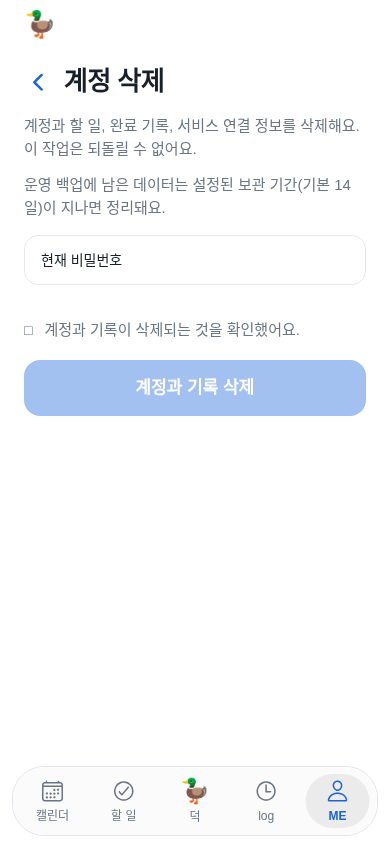
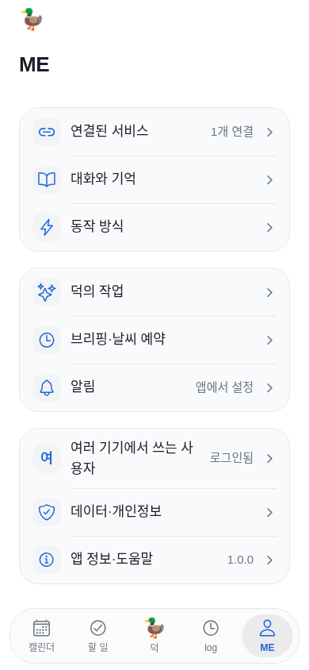
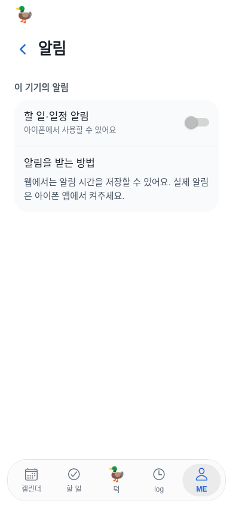
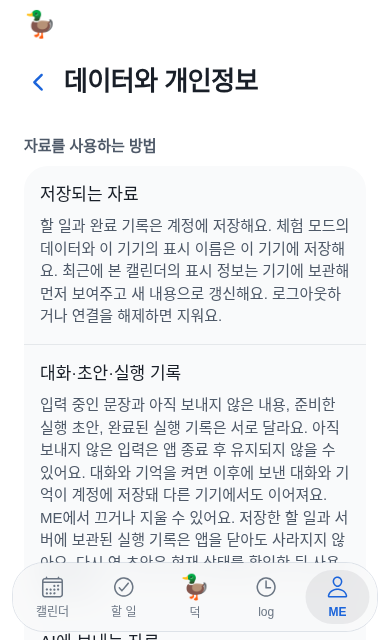
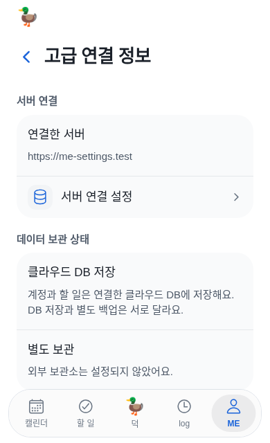
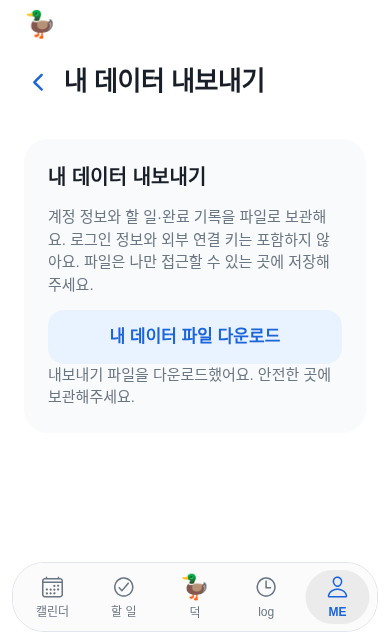
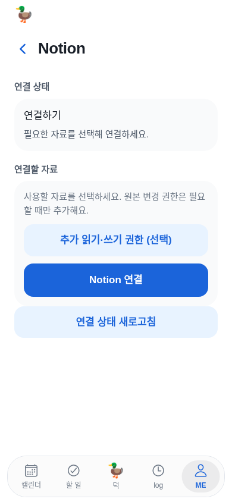
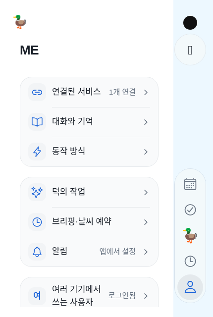
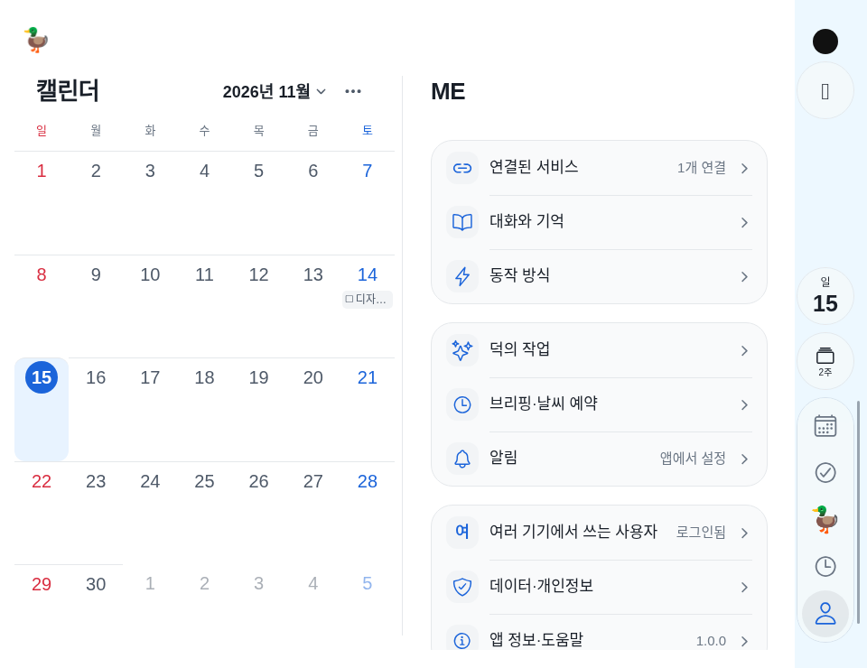
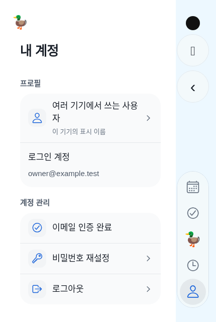
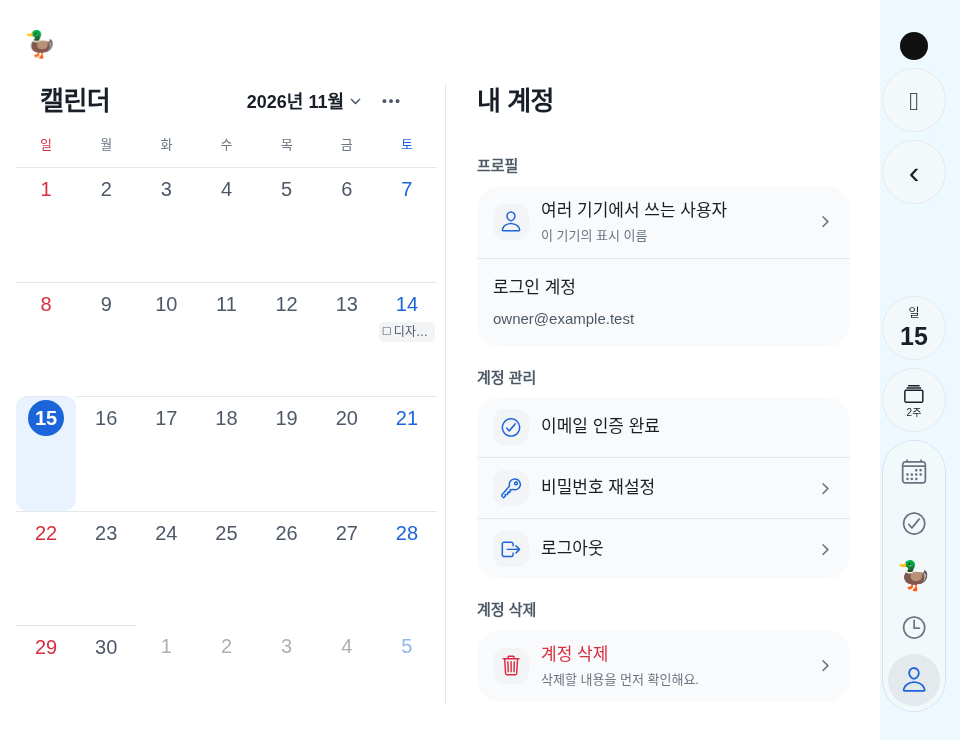
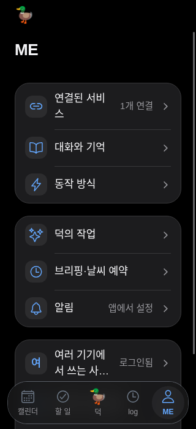

final result: passed
