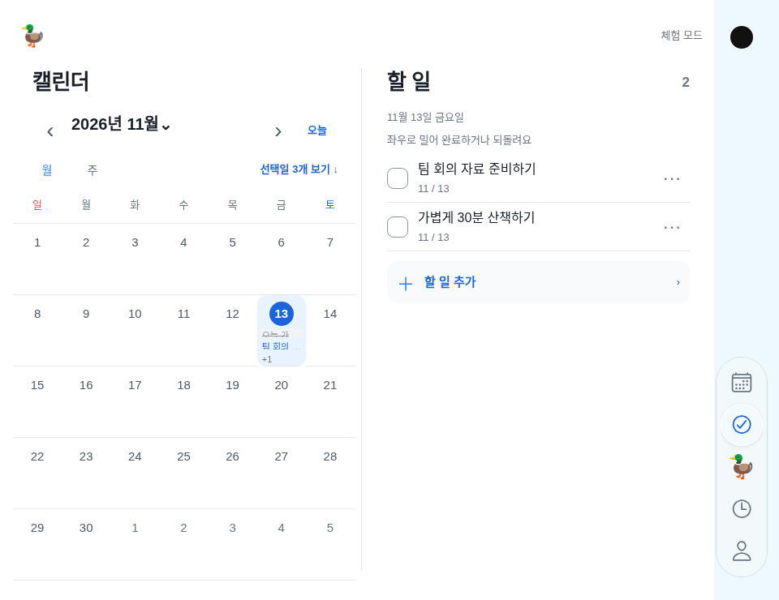

# 내비게이션 선택 표시의 Glass 정정 — 2026-11-13

> **현재 구현 기준:** [전체 이어받기 기준서](continuation-guide.md) → [Liquid Glass 상태·수치·검수](liquid-glass-navigation.md). 아래 날짜별 기록은 당시 이력입니다. 일반 iPhone 하단 capsule·상태별 터치 동작, Duo 카메라 열·64/272/52/28,3초 완료,예약 메시지 문서 대기 해제가 최신이며 이전 설명보다 우선합니다. 구현·웹 검사·native 빌드·실기기 확인은 따로 읽으세요.

## 2026-11-13 정정 — 파란 선택 음영을 실제 GlassView로 변경

사용자가 “Liquid Glass가 아니라 파란 음영”이라고 보고했다. 소스에서 **움직이는 선택 표시는 rgba(49,130,246,0.16) 색의 일반 Animated.View이고 native GlassView는 바 배경에만 연결돼 있었다**는 것을 확인했다. 따라서 이전 “Glass 연결” 설명을 선택 표시 전체의 실제 유리 검증으로 읽으면 안 된다. 사용자는 **아이폰 TestFlight 앱**에서 본 현상이라고 답했다. 웹 미리보기 차이로 설명하지 않는다. 실제 설치 버전/OS/접근성 모드를 원격으로 읽은 것은 아니다.

구현fdd555f에서 파란 채움을 제거하고 선택 표시 안에도 NavigationGlass의 **selection variant**를 넣었다. 지원 iOS는 실제 GlassView regular·isInteractive=true를 사용하며 글라스가 들어가는 부모/선택 이동 뷰의 opacity를 낮추지 않는다. 바깥 host의 overflow:hidden도 제거해 유리 가장자리/깊이 효과를 자르지 않게 했다. 이동은 기존250ms/1.06배 커스텀 애니메이션이고 Apple이 자동으로 생성하는 tab 동작 전체를 복제했다고 하지 않는다. 선택 아이콘의 기존 파란색·카메라 열·크기·구분선·입력/월/스크롤은 보존한다.

웹/이전OS의 선택 표시는 **중립색 반투명 블러 대체**이며 native Liquid Glass가 아니다. 투명도 줄이기/강제 고대비는 불투명한 대비 선택 표시를 사용한다. 가용성 검사나 사용자 OS 설정을 끄거나 우회하지 않는다. [Apple Materials](https://developer.apple.com/design/human-interface-guidelines/materials.md)는 clear를 시각적으로 풍부한 배경용으로 안내하므로 흰 표면의 덕은 regular를 유지한다. [Expo Glass 공식 API](https://docs.expo.dev/versions/latest/sdk/glass-effect/)를 따르고 새 native 패키지/인증은 추가하지 않았다.

검증: 문법·전체225개 중224통과/실패0/기존 선택1개 제외·타입·웹/iOS JS export·전체 앱/모션·Duo 회귀에서 파란 선택 배경 없음, 명시적 중립 fallback/불투명 모드, glass host 비클리핑, 선택 이동/연속 전환/동작 줄이기·구분선/기존 상태를 확인했다. 첫 웹 색상 단정은 BlurView가 실제 tint 색으로 덮는 점, 고대비는 OS 팔레트를 쓰는 점을 반영해 **중립/투명·대비·불투명 정책**을 검사하도록 바로잡았다. 공개 문서/디자인 가이드와153개 이미지 해시도 검증했다. native 광학 효과를 웹 캡처로 검증했다고 하지 않는다.

실제 최신 빌드도 확인했다. [43374883126](https://github.com/thepmpo/donknow/actions/runs/43374883126)은 소스57530ac의 **1.0.0(20)**이며 Xcode27.1·ExpoGlassEffect58.0.5 설치/패키징·서명IPA 생성·**15:04:13 KST Apple 업로드 성공**이다. [제출 상세](https://expo.dev/accounts/thepmpo/projects/duckduck-donknow/submissions/387bcae4-0749-4feb-b83a-c66fff678447).20번에는 구분선과 Glass 모듈이 있지만 선택 표시는 수정 전 파란색이다. 사용자 설치/Apple 처리 완료까지 독립 확인한 것은 아니다.

**이번 선택 재질 수정은20번에 없다.** 현재 Expo Update를 구성하지 않았으므로 최신 main의 새 무료 빌드·Apple 처리·실제 아이폰 비교가 필요하다. [무료 빌드 화면](https://github.com/thepmpo/donknow/actions/workflows/ios-testflight.yml)의 새 main 실행을 사용하고20번 실행의 재시도는 하지 않는다. 다음 번호를 미리 고정하거나 실제 폰의 Glass 모드를 추정하지 않는다. 기존 데이터·인증·서명·원본 recovery bundle·무료 플랜을 보존했다.

## 수정 후 웹 확인용 이미지

이 이미지는 실제 앱 컴포넌트의 기하/체험 데이터 웹 fixture다. native Glass/실기기 사진이 아니며 OS의 굴절/재질/상호작용 품질을 보장하는 시안으로 쓰지 않는다. 파란 카메라 열·검은 점은 위치 안내이고 제품에 그리지 않는다.

## 확인된 것과 다음 검수

- [x] 20번 빌드에 ExpoGlassEffect native 모듈이 설치·패키징되고 Apple에 업로드된 실제 로그.
- [x] 20번 소스의 선택 원은 일반 파란 View였다는 확정 원인과, 바 배경의 Glass 연결을 구분.
- [x] 선택 표시를 기존 가용성/접근성 정책의 GlassView로 변경하고 파란 배경/부모 클리핑 제거. pointerEvents는 기존 버튼에 전달.
- [x] 웹에서는 native 효과를 주장하지 않고 중립 fallback·OS 강제 고대비를 존중. 모션/상태/터치·화면 배치 회귀 통과.
- [x] 사용자 답변: 아이폰 TestFlight 앱에서 관찰한 현상.
- [ ] 실제 설치 버전/OS/접근성 재질 모드와 수정 후 실제 화면 확인.
- [ ] 수정 후 새 native 빌드에서 Material/Selection GlassView 실제 렌더링·가장자리/굴절·250ms 이동·눌림·큰 글자/VoiceOver/투명도 줄이기/동작 줄이기 검수.

사용자에게 실제 iPhone 화면을 보지 않고 Glass가 정상으로 보인다고 단정하지 않는다. 무늬가 없는 흰 배경에서는 굴절이 눈에 덜 보일 수 있지만 이번 파란 선택 View 누락을 사용자 설정 탓으로 돌리지 않는다. OS 강제 고대비나 투명도 줄이기는 사용자의 선택이며 효과를 강제로 켜지 않는다.
