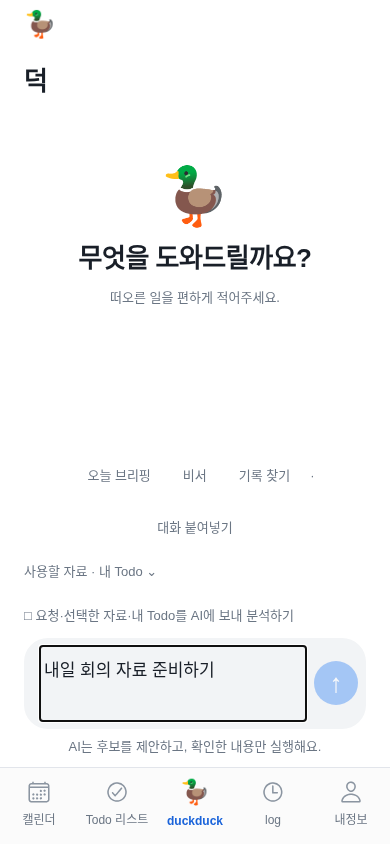
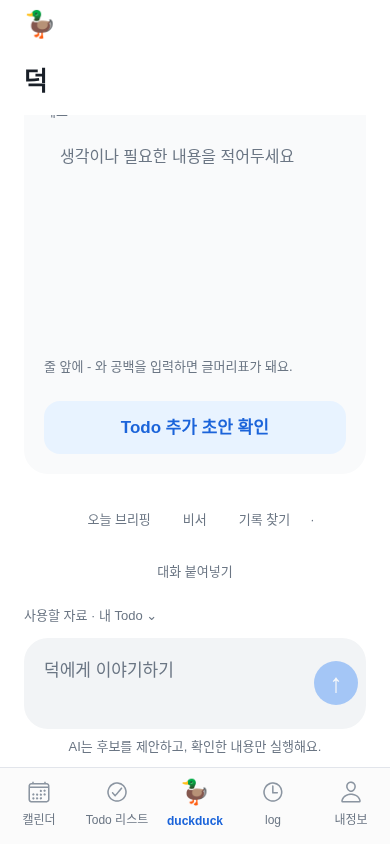
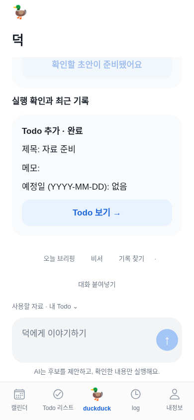
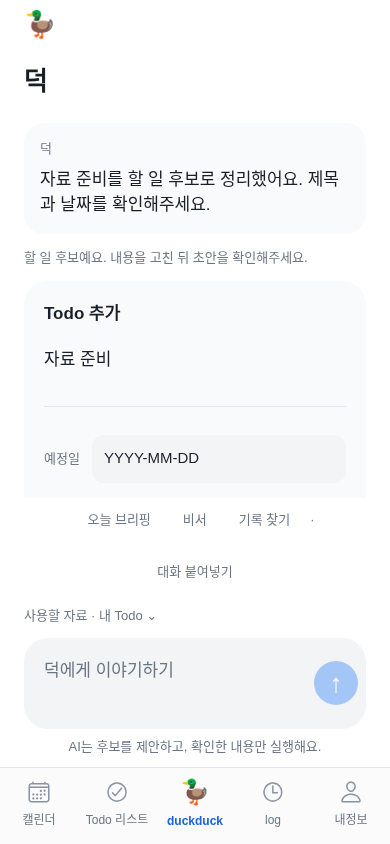
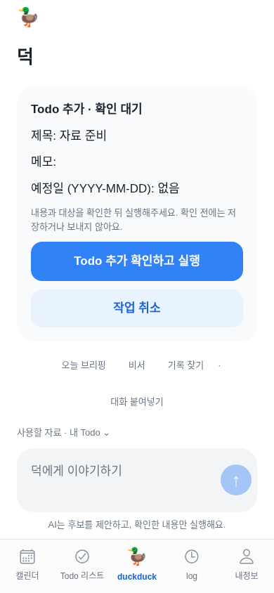
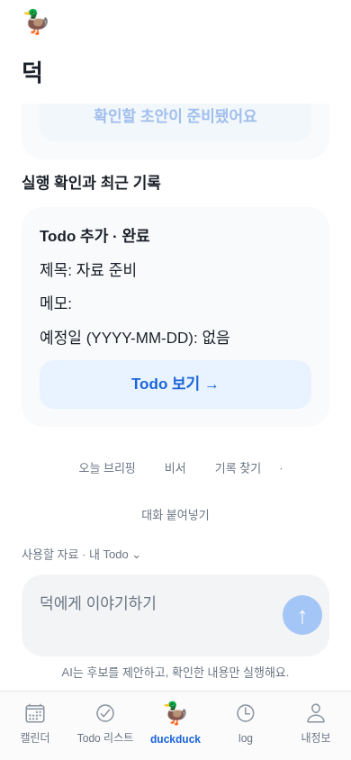

# 덕 채팅 Product Design 검토 — 2026-11-12

## 범위와 판단 근거

Product Design 설치 완료 알림 뒤 기존 덕 작업을 이어서 요청 입력→후보 편집→실행 확인→저장 결과를 검토했다. 기준 소스는 `7644621`, 검토 시작 main은 `ee08bdb`다. [공식 audit 지침](https://github.com/openai/plugins/blob/d420d13051bffe4543ed39e30fa46b87148e47dd/plugins/product-design/skills/audit/SKILL.md)을 읽고 현재 실행한 화면만 근거로 삼았다. 기존 승인된 차분한 비서·기존 토큰·5개 탭·확인 후 실행 원칙을 유지한다.

현재 Expo 웹 번들을 390×844px에서 실행하고 테스트 전용 계정·AI 응답·Todo 저장을 사용했다. 아래 이미지는 이번 검토에서 새로 캡처해 각각 열어 확인했다. 실제 사용자 자료·AI 호출·외부 쓰기·iPhone 기기 화면이 아니다. 공유 클라우드 브라우저 조작 도구가 노출되지 않아 기존에 승인된 앱 검사 경로인 격리 브라우저로 검증했다. 모바일 키보드/VoiceOver와 네이티브 힌지 검증은 별도다.

설치 완료 알림과 현재 도구 카탈로그 표시가 일치하지 않아 공식 고정 버전 원문을 읽었다. 전용 플러그인 원격 실행 성공을 주장하지 않는다. Product Design의 별도 로컬 user-context는 없었고, 이미 승인된 저장소 문서와 개인 Notion을 기준으로 사용했다. 새로운 전역 설정·브라우저 인증·계정 권한은 만들지 않았다.

## 검토한 네 단계

### 1. 요청 입력·자료 동의 — 기본 흐름 정상

입력창 가까이에 자료 사용 동의가 있고 동의 전 전송이 비활성화된다. 요청을 입력하는 것만으로 AI 호출·Todo 생성이 발생하지 않았다. 작은 설명문·체크 상태의 실제 화면 낭독과 큰 글자 사용성은 실기기에서 확인해야 한다.

### 2. 후보 편집 — 이동 위치 수정 완료

응답 후 맨 아래로 이동해 후보 제목·날짜가 위로 가려지고 빈 메모와 버튼만 보였다. 저장된 실행 기록이 있으면 더 오래된 기록으로 이동할 수도 있다. 새 답변·후보와 방금 만든 초안 위치를 기준으로 이동해야 한다. 기존 메모 편집 높이·토큰을 임의로 줄이는 대신 이동 동작을 바로잡는다.

### 3. 실행 미리보기 — 확인 경계 정상, 읽기 전용 표시 보완 완료

실행 전 제목·대상과 확인 버튼을 볼 수 있고 이 시점에는 Todo가 만들어지지 않는다. 소스 검토에서는 준비된 후보의 제목·메모는 잠겨도 날짜 선택기는 열리는 문제를 확인했다. 변경이 반영되지 않는 입력처럼 보이지 않게 준비 후 날짜를 읽기 전용으로 표시한다.

### 4. 저장 결과 — 완료와 다음 이동 정상

명시적 확인 후 Todo가 1개 생성되고 완료 상태와 Todo로 이동하는 버튼이 나타났다. 현재 검토 계정은 실행 이력이 짧다. 이력이 많은 경우에도 방금 실행한 결과가 바로 보이도록 별도 회귀가 필요하다.

## 추가 코드 검토와 적용 범위

자료 선택 버튼은 입력창 가까이에 있지만 패널은 대화 스크롤 안에 있어 긴 대화의 위쪽에서 누르면 패널이 보이지 않을 수 있었다. 열 때 패널 위치로 이동하도록 보완했다. 전송·동의·자료 선택의 터치 높이는 코드에서 최소 44pt를 확보한다. 스크린샷만으로 WCAG 전체 준수나 화면 낭독 성공을 주장하지 않는다.

이번 수정 범위는 새 결과의 위치 안내, 자료 선택 표시, 확정 후보 날짜의 읽기 전용 표현이다. 색상·브랜드·전체 레이아웃 변경, 새 캐릭터, 브리핑·날씨, 새 외부 계정 권한은 포함하지 않는다. 별도 톤 선택은 필요하지 않다.

## 검증 결과와 남은 일

초기 4단계 캡처에서 실제 웹 번들이 실행됐고, 모의 AI 요청 1회·확인 후 Todo 저장 1회·브라우저 오류 없음으로 확인했다. 수정 후 검사와 캡처는 아래에 이어 기록한다. 실제 AI 활성화·Render 배포·TestFlight 설치·Duo 실기기는 이전 운영 기록을 따른다.

## 수정 후 확인 — 구현 adf396b

새 답변·준비한 초안·실행 결과의 시작 위치를 네이티브 레이아웃 좌표로 찾아 이동한다. 기록 끝으로 무조건 이동하지 않는다. 자료 선택도 열었을 때 해당 제목을 보여준다. 이미 준비한 후보의 날짜는 읽기 전용 텍스트로 바꿨다. 줄바꿈·긴 답변·메모 편집 높이·브랜드 토큰은 유지한다.

| 단계 | 최종 상태 | 실제 확인 |
|---|---|---|
| 1 요청 입력·자료 동의 | 정상 | 동의 전 보내기 비활성, 화면을 열거나 입력하는 것만으로 실행하지 않음 |
| 2 후보 편집 | 수정 후 정상 | 짧은 답변 아래 제목·날짜가 화면 안에 보임. 긴 답변은 답변 시작을 보여주고 본문은 스크롤로 보존 |
| 3 실행 미리보기 | 수정 후 정상 | 새 초안의 확인 대기 제목·내용·실행 버튼이 보임. 준비한 날짜는 읽기 전용 |
| 4 결과 확인 | 정상 | 확인 후 Todo 한 번 생성, 완료 상태와 Todo 보기 표시. 이전 기록 5개가 있어도 최신 결과가 보임 |

수정 후에도 390×844px의 같은 흐름을 새로 실행해 각 캡처를 열어 확인했다. 2단계의 전후 이미지를 함께 비교해 제목·날짜가 가려졌던 문제가 해소됐음을 확인했다. 아래 네 이미지는 수정 후의 모의 데이터 화면이다.

검증 결과:

- `npm run check`: 문법 검사 39개 통과.
- `npm test`: 총 203개 중 202개 통과, 실패 0개, 기존 사무실 격리 선택 검사 1개 건너뜀.
- 모바일 TypeScript, 웹 export, iOS JS export 통과. 네이티브 Swift·IPA·실기기 검증을 대신하지 않는다.
- `mobile/e2e/assistant-chat.mjs`: 이전 기록 5개가 있는 상태의 새 답변·후보 제목·날짜·초안·완료 표시, 자료 선택 노출, 준비된 날짜 비활성, 기존 동의·한 번 실행·계정 격리 회귀 통과.
- 전체 앱 `npm --prefix mobile run test:e2e` 통과.
- 수정 후 4단계 캡처: 모의 AI 요청 1회, 확인 후 Todo 생성 1회, 브라우저 오류 없음.

운영 한계: 실제 AI 서버 활성화·새 외부 계정 쓰기·iPhone 키보드/VoiceOver·Duo 실기기는 별도다. Render 자동 배포가 꺼져 있어 GitHub 저장만으로 공개 문서/화면은 바뀌지 않는다. 이번 후속 작업도 개인 Notion 업무 기록에 별도로 저장한다. 사무실 업데이트는 요구하지 않는다.

문서 회귀에서는 본문의 전후 이미지 8장이 추가돼 기존 “전체 이미지 수=갤러리 수” 가정이 실패했다. 갤러리의 파일 목록을 manifest와 정확히 대조하도록 검사하고, 본문 이미지는 이미지용 주소로 변환해 같은 `/project-assets/`에서 지연 로딩되도록 생성기를 수정했다. 이후 공개 문서·전체 이미지·댓글 CRUD·XSS 방지·320px·디자인 가이드 회귀가 통과했다. 실패를 제거하기 위해 이미지 검사를 생략하지 않았다.

후속 운영 조회에서 Render 플러그인으로 기존 무료 `duckduck-test` 서비스에 접근했다. 배포 전 실제 live는 `5e129f0`이고 자동 배포는 꺼져 있었다. 이전의 “연결 도구 없음”은 당시 상태다. 기존 서비스를 유지한 최신 main 배포와 공개 문서 반영 확인은 이 후속 작업에서 계속 진행한다.
