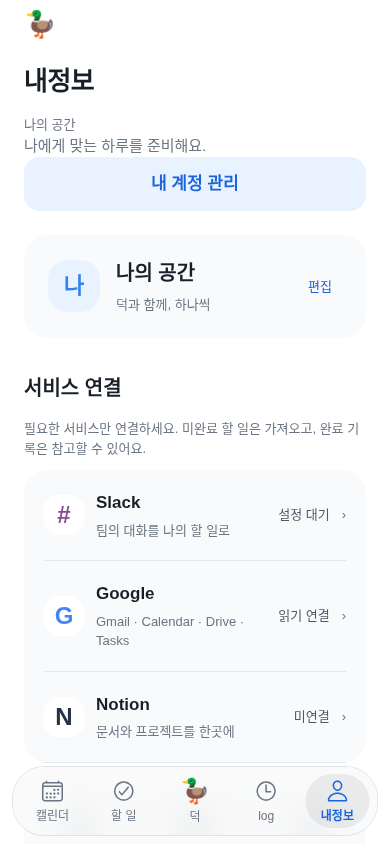
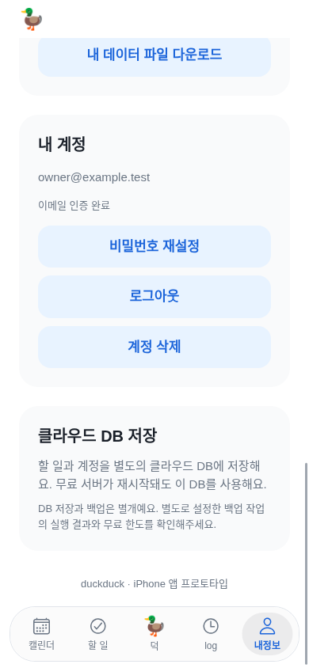
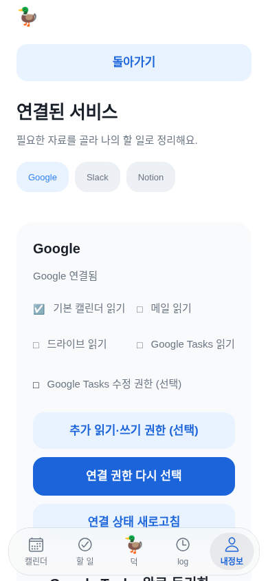
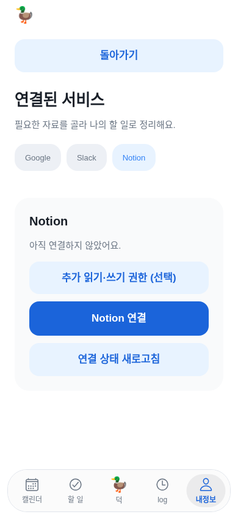
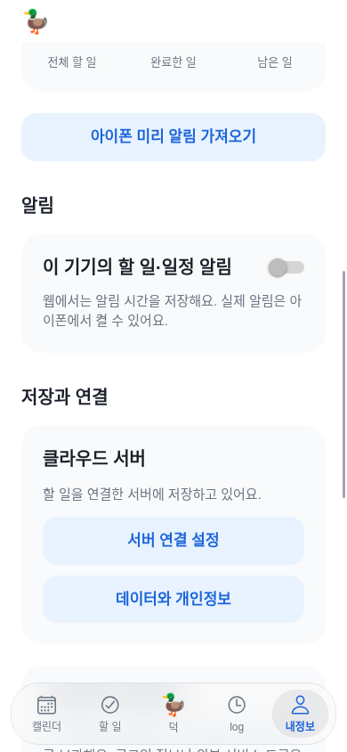
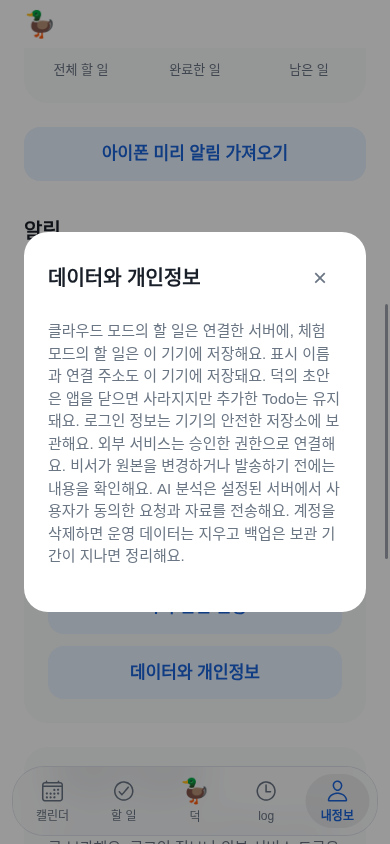
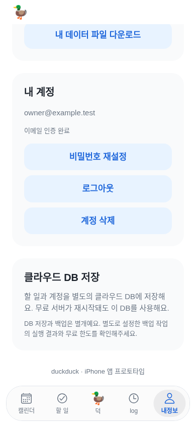
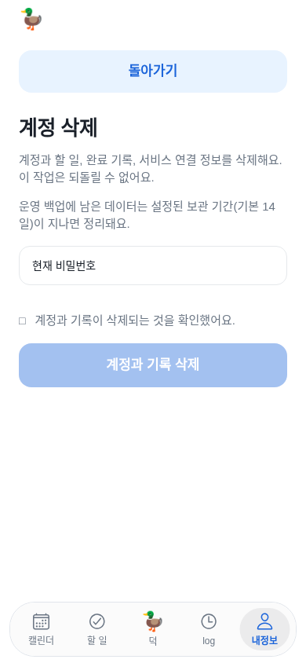

# 내정보의 사용자 흐름 점검

현재 Expo 앱을 테스트 브라우저에서 직접 조작했다. 사용자 실계정 대신 읽기 연결된 Google·미연결 Notion·미설정 Slack과 예시 할 일 하나를 사용했다. 일반 iPhone 390×844 기준의 새 캡처이며 native·사용자 데이터가 아니다. 빈 로딩/잘못된 모의 응답으로 찍힌 화면은 증거에서 제외했다. 내정보 코드는 이번에 재설계하지 않았고 아래는 점검 결과와 수정 제안이다.

## 순서별 화면과 상태

1. **내정보 진입 — 개선 필요.** 이름·짧은 소개·큰 계정 이동 버튼·프로필 카드가 먼저 나온다. 서비스 연결은 그 아래에 있어 알림 설정은 첫 화면에서 보이지 않는다. 반복 소개와 여백을 줄이고 이름/계정을 한 구역으로 묶으면 좋다.
   
2. **내 계정 관리 — 이동 동작 정상, 경로는 길다.** 버튼은 새 계정 화면을 여는 대신 긴 같은 페이지 아래로 이동한다. 이메일·인증·비밀번호·로그아웃·삭제가 보이며 파괴적 삭제에는 별도 확인이 있다. 계정 전용 화면으로 나누면 뒤로가기가 더 예측 가능하다.
   
3. **Google 연결 설정 — 동작 가능, 선택 과다.** 읽기 연결인데 수정 권한·재승인·상태 새로고침·Tasks 동기화·점검·해제를 한 화면에서 다룬다. 처음에는 ‘연결 상태/사용할 자료/연결 관리’만 보이고 쓰기·동기화·점검은 필요한 때 펼치면 좋다. 이번에는 OAuth나 원본 쓰기를 실행하지 않았다.
   
4. **Notion 미연결과 돌아가기 — 정상, 안내 개선 필요.** 연결 전 추가 읽기·쓰기 권한 버튼이 주요 연결 버튼보다 먼저 보인다. 첫 연결에는 간단한 설명과 연결 버튼을 우선하고 고급 권한은 선택 사항으로 두는 편이 명확하다. 돌아가기는 내정보 첫 위치로 복귀하므로 이전 스크롤 위치 보존도 검토할 만하다.
   
5. **알림·저장과 연결 — 정보 구조 개선 필요.** Todo 통계와 미리 알림 가져오기가 알림 앞에 있고 서버 설정이 그 다음에 있다. 추천 순서는 ‘계정/서비스 연결/알림/데이터·개인정보’다. 서버 주소는 일반 사용자의 자주 쓰는 설정이 아니므로 고급 설정 안으로 분리하는 게 좋다. 웹에서 native 알림을 켜지 못한다는 구분은 정상이다.
   
6. **개인정보 설명 — 내용 정정·가독성 개선 필요.** 한 덩어리의 긴 문단이며 제목/소제목 없이 저장·AI·연결·삭제를 모두 설명한다. ‘덕 초안은 앱을 닫으면 사라짐’은 서버에 남는 실행 기록과 기기 입력 초안을 구분해야 한다. 저장 위치/AI에 보내는 자료/연결 해제/계정 삭제로 나누고 짧은 화면에서는 스크롤 가능 여부도 별도 검사해야 한다.
   
7. **클라우드 DB·백업 — 일반 사용자에게 불필요하게 상세.** 무료 서버 재시작·DB·백업 설정·무료 한도는 운영 정보다. ‘데이터 저장 상태’ 한 줄과 오류가 있을 때의 안내를 먼저 보여주고 기술 내용은 고급 정보로 이동할 수 있다. ‘iPhone 앱 프로토타입’ 문구도 출시 상태에 맞게 정리해야 한다.
   
8. **계정 삭제 진입 — 확인 구조 정상.** 비밀번호+삭제 확인 체크를 요구하고 기본 실행 버튼은 비활성이다. 실제 삭제는 하지 않았다. 이 확인과 데이터 내보내기·로그아웃·복구 기능은 정리 과정에서도 보존해야 한다.
   

## 먼저 바꿀 순서

1. 사용자 설정과 운영/서버 설명을 분리하고 중복 소개·통계를 줄인다.
2. 연결된 서비스는 상태를 먼저, 쓰기 권한·동기화·점검은 필요한 경우에만 펼친다.
3. 이름/계정을 한 곳에 두고 ‘내 계정 관리’가 긴 페이지 이동인지 전용 화면인지 일관되게 만든다.
4. 개인정보 문장을 짧게 나누고 기기 입력 초안과 서버 실행 기록의 보관 범위를 바로잡는다.

시각적으로 작은 보조 글자·긴 한국어 줄바꿈·고정 하단 메뉴에 가리는 조작부를 확인했다. 사진만으로 VoiceOver 순서·Dynamic Type 전체·native 시스템 권한 창·실제 이메일/Google/Notion 연결 성공을 검증했다고 할 수 없다. 계정 삭제·토큰 재승인·내보내기 실데이터는 수행하지 않았다. 다음 UI 변경은 기존 규칙대로 일반 iPhone/Duo의 위치·분할 범위를 각각 설명하고 사용자 답변을 받아 적용한다.
