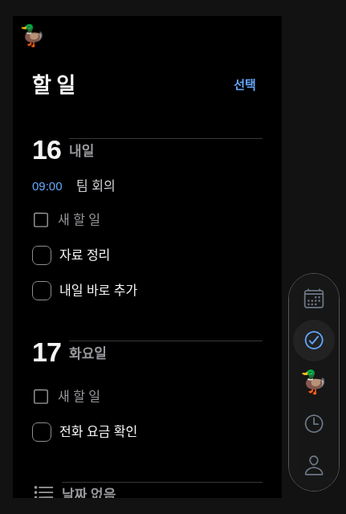
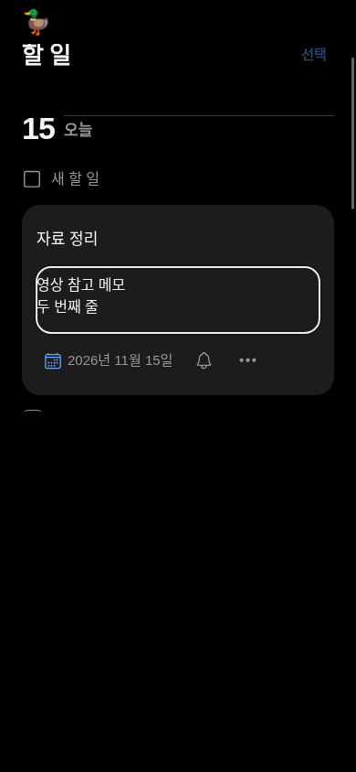
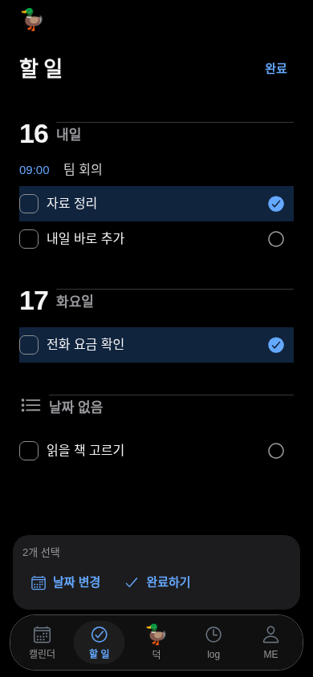
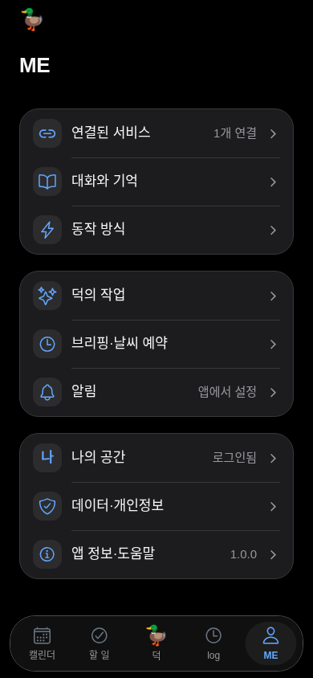
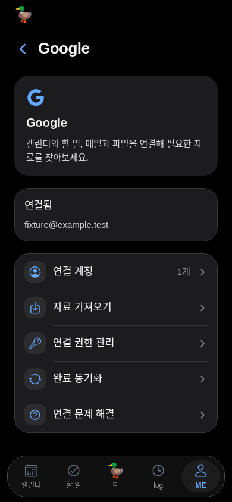
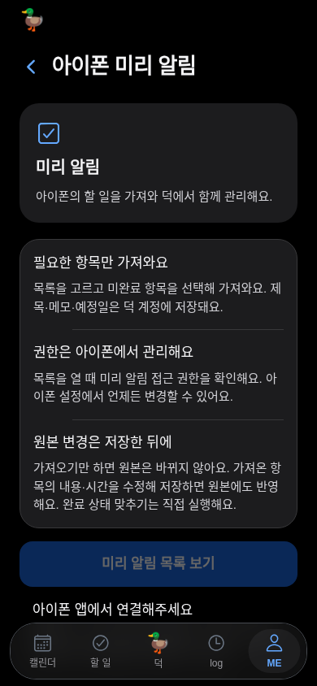
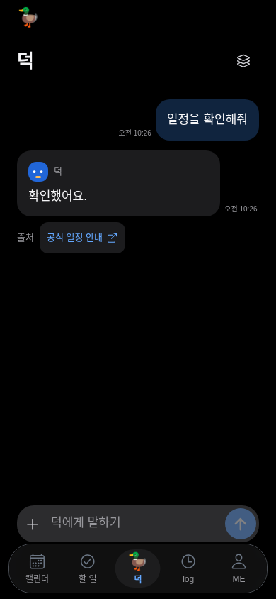

# Things·피클 영상 적용 검수

실제 Expo/React Native Web을 Chromium에서 조작했다. 사용자 원본 영상은 참고 검토이며, 공개 캡처는 합성 계정·일정·메모만 사용한다. Duo는 기하 fixture, 키보드는 가림 좌표 fixture다. 실제 UIKit·EventKit/iCloud·IME·VoiceOver·push·실계정 공급자 쓰기 성공으로 해석하지 않는다.

## 새 흐름

`node mobile/e2e/reference-flows.mjs` 통과. `artifacts/reference-flows-2026-11-15/results.json`과26개 캡처에 실제 검사 내역이 있다. 일반390×844/light·dark,320px, Duo431×640접힘·960×740펼침을 포함한다. 페이지 실행 오류0.

- 날짜/일정/새 할 일/기존 체크의 순서, 날짜에 맞는 생성, 기존3초 완료·log·복원.
- 목록 안 편집에 별도 Todo modal이 없고, 원본 시간과 실패한 원본 저장 재시도는 기존 경로를 사용한다.
- 다른 탭을 다녀와도 초안이 남으며, 긴 compact 메모는 원래 입력란 내부에서 커서를 드러낸다.
- 키보드 좌표450px 가림 시 입력란이 그 위에 있고 저장은 숨겨진다. 실물 키보드 캡처가 아니다.
- 선택만으로 PATCH0회. 두 항목 날짜 저장은 정확히2회. 부분 완료 실패에서도 성공한 항목을 다시 쓰지 않고 실패한 항목만 선택에 남긴다.
- 저장 실패 뒤 메모가 남고, 사용자 재시도 후 저장된다. 새 쓰기를 자동 반복하지 않는다.
- ME→서비스→소개→권한/문제 해결→한 단계씩 복귀. 준비 중 Slack의 연결 CTA는 비활성화한다.
- Apple 미리 알림의 설명·기기 필요 상태와 비활성 CTA를 웹에서 확인한다. 첫 진입에 ‘선택한0개 가져오기’가 없다.
- 첫 연결 자료 선택 유지, 전화 숨김/첨부 유지, 달 첫 주 경계선1일부터 시작을 유지한다.

## 회귀·정적 검사

- `npm test`:391개 중390통과,0실패,1개 기존 선택 제외.
- `npm run check`:100개 서버/웹/도구 문법 검사 통과.
- `npm --prefix mobile run typecheck`:통과.
- `export:web`, `export:ios`:통과. iOS JS export는 IPA/서명/설치가 아니다.
- `mobile/e2e/me-settings.mjs`:권한 요청과 실제 승인 분리, unsaved 권한이 완료 동기화 승인으로 섞이지 않음, 잘못된 상태 응답 복구, 미완료만 가져오기, 확인 후 해제/기존 자료 보존, 동작 방식 실패 입력 보존·재저장, 기억 조회 실패 복구, 계정/내보내기/뒤로가기 스크롤·초점, 작은 화면/접힘/펼침 통과.
- `mobile/e2e/assistant-chat.mjs`:긴 답변/후속 입력·동의·실행 초안/단일 확인·탭/리사이즈·소유자 격리·AI 미설정에서도 Todo로 바꾸지 않는 흐름 통과.
- `mobile/e2e/assistant-chat-errors.mjs`:403/502/서버·클라이언트 시간 초과, 실패 입력과 동의 유지, 명시 재시도, 상태 재확인은 AI 전송을 하지 않음, 만료 세션 복구 통과.

최종 회귀 실행도 통과했다.

- `app.mjs`:실제 격리 서버/쿠키·이메일 인증·가입·재로그인·개인 데이터 내보내기·삭제, 메모 검증·알림 보관·지연 응답/쓰기 실패 복구·queued undo·공급자 모의 쓰기 확인·다섯 탭과 반응형 통과. 개편된 목록 안 편집/공유/날짜/알림 진입으로 검사를 갱신했다.
- `integration-stability.mjs`:안전 읽기 취소별1회 복구, 늦게 도착한 연결 해제 응답 무시, 일시 실패 때 계정·연결 보존, 상태 읽기5회로 유한함을 확인했다. ME 진입은 새 서비스 목록 경로로 갱신했다.
- `duo-layout.mjs`:카메라 중심선·52pt 내비게이션·짧은 높이·뒤로가기·왼쪽 캘린더/오른쪽 탭 변경과 초안/월/스크롤 보존 통과.
- `keyboard-device.mjs`:일반·접힘·가로/세로 펼침의 메모/제목, 저장 숨김, 기존 X와 별도 키보드 닫기, 밝음/어두움 오늘 음영 통과. 실제 일반 iPhone 완료 accessory 검수는 별도다.

첫 회귀 실행의 실패는 예전 시트/펼침/ME 문구를 전제로 한 검사였다. 새 UI 경로로 바꾸되 저장·권한·상태 보존 검증은 유지했다. web export가 출력 디렉터리를 교체하는 동안 읽었던 최초 integration-stability의 문서 요청 실패는 빌드 후 순서로 재검사했다. 최종 검사에는 남아 있지 않다.

## 시각 검수

[루트 design-qa](../design-qa.md)에 사용자 원본/이번 앱을 같은 비교 이미지에 배치한 결과와 의도적 차이를 기록한다. 원본 사용자 자료가 섞인 비교 파일은 공개 artifacts에 복사하지 않았다. 폰트·간격·의미 색·아이콘·문구를 확인했다. 실제 iOS 렌더링과 접근성은 후속이다.

대표 화면:

- 
- 
- 
- 
- 
- 
- 

새 iPhone 빌드 미실행. 마지막 확인41은 이번 코드 이전이다. UI를 다듬은 것을 운영 AI 잔액 해결·정상 생성·실기기 연결 성공으로 보고하지 않는다.
