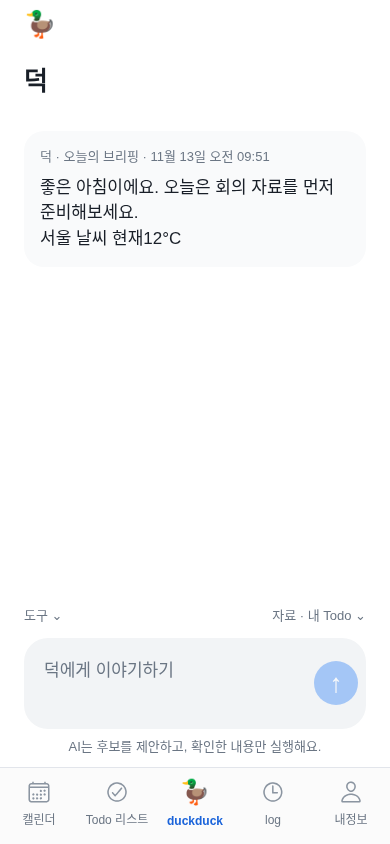
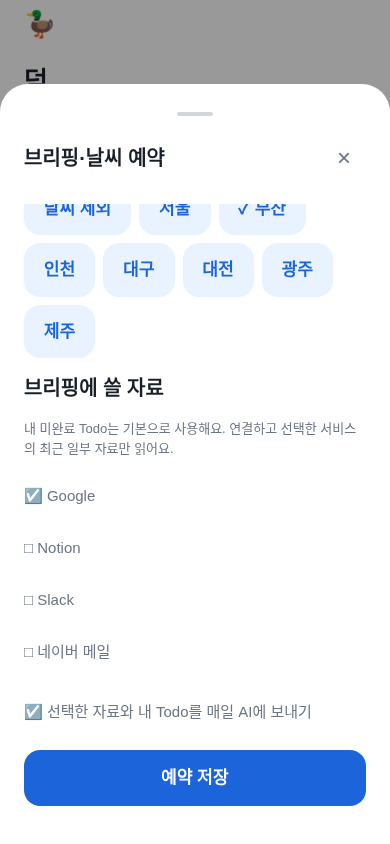
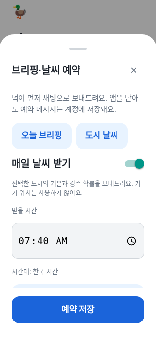

# 덕이 먼저 보내는 브리핑·날씨 — 2026-11-13

사용자는 “브리핑은 ChatGPT의 dot처럼 보내달라는 것”이며 별도 간략 문서를 더 기다릴 필요가 없다고 정정했다. 기존의 ‘후속 명세 대기’는 이 기능에 대해 해제한다. AI 사무실은 보류하고 덕의 예약 메시지를 구현한다. 출시 준비와 새 TestFlight 빌드는 마지막/별도 수동 단계다.

## 쓰는 방법

1. [덕](https://duckduck-test.onrender.com/)에 로그인하고 **duckduck → 도구 → 브리핑·날씨 예약**을 연다.
2. **오늘 브리핑 → 매일 브리핑 받기**를 켜고 받을 시간·시간대를 정한다. 기본 제안은 한국 시간08:00이며 자동으로 켜지지 않는다.
3. 날씨를 함께 받으려면 도시를 고른다. 내 Todo는 기본이고 Google·Notion·Slack·네이버는 연결된 자료 중 원하는 것만 선택한다.
4. **선택한 자료와 내 Todo를 매일 AI에 보내기**에 직접 동의하고 **예약 저장**을 누른다. 켜둔 동안 하루 한 번 기존 OpenAI API 사용 한도에 포함된다.
5. **도시 날씨** 탭은 AI 없이 별도 시간·도시로 예약할 수 있다. 두 예약을 모두 켜면 각각 메시지를 받는다.
6. 메시지는 별도 브리핑 화면이 아니라 **덕 채팅**에 도착한다. 다른 탭에 있으면 덕 탭에 미확인 개수가 표시되고, 덕을 열면 읽음 처리한다.
7. 아이폰 설치 앱에서는 **이 아이폰에 도착 알림 연결**을 눌러 OS 허용과 기기 연결을 진행한다. 잠금 화면에는 내용 대신 일반 도착 안내만 보인다. 알림을 누르면 덕 채팅을 연다. **이 아이폰의 도착 알림 끄기**는 이 기기의 알림만 끈다.
8. 예약 스위치를 끄고 **예약 저장**을 누르면 자동 생성을 중단한다. 이미 받은 메시지는 계정에 남는다.

기존 **오늘 내용 보기**는 즉시 직접 조회하는 보조 기능이다. 이 화면에서도 예약 설정으로 이동할 수 있다. 웹은 도착한 채팅을 조회하며 네이티브 푸시 권한을 대신 받지 않는다. 기존 TestFlight 바이너리에는 새 수동 업데이트가 필요하다.

## 실제 동작과 보호 기준

- 예약·메시지·푸시 토큰은 기존 암호화 키로 DB에 저장하며 새 키를 만들지 않는다. 토큰/비밀번호는 모델·문서·로그·Git으로 보내지 않는다.
- 기본 예약은 모두 꺼짐이다. 이메일 인증된 사용자만 예약과 푸시 기기를 연결한다. 브리핑의 반복 AI 분석에는 명시적 동의가 필요하고, 자료 선택을 바꾸면 UI 동의를 다시 선택한다.
- 브리핑은 선택한 연결 자료의 최근 일부와 내 Todo로 작성한다. AI는 문장을 요약할 뿐, Todo 추가·메일 발송·외부 쓰기 초안을 자동 실행하지 않는다.
- 모델/계정 한도 오류가 나면 내 Todo 목록으로 안내하고 **AI 요약을 만들지 못했다는 사실**을 메시지에 적는다. 날씨 오류도 실제 실패로 적으며 성공 데이터로 저장하지 않는다.
- 시간대는 유효한 IANA 값, 시각은HH:mm, 도시는 기존7개 고정 목록이다. 위치 권한·임의 URL·임의 메일 서버를 받지 않는다.
- 각 사용자·예약 종류·현지 날짜에 하나만 전달한다. 여러 실행기·재시작·일광절약시간의 반복 시각에도 중복되지 않는다. 존재하지 않는 현지 시각은 다음 유효한 날로 넘어간다.
- 서버가 오래 꺼졌다가 오늘 예약 시각 전에 켜진 경우 어제 메시지를 오늘 미리 보내지 않는다. 오늘 시각 이후에는 당일 메시지만 보낸다.
- 처리 중 재설정/해제되면 revision을 확인해 늦은 결과를 버린다. 죽은 실행기는10분 lease 뒤 다시 시도하고 동일 메시지ID로 한 번만 저장한다.
- 브리핑/날씨는 각각 하루 한 번이다. 현재 서비스는 한 번에 최대10개 due 예약을 처리하는 초기 규모이며 분 단위 정시 SLA를 보장하지 않는다.
- 초기 메시지 목록은 최근100개, 이후 조회는 마지막 메시지 이후의 새 항목만 전송해 반복 다운로드를 줄인다. 개인 내보내기에는 본인의 전체 예약 메시지와 설정이 포함된다.
- 푸시 큐와 채팅 저장은 한 트랜잭션이다. 기기는 유효한 해당 로그인 세션과 연결하며 로그아웃/세션 만료 후 새 알림을 보내지 않는다. 기기 연결 변경 시 옛 큐는 지운다.
- Expo의 접수(accepted)는 실제 아이폰 수신 확인과 다르다. 네트워크 결과가 불확실하면 unknown으로 남기고 자동 중복 발송하지 않는다. 채팅 메시지는 그대로 조회할 수 있다.
- 계정 삭제 시 새 테이블도 함께 삭제된다. 원격 복원 시 예약은 비활성, 실행 중 예약은취소, 푸시 기기/큐는 삭제해 옛 권한을 다시 실행하지 않는다. 데이터·메시지·연결 설정은 원래 복원 정책에 따라 보존한다.

## 클라우드 예약 실행

`.github/workflows/briefing-delivery.yml`이5분 간격의 예약 기회를 만들고, 깨어 있는 서버는1분 간격으로 due 예약을 확인한다. GitHub 일정 지연과 Render 무료 서버 기동 때문에 메시지가 몇 분 늦을 수 있다. 무료 서버가 완전히 중지되어도 다음 GitHub 요청이 깨울 수 있지만 GitHub/Render 자체 장애나 사용 한도는 별도다.

장기 비밀 토큰을 추가하지 않는다. GitHub Actions의 짧은 수명 OIDC를 공식JWKS의RSA 서명으로 검증한다. 정확한 issuer·audience·저장소명/숫자ID·main·전용workflow_ref·schedule/workflow_dispatch/main의전용실행기push·발급/만료시각을 확인한다. PR/다른 저장소/다른workflow/만료/서명 변조는 거부한다. 실행 endpoint는 사용자ID나 임의 작업 인자를 받지 않는다. JWT/개인 본문은 실행 로그에 적지 않는다.

직접 gh 수동 실행은 작업 환경의 api.github.com CONNECT403 정책에 막혔다. 전용workflow·전달script·인증 코드가 main에 바뀌면 연결 검사도 자동 실행하도록 보완했다. 이 검사는 서버의 schedulerProtocol2가 준비될 때까지 기다린 후 새 OIDC를 받아 동일한 due endpoint를 호출한다. 새 저장소·브랜치·workflow를 신뢰하지 않으며 서명·숫자 저장소ID·audience 검증은 유지한다. 실제 실행 성공과 정시 메시지 수신은 별도로 기록한다.

예약 workflow는 EAS/TestFlight를 호출하지 않는다. 현재 저장소는 공개이며 표준 GitHub runner를 사용한다. 예약 HTTP 호출이 무료 Render의 기동 시간을 늘리므로 같은 워크스페이스의750시간/월·대역폭 한도를 확인한다. 유료 플랜·업그레이드는 자동 활성화하지 않는다.

[GitHub OIDC 공식 기준](https://docs.github.com/en/actions/reference/security/oidc) · [공식 discovery](https://token.actions.githubusercontent.com/.well-known/openid-configuration) · [Render 무료 한도](https://render.com/docs/free).

## 검증과 파일

실제 임시 HTTP·인증·SQLite DB에서 opt-in/인증·소유권·확인한 설정·동시 실행1회 저장·읽음·재시작·암호화·계정 내보내기를 검사했다. 별도 검사는 생성 중 취소, 죽은 worker 회복, DST 공백/중복, 오래된 예약 건너뛰기, AI/날씨 실패의 정직한 대체, 푸시 세션 만료·본문 비공개·중복 금지·불확실한 결과 재전송 금지, 복원 후 자동 실행 차단을 검증한다. 외부 모델·메일·푸시 응답은 모의다.

UI는 현재 Expo 웹 번들로 시간·도시·자료·AI 동의·독립 날씨·320px 저장 버튼·미확인/읽음·새 메시지 도착 중 입력 유지·다른 계정 격리를 검사했다.

구현: `server/automations-store.js`, `server/automations.js`, `server/scheduler-auth.js`, `server/push.js`, `server/feature-routes.js`, `mobile/src/useAutomations.ts`, `mobile/src/screens/AutomationSheet.tsx`, `mobile/src/screens/AssistantChat.tsx`, `mobile/src/push.ts`, `scripts/deliver-briefings.mjs`.

검사: `test/automations.test.js`, `test/scheduler-auth.test.js`, `test/push.test.js`, `test/remote-backups.test.js`, `npm --prefix mobile run test:automations`.

실제 GitHub OIDC→서버 연결 검사는 성공했다. 배포·재실행의 정확한 증거는 [공개 서버 검증](functional-completion-2026-11-13.md#공개-서버예약-실행기-확인--2026-11-13-1006-kst)을 따른다. 코드/모의 검증을 사용자의 실제 예약 생성·모델 응답·아이폰 푸시 수신으로 표시하지 않는다. 실제 계정은 사용자가 원하는 시간과 자료를 골라 켜야 한다.
