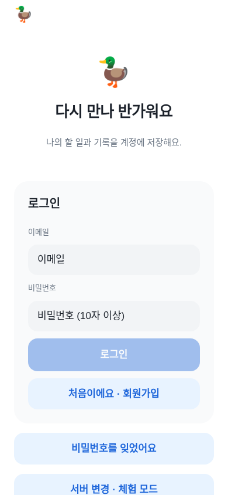
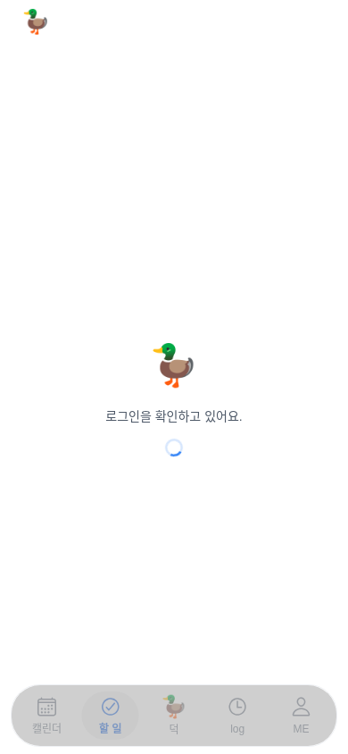
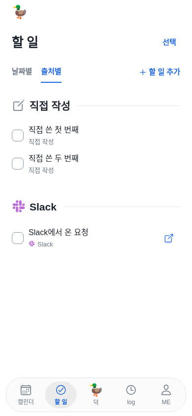
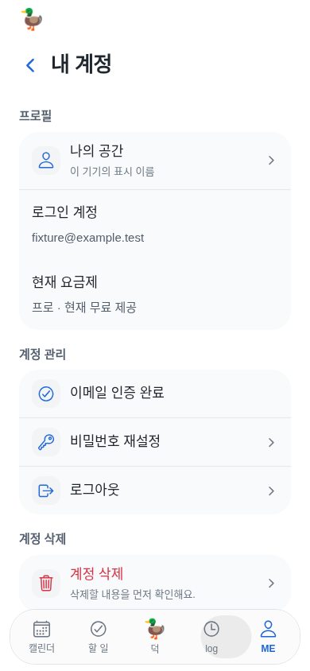

# Todo 우선순위·로그인 복원·모션·전체 프로 — 2026-11-16

1. 출처별 Todo: 직접 작성 → Slack → Google 등으로 표시한다. 신규 공급자는 뒤에 두고 날짜·원본 링크와 수동 순서를 유지한다.
2. 현재 회원가입: 이메일 + 10~128자 비밀번호, 가입 즉시 로그인. 로그인 세션30일. 아이폰 토큰은 기존 SecureStore, 웹은 HttpOnly 쿠키다. 외부 서비스 연결에는 별도 이메일 인증이 필요하다. Google 자료 연결은 소셜 회원가입이 아니다.
3. 재실행: 세션 확인 전에 connection만 복원하고 user=null을 미로그인으로 그리던 것이 원인이다. restoring/ready/unavailable을 분리하고 실제401만 로그인으로 이동한다. 네트워크 실패는 연결 유지·명시 재시도다. 내비게이션은 처음부터 같은 자리에 disabled로 표시하고 인증을 확인하면 목록이 아직 느려도 활성화한다. 확인 전 개인 자료 조회·권한 부여는 하지 않는다. 무료 서버의 실제 기동/공급자 지연을 없앴다고 주장하지 않는다.
4. 모션: 페이지640ms·전체.975배 확대, OS 동작 줄이기 조회 뒤 재등장하던 효과를 제거했다. 페이지200ms/탭180ms, 선택 렌즈200ms·눌림1.025배, 행 순서 변경200ms로 정착한다. 웹 ResizeObserver는 위치만 바뀐 형제를 알리지 않아 순서 변화 때 실제 위치를 측정한다. 동작 줄이기에서 즉시 반영하며 초안·스크롤·3초 완료/원본 재시도·Duo 카메라 열/반대 pane을 유지한다.
5. 기존·신규 계정 모두 서버에서 complimentary Pro 권한을 받는다. account/session/login/register/assistant status에 동일하게 반영하며 ME→내 계정에 표시한다. 권한과 실제 AI 예산을 분리하고 받은 자료를 Todo로 보내는 기능도 권한으로 판단한다. 비용이 발생하는 모델 호출은 기존 정산 확인/월 상한/예약 검사를 계속 적용한다. 결제·정산 금액·잔액을 생성하거나 실제 모델 잔액 문제를 해결했다고 주장하지 않는다. 프로여도 AI 예산이 준비되지 않았으면 입력 초안을 보존하고 이유를 표시한다. 기존27,900원 가격표는 유지하고 현재 무료 제공/자동 결제 없음도 명시한다.

추가로 브리핑/비서 작업 API가 배열 대신 예상과 다른 JSON을 주면 잘못된 값을 state에 넣어 전체 앱을 비우던 경로를 막았다. 이전 내용을 유지하고 읽기 오류를 표시한다. 자동 원본 쓰기나 발송 재시도는 추가하지 않는다.

## 실제 브라우저 확인

- 01-before-session: 기존 프로덕션 웹에서 세션 응답을 보류했을 때 로그인 입력창이 보이고 내비게이션0개임을 재현했다.
- 03-restoring: 수정 뒤 세션 응답을 보류해도 로그인 입력창0개·개인 Todo 요청0회, 고정 내비게이션5개 disabled다.
- 04-manual-first: 인증 확인 후 Todo 응답이 아직 보류돼도 같은 위치의 내비게이션이 활성화되고, 출처별 직접 작성이 맨 위다. 선택한 행 이동 시 실제 중간 translateY 값을 관찰하고 새 순서·정착을 확인했다.
- 05-pro-chat / 06-account-pro: Pro 권한과 실제 AI 예산 부족을 구분한다. 탭을 빠르게 바꿔도 초안을 보존하고 페이지 scale=1, 움직임 줄이기를 확인했다.
- 07-connection-retry:503으로 로그인 화면을 만들지 않고 재시도 후 같은 세션으로 복귀했다. 실제401에서는 로그인 화면으로 이동한다.
- reference/: 실제 Expo 앱에 합성 API·Duo 기하를 제공해 일반/접힘/펼침·320px·목록 안 편집·키보드 reveal·3초 완료/복원·ME 서비스/권한26장 회귀를 확인했다. 실제 iOS/IME/EventKit/외부 계정 검증이 아니다.

검사 스크립트: mobile/e2e/startup-session.mjs, mobile/e2e/session-isolation.mjs, mobile/e2e/reference-flows.mjs, test/plans.test.js, 기존 ai-budget 검증. 캡처는 artifacts/startup-session-2026-11-16/에 있다. 세션 보류/늦은401/이전 계정 응답이 새 계정을 바꾸지 않는 검사도 통과했다.

게시 전 상태: 전체 테스트406통과·실패0/기존조건부1skip, 문법105개, 모바일 타입, 실제 Expo 웹 빌드와 위 브라우저 흐름을 확인했다. 최종 CI/배포는 완료 후 별도 기록한다. 이번 수정에서 새 TestFlight/서명/Apple 업로드를 실행하지 않으며 기존 설치본이 자동으로 바뀌었다고 보고하지 않는다.

## 최종 CI·웹 게시

[PR2](https://github.com/thepmpo/donknow/pull/2)를 병합했다. [CI43790355466](https://github.com/thepmpo/donknow/actions/runs/43790355466)은 총408개 중406통과·실패0·기존조건부2skip, 소개 빌드/packaging4개·타입·native 설정 검사·iOS JavaScript export가 모두 성공했다. Apple 서명/IPA/업로드를 뜻하지 않는다.

기존 무료 Render·자동 배포off를 확인하고 수동 deploy dep-dbt6c56c6qcc73as1sig를 한 번 실행했다. 게시 소스774db980ac0a81030614b36b481dcf0568dc32e6, 2026-11-16 11:11:29 KST에 live다. Docker build와 port10000 listening/service live 로그를 확인했다. 프로 권한은 DB 입금 조작 없이 서버 정책으로 기존·신규 계정 전체에 적용된다. 별도 원본 쓰기/결제/모델 비용 집행은 실행하지 않았다. 공개 주소 직접 읽기는 이 환경에서403으로 완료하지 못했으므로 배포 뒤 본문/실계정 재접속까지 검수했다고 보고하지 않는다.

아래는 이번 실행에서 확인한 화면이다. 합성 계정/API의 실제 Expo 웹이며 실제 iPhone/Duo 캡처가 아니다.

### 1. 기존 지연 중 로그인 — 문제 재현

### 2. 수정 후 세션 확인 — 정상, 화면·내비게이션 자리 유지

### 3. 직접 작성 우선 — 정상, 원래 목록의 행 이동

### 4. 현재 프로 — 정상, 자동 결제 없음

### 5. 접속 실패 — 정상 복구 경로, 로그인으로 오인하지 않음

페이지 확대 제거·키보드/터치·보조기술의 모든 실제 기기 조작이나 Things와 동일한 체감을 스크린샷만으로 보증하지 않는다. 웹에서는 DOM 역할/disabled 탭·실제 위치 보간·초안 유지·동작 줄이기 및 기존 분할 기하를 추가 확인했다. 전체 대비/VoiceOver/physical Duo 검수는 별도다.
