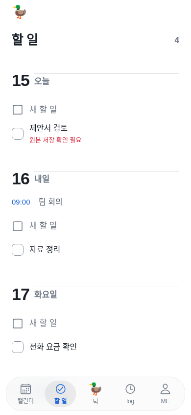
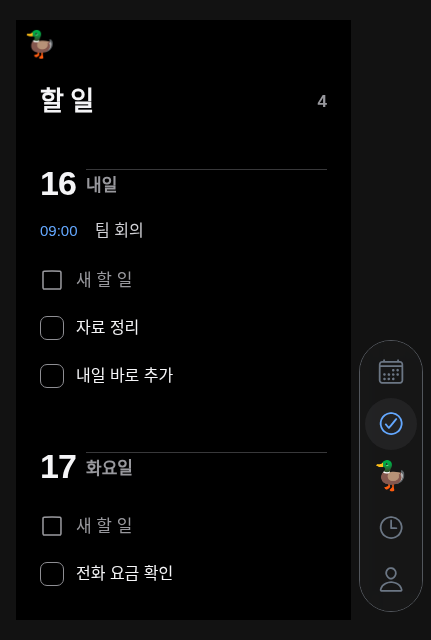
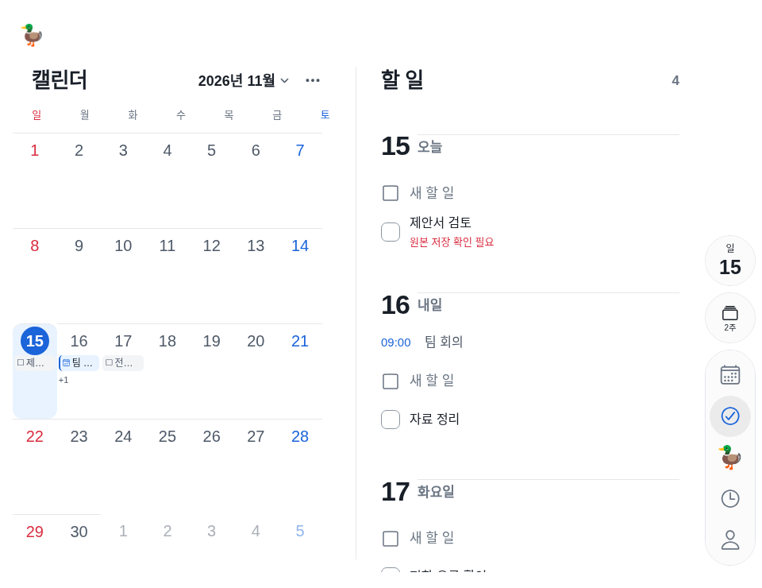
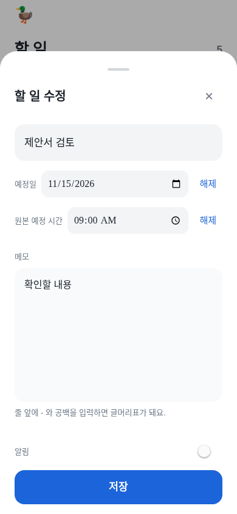
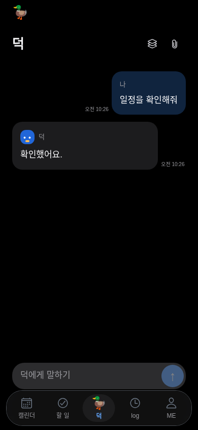
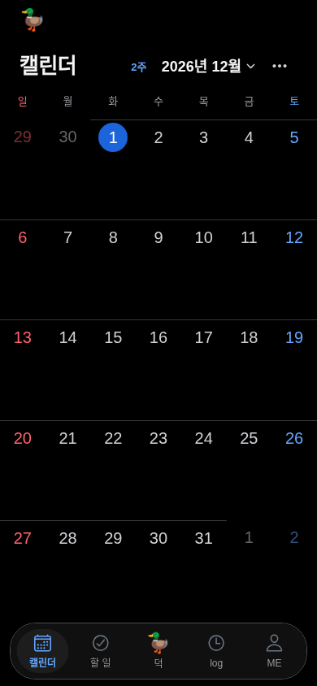

# Things형 Todo·원본 저장 검수

최신 사용자 Things 사진과 실제 Expo 렌더를431×640으로 맞춰 `/tmp/duck-things-comparison-before.png`, `/tmp/duck-things-comparison-after.png`, 날짜/일정/체크 확대 비교를 같은 이미지에 놓고 확인했다. 첨부 원본은862×1280에서0.5배 정규화했고 앱은431×640 CSS·DSF1이다. 사용자 원본과 결합 이미지는 공개 갤러리에 복제하지 않는다. [상세 QA](../design-qa.md).

첫 비교에서 체크 행64pt와 빈 오늘 묶음, 새 할 일 위치를P2로 잡았다. 행48pt/최소44pt 편집 터치·체크 hitSlop, 빈 오늘 제외, 추가 행 우선으로 고친 뒤 다시 캡처/조작했다. 덕의 한글·검정/흰색 의미 색과 카메라 열/다섯 탭은 의도한 적용 범위다. 서로 다른 일정/제목은 합성 자료이며 픽셀 복제라고 하지 않는다.

## 실제 검사

| 검사 | 결과와 범위 |
|---|---|
| 전체 단위/HTTP |391개 중390통과·실패0·기존 선택1제외 |
| 문법/타입/번들 |100 server/web/tool 파일, TypeScript, web/iOS JS export 성공 |
| 원본 수정 |격리 Google Calendar/Tasks PATCH·If-Match·부분 필드·시간대/길이·종일 전환·권한 실패·불확실 쓰기·재시도·소유자 격리·AI 확인 경로 |
| Apple 원본 |단위/HTTP로 권한 전제·수정 시각 충돌·동일 결과 중복 쓰기 회피·nullable 날짜·개정/계정·20×4,000자 한국어 메모 검사 |
| Apple 가져오기 |가짜 EventKit 공유 객체로 새 목록·전체 상태·날짜 없음·완료·1회 빈 재조회·실패·계정 전환 무시 검사 |
| Things 흐름 |실제 Chromium에서 일반390·320, Duo431×640/960×740, 밝게/어둡게, 날짜 추가·원본 재시도·3초 이동/log 복원·기본 연결 자료·전화 숨김·첨부 유지·월1일부터 선. 콘솔 오류0 |
| 기존 회귀 |전체 앱·AI 채팅·채팅 오류/입력 보존·고정 편집창/메모 reveal·캘린더 편집/불확실 쓰기·저장본/소스별 도착/계정 격리 통과 |

실제 iPhone·EventKit/iCloud·IME·VoiceOver·push·실계정 원본 쓰기 성공은 별도다. 웹의 합성 기하/키보드 가림은 이를 대신하지 않는다. AI 진단은 잔액 오류를 확인한 것이며 정상 생성 성공 검수가 아니다.

## 새 화면

9장과 `results.json`은 실제 앱/합성 API·기하 캡처다. 추가 `app`, `calendar`, `chat`, `interaction` 하위 폴더는 기존 흐름의 새 회귀 캡처다. 과거 이미지와 사용자 복구 bundle을 덮지 않는다.
