# 덕 UX/UI 점검 — 2026-11-12

> 후속: 사용자 요청으로 아래10개와 편집 저장 가림을 수정했습니다. [현재 구현·19개 새 화면·검증](ux-ui-fixes-2026-11-12.md)을 확인하세요. 아래15개는 수정 전 감사 근거로 보존합니다.

## 판단과 범위

기능 흐름은 갖춰져 있지만 **대화에서 다음 행동으로 넘어가는 화면 구조**가 가장 부족하다. 색·캐릭터를 전면 교체하기보다, 대화 공간 확보·다음 버튼 노출·권한 선택 동선을 먼저 고치는 편이 낫다.

사용자가 승인한 테스트용 Chromium에서 현재 Expo 웹 번들을 새로 실행해 아래15개 단계를 촬영하고 원본을 각각 열어 확인했다. 기준 앱 코드는 `62bcde1`이며 이번 자동화·검사 변경은 앱의 화면 코드를 바꾸지 않는다. 모든 사용자·Todo·AI 응답·외부 서비스 상태는 격리된 모의 자료다. 운영 계정·원본 Todo·실제 메일을 읽거나 수정하지 않았다. **이 문서는 운영 사이트나 iPhone 실기기 전체에 대한 시각 검수 완료를 뜻하지 않는다.**

기본 화면은390×844, 작은 화면은320×700, 터치 입력과 동작 줄이기 설정을 사용했다. 재현: `EXPO_NO_TELEMETRY=1 npm --prefix mobile run export:web` 후 `node mobile/e2e/ux-audit.mjs`. 원시 측정은 [capture-metadata.json](../artifacts/ux-audit-2026-11-12/capture-metadata.json)에 있다. 이전 캡처를 이번 감사 근거로 재사용하지 않았다.

## 좋은 점

흰 바탕·공통 파란색·표면·간격과5개 탭이 일관된다. Todo의 긴 제목은 줄바꿈되고, 동의 전 AI 전송은 막힌다. 후보→실행 전 확인→완료를 구분하고, 오류와 재시도가 입력창에 가까이 보인다. 실제 임시 서버에서는 사용자 확인 전에 Todo가 없고, 확인 후1개가 저장되며 재확인에도 중복되지 않는 것을 별도로 검증했다.

## 먼저 고칠 문제

| 우선순위 | 문제와 근거 | 사용자에게 생기는 어려움 | 권장 방향 |
|---|---|---|---|
| P1 | 고정 도구가 대화/후보 공간을 많이 사용 — 3·8·14 | 후보의 확인 버튼을 찾으려면 추가 스크롤 | 부가 메뉴를 하나의 도구 메뉴로 묶고 대화·후보·현재 행동을 우선 노출 |
| P1 | 동의 전 전송 불가 이유의 위계가 약함 — 7 | 파란 화살표를 눌러도 반응이 없다고 느낄 수 있음 | 입력 직후 ‘자료 사용에 동의하면 보낼 수 있어요’를 전송 가까이에 표시. 동의 자동 체크는 금지 |
| P1 | 권한 선택과 연결 버튼의 순서가 갈라짐 — 6 | 아래에서 권한을 고른 뒤 위로 되돌아감 | 읽기/쓰기 선택을 먼저 모으고 선택 결과와 연결 버튼을 그 다음에 배치. 기존 승인 경계 유지 |
| P1 | 일부 터치 영역이44px보다 작음 — 2·5·6 | 작은 권한 행/탭을 누르기 어려움 | 권한 행 최소44높이, 서비스 탭·월/주·편집 영역 최소44 보장 |
| P1 | 파란 버튼과 흰 글자의 대비 — 6·9·12 | 작은 버튼 글자를 읽기 어려울 수 있음 | 현재 #3182f6/흰색 대비 약3.71:1. 17px·600 텍스트의4.5:1 목표를 만족하도록 용도별 색/텍스트 토큰 검토 |
| P2 | YYYY-MM-DD·빈 메모 같은 표기 — 8·9·10·12 | 대화 흐름이 개발 설정 화면처럼 느껴짐 | ‘날짜 선택’, ‘날짜 없음’으로 표현하고 값 없는 행 생략. 웹 날짜 선택 방식도 검토 |
| P2 | 완료 카드와 이전 후보가 계속 대화에 노출 — 10·14 | 완료한 일과 지금 요청이 섞임 | 완료는 짧게 접고 필요할 때 세부 내용·실행 기록 열기 |
| P2 | 작은 화면의 탭 글자 분리 — 14 | ‘리스트’의 마지막 글자가 따로 내려감 | 확정 탭 이름을 유지하면서 단어 단위 줄바꿈과 탭 안쪽 여백 조정 |
| P2 | 선택 날짜 상세와 계정 행동이 아래에 숨음 — 2·5 | 선택 후 어디서 내용을 보는지 찾기 어려움 | 선택일 요약/본문으로 이동 안내, 내정보의 계정·연결 관리 우선순위 재정리 |
| P2 | 붙여넣기 경로3개와 긴 설명 — 13 | 분석 준비와 보내기의 차이를 이해하기 어려움 | 기본 행동은 AI 후보 준비로 명확히, 수동/목록 분리는 보조 경로로 제시. 전송 전 동의 유지 |

P1은 현재 작업의 조작·가독성 개선 우선순위이고 모든 항목이 기능 실패나 WCAG 위반이라는 뜻은 아니다. 대규모 톤/IA 변경을 이번에 적용하지 않았으며 승인된 오리·5개 탭·공통 토큰을 기준으로 개선한다.

## 접근성 측정과 한계

- DOM 측정에서 Google 권한 행은 약23px 높이, 서비스 탭은 약37px 높이였다. Calendar 월/주 버튼 폭은 약37px, 표시 이름 편집 높이는40px다. 권장44px와 차이가 있다.
- Todo 체크의 DOM/시각 크기는26px이나 소스의 `hitSlop={9}`로 확장한다. 이를26px 터치 영역이라고 단정하지 않는다. DOM 상자만으로 네이티브 유효 터치 영역을 증명하지 않는다.
- 색 토큰의 상대 휘도 계산: #3182f6/white 약3.71:1, #1b64da/white 약5.41:1, #6b7684/white 약4.62:1. 실제 조합·상태 전체 대비 검수와 색각/스크린리더 검사는 별도다.
- 320px에서 가로 넘침이 없다는 자동 검사와, 줄바꿈이 보기 좋다는 판단은 다르다. 이번에는 탭 단어 분리 문제를 실제 이미지에서 확인했다.
- VoiceOver·TalkBack, 실기기 키보드 가림, 네이티브 날짜/알림·Duo 실제 접힘, 큰 글자 설정, 로딩/오프라인 모든 상태, 실제 OAuth 팝업은 이번15개 화면의 검수 범위가 아니다.

## 단계별 화면과 판단

### 1. Todo 목록 — 양호

6개 미완료 항목과 긴 제목이 구분되고 추가 버튼을 찾을 수 있다. 체크 표시의 시각 크기는26px지만 소스의 hitSlop9로 확장되므로 시각 크기만으로 터치 실패라고 판정하지 않는다.

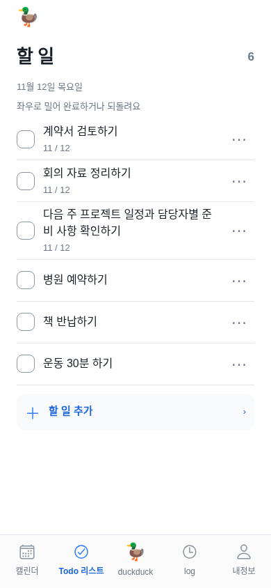

### 2. 월간 캘린더 — 개선 필요

42칸 그리드는 유지되지만 긴 일정 이름이 줄임표로 짧아진다. 선택일의 자세한 할 일 목록은 첫 화면 아래에 있어 추가 스크롤이 필요하다.

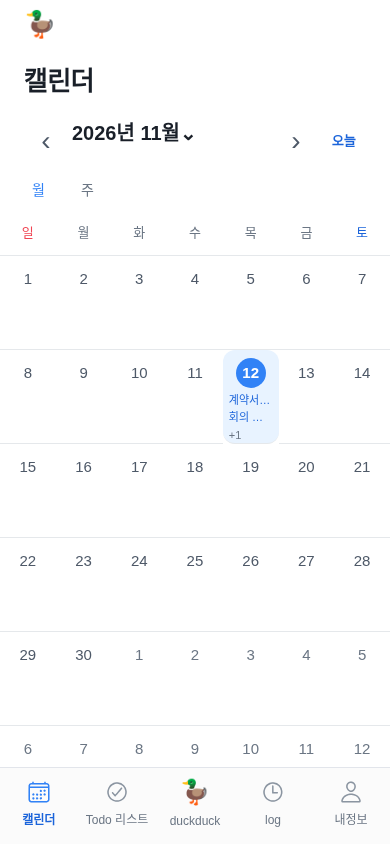

### 3. 덕 첫 화면 — 개선 필요

인사와 입력창은 명확하다. 오늘 브리핑·비서·기록 찾기·대화 붙여넣기와 자료 선택이 고정되어 대화 영역을 차지한다.

### 4. 완료 기록 — 대체로 양호

완료 항목과 되돌리기가 분명하다. 빈 공간이 크고 첫 사용자가 log의 의미를 바로 이해하기는 어려울 수 있다. 탭 이름 변경은 확정 IA와 별도 합의가 필요하다.

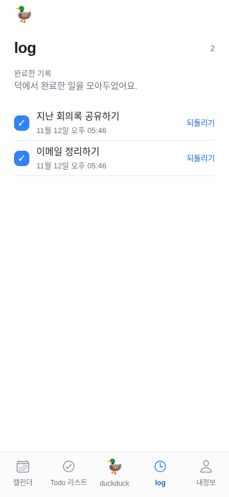

### 5. 내정보 — 개선 필요

표시 이름·통계·미리 알림이 상단을 차지한다. 서비스 목록과 계정 관련 행동은 아래로 내려가야 한다.

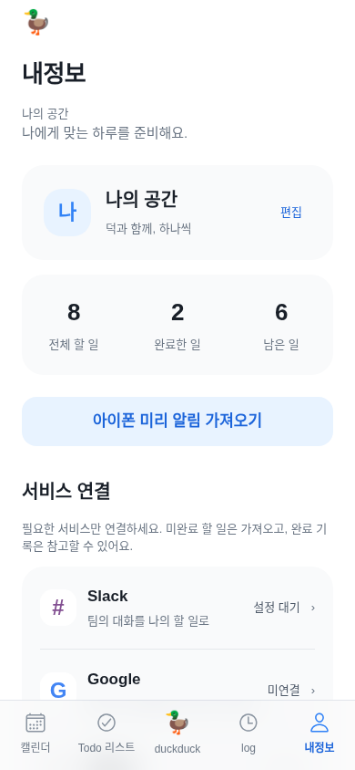

### 6. Google 연결 권한 — 개선 필요

읽기 선택·연결·새로고침·추가 쓰기 권한이 길게 이어진다. 쓰기 권한은 연결 버튼 아래에 있어 고른 뒤 위로 돌아가야 한다.

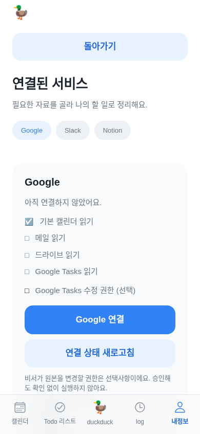

### 7. 요청 입력·동의 전 — 개선 필요

동의 전 요청0회와 전송 버튼 비활성은 확인했다. 작은 동의 문구와 비활성 화살표만으로는 다음 행동이 충분히 드러나지 않는다.

### 8. AI 답변·후보 편집 — 우선 개선

후보 제목과 날짜는 보이지만 확인 버튼은 첫 화면에서 아래로 밀린다. 고정 도구 영역이 후보 작성 공간을 줄인다.

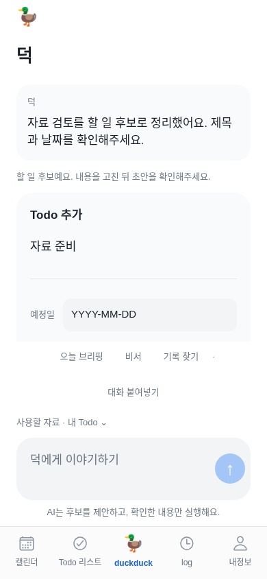

### 9. 실행 전 확인 — 양호·문구 개선

확인 전 Todo 수8개로 유지된다. 실행과 취소 버튼이 명확하다. 비어 있는 메모와 YYYY-MM-DD 같은 내부 형식 표기는 줄일 수 있다.

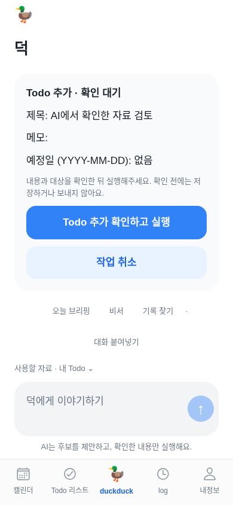

### 10. 실행 완료 — 양호·기록 정리 필요

완료 상태와 Todo 보기 버튼이 보인다. 완료 카드와 이전 후보가 대화에 계속 남아 다음 대화의 초점을 분산한다.

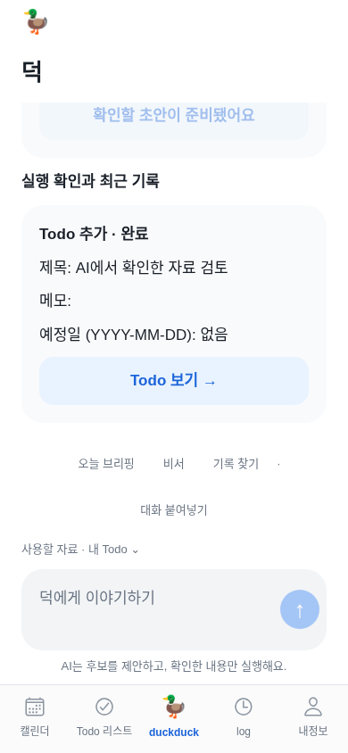

### 11. 추가된 Todo 확인 — 양호

격리 모의 API에서 확인한 항목1개가 새로 표시되고 목록 수가7개 미완료로 바뀐다. 실제 서버 저장은 별도의 임시 서버 회귀에서 검증했다.

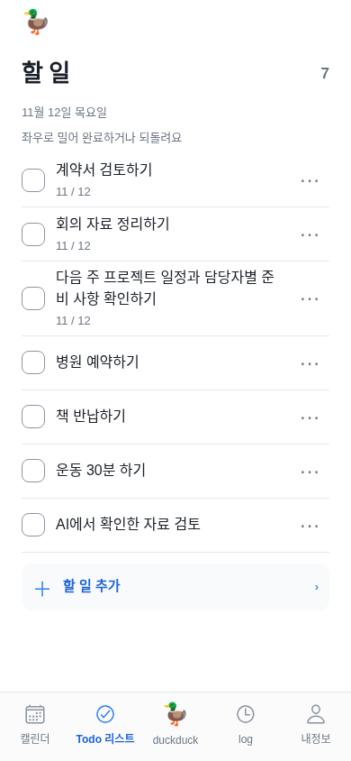

### 12. 할 일 편집 시트 — 대체로 양호

제목·날짜·메모·저장과 닫기 흐름이 분명하다. 웹 예정일 입력의 기계적인 표기와 작은 부가 설명은 개선 여지가 있다.

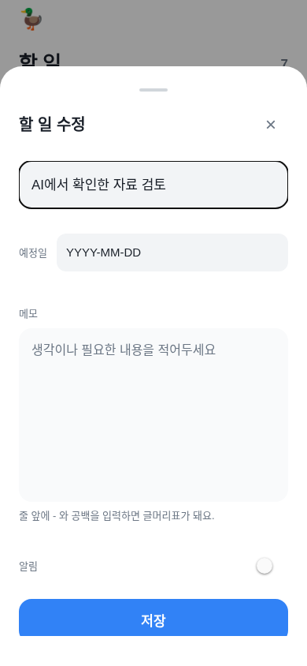

### 13. 대화 붙여넣기 — 개선 필요

목록 초안 나누기·AI 분석 준비·수동 입력의 선택지가 한 화면에 있다. 분석 준비와 실제 전송의 차이를 사용자가 여러 설명을 읽어야 이해한다.

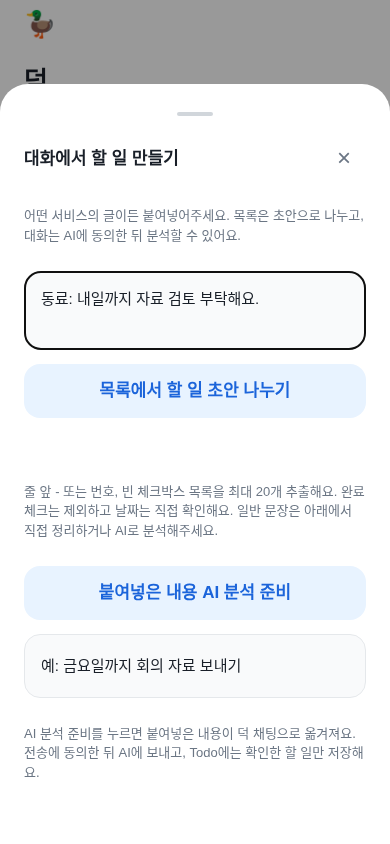

### 14. 320×700 작은 화면 — 개선 필요

가로 넘침은 없지만 Todo 리스트 탭 이름의 마지막 글자가 분리되고 결과 카드가 더욱 좁아진다.

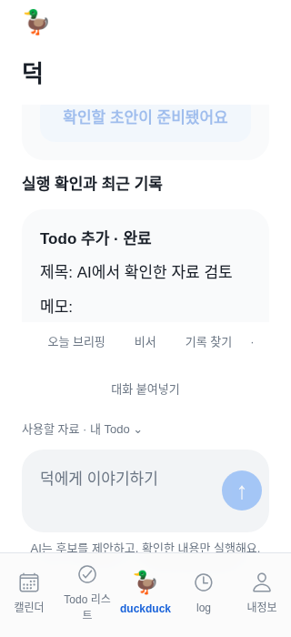

### 15. 오류와 재시도 — 양호

오류가 입력창 위에 나타나고 입력·동의가 유지된다. 다시 보내기가 보여 복구 행동을 알 수 있다.

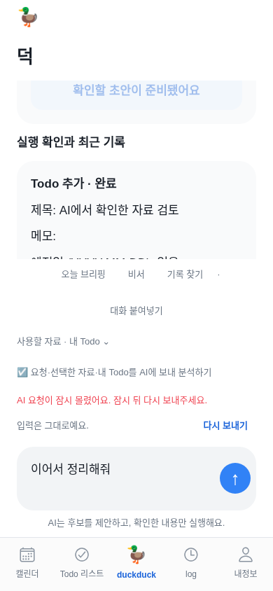

## 구현·검증·계정 확인의 구분

이번에 적용하는 것은 자동 TestFlight의 수동 전환과 자동 품질 검사 분리다. UX 지적10개는 개선 목록이며 앱 전체 디자인 변경 완료로 표시하지 않는다. 브리핑·날씨는 상세 명세 대기, 출시 준비는 마지막 순서로 둔다.

`test/assistant-todo-flow.test.js`는 실제 임시 HTTP 서버·인증·DB에서 모의 모델 응답→후보→미리보기→사용자 확인→Todo 저장을 검증한다. 확인 전 저장0개, 다른 계정 확인 거부, 재확인 중복 없음, 본인 목록/내보내기와 원문 비저장을 확인한다. 이는 운영 사용자 계정에 실제 Todo를 추가했다는 뜻이 아니다.

Google·Notion·Slack·네이버 쓰기, iPhone 미리 알림은 실제 계정 승인/기기 권한이 남는다. [작업 순서와 사용자 승인 항목](functional-workstream-2026-11-12.md)을 따른다. Figma 읽기는 재확인했지만 후속 호출이 Starter 한도로 막혀 원본69개와 Current baseline/Proposed는 수정하지 않았다. 새 유료 플랜이나 권한 우회를 적용하지 않았다.
