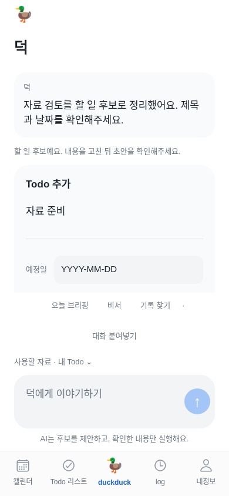
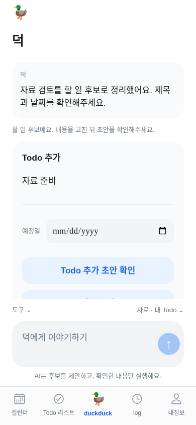
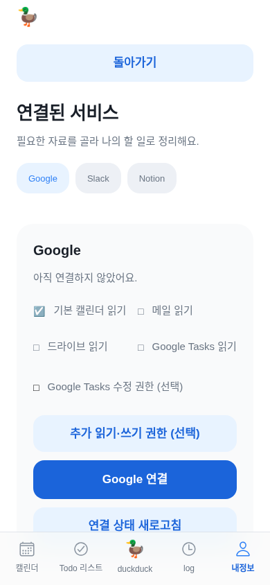
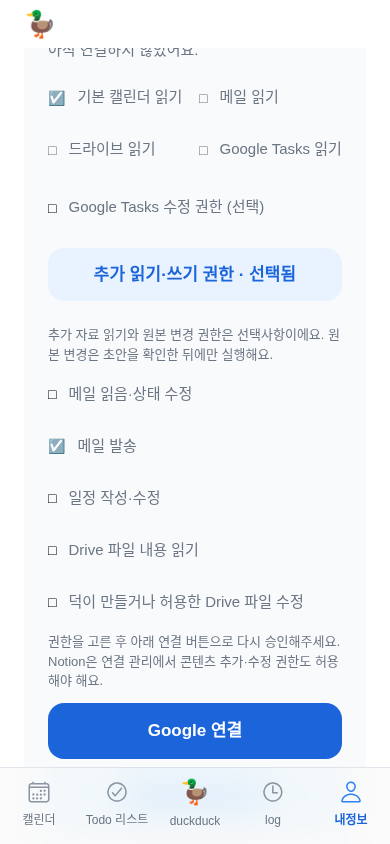
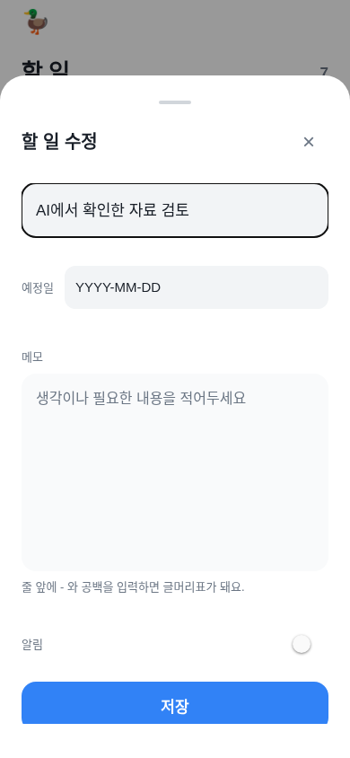
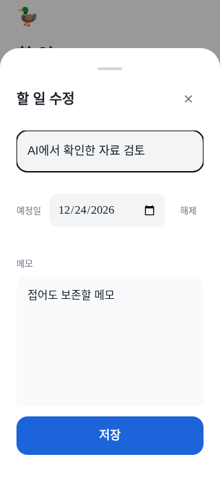
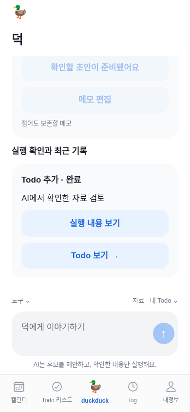
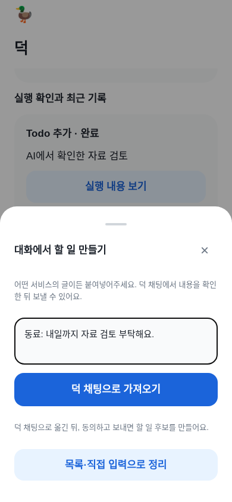
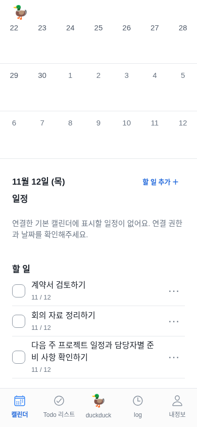
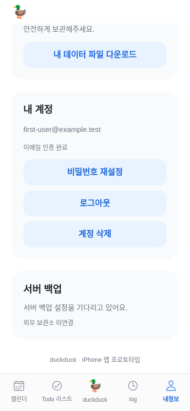

# 덕 UX/UI 문제 수정과 기능 검증 — 2026-11-12

사용자 지시: “남은 기능들 하면서 너가 확인한 문제들도 수정해”. [직전 15단계 감사](ux-ui-audit-2026-11-12.md)의 10개를 같은 톤·오리·5개 탭 안에서 수정했다. 추가 검수에서 발견한 편집창 저장 버튼 가림도 고쳤다. 출시 준비는 마지막이며 AI 사무실·브리핑·날씨의 예약 동작은 이번에 변경하지 않았다.

## 사용자가 바로 느끼는 변화

- **덕 → 도구**에서 비서·대화 붙여넣기·기록 찾기·기존 브리핑을 연다. 메뉴를 접어 대화와 할 일 후보를 넓게 본다.
- 입력하면 **자료 사용에 동의하면 보낼 수 있어요**가 전송 가까이에 보인다. 동의를 자동 체크하지 않는다.
- 후보는 제목·날짜와 **Todo 추가 초안 확인**이 먼저 보인다. 메모는 **메모 추가/편집**으로 열고, 접어도 보존된다.
- **Todo 추가 확인하고 실행** 전에는 저장하지 않는다. 완료 결과는 짧게 보이고 **실행 내용 보기 / Todo 보기 →**로 확인한다.
- **내정보 → 서비스 → 추가 읽기·쓰기 권한 (선택)**을 펼쳐 필요한 권한만 고른 다음, 그 아래 **연결 / 연결 권한 다시 선택**을 누른다. 체크만 해서는 실제 권한이 생기지 않는다.
- **캘린더 → 선택일 N개 보기 ↓**, **내정보 → 내 계정 관리**로 아래 내용을 바로 찾는다.
- 할 일 편집의 **저장**은 본문 스크롤과 분리해 작은 화면에서도 보인다.

웹은 아래 공개 배포 확인 후 반영되며 설치된 TestFlight 앱은 새 수동 빌드를 설치해야 바뀐다. 이번 작업은 EAS 빌드를 요청하지 않는다.

## 감사 항목별 구현

| 기존 문제 | 수정 | 동작/수치 확인 |
|---|---|---|
| 1. 고정 부가 메뉴가 대화 공간 차지 | 도구/자료를 44높이 도구줄로 정리, 상세는 스크롤 안에서 열기 | 390×844에서 대화 스크롤 높이 450px 이상. 새 후보의 확인 버튼이 대화 영역 안에 완전히 보임 |
| 2. 동의 전 전송 비활성 이유 불명확 | 입력창 근처에 구체적 다음 행동 안내 | 동의 전 모델 요청0회·전송 비활성. 기존 실패 시 입력/동의/수동 재시도 유지 |
| 3. 쓰기 선택이 연결 버튼 아래 | 읽기/추가 권한을 먼저, 연결 행동은 다음 | 접기/펼치기 후 선택 보존. 모의 요청에서 calendar+gmailSend만 전달 |
| 4. 작은 조작 영역 | 권한 행·서비스 탭·월/주·이름 편집·도구·날짜 해제 최소44 | DOM 실제 권한 행과 서비스 탭의 폭·높이44 이상 검증. Todo 기존 hitSlop9 유지 |
| 5. 흰 버튼 글자 대비 | 흰 글자 공통 버튼의 배경을 기존 blue700 용도로 분리 | action=#1b64da. 흰색 대비 약5.41:1, 실제 DOM 4.5:1 이상. blue500 브랜드/아이콘 유지 |
| 6. 기계적인 날짜/빈 메모 | 웹 날짜 선택기, 네이티브 선택기 유지, 읽기는 한국어 날짜·빈 메모 생략 | 표시2026년12월24일, 저장2026-12-24. 웹 입력 표시 순서는 브라우저 언어를 따름 |
| 7. 완료 카드가 계속 큼 | 완료/취소 카드를 접고 필요한 상세만 열기 | 저장된 메모·날짜·결과를 지우지 않음. 대기/실패/결과 불확실은 접지 않음 |
| 8. 320px 탭 단어 분리 | Todo와 리스트 사이에 줄바꿈 | 탭 이름·접근성 이름·순서 유지. 가로 넘침 없음 |
| 9. 일정/계정 행동이 아래에 숨음 | 본문 위치로 이동하는 바로가기 | 선택일 제목·계정 제목이 화면에 들어옴. 동작 줄이기 설정 반영 |
| 10. 붙여넣기 경로3개가 동등 | 채팅으로 가져오기를 주 행동, 수동/목록을 펼치는 보조 행동 | 옮기기만으로 모델 호출/저장 없음. 새 원문은 새 동의 필요. AI 미설정이면 수동 기능 유지 |
| 추가. 편집창 저장이 아래에서 가림 | 본문만 스크롤, 저장은 시트 하단 고정 | 390×844와320×700에서 저장 버튼 전체가 화면 안에 표시 |

내정보 서비스 표시는 서버가 실제 내려준 features를 기준으로 **읽기 연결 / 쓰기 포함**을 구분한다. 구형 응답에 권한 정보가 없으면 **연결됨**으로 남긴다. ‘쓰기 포함’은 승인 범위 표시이며 실제 발송 성공이나 자동 실행 허용을 뜻하지 않는다.

## 화면 근거

모든 화면은 사용자가 승인한 테스트용 Chromium에서 최신 Expo 웹 번들·격리 모의 계정/자료/AI/API로 새로 촬영했다. 운영 계정·메일·Todo를 읽거나 변경하지 않았다. 기본390×844, 작은 화면320×700, 터치·Asia/Seoul·동작 줄이기 조건이다. 기존 감사 이미지와 같은 크기/단계를 비교했다. 확인창/편집창에는 보존 검증용 메모와12월24일을 넣어 날짜·메모가 없는 이전 화면과 내용이 다르다.

### 후보 확인 버튼 — 수정 전 / 후

### 권한 선택 — 기본 / 펼친 상태

### 편집창 — 수정 전 / 작은 화면 수정 후

### 완료 / 붙여넣기 / 바로가기

전체19개 원본은 [캡처 폴더](../artifacts/ux-fixes-2026-11-12/), DOM 측정·호출 수는 [capture-metadata.json](../artifacts/ux-fixes-2026-11-12/capture-metadata.json)에 보존한다. 이전 감사 원본은 덮어쓰지 않는다.

## 구현자가 유지할 기준

동의→후보 편집→초안→확인 실행, 계정별 늦은 응답 차단, 이중 실행 방지, 완료 기록/가져오기 기준은 유지한다. 권한 선택을 자동 확대하거나 체크를 동의/발송으로 취급하지 않는다. 완료 카드가 접혀도 실제 기록은 남긴다. 날짜 저장 형식은ISO 그대로다. 미연결/설정 대기/연결됨/선택한 권한/실제 실행 성공을 구분한다.

공통 action 토큰은 기존blue700을 용도별로 재사용한다. 전체 팔레트·서체·모서리·캐릭터·탭 IA를 새로 설계하지 않는다. Duo 판별을 폭 조건으로 대체하지 않는다. 일반 iPhone의320px 탭 줄바꿈은 기기 판별과 별개다. Figma 원본69개와 Current baseline/Proposed 분리는 이번에 완료되지 않았다.

## 검증

구현 커밋: [e96d9b3](https://github.com/thepmpo/donknow/commit/e96d9b32f738c49ab50382f85e82a29f2713f8fa).

- 문법 검사, 루트208개:207통과·실패0·기존 선택1개 제외. 실제 임시 HTTP/DB의 AI 후보→확인 후 Todo 저장·다른 계정 차단·중복 방지 포함. AI 응답은 모의다.
- 모바일 타입, Expo 웹 출력, 전체 앱 e2e, 덕 채팅/오류 회귀, 웹 로그인, 계정 격리, 모션과 Duo 상태 보존 검증.
- `node mobile/e2e/ux-audit.mjs`:19단계 캡처와 대화 공간·동의·후보 버튼 노출·메모 보존·날짜 저장/표시·접힌 완료 상세·권한 순서/요청·44px·대비·320px·편집 저장 버튼 검사.
- iOS JS 출력은 네이티브 Swift 컴파일·IPA·실기기·App Store 처리 검증이 아니다. TestFlight 수동 실행 정책은 유지한다.

## 남은 기능 가동·실사용 확인

[계정별 활성화 순서](functional-workstream-2026-11-12.md)를 따른다. Google 쓰기 재승인, Notion 쓰기 capability/대상 페이지, Slack 앱 설정/chat:write/채널 접근, 네이버 IMAP/SMTP와 앱 비밀번호, iPhone 미리 알림·알림 권한이 필요하다. 연결된 문서용 Notion은 덕 앱의 OAuth를 대신하지 않는다. 비밀값은 앱/공식 보안 설정에서만 입력한다.

운영 AI 첫 인사는 사용자 확인이며 이번 격리 검증을 실계정 외부 쓰기 성공으로 표시하지 않는다. 네이티브 키보드·VoiceOver·큰 글자·iPhone/Duo 접힘 실기기 확인은 남는다. 브리핑·날씨는 사용자 후속 명세 대기, 출시 준비는 마지막이다.

GitHub 커밋/자동 검사와 Render 실제 live/공개 문서 확인은 별도 기록한다. 배포가 완료되기 전 웹 반영 완료로 표시하지 않는다.
