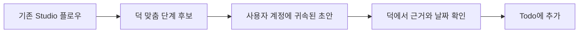

# Google Workspace Studio — 덕 도입 검토

조사일: 2026-11-05 (한국 시간). 결론은 **덕의 핵심 기능을 먼저 완성하고, Studio는 선택적 업무 자동화 연결 후보로 보류**한다. 실제 커넥터·웹훅 수신 API·Studio 설치는 이번에 구현하지 않았다.

## 1. 무엇을 확인했나

공식 도움말은 사용자가 이 대화에 붙여넣은 본문으로 읽었다. 공식 문서/발표 페이지 및 기사 사이트에 직접 접속하면 이 환경의 프록시 정책이 403으로 차단한다. 따라서 관련 기사 여러 개를 읽고 교차 검증했다고 주장하지 않는다. 대신 허용된 공개 GitHub에서 실제 개발 가이드와 manifest/Apps Script 코드를 조사했다. 외부 코드는 실행하거나 계정에 설치하지 않았다.

| 자료 | 실제 열람 | 확인한 내용과 한계 |
|---|---|---|
| [Google 공식: 플로우로 서드 파티 서비스에서 작업하기(베타)](https://support.google.com/workspace-studio/answer/16658279) | 사용자 제공 본문 | 서비스 연결·권한 승인·Marketplace·관리자 제한·서비스별 구독 필요 가능성·테스트 실행의 실제 쓰기. 커넥터를 외부 앱에 제공하는 SDK/API 설명은 없음 |
| [Google Chat Unread Messages Brief 개발 가이드](https://github.com/meteatamel/google-chat-unread-brief) | README 전체 | 일정 기반/사용자 요청 기반 Chat 요약을 Apps Script 맞춤 단계와 Studio로 구성하는 예시. 설치·테스트 배포·OAuth·플로우 설정 절차가 필요. 작성자의 실사용 설명이며 우리가 실행 검증한 것이 아님 |
| [JSON Resume Connect 개발 가이드](https://github.com/ismailkattakath/jsonresume-connect) | README·manifest·주요 실행 코드 | Studio 맞춤 단계에서 외부 서비스 OAuth 연결, HTTPS 요청, 스키마 확인, Drive 문서 생성과 출력 변수 반환을 구현한 독립 프로젝트. Google 공식 보증 제품이 아니며 작성자의 실측 수치는 공식 사양으로 취급하지 않음 |
| [JSON Resume Connect manifest](https://github.com/ismailkattakath/jsonresume-connect/blob/main/src/appsscript.json) | 코드 확인 | addOns.flows, script.external_request, drive.file, 외부 호출 허용 목록을 실제로 선언 |
| [JSON Resume Connect 실행 코드](https://github.com/ismailkattakath/jsonresume-connect/blob/main/src/JsonResumeToDoc.gs) | 코드 확인 | UrlFetchApp.fetch로 외부 OAuth/자료 API 호출, event.workflow.actionInvocation.inputs 읽기, AddOnsResponseService로 출력 변수 반환 |
| [google-wss-flows](https://github.com/dceoy/google-wss-flows) | README | 뉴스/시장 요약 프롬프트 모음이며 보관된 저장소. 프롬프트 사례일 뿐 서비스 성능·공식 지원·상용 안정성의 근거로 사용하지 않음 |

Google 공식 add-ons-samples/apps-script-samples 저장소도 살펴봤으나 이번 검색에서 해당 Studio 맞춤 단계 샘플은 찾지 못했다. AI Studio·Data Studio 폴더는 다른 제품이라 증거에서 제외했다. 검색 결과 수나 작은 공개 프로젝트 수를 시장 점유율·성숙도 지표로 사용하지 않는다.

## 2. 덕에 적합한 부분

- 이미 Studio로 업무를 자동화하는 사용자는 그 결과를 덕의 할 일 초안으로 가져오면 중복 입력을 줄일 수 있다.
- 정해진 시간의 요약·조건 충족 이벤트처럼 반복 업무를 Studio에 맡기고, 덕은 사람의 확인·우선순위·Todo 상태와 완료 기록을 담당하는 분리가 가능하다.
- 전달 형식을 제목·예정일·출처 링크·외부 이벤트 ID 같은 구조화 데이터로 좁히면 이메일 전체를 반복 수집하거나 같은 내용을 AI에 다시 보내는 일을 줄일 여지가 있다. 실제 비용 절감 규모는 검증하지 않았다.
- 덕의 기존 Todo/실행 카탈로그와 별도로 어댑터를 두면 Google 계정/Studio를 쓰지 않는 일반 아이폰 사용자에게 설정을 강요하지 않을 수 있다.

## 3. 핵심 기반으로 삼기에는 맞지 않는 부분

- 보내준 공식 문서는 Studio 내부 플로우의 연결을 설명한다. 덕이 모든 Studio 커넥터를 가져다 쓰는 공개 SDK/API가 있다고 확인되지 않았다.
- 일반 사용자가 ‘덕 설치→연결 버튼→로그인’만으로 쓰게 하는 목표에, 별도 플로우 작성·맞춤 단계 설치를 필수로 추가하면 설정 부담이 커진다. 개발자 설정과 사용자의 연결을 구분해야 한다.
- Studio, Google 계정, 서드 파티, 덕 사이의 권한·관리자 정책·연결 해제·실패 지점이 추가된다. 외부 서비스에 이미 준 권한이 덕으로 자동 이전되지 않는다.
- ‘지금 오늘 할 일 알려줘’ 같은 대화형 최신 조회와 Studio의 예약/이벤트 플로우는 다르다. 지연·실행 한도·이벤트 순서를 확인하기 전 실시간 응답의 핵심 경로로 두지 않는다.
- Beta라는 사실은 공식 본문에서 확인된다. 현재 요금제/개인 계정 지원/쿼터/Marketplace 공개 조건은 이번 자료만으로 확정할 수 없다. 무료·무제한·모든 사용자 지원으로 소개하지 않는다.

## 4. 검토할 연결 형태

우선순위 후보는 **Studio 맞춤 단계 → 덕의 제한된 초안 수신 API → 사용자 확인 → Todo**다. 공개 코드에서 맞춤 단계의 외부 HTTPS 호출은 관찰했지만 덕 계정 인증·실제 Studio 실행은 추가 검증해야 한다.

예: ‘특정 메일을 받은 경우’라는 기존 플로우가 작업 제목·기한·원문 링크를 덕에 보내고, 사용자는 덕에서 확인해 Todo로 저장한다. 이는 설계 예시이지 이미 동작하는 연결이 아니다. Studio가 추출한 값도 신뢰할 수 없는 입력으로 검증한다.

덕→Studio 호출은 별도 후보다. [웹훅 연결 공식 문서](https://support.google.com/workspace-studio/answer/16521900)의 본문을 읽지 못했기 때문에 방향·인증·허용 payload를 확정하지 않았다. **‘웹훅이 있다’는 제목만으로 Studio→덕의 일반 HTTP 전송까지 지원한다고 가정하지 않는다.** 앞선 대화에서 그 경로를 제안한 것은 검토 가능성이지 확인된 제품 기능이 아니다.

## 5. 작은 실증을 하기 전 확인할 것

| 항목 | 합격 조건 |
|---|---|
| 계정/요금제 | 실제 대상 사용자 계정에서 Studio 사용 가능 여부와 필요한 비용 확인 |
| 배포 | 개인용 테스트 설치와 타 사용자 배포/Marketplace 심사 조건을 구분해 확인 |
| 로그인 | 사용자가 API 키를 복사하지 않고 덕 계정에 연결하는 위임 인증 설계. 현재 덕 로그인 구현만으로 외부 OAuth 공급자 기능이 생기는 것은 아님 |
| 권한 | 초안 추가 같은 최소 권한, 연결별 폐기, 다른 사용자/조직 자료 수신 방지 |
| 재실행 | 외부 이벤트 ID로 중복 방지, 타임아웃·재시도에도 중복 Todo가 생기지 않는지 확인 |
| 데이터 | 원문 전체 대신 최소 필드 전달, 출처/날짜/사용자 확인 보존, 연결 해제 시 중지 |
| 품질 | 기한·담당자·완료 상태를 오해하지 않고, 완료 기록을 새 할 일로 중복 추출하지 않기 |
| 제품 가치 | 직접 Google/Slack/Notion 연결에 비해 사용자가 절약하는 단계/시간을 실제로 확인 |

실증은 시험 계정과 하나의 흐름만 사용한다. 자동 메일 발송·원본 상태 변경은 실증에 포함하지 않는다. 문서의 테스트 실행도 실제 작업을 수행하므로 일반 고객 데이터를 시험용으로 쓰지 않는다.

## 6. 비용 판단

사용자가 제공한 공식 문서는 유료 서드 파티에는 해당 서비스 구독이 필요할 수 있다고 설명한다. 이 문서만으로 Studio 자체의 현재 제공 요금제나 추가 실행료를 확정할 수는 없다. Apps Script/외부 API/덕 서버의 한도와 운영비도 별개다. 이미 적절한 서비스를 구독한 사용자는 활용 가치가 있을 수 있지만 덕을 쓰기 위해 별도 구독을 필수로 요구하는 설계는 현재 무료 우선 방향과 맞지 않는다.

## 7. 결정과 남은 조사

**지금:** 덕의 직접 연결·오늘 할 일 제안·Todo·확인 후 실행·테스트 자동화를 먼저 완성한다. Studio를 필수 의존성으로 추가하지 않는다.

**이후:** Studio를 이미 쓰는 사용자의 수요가 확인되면 ‘초안 추가’ 한 기능만 검증한다. 계정/요금제·배포·최소 권한·중복 방지를 확인한 뒤 선택적 통합으로 도입 여부를 판단한다.

공식 웹훅/맞춤 단계 문서의 최신 본문, 독립 기사/리뷰의 교차 확인, 실제 계정·플로우 실행은 미완료다. 이번 평가는 사용자 제공 공식 본문과 실제 열람한 공개 구현을 바탕으로 한 조건부 제품 판단이다.
